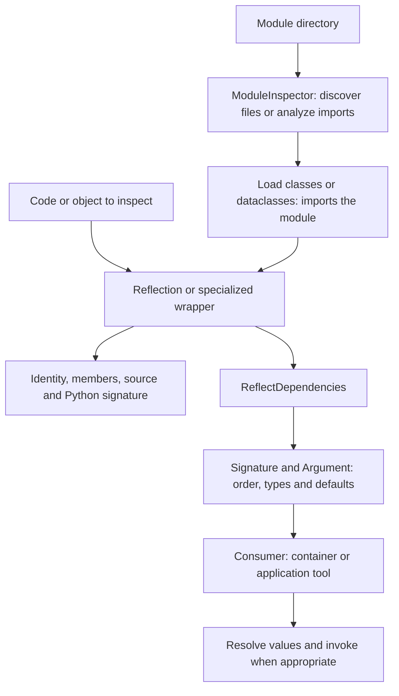

Introspection reads the structure of Python code at runtime: which class an object represents, which methods it declares, which arguments a function needs and where it is defined. Orionis groups these operations into specialized wrappers, dependency analysis and module discovery tools.

Use this component for diagnostic tools, plugin discovery or analysis of application handlers. Ordinary controllers, jobs and commands do not need to resolve dependencies manually: the [container](/en/architecture/service-container) already uses these tools during construction and invocation.

## Choose a tool

| Need | Reference |
| --- | --- |
| Classify an object and select a wrapper | [Reflection](/en/advanced/introspection/reflection). |
| Read a function's identity, documentation, source or signature | [Callables](/en/advanced/introspection/callables). |
| Inspect an abstract class | [Abstract classes](/en/advanced/introspection/abstract-classes). |
| Inspect or modify a concrete class | [Concrete classes](/en/advanced/introspection/concrete-classes). |
| Read an existing object's data and methods | [Instances](/en/advanced/introspection/instances). |
| Analyze arguments and their dependencies | [Dependencies and signatures](/en/advanced/introspection/dependencies-and-discovery). |
| Inspect an imported module's classes, functions and constants | [Modules](/en/advanced/introspection/modules). |
| Find Python files and load components | [Module discovery](/en/advanced/introspection/module-discovery). |

## Public imports

```python
from orionis.introspection import (
    ModuleInspector,
    ReflectDependencies,
    Reflection,
    ReflectionAbstract,
    ReflectionCallable,
    ReflectionConcrete,
    ReflectionInstance,
    ReflectionModule,
)
```

These are the package's eight exports. Do not import them from `orionis.support.facades`: `Reflection` is a class of static utilities, not a container facade. Argument analysis entities have explicit module paths:

```python
from orionis.introspection.dependencies.entities.argument import Argument
from orionis.introspection.dependencies.entities.signature import Signature
```

The component works without booting an application and has no configuration file of its own. Its dependencies are included with Orionis; these examples require no additional package installation.

## Analyze a handler

```python
from orionis.introspection import Reflection

def quote(units: int, *, currency: str = "USD") -> str:
    """Build a quote label."""
    return f"{units} {currency}"

reflected = Reflection.callable(quote)
assert reflected.getName() == "quote"
assert reflected.getDocstring() == "Build a quote label."
assert list(reflected.getSignature().parameters) == ["units", "currency"]

dependencies = reflected.getDependencies()
assert "units" in dependencies.getUnresolved()
assert dependencies.getResolved()["currency"].default == "USD"
assert list(dependencies.getAllOrdered()) == ["units", "currency"]
```

`getSignature()` returns Python's `inspect.Signature`. `getDependencies()` produces the Orionis `Signature` entity with `Argument` descriptors. The latter classifies arguments for later resolution; it **does not invoke the handler or construct its services**. Required builtin values, such as `units`, need caller-supplied data.

## Reading and resolution flow



File discovery and AST import analysis do not execute a module. Reflecting a module, loading a class or discovering frozen dataclasses can import it and execute its top-level code. Use file analysis when you only need to decide which components to inspect next.

## Direct access and injection

Wrappers receive **the inspection target**: a class, function, instance or module name. That target is not supplied automatically by annotating a dependency as `ReflectionCallable` or `ReflectionInstance`.

Construct a wrapper where its target is available, deliberately bind a prepared instance, or inject an application service that performs inspection. Each reference shows the applicable pattern. `Reflection` and `ModuleInspector` are normally called through the class, without creating an instance or using the container.

To execute a component with dependencies, use the application's [binding and invocation](/en/architecture/service-container/bindings-and-invocation) mechanisms. Introspection supplies metadata; it does not replace container lifetimes, [validation](/en/validation) or request input data.

## Caches, mutations and source availability

Wrappers cache results in process memory. Results do not necessarily update when other code changes a class, instance, module or function: use `clearCache()` as described in the relevant reference, or create another wrapper. Mutation methods do not all invalidate the same cache groups; their pages explain the actual effects.

Source retrieval depends on Python being able to access the object's defining file. Save code analysis examples in `.py` files when using `getSourceCode()`; interactive sessions or functions created with `exec()` may have no retrievable source.

Public, protected, private and dunder categories describe naming conventions and each scan's rules. They are not authorization controls. Class, instance and module wrappers traverse different members; check their rules before treating results as an application's inventory.
