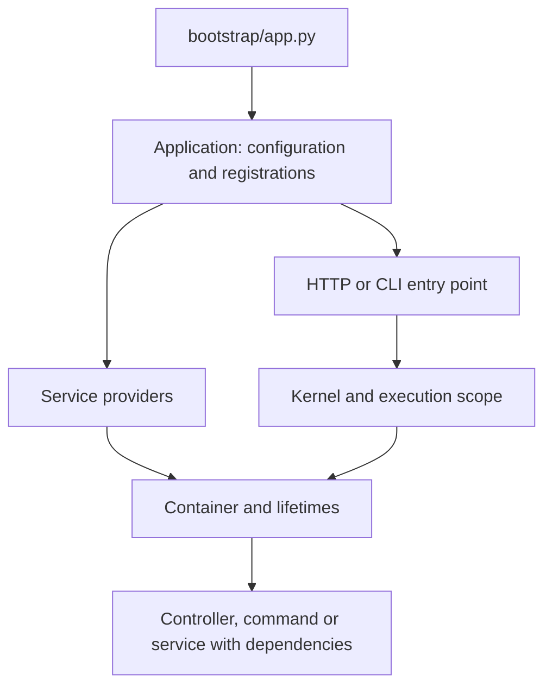

`Application` coordinates Orionis startup and execution. It extends `Container`: **the application is also the container** that registers and builds services. You do not need another container for each controller or command.

`IApplication` defines that contract and includes `IContainer` operations. The instance is registered during `create()` and can be injected. Providers declare services, the container resolves dependencies, and HTTP/CLI kernels coordinate each request or command.

## How the components connect



Bootstrap prepares metadata. A valid disk cache can restore it; service instances are built in each process's memory. A container singleton is not an instance shared between workers or servers.

## Recommended reading

| Need | Guide |
|---|---|
| Creation, startup and shutdown | [Application lifecycle](/en/application/lifecycle) |
| Server and protocol integration | [ASGI and RSGI](/en/application/server-entrypoints) |
| Inject the application and access services | [IApplication and API](/en/application/api) |
| Configure the bootstrap file | [Bootstrap options](/en/application/bootstrap) |
| Define and access configuration | [Application configuration](/en/application/configuration) |
| Paths and cache per deployment | [Directories and caching](/en/application/paths-and-caching) |
| Register classes and invoke callables with DI | [Container](/en/application/container) and [bindings and invocation](/en/application/container/bindings-and-invocation) |
| Choose transient, singleton or scoped | [Scopes and concurrency](/en/application/container/scopes-and-concurrency) |
| Organize registrations and initialization | [Providers](/en/application/container/providers) |
| Expose a service through a facade | [Sync and async facades](/en/application/container/facades) |

Read `.env` variables exclusively in configuration files; see the independent [Environment](/en/environment) guide. During runtime, use resolved settings through `app.config()`. Database, Storage, HTTP and Queues have their own API guides; this section explains how the application integrates them.

## An injection example

Save this controller as `app/http/controllers/app_info_controller.py`:

```python
from orionis.foundation.contracts.application import IApplication
from orionis.http import JSONResponse


class AppInfoController:
    def __init__(self, app: IApplication) -> None:
        self.app = app

    async def __call__(self) -> JSONResponse:
        return JSONResponse({
            "name": self.app.config("app.name"),
            "created": self.app.isCreated,
        })
```

In an API route file:

```python
from app.http.controllers.app_info_controller import AppInfoController
from orionis.support.facades import Route

Route.get("/app-info", AppInfoController)
```

The route passes its class to the container. Do not construct another `Application` inside the handler. The [IApplication reference](/en/application/api) also covers method injection and the limits of shared configuration.
