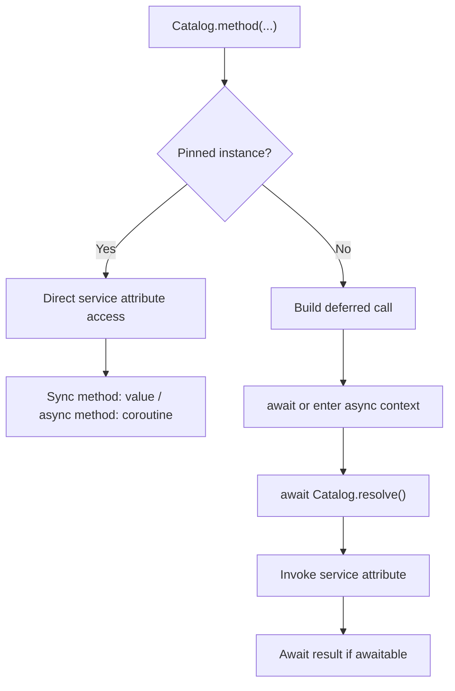

A facade provides access to a container service through a class, such as `Storage`, `Mail` or `Cache`. Its `getFacadeAccessor()` identifies the contract or alias to resolve; business methods still belong to the service.

Import framework facades from their public module:

```python
from orionis.support.facades import Cache, Mail, Storage
```

For your own services, you can choose dependency injection or a facade. Injection makes the contract visible in the consumer's constructor or method; a facade accesses the same binding without declaring that parameter. Neither approach changes the registered lifetime by itself.

## Create a facade

The generator requires a name and a service identifier:

```bash
orionis make:facade catalog --accessor catalog
```

```bash
python -B reactor make:facade catalog --accessor catalog
```

<a id="facade-generator"></a>

| Argument or option | Requirement and effect |
| --- | --- |
| `name` | Required. File and class name. Accepts relative subdirectories. |
| `--accessor`, `-a` | Required. String identifying the service in the container. No default. |
| `-h`, `--help` | Displays command help. |

This generates `app/facades/catalog.py` and `app/facades/catalog.pyi`, both declaring the `Catalog` class. Underscore-separated names become class names by words and directories are normalized to lowercase. For example, `billing/invoice_catalog` creates `InvoiceCatalog` in `app/facades/billing/invoice_catalog.py` and its `.pyi` file.

The `.py` uses the `Facade` template; its functional content is:

```python
from orionis.container.facades.facade import Facade


class Catalog(Facade):
    @classmethod
    def getFacadeAccessor(cls) -> str:
        return "catalog"
```

The `.pyi` declares a same-named interface based on `IFacade`. You can add the service's method signatures for completion and type analysis; it is not an executable implementation and does not register services.

The generator creates directories and rejects absolute paths or unsafe components. It never overwrites files and offers no `--force`. It creates the `.py` first and then the `.pyi`: if the second already exists, the first may have been created; check both before repeating the command.

<a id="facade-accessor"></a>

## Choose the accessor and register the service

```python
@classmethod
def getFacadeAccessor(cls) -> str | type:
    ...
```

Return an alias or a class used as a contract. The base `Facade` implementation raises `NotImplementedError` if you do not define it. The method must not perform asynchronous work: `app.make(...)` needs an immediate key.

The generator builds a string accessor. You can instead return `ICatalog` to resolve the contract directly. A string such as `"catalog"` is an alias: writing a module name does not automatically import or register its service.

The example uses the contract and `MemoryCatalog` from the [provider guide](/en/application/container/providers). Complete the provider as follows:

```python
from app.facades.catalog import Catalog
from app.services.catalog import ICatalog, MemoryCatalog
from orionis.container.providers import ServiceProvider


class CatalogProvider(ServiceProvider):
    def register(self) -> None:
        self.app.singleton(ICatalog, MemoryCatalog, alias="catalog")

    async def boot(self) -> None:
        await Catalog.pin()
```

Provider discovery registers the singleton. Its `boot()` pins the instance on the facade so synchronous methods can be accessed directly. This occurs when startup awaits providers; an isolated `app.create()` call may still leave that hook pending.

<a id="facade-dispatch"></a>
<a id="facade-meta"></a>

## When to use `await`

Behavior depends on whether the facade has an instance pinned through `pin()` or uses deferred resolution. **It does not depend on the presence of an event loop at the call site.** The facade does not run a loop for you or move synchronous methods into background execution.

| Facade state | Synchronous service method | Asynchronous service method |
| --- | --- | --- |
| Pinned instance | Returns the result directly: `Catalog.names()`. | Returns the service coroutine: `await Catalog.summary()`. |
| No pinned instance | Returns a deferred call you must await: `await Catalog.names()`. | Returns a deferred call that resolves and awaits the result: `await Catalog.summary()`. |
| `ScopedFacade` with an available service | Direct access to the scope's instance. | Direct access; await the method when asynchronous. |

### Pinned facade: preserve the service API

With the preceding provider, after startup is complete:

```python
from app.facades.catalog import Catalog
from orionis.http import JSONResponse


class CatalogController:
    async def index(self) -> JSONResponse:
        names = Catalog.names()
        summary = await Catalog.summary()
        return JSONResponse({"names": names, "summary": summary})
```

`names()` is synchronous in `MemoryCatalog`, while `summary()` is asynchronous. Pinning a facade does not automatically await asynchronous methods or make synchronous results awaitable. `await Catalog.names()` would attempt to await a list and raise `TypeError`.

A pinned synchronous method also works from a synchronous function outside an event loop, provided application and provider startup already completed. An asynchronous method still needs a caller to await its coroutine.

### Unpinned facade: resolve when awaiting the call

If the provider registers the binding but does not call `pin()`, consume both methods with `await`:

```python
from app.facades.catalog import Catalog
from orionis.http import JSONResponse


class CatalogController:
    async def index(self) -> JSONResponse:
        names = await Catalog.names()
        summary = await Catalog.summary()
        return JSONResponse({"names": names, "summary": summary})
```

Reading `Catalog.names` returns a dispatcher. Calling it builds a deferred operation; it has not resolved the service or executed `names()` yet. Awaiting the operation obtains the binding, calls the method and awaits the result if awaitable.

This preserves lifetimes: each deferred call consults the container. A `transient` binding can produce a distinct instance per call; a `singleton` retains its instance. Dispatcher caching avoids recreating attribute dispatch functions, but does not cache responses or turn a transient into a singleton.

From a synchronous function, an unpinned facade likewise returns a pending operation. Do not treat it as a result or assume it will run on its own. Use an asynchronous consumer, inject the service into the component or deliberately pin a process service during startup.



### Attributes and context managers

With a pinned instance, non-callable attributes are also read directly. Without pinning, the dispatcher is still a function: resolve the instance and read its attribute there to avoid these differences.

```python
from app.facades.catalog import Catalog


async def catalog_names() -> list[str]:
    service = await Catalog.resolve()
    return service.names()
```

A deferred call also supports `async with` when the service method directly returns an asynchronous context manager. The facade resolves the service and delegates to `__aenter__()` and `__aexit__()`; it does not turn a synchronous context or an arbitrary coroutine into an asynchronous context manager.

For example, a custom service can define:

```python
from contextlib import asynccontextmanager
from collections.abc import AsyncIterator


class CatalogSession:
    @asynccontextmanager
    async def open(self) -> AsyncIterator[dict[str, bool]]:
        state = {"active": True}
        try:
            yield state
        finally:
            state["active"] = False
```

A facade whose accessor resolves `CatalogSession` allows `async with CatalogSessionFacade.open() as state:`. This example's `open()` returns the manager directly because it is decorated with `asynccontextmanager`; it does not need awaiting before entering the context. Full registration for a facade using this service follows the same pattern as `Catalog`.

<a id="facade-resolve"></a>

## `resolve()`: obtain the container instance

```python
@classmethod
async def resolve(cls, *args: object, **kwargs: object) -> object:
    ...
```

Delegates to `await app.make(accessor, *args, **kwargs)` and returns the service. Additional arguments belong to service resolution or construction, rather than to one of its methods. Normal calls such as `Catalog.names(...)` forward arguments to the method, not to the instance's constructor.

`resolve()` preserves the binding's lifetime and still consults the container when the facade is pinned. Explicit resolution and pinned attribute access are therefore distinct paths; replacing a binding does not update an already pinned instance automatically.

The facade obtains the shared application lazily and checks `app.isBooted`. If it has not been created yet, it raises `RuntimeError` asking you to boot the application. That flag confirms registration and configuration: when a consumer needs services prepared by `boot()`, await the relevant component's full startup.

An unknown alias produces the container's resolution error; invalid dependencies and missing methods propagate their errors. The facade does not turn them into HTTP responses or hide them.

<a id="facade-pin"></a>

## `pin()`: retain a process instance

```python
@classmethod
async def pin(cls) -> None:
    ...
```

Resolves the service without arguments and retains that instance on the facade class. Subsequent attribute reads access it directly. Returns `None` and propagates resolution errors.

Use it in the provider's `async boot()` when the service should be reused as process state and its API includes synchronous methods. Registering a singleton **does not automatically pin a custom facade**; the example's provider performs both steps.

Do not pin a request- or command-dependent service on a normal `Facade`. Even with a `transient` or `scoped` binding, pinning retains a single instance and exposes it to subsequent calls. Choose an unpinned facade to preserve independent resolutions or `ScopedFacade` for state published in a scope.

<a id="facade-unpin"></a>

## `unpin()`: return to deferred dispatch

```python
@classmethod
def unpin(cls) -> None:
    ...
```

Clears only that facade's pinned reference and returns `None`. It can be called repeatedly. It does not remove the binding, release the service's resources or clear a singleton retained by the container. A later call resolves according to the registered lifetime again.

During a test that changes a binding, call `unpin()` and pin the instance again when appropriate, or use explicit `resolve()`. There is no public `Facade.reset()` method that globally resets the application and all its services.

<a id="scoped-facade"></a>
<a id="scoped-facade-meta"></a>

## Scope facades: `ScopedFacade`

Import the base from its module:

```python
from orionis.container.facades.facade import ScopedFacade
```

`ScopedFacade` looks for a service **already published** under its accessor in the active scope. It does not call `make()`, construct services automatically or retain a global instance. This is how the HTTP session facade reads the current request's session.

The following independent example illustrates a manual scope lifecycle. Normal HTTP and CLI execution already has [kernel-managed scopes](/en/application/container/scopes-and-concurrency).

```python
from orionis.container.facades.facade import ScopedFacade
from orionis.foundation.contracts.application import IApplication


class OperationState:
    def __init__(self, identifier: str) -> None:
        self.identifier = identifier


class CurrentOperation(ScopedFacade):
    @classmethod
    def getFacadeAccessor(cls) -> type:
        return OperationState


async def read_operation(app: IApplication) -> str:
    async with app.beginScope():
        app.instance(OperationState, OperationState("report-42"))
        return CurrentOperation.identifier
```

The instance binding created inside this scope remains local. Outside the block, `CurrentOperation.identifier` raises `RuntimeError`. An asynchronous child that inherited the context likewise cannot continue accessing it after the owning scope closes.

Declaring only `app.scoped(OperationState, ...)` does not yet publish an instance for the facade: first construct it using `await app.make(OperationState)` inside the scope or publish it explicitly as in the example. Keep the contract accessor consistent with the stored key; `ScopedFacade` does not automatically translate global aliases when reading the local dictionary.

<a id="scoped-facade-instance"></a>

### `ScopedFacade` API

| Class method | Result and behavior |
| --- | --- |
| `scopedInstance() -> object` | Returns the local service directly. Raises `RuntimeError` without an active scope or a non-null instance under the accessor. |
| `async resolve(*_args: object, **_kwargs: object) -> object` | Returns `scopedInstance()`. Arguments are ignored; no service is constructed. |
| `async pin() -> None` | Checks that the scope contains the service; does not pin it globally. |
| `unpin() -> None` | Makes no change: the scope retains lifetime responsibility. |

Its metaclass returns the local service's attribute directly, like instance access. Consume synchronous method results directly and await asynchronous methods. Pinning is not required for this behavior.

## Choose an access pattern

- **Contract injection:** when you want explicit dependencies and container-managed construction and lifetimes.
- **Unpinned facade:** when every call should resolve according to the binding and the consumer can use `await`.
- **Pinned facade:** for a deliberately shared process service prepared by its provider, preserving the service's synchronous or asynchronous API.
- **`ScopedFacade`:** for a service that already belongs to the active scope and must become unavailable when it closes.

See also [Service providers](/en/application/container/providers) and [Register and invoke services](/en/application/container/bindings-and-invocation).
