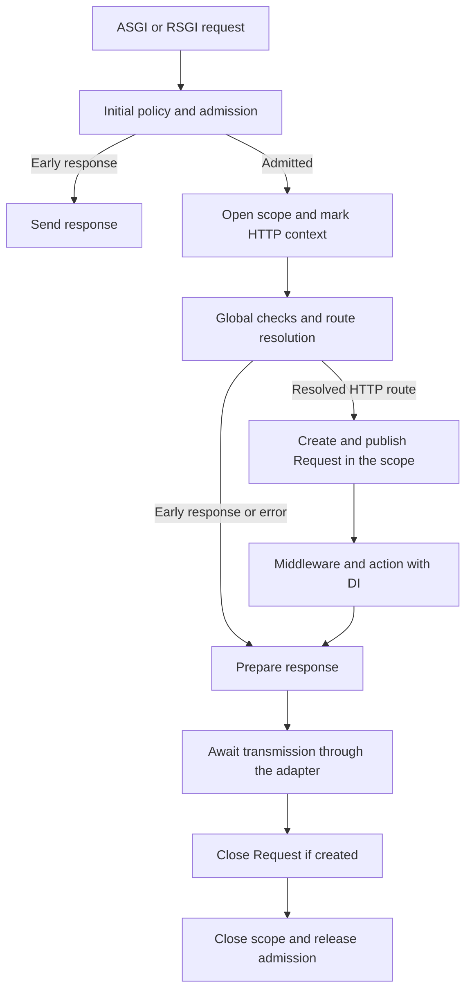
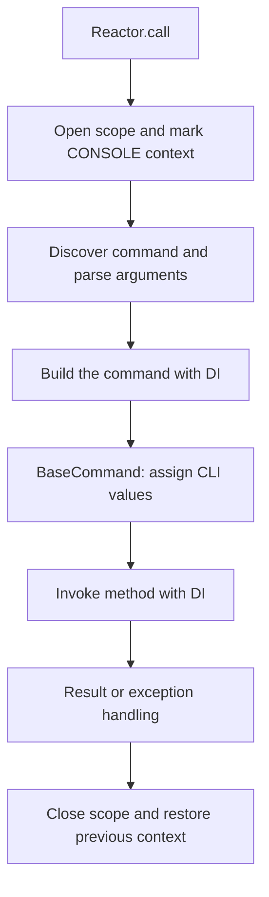

A scope delimits a unit of work and holds its own instances. Two requests can use the same scoped contract and receive different objects; resolving that contract repeatedly within one request returns the same object.

The HTTP kernel and Reactor already manage these scopes. Open a manual scope when implementing a unit of work that does not have one yet; ordinary controllers do not need another scope.

<a id="container-begin-scope"></a>

## Open a scope

```text
beginScope() -> ScopeManager
```

Returns a new manager that is not active yet. Entering `async with` publishes that scope in a `ContextVar`; exiting clears its references, marks it closed, and restores the previous context, even when an exception occurs.

Save this module as `app/providers/work_provider.py`:

```python
from orionis.container.providers import ServiceProvider
from orionis.foundation.contracts.application import IApplication


class WorkState:

    def __init__(self) -> None:
        self.visited: list[str] = []


class WorkProvider(ServiceProvider):

    def register(self) -> None:
        self.app.scoped(None, WorkState)


async def run_work(app: IApplication) -> list[str]:
    async with app.beginScope():
        first = await app.make(WorkState)
        first.visited.append("catalog")
        second = await app.make(WorkState)
        assert first is second
        result = second.visited.copy()

    async with app.beginScope():
        third = await app.make(WorkState)
        assert third is not first
        assert third.visited == []

    return result
```

After registering the provider, `run_work(app)` returns `["catalog"]`. The two scopes have independent instances. Return simple operation data; avoid continuing to use a scope-owned dependency after its scope closes.

<a id="container-current-scope"></a>

## Inspect the current context

```text
getCurrentScope() -> ScopeManager | None
```

Returns the manager associated with the current context or `None` when none exists. In an ordinary context, exiting the scope restores its parent, which may be another scope or `None`.

A child task can retain a reference to a manager whose scope has already closed. Also check `scope.isActive` when working with low-level contexts; `getCurrentScope()` does not automatically turn that inherited reference into `None`. Resolving a new scoped service in that closed scope raises `RuntimeError`.

<a id="scope-http"></a>

## HTTP request scope

ASGI and RSGI follow the same resolution boundary:



The scope includes action execution and the adapter's awaited response transmission, including progressive content. The kernel's `finally` closes the `Request` if it was created; the manager then releases its references.

Not every early response has a `Request`: some policies and capacity rejections run before opening the scope, and checks before route resolution use the transport adapter. Request dependencies must be requested at a point where the flow has already created them.

HTTP middleware can be built at startup and reused. Do not store a `Request` or scoped service in their constructors; use the `request` passed to `handle()` or resolve the context during the appropriate execution. See [Middleware](/en/http/middleware).

### WebSocket connections

The kernel opens a dedicated scope for each admitted connection and publishes `WebSocket`. The scope remains open throughout the connection handler; the kernel attempts to close the socket in its `finally`, then releases the scope and admission slot. Do not assume an ordinary HTTP `Request` is available in this context. See [WebSocket](/en/realtime/websocket).

<a id="scope-cli"></a>

## CLI command scope

Every `Reactor.call()` opens a new scope, including programmatic execution:



For `BaseCommand`, CLI values are stored through `setArguments()` and read through `getArgument()`; method parameters request dependencies. A console route handler that does not extend `BaseCommand` receives the parsed values as named arguments. Both forms use the same container.

When a command calls another through Reactor, the inner execution receives a separate scope and restores the outer one on completion. It does not inherit instances from the parent scope. An `Exception` handled by Reactor normally produces exit code `1`; parser exits and cancellation retain their own rules. The manager's cleanup does not suppress those exceptions. See [programmatic execution](/en/console/reactor-and-injection).

<a id="scope-precedence"></a>

## Resolution precedence and nested scopes

`make()` first checks an already-cached global singleton, then the current scope's instances, and finally the binding or automatic construction. Consequently:

- A scope-published instance can provide a contract not yet materialized globally, but does not replace an already-cached global singleton.
- An inner scope has its own dictionary and does not consult the outer dictionary. Global bindings and singletons remain available.
- Exiting the inner scope restores the outer scope and its objects.
- `transient()`, `singleton()`, and `scoped()` always modify global registrations, even when called inside a scope. `instance()` is the registration method that selects the active scope as its destination.

The context is shared by container instances running in the same task; it is not a separate store for each `Container` object. In an application, use the existing `IApplication` instance.

<a id="scope-concurrency"></a>

## Concurrent tasks and identity

Child tasks inherit their creation context. When created within a scope without opening another, they share that manager and its scoped services. A `TaskGroup` lets you await their completion before closing the unit of work:

```python
import asyncio

from app.providers.work_provider import WorkState
from orionis.foundation.contracts.application import IApplication


async def shared_work(app: IApplication) -> bool:
    async with app.beginScope():
        async with asyncio.TaskGroup() as tasks:
            first = tasks.create_task(app.make(WorkState))
            second = tasks.create_task(app.make(WorkState))
        return first.result() is second.result()
```

With the binding above this returns `True`. For independent units, each task must enter its own `beginScope()`. Sharing the manager does not make arbitrary mutable state safe: your service must coordinate its own concurrent operations.

Initial singleton construction is serialized per contract within the same event loop. Scoped services use one lock per contract and scope; deferred providers also coordinate initialization. Cancelling construction releases its lock and lets a later resolution retry.

Container creation itself uses a thread lock and returns one instance per subclass. Binding registration mutates dictionaries without additional coordination. Singleton and provider construction locks are replaced when the event loop changes: there is no single-construction guarantee across concurrent loops in different threads.

<a id="scope-cleanup"></a>

## Resource cleanup and retained dependencies

Exiting the scope removes its references; it does not automatically call `close()` or `aclose()` on all services, cancel arbitrary tasks, or await tasks you created yourself. Use the resource's context manager or `try/finally` in the component that owns it.

A child task that continues after scope exit retains its inherited context, but the manager is closed. It cannot publish new instances, and an in-flight resolution that attempts to store its result raises `RuntimeError`. Await tasks that depend on the scope before leaving it.

The container does not prevent a singleton from storing a scoped service: that reference could outlive the request and leak state between users. Avoid this incompatible lifetime dependency. Previously returned objects are not automatically destroyed when the scope is cleared.

<a id="scope-manager"></a>

## `ScopeManager` reference

Normally obtained through `beginScope()`. Its public constructor `ScopeManager()` creates an empty, single-use manager.

| Member | Signature and behavior |
|---|---|
| `isActive` | `bool` property: `False` before entry and after exit. |
| `__aenter__` | `async __aenter__() -> Self`: publishes the context and returns the manager. Reentry or reuse after closure raises `RuntimeError`. |
| `__aexit__` | `async __aexit__(exc_type: type[BaseException] | None, exc_val: BaseException | None, exc_tb: types.TracebackType | None) -> None`: clears and restores the context without suppressing exceptions. |
| Key lookup | `__getitem__(key: object) -> object | None`: returns the stored value or `None`. |
| Key assignment | `__setitem__(key: object, value: object) -> None`: stores or replaces; fails after closure. |
| Membership | `__contains__(key: object) -> bool`: checks whether a key exists. |
| `set()` | `set(key: object, value: Any) -> None`: equivalent to key assignment, with the same closure check. |
| `get()` | `async get(key: object) -> Any | None`: returns the value; turns a coroutine into a `Task`, awaits it, and stores its result. Also awaits a stored `asyncio.Task`. |
| `resolve()` | `async resolve(key: object) -> Any`: uses `get()`; raises `KeyError` if no value exists or the result is `None`. |
| `clear()` | `clear() -> None`: clears stored references without closing or restoring the context. |
| `creationLock()` | `creationLock(key: object) -> asyncio.Lock`: returns the per-key lock; a closed manager raises `RuntimeError`. |

Keys must be usable in a dictionary. `get()` does not execute stored functions or automatically await every kind of `Future`. Exceptions from the coroutine propagate.

The asynchronous behavior of `ScopeManager.get()` is explicit. `app.make()` reads the scoped entry directly; it does not use that method to await a stored coroutine. Publish initialized services for ordinary dependency injection.

<a id="scoped-context"></a>

## Low-level context

`orionis.container.context.scope.ScopedContext` exposes class methods for context-managing integrations:

```text
getCurrentScope() -> object | None
setCurrentScope(scope: object) -> contextvars.Token
reset(token: contextvars.Token) -> None
```

`setCurrentScope()` returns a token for the previous state; `reset()` restores it in the corresponding context. These operations only change the `ContextVar`: they do not activate, clear, or close a `ScopeManager`. An invalid token or one used from another context retains native `contextvars` errors.

The module also exposes `get_current_scope()`, `set_current_scope(scope)`, and `reset_scope(token)` as accessors for that same `ContextVar`. In application code, `IApplication.beginScope()` and `getCurrentScope()` provide the usual flow and manage cleanup.

Continue with [Registration and invocation](/en/application/container/bindings-and-invocation) or [Providers and facades](/en/application/container/providers).
