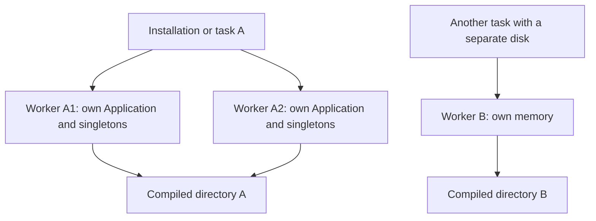

The application resolves directories and can persist bootstrap metadata in files. Both belong to a particular installation: they do not turn services, scopes or process data into distributed state.

<a id="directory-construction"></a>
## Access directories

```text
Directory(app: IApplication) -> None
```

`orionis.foundation.directory.Directory` implements `IDirectory` and captures a copy of a configured application's path map. Before configuration is created, `app.path()` raises `RuntimeError`; construct Directory after that stage. Its methods are synchronous and return `Path`. They do not create folders or read business files.

You can receive the concrete class through DI or construct `Directory(app)` when you already have an `IApplication`. There is no automatic `IDirectory` binding here that you should assume when requesting the contract.

```python
from orionis.foundation.directory import Directory
from orionis.http import JSONResponse


class LocationsController:
    async def __call__(self, directory: Directory) -> JSONResponse:
        return JSONResponse({"views": str(directory.resourcesViews())})
```

A route invoking this controller lets the container construct Directory with the same application. Use [Storage](/en/storage) for file operations instead of scattering physical paths throughout business code.

<a id="directory-methods"></a>
## Complete Directory reference

Every method below has signature `name() -> Path`, with no additional arguments. They access the captured map; a missing key in an incomplete map raises `KeyError`. Defaults are resolved relative to `basePath`.

| Method | app.path key | Default path |
|---|---|---|
| `root()` | `root` | `.` |
| `app()` | `app` | `app` |
| `appConsole()` | `app_console` | `app/console` |
| `appConsoleCommands()` | `app_console_commands` | `app/console/commands` |
| `appConsoleListeners()` | `app_console_listeners` | `app/console/listeners` |
| `appExceptions()` | `app_exceptions` | `app/exceptions` |
| `appHttp()` | `app_http` | `app/http` |
| `appHttpControllers()` | `app_http_controllers` | `app/http/controllers` |
| `appHttpMiddleware()` | `app_http_middleware` | `app/http/middleware` |
| `appHttpSchemas()` | `app_http_schemas` | `app/http/schemas` |
| `appHttpSchemasRules()` | `app_http_schemas_rules` | `app/http/schemas/rules` |
| `appModels()` | `app_models` | `app/models` |
| `appMcp()` | `app_mcp` | `app/mcp` |
| `appMcpServers()` | `app_mcp_servers` | `app/mcp/servers` |
| `appMcpTools()` | `app_mcp_tools` | `app/mcp/tools` |
| `appMcpResources()` | `app_mcp_resources` | `app/mcp/resources` |
| `appMcpPrompts()` | `app_mcp_prompts` | `app/mcp/prompts` |
| `appRealtime()` | `app_realtime` | `app/realtime` |
| `appRealtimeSockets()` | `app_realtime_sockets` | `app/realtime/sockets` |
| `appRealtimeHubs()` | `app_realtime_hubs` | `app/realtime/hubs` |
| `appProviders()` | `app_providers` | `app/providers` |
| `appNotifications()` | `app_notifications` | `app/notifications` |
| `appServices()` | `app_services` | `app/services` |
| `appFacades()` | `app_facades` | `app/facades` |
| `appJobs()` | `app_jobs` | `app/jobs` |
| `appContracts()` | `app_contracts` | `app/contracts` |
| `bootstrap()` | `bootstrap` | `bootstrap` |
| `config()` | `config` | `config` |
| `database()` | `database` | `database` |
| `databaseFactories()` | `database_factories` | `database/factories` |
| `databaseMigrations()` | `database_migrations` | `database/migrations` |
| `databaseSchemas()` | `database_schemas` | `database/schemas` |
| `databaseSeeders()` | `database_seeders` | `database/seeders` |
| `resources()` | `resources` | `resources` |
| `resourcesCss()` | `resources_css` | `resources/css` |
| `resourcesJs()` | `resources_js` | `resources/js` |
| `resourcesLang()` | `resources_lang` | `resources/lang` |
| `resourcesViews()` | `resources_views` | `resources/views` |
| `routes()` | `routes` | `routes` |
| `storage()` | `storage` | `storage` |
| `storageApp()` | `storage_app` | `storage/app` |
| `storageAppPrivate()` | `storage_app_private` | `storage/app/private` |
| `storageAppPublic()` | `storage_app_public` | `storage/app/public` |
| `storageFramework()` | `storage_framework` | `storage/framework` |
| `storageLogs()` | `storage_logs` | `storage/logs` |
| `tests()` | `tests` | `tests` |

`root()` always returns `basePath`. The corresponding `IDirectory` methods express the same contract. `app.path()` exposes the complete frozen registry; `app.path("key")` returns the path, or `None` when absent.

Configure changes through `withConfigPaths()` before creating the application, using the keys in the table. A relative string uses the project root; a relative `Path` uses the working directory. Each key has an independent default: changing `app` does not automatically relocate `app_models`. Each call rebuilds the entire registry; see [Bootstrap options](/en/application/bootstrap#bootstrap-paths).

<a id="bootstrap-disk-cache"></a>
## What the cache stores

```python
# bootstrap/app.py, before app.create().
app.compile(
    path="storage/framework/bootstrap",
    invalidation_paths=["app", "bootstrap", "config", "routes", ".env"],
)
```

`compile(path=None, invalidation_paths=None) -> None` enables persistence. Without an explicit path it uses `storage/framework/cache`. The generated bootstrap selects `storage/framework/bootstrap` and also monitors other project directories. Files are created when each component needs to persist its information:

| Extensionless JSON file | Scope |
|---|---|
| `config` | Resolved configuration and metadata for directories, providers, routes, middleware, kernels, scheduler and handler. |
| `commands` | Reactor command registry and arguments. |
| `routes` | Compiled HTTP route registry. |

It does not store live service objects, open connections, event loops, asyncio locks, authenticated users or scoped instances. It is also separate from the business cache managed by the Cache facade.

The file contains format, generation and source-hash metadata alongside serialized data. Writing uses a sibling temporary file and replaces the destination. That replacement prevents a partially written file, but is not a distributed lock coordinating every process regenerating content. [Environment: JSON persistence](/en/environment/compiled-configuration) details types, credentials, invalidation, corrupt files and why there is no `env.json`.

A `config` hit during `compile()` restores and freezes bootstrap before subsequent registrations. The `with...` methods reuse that snapshot. Lifespan callbacks are registered per process and are not saved in these files; providers register their services again in every container.

<a id="cache-deployment-scope"></a>
## Worker, server and Fargate task

| Level | Application memory | Compiled files |
|---|---|---|
| Request or command | Has its own scope; shares its process's application. | There is no cache created per request or command. |
| Several workers on one server | Each process retains its own Application, bindings, singletons and locks. | They can reuse files when resolving the same directory on the same filesystem. |
| Servers or containers with separate disks | They do not share memory. | They generate independent caches even when the path string is identical. |
| Several Fargate tasks with local storage | Each process and task retains its own state. | A task does not automatically use another task's local files. |
| A volume explicitly mounted in common | It does not turn containers into one application. | Only files actually inside the mounted volume are shared. |

In Fargate, ephemeral storage belongs to the task; Linux containers in one task can share it when their volumes and mounts are configured accordingly. It is not a service-wide global disk. See [task ephemeral storage](https://docs.aws.amazon.com/AmazonECS/latest/developerguide/fargate-task-storage.html).

Persistent shared storage such as EFS requires explicit deployment configuration. That infrastructure capability does not make Orionis automatically coordinate its cache across tasks. The difference between ephemeral and persistent storage is described under [ECS storage options](https://docs.aws.amazon.com/AmazonECS/latest/developerguide/using_data_volumes.html).

The consequence for Orionis follows from its use of local paths: plan for regeneration when replacing a task and do not rely on another installation's file existing. The snapshot contains absolute paths and component references; mixing releases or different configurations in one directory can restore incorrect data. The fingerprint monitors files, not a server identifier or an AWS task.



<a id="cache-refresh"></a>
## Changes, invalidation and cleanup

The hash considers monitored files' paths, mtime and size. Directories contribute `*.py` files; `.env` must be declared as a file and exist when `compile()` is called. Changes exclusively to system variables do not alter that fingerprint. Configuration in already running processes is not rebuilt.

To force reconstruction in the affected installation, run either alternative:

```shell
orionis optimize:clear
python -B reactor optimize:clear
```

The command removes compiled artifacts as well as bytecode and project build directories: see [its complete scope](/en/console/built-in-application#command-optimize-clear). A CLI on another filesystem does not clear a remote task's disk. Restart the workers that need to load changes; deleting a file does not remove already constructed singletons or rerun an existing application's configuration.

`optimize` validates Python sources in memory; it does not warm every cache. To understand initial creation and startup with a valid snapshot, see [Lifecycle](/en/application/lifecycle).
