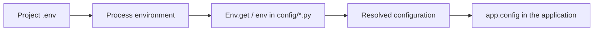

The environment component connects project variables to configuration files. It reads `.env`, interprets its values and helps build settings such as the database connection, application name or service limits.

**Use `Env` and `env()` exclusively inside files in `config/`. Do not use them directly during application runtime.** Controllers, jobs, commands, hubs and other components must consume resolved configuration through `app.config(...)` or the relevant service. This keeps their settings consistent whether the application loads Python configuration files or restores compiled configuration.

## From `.env` to configuration



The `.env` file stores entries as text. Reading from `config/` can produce strings, numbers, booleans, collections and other supported values. The application receives the result of that read and does not need to query the file on every request.

## 1. Define the variables

Create or edit `.env` at the generated project's root, alongside `reactor`, `bootstrap/` and `config/`:

```dotenv
APP_NAME="str:Orionis Reports"
APP_DEBUG=bool:true
REPORTS_LIMIT=int:100
REPORTS_ENABLED=bool:on
```

Names used with the API must match `[A-Z][A-Z0-9_]*`: an uppercase letter followed by uppercase letters, digits or underscores. `REPORTS_LIMIT` is valid; `reports_limit`, `1REPORT` and `REPORTS-LIMIT` are not.

Maintain a `.env.example` listing the keys the project needs and sample values. The actual `.env` contains deployment-specific values. Prefixes such as `int:` and `bool:` are part of the value, not the variable name.

## 2. Read values from `config/`

The public package exposes both alternatives:

```python
from orionis.environment import Env, env
```

`Env.get("REPORTS_LIMIT", 100)` and `env("REPORTS_LIMIT", 100)` perform the same read. The `env()` helper delegates to `Env.get()` and introduces no separate conversion rules.

For example, create `config/reports.py`:

```python
from dataclasses import dataclass, field
from orionis.environment import Env, env


@dataclass(frozen=True, kw_only=True)
class Reports:
    limit: int = field(
        default_factory=lambda: Env.get("REPORTS_LIMIT", 100),
    )
    enabled: bool = field(
        default_factory=lambda: env("REPORTS_ENABLED", False),
    )
```

Orionis discovers frozen dataclasses in `config/`, instantiates them when building configuration and registers their values under the section associated with the module. The resulting keys here are `reports.limit` and `reports.enabled`.

`default_factory` defers the environment read until the configuration instance is constructed. The `int` or `bool` annotation describes the field; the value prefix controls conversion by the environment component. A dataclass alone does not convert an incorrect string to its annotated type.

## 3. Consume resolved configuration

Once the application has been created, use `app.config("reports.limit")` and `app.config("reports.enabled")` from components that receive the application. With the file above, the resolved values are the integer `100` and boolean `True`.

This is the boundary between configuration and runtime: `.env` reads stay in `config/`; the rest of the project uses settings built during startup. The [compilation and persistence guide](/en/architecture/environment/compiled-configuration) includes consumption from a component and explains restoration from JSON.

## How `.env` is selected and loaded

The first facade call initializes a process-wide `DotEnv`:

1. It selects `.env` in the current working directory. Run project commands from the project root.
2. If the file does not exist, it attempts to create an empty one. The selected directory must allow this operation.
3. It loads the file into the process environment with overwrite enabled: when a key exists in both the system and file, the `.env` value takes precedence.
4. It keeps a snapshot of file entries for `Env.all()`.

Subsequent `Env.get()` calls read the process environment and convert the value found. A variable defined only by the system can also be read, provided its name meets the required format and the file has not overwritten it.

The selected path belongs to that singleton: changing directories after initialization does not select another `.env`. Direct `DotEnv(path)` construction can select a path on first initialization; this integration option is covered in the [component reference](/en/architecture/environment/operations-and-reference).

## Defaults and changes

The second argument of `Env.get()` and `env()` applies only when the key is absent. An empty entry or `null` value produces `None`, even when another default was supplied. To preserve text that resembles a number or boolean, use `str:`. See every case and all ten supported prefixes in [Variables and typed configuration](/en/architecture/environment/typed-configuration).

Editing `.env` does not change the configuration of an application that has already been created. Start a new process after changing settings and follow the [compiled configuration invalidation instructions](/en/architecture/environment/compiled-configuration). `Env.reload()` refreshes the process environment but does not rebuild existing instances or resolved configuration.

## Continue with the guide

- [Variables and typed configuration](/en/architecture/environment/typed-configuration): strings, numbers, booleans, collections, paths, Base64 and converters.
- [Compilation and persistence](/en/architecture/environment/compiled-configuration): bootstrap activation, JSON files and runtime configuration consumption.
- [Operations and reference](/en/architecture/environment/operations-and-reference): APIs for reading, writing, removing, reloading, validating and generating keys.
