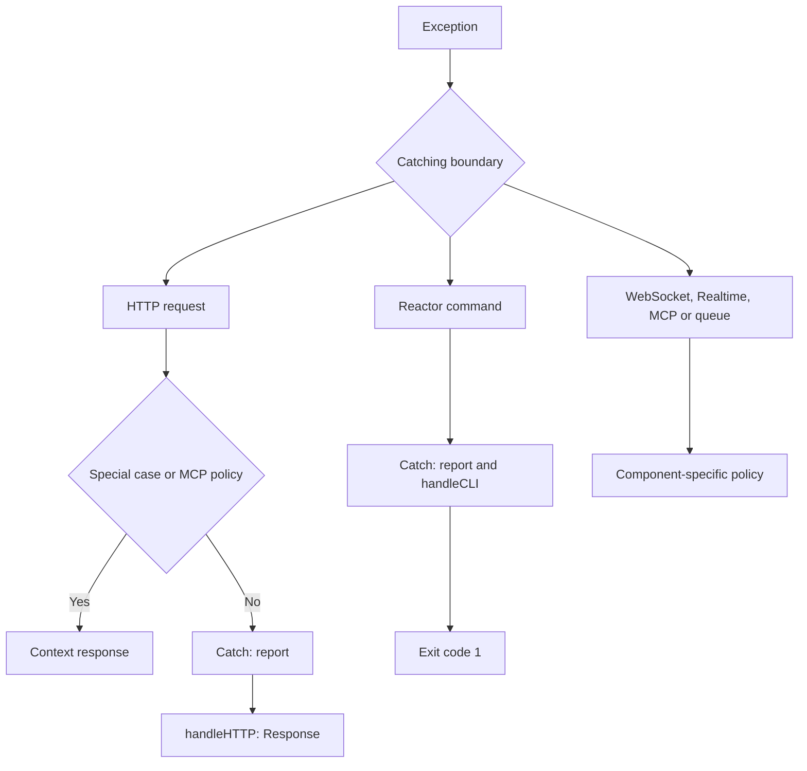

Registering `app.withExceptionHandler(ExceptionHandler)` selects the application handler. Each component decides **when to invoke it and which method to use**. This does not place the whole process inside a `try/except` or convert every failure into an HTTP error page.

## Which boundary processes each failure

<a id="context-boundaries"></a>

| Context | Implemented treatment | Registered handler involvement |
| --- | --- | --- |
| HTTP API and WEB | Special responses for validation, body limits and fallback; other pipeline errors are delegated. | `Catch.exception()` calls `report()`, then `handleHTTP()`. |
| Reactor command | Catches `Exception`, logs the failure and returns code `1`. | `Catch.exception()` calls `report()`, then `handleCLI()`. |
| Direct WebSocket | Treats an expected disconnect as completion; logs a generic message for other errors, attempts closure and propagates. | The WebSocket kernel does not automatically call `Catch`. |
| Realtime remote method | Returns a protocol error correlated with the invocation identifier. | Invocation error translation does not call the global handler. |
| MCP | Preserves JSON-RPC, `isError` results and transport-specific statuses. | The dispatcher and HTTP policy use `report()` at their reporting boundaries; neither `handleHTTP()` nor `handleCLI()`. |
| Response task / HTTP streaming | Closes resources and propagates delivery or post-response failures. | Delivery runs outside the request's error-to-response conversion block. |
| Queue job | Applies timeout, retry or persisted failure according to the job and worker policy. | The worker owns this policy and does not call `Catch`. |
| Startup and shutdown | Propagates the failure or reports a failed lifespan event to the ASGI server. | This is not presented as a controller or command exception. |



## HTTP: translate the failure before sending the response

<a id="context-http"></a>

Body reading, route resolution, controller construction and middleware run inside HTTP request processing. The kernel catches `Exception` and distinguishes these cases:

- `PayloadTooLargeException`: a `413` response without invoking the global presenter.
- `ValidationException` in API: JSON `422` with field errors. In WEB, the route terminal builds the validation response inside the session layer so the corresponding redirect and flash data can be persisted.
- `RouteNotFound` with a registered fallback: executes that fallback; this is not automatically a `500` error.
- An endpoint policy such as MCP: delegates to that policy before applying the preceding rules.
- Other failures: `Catch.exception(exception, request)` reports the failure and requests `handleHTTP()` from the registered handler.

The WEB session layer also catches exceptions from its downstream components while the session is still available. A handler can therefore run at that layer without waiting for the outer kernel block.

To observe an unexpected error, register this class and action like any [HTTP controller](/en/http/request-lifecycle):

```python
from orionis.http import JSONResponse
from orionis.support.facades import Route


class ErrorDemoController:
    async def show(self) -> JSONResponse:
        raise RuntimeError("Example controller failure")


Route.get("/examples/error", [ErrorDemoController, "show"])
```

This example activates the error policy; it does not return the annotated `JSONResponse`. Debug mode, the exception and the handler determine the actual response. [HTTP exceptions](/en/http/exceptions) explains the diagnostic page and its contents, while [handler customization](/en/architecture/exception-handling/handling-exceptions) explains how to change the result.

## CLI: exceptions, return values and parser exits

<a id="context-cli"></a>

`Reactor.call()` opens a scope with the `CONSOLE` context. If command lookup, construction or execution raises an `Exception`, it logs the failure, delegates to `Catch` and returns `1` if handling finishes successfully. During execution it may add the class and method name to the exception message.

```python
from orionis.console.base import BaseCommand


class FailCommand(BaseCommand):
    signature = "examples:fail"
    description = "Demonstrate the command exception boundary."

    async def handle(self) -> int:
        raise RuntimeError("Example command failure")
```

Save the command in the application's command directory and use either launcher:

```shell
orionis examples:fail
python -B reactor examples:fail
```

An action that deliberately returns `1` also signals a non-success status, but **it has not raised an exception** and does not activate `Catch`. Integer action results are preserved; other results are normalized to `0`.

Help and argument errors use the parser's exit path (`SystemExit`) with its corresponding code, outside `except Exception`. A return value of `1` is also not guaranteed if logging or the handler itself fails. See [command execution](/en/console/commands-and-arguments).

## Direct WebSocket: closure and disconnection

<a id="context-websocket"></a>

After accepting a WebSocket connection, an HTTP exception page is no longer sent. Rejection before the handshake uses `socket.reject(status_code=...)`; accepted connections use messages and WebSocket closure.

The kernel treats `WebSocketDisconnected` as expected completion. For another `Exception`, it logs `WebSocket handler failed`, attempts to close an accepted connection with `1011` when the transport supports close details, or `1000` otherwise, and **re-raises the exception**. Cleanup closes a still-open socket and releases capacity.

The RSGI adapter does not expose WebSocket close details: this fallback value does not guarantee that a browser observes code `1000`. Its close API's `status` is used for HTTP rejection, rather than sending a frame with code `1011`.

This endpoint handles a recoverable input error without ending the connection:

```python
from orionis.http import WebSocket, WebSocketDisconnected
from orionis.support.facades import Route


async def double_number(socket: WebSocket) -> None:
    await socket.accept()
    try:
        while True:
            raw = await socket.receiveText()
            try:
                number = int(raw)
            except ValueError:
                await socket.sendJson({"error": "Send an integer."})
                continue
            await socket.sendJson({"result": number * 2})
    except WebSocketDisconnected:
        return


Route.websocket("/examples/double", double_number)
```

Place it in the [WebSocket route file](/en/asynchronous/realtime/routing-and-lifecycle) registered with the application. The `except ValueError` only covers input conversion: infrastructure or send failures continue to the kernel boundary.

## Realtime: invocation and connection errors

<a id="context-realtime"></a>

A hub uses WebSocket, but its `@remote` methods add a boundary per invocation. Method failures usually finish that invocation with `completion.error`; streams use `stream_complete.error`. This does not require closing the entire connection.

| Invocation failure | Client error code |
| --- | --- |
| `RPCError(code, message)` | The specified `code`. |
| Argument validation translated by the binder | `validation_error`. |
| Authentication / authorization | `unauthorized` / `forbidden`. |
| Expired timeout | `timeout`. |
| Cancellation | Attempts to send `cancelled`, then propagates cancellation. |
| Another `Exception` | `internal_error`. |

The runtime uses `"Invocation failed"` for controlled error codes and `"Internal server error"` for `internal_error`. **It does not transmit the `message` from `RPCError`** or arbitrary exception text. Translate the code on the client to present a useful explanation.

```python
from orionis.realtime import Hub, remote
from orionis.realtime.errors import RPCError
from orionis.support.facades import Route


class CalculationHub(Hub):
    @remote
    async def divide(self, numerator: float, denominator: float) -> float:
        if denominator == 0:
            raise RPCError("division_by_zero", "A nonzero divisor is required.")
        return numerator / denominator


Route.hub("/examples/calculations", CalculationHub)
```

An invocation with a zero denominator receives the following, preserving its identifier:

```json
{"type":"completion","id":"calculation-1","error":{"code":"division_by_zero","message":"Invocation failed"}}
```

Connection protocol errors are different: an invalid message or reused active identifier may terminate the connection with the `ProtocolError` close code (`1002` by default). A failure outside the method boundary, such as in `onConnect()`, propagates after cleanup. An `onDisconnect()` failure is logged and must not prevent closure; that hook has a five-second limit. Remote error translation **does not automatically invoke the global handler to report every failure**. If an operation requires additional reporting, add it inside that operation before re-raising its exception.

See [hubs and remote methods](/en/asynchronous/realtime/hubs-and-methods) and [protocol and streams](/en/asynchronous/realtime/protocol-and-streaming) for client and invocation management.

## MCP: distinguish tool errors from JSON-RPC errors

<a id="context-mcp"></a>

MCP transport preserves its formats even when `app.debug` is enabled. The dispatcher reports unexpected failures with `app.getExceptionHandler()` and `app.call(handler, "report", exception=...)`, without requesting an HTML page or CLI presentation. Reporting is protected: its failure does not replace the original protocol error.

There are three distinct situations:

1. **Expected business error in a tool:** return `McpResponse.error("safe message")`. The result has `isError: true`; this is neither an exception nor an automatic handler report.
2. **Unexpected exception during tool execution or normalization:** the failure is reported and produces an `isError: true` result containing `"Tool execution failed"`. Tool input validation produces `"Invalid tool arguments"` without disclosing internal details.
3. **Protocol, prompt or resource error:** uses the JSON-RPC `error` object. Unexpected resource/prompt execution failures are reported and become `-32603`, `"Internal error"`. `McpProtocolException` preserves its code, message, optional `data` and HTTP status where applicable; these values are explicitly public.

```python
from orionis.mcp import McpResponse, Tool
from orionis.schemas import Schema


class DivisionInput(Schema):
    numerator: float
    denominator: float


class DivideTool(Tool[DivisionInput]):
    name = "divide"
    description = "Divide two numbers."
    input = DivisionInput

    async def handle(self, payload: DivisionInput) -> McpResponse:
        if payload.denominator == 0:
            return McpResponse.error("Use a nonzero denominator.")
        return McpResponse.text(str(payload.numerator / payload.denominator))
```

Register `DivideTool` in `Server.tools`, as shown in [tools](/en/protocols/mcp/tools). Division by zero produces the following tool result fields; server `_meta` metadata is omitted:

```json
{"jsonrpc":"2.0","id":1,"result":{"resultType":"complete","content":[{"type":"text","text":"Use a nonzero denominator."}],"isError":true}}
```

A protocol failure uses a different structure:

```json
{"jsonrpc":"2.0","id":1,"error":{"code":-32603,"message":"Internal error"}}
```

The MCP HTTP endpoint policy also reports middleware/kernel errors and translates them to sanitized JSON-RPC responses. The transport catches some reading, protocol and capacity errors itself; not every such error passes through `report()`. Valid notifications do not generate a JSON-RPC response and may receive HTTP `202`. With STDIO, the dispatcher boundary preserves the same distinction between tool results and protocol errors. See [MCP transports](/en/protocols/mcp/transports-and-configuration) for execution details.

## Scheduler: exit status, task failure and listener failure

<a id="context-scheduler"></a>

Scheduled command tasks execute `Reactor.call()`. Therefore, a command whose exception is caught may return `1` and produce a **completed task execution**. Check `event.retval` inside `onTaskExecuted()`; `onTaskError()` represents an exception that escaped the scheduled callable.

```python
from orionis.console.base import BaseTaskListener
from orionis.console.entities import TaskEvent


class CommandResultListener(BaseTaskListener):
    async def onTaskExecuted(self, event: TaskEvent) -> None:
        if event.retval != 0:
            self.warning(f"{event.signature}: exit code {event.retval}")

    async def onTaskError(self, event: TaskEvent) -> None:
        self.error(f"{event.signature}: {event.exception}")
```

Register an **instance** with `registerListener()` in [task configuration](/en/console/scheduler-listeners). Sync/async listener failures are logged and delegation to `ICatch` is attempted. This requires an active scope containing the `kernel` key; outside such a scope, delegation may fail and the scheduler logs `Error in exception handler`. Do not assume every listener runs inside the command's CLI scope: listener execution is another boundary. Its failure does not retroactively change the command result.

## Queues: preserve the retry policy

<a id="context-queues"></a>

The worker catches job exceptions, logs the attempt and chooses between releasing the job with its corresponding delay or persisting a terminal failure. It considers `max_tries`, `backoff`, `retry_until`, the error type and whether immediate propagation was requested. Payload, configuration and retry errors are not treated as retryable transient failures.

A job can explicitly fail a permanently invalid condition:

```python
from dataclasses import dataclass
from orionis.queues import BaseJob, JobContext


@dataclass
class ValidateReportJob(BaseJob):
    report_id: int

    async def handle(self, context: JobContext) -> None:
        if self.report_id <= 0:
            await context.fail(ValueError("report_id must be positive"))
            return
```

`context.fail()` requires the configured failed-job repository: it records the terminal failure and acknowledges that reservation transition. In a real job, continue with the operation after checking its input. Catching a recoverable exception and returning normally may cause the worker to consider the job complete; to preserve automatic retry policy, let the exception propagate or use the appropriate explicit transition.

In immediate execution with `raise_errors=True`, the worker disables automatic retries for that attempt, attempts failure recording and re-raises the exception. Cancellation attempts to release unfinished work, then propagates. See [failures and retries](/en/asynchronous/queues/failures-and-retries) and [execution modes](/en/asynchronous/queues/execution-modes).

The `sync` connection uses this immediate execution: `await Queue.dispatch(job)` can propagate a failure to the controller or command dispatching it. Failure to submit a job to another connection also propagates to its caller; this differs from the later execution failure handled by its worker.

## Streams, SSE and post-response work

<a id="context-response-delivery"></a>

Controller error conversion ends when `Response` is built. The ASGI/RSGI adapters subsequently deliver it, consume its stream and run `response.runBackground()`. Failures at these stages may occur after headers or body data have already been sent: they are not automatically replaced by another handler response.

```python
from orionis.background import BackgroundTask
from orionis.http import JSONResponse


async def verify_report_id(report_id: int) -> None:
    if report_id <= 0:
        raise ValueError("Invalid report identifier")


class ReportController:
    async def show(self) -> JSONResponse:
        return JSONResponse(
            {"report_id": 42},
            background=BackgroundTask(verify_report_id, 42),
        )
```

`BackgroundTask` logs an error and re-raises it; it neither treats failure as success nor automatically calls `Catch`. A failed stream or task also does not gain queue retries merely because it is asynchronous. See [response tasks](/en/asynchronous/background-tasks/response-tasks).

`BackgroundTasks` executes its tasks sequentially. A failing task interrupts iteration, so subsequent tasks do not run.

For SSE, adapters observe disconnects, cancel sending and close the producer. Background work runs after delivery and cleanup have completed, rather than when a stream is abandoned due to disconnection. Producer or cleanup failures propagate; do not promise a new JSON or HTML response over an already-started stream. Only convert a locally handled producer exception into an application event if you define that contract with the client.

## Startup, cancellation and execution outside a kernel

<a id="context-startup-and-cancellation"></a>

Failure while creating configuration, registering providers, starting kernels or running lifecycle hooks is not an endpoint exception. ASGI lifespan sends `lifespan.startup.failed` or `lifespan.shutdown.failed` with the failure message and ends that flow. CLI startup occurs before the command execution block; failures there are not translated by `Reactor.call()`. See [application lifecycle](/en/getting-started/application-lifecycle).

RSGI startup and shutdown hooks execute the lifecycle with the supplied loop and propagate errors; they do not generate those ASGI lifespan messages.

`except Exception` does not catch `asyncio.CancelledError`, `SystemExit` or `KeyboardInterrupt`. Components that catch `BaseException` for resource cleanup propagate the failure again; cleanup does not imply global handler processing. Do not manually pass cancellation to `Catch` to simulate an ordinary error.

The [container](/en/architecture/service-container) propagates construction and invocation errors to its caller. When used by a controller, command or tool, the outer boundary described above determines the result. Calling it from your own code without that boundary does not automatically provide HTTP/CLI presentation.

`Catch.exception()` requires an active scope and its `kernel` key. Outside that context, to **report explicitly** from a component that has `IApplication`, obtain the handler with `app.getExceptionHandler()` and execute `report()` through `app.call()`. Do not request `handleHTTP()` or `handleCLI()` when only reporting is needed.

The application must already be created. The [recovered error reporting example](/en/architecture/exception-handling/handling-exceptions#handler-recovered-errors) demonstrates this pattern with injection; the [Catch and handler reference](/en/architecture/exception-handling/policies-and-reference) details their contracts and prerequisites. Explicit reporting does not install global error interception or a retry policy.
