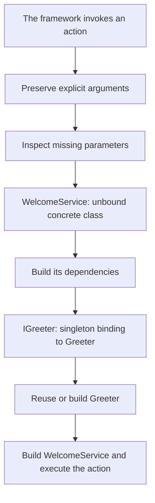

The container builds application objects and connects their dependencies. A controller can request a service through a type annotation; a provider registers the implementation of that contract and how long its instances should be reused.

`Application` extends `Container`, and `IApplication` extends `IContainer`. Receiving `app: IApplication` gives you both application features and the bindings registered by its providers. Ordinary application code uses this existing instance.

## From contract to consumer

Save this example as `app/services/greetings.py`:

```python
from abc import ABC, abstractmethod


class IGreeter(ABC):

    @abstractmethod
    def greet(self, name: str) -> str:
        raise NotImplementedError


class Greeter(IGreeter):

    def greet(self, name: str) -> str:
        return f"Hello, {name}!"


class WelcomeService:

    def __init__(self, greeter: IGreeter) -> None:
        self._greeter = greeter

    def message(self, name: str) -> str:
        return self._greeter.greet(name)
```

Register the implementation in `app/providers/greeting_provider.py`:

```python
from app.services.greetings import Greeter, IGreeter
from orionis.container.providers import ServiceProvider


class GreetingProvider(ServiceProvider):

    def register(self) -> None:
        self.app.singleton(IGreeter, Greeter)
```

Configure or discover this provider as described in the [provider guide](/en/architecture/service-container/providers-and-facades). The following action receives its service through the container:

```python
from app.services.greetings import WelcomeService
from orionis.http import JSONResponse


class GreetingController:

    async def show(
        self,
        name: str,
        welcome: WelcomeService,
    ) -> JSONResponse:
        return JSONResponse({"message": welcome.message(name)})
```

A [route](/en/http/routing) supplies `name` and selects `GreetingController.show`. The framework builds `WelcomeService`, resolves its `IGreeter` contract, and reuses the singleton `Greeter`. The concrete `WelcomeService` class can be built without its own binding.



Injection happens when the container builds or invokes the component. Calling `GreetingController().show(...)` directly in Python requires you to supply its arguments.

## Choose a lifetime

| Registration | Creation and reuse | Typical use |
|---|---|---|
| `transient(contract, class)` | A new instance for each `make()`. | Services without shared identity. |
| `singleton(contract, class)` | One instance per container, created on first resolution. | Services reusable throughout the process lifetime. |
| `scoped(contract, class)` | One instance per active scope. | Request or command state. |
| `instance(contract, object)` | Publishes an existing object in the active scope; globally when outside one. | Adapters or resources you have already initialized. |

A singleton is shared inside the process that owns the container. Other workers, servers, or Fargate tasks have their own instances. The application's JSON cache stores bootstrap metadata, not container objects.

## Resolve and invoke

| Operation | Purpose |
|---|---|
| `await app.make(contract_or_alias)` | Resolve a registration using its lifetime; an unbound concrete class can be built automatically. |
| `await app.build(Class)` | Create a new instance of that class and inject its constructor. |
| `await app.invoke(function, ...)` | Inject and execute a synchronous or asynchronous function. |
| `await app.call(object, "method", ...)` | Inject and execute a method on an existing object. |

`build()` constructs the supplied type even if that type has a singleton registration. Use `make()` to retrieve the shared instance.

## Read the guide

- [Register and invoke services](/en/architecture/service-container/bindings-and-invocation): the complete `IContainer` API, arguments, classes, and functions.
- [Providers and facades](/en/architecture/service-container/providers-and-facades): publishing services and accessing them through facades.
- [Scopes, isolation and concurrency](/en/architecture/service-container/scopes-and-concurrency): HTTP and CLI scopes, child tasks, and resource cleanup.

See [Application and container](/en/getting-started/application-overview) for bootstrap and the `IApplication` lifecycle, and [Schemas and validation](/en/validation) for typed payloads.
