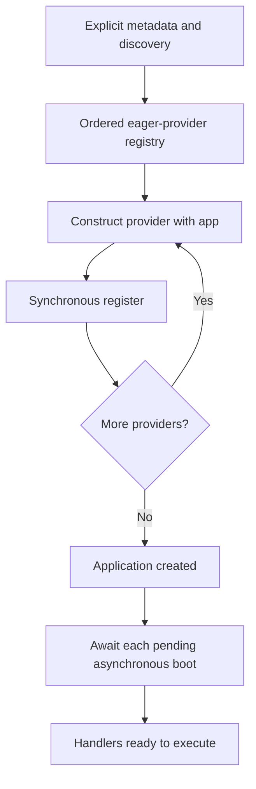

A service provider brings together a component's setup: it registers contracts in the container and performs any initialization required before use. Place these tasks in `app/providers/` to keep startup separate from controller, command or job logic.

`ServiceProvider` exposes the application as `self.app`. The same application registers services, resolves dependencies and reads configuration through `self.app.config(...)`. Read environment variables in [configuration files](/en/architecture/environment), not from the provider during runtime.

## Create a provider

From the project root, use either CLI entry point:

```bash
orionis make:provider catalog
```

```bash
python -B reactor make:provider catalog
```

Both create `app/providers/catalog_provider.py` with the `CatalogProvider` class. The generator adds the `Provider` suffix when missing; a name such as `catalog_provider` also produces `CatalogProvider`. To preserve word boundaries, use names such as `product_catalog` or `Product_Catalog`; `ProductCatalog` preserves the class name, but its filename becomes `productcatalog_provider.py`.

<a id="provider-generator"></a>

| Argument or option | Requirement and effect |
| --- | --- |
| `name` | Required. File and class name; accepts relative subdirectories, such as `billing/invoice`. |
| `--deferred` | Optional; defaults to `False`. Generates a deferred provider with `provides()`. |
| `-h`, `--help` | Displays command help. |

Intermediate directories are created automatically. The generator rejects absolute paths, `..` components and names incompatible with its letter, digit and underscore module-name pattern. Existing files are not overwritten and there is no `--force` option.

The generated hooks have the following structure; their docstrings are omitted to highlight the code you complete:

```python
from orionis.container.providers import ServiceProvider


class CatalogProvider(ServiceProvider):
    def register(self) -> None:
        # Register application-specific services here.
        pass

    async def boot(self) -> None:
        # Perform any asynchronous bootstrapping tasks here.
        pass
```

<a id="provider-service-provider"></a>
<a id="provider-construction"></a>

## Responsibilities of each hook

```text
ServiceProvider(app: IApplication) -> None
```

The constructor stores `app` in `self.app`. For an eager provider, the application constructs the class directly with that single argument. Keep the inherited constructor or a compatible signature; do not declare other required dependencies expecting automatic injection into an eager provider.

<a id="provider-register"></a>

### `register()`: declare services

```python
def register(self) -> None:
    ...
```

This hook is **synchronous**. Use `self.app.instance(...)`, `transient(...)`, `singleton(...)` and `scoped(...)` to declare [bindings and lifetimes](/en/architecture/service-container/bindings-and-invocation). Do not declare `async def register()`: the loader calls the method without awaiting its result.

Register the relationship between contracts and implementations here. Leave operations requiring `await`, service resolution and preparation that depends on other providers for `boot()`.

<a id="provider-boot"></a>

### `boot()`: initialize registered services

```python
async def boot(self) -> None:
    ...
```

Asynchronous eager-provider hooks run after their registrations are complete. `create()` registers providers and leaves those hooks pending; `await app.boot()` completes them for execution without a kernel. For HTTP and CLI, the framework startup lifecycle awaits providers before running the corresponding handlers.

Resolve a dependency explicitly inside the hook:

```python
from app.services.catalog import ICatalog, MemoryCatalog
from orionis.container.providers import ServiceProvider


class CatalogProvider(ServiceProvider):
    def register(self) -> None:
        self.app.singleton(ICatalog, MemoryCatalog, alias="catalog")

    async def boot(self) -> None:
        catalog = await self.app.make(ICatalog)
        catalog.names()
```

The contract and implementation used here are defined in the next section. Hooks are called directly: **they do not receive automatic parameter injection**. A signature such as `boot(self, catalog: ICatalog)` would leave a required argument unsupplied.

A synchronous `boot()` is also called, but runs immediately while registrations are being traversed and may precede other providers' registrations. Use the template's asynchronous hook when you need every registration to be available. Do not return a coroutine from a synchronous `boot()` expecting the loader to await it.

## Complete example: contract, implementation and consumer

Create `app/services/catalog.py`:

```python
from abc import ABC, abstractmethod


class ICatalog(ABC):
    @abstractmethod
    def names(self) -> list[str]:
        raise NotImplementedError

    @abstractmethod
    async def summary(self) -> dict[str, int]:
        raise NotImplementedError


class MemoryCatalog(ICatalog):
    def names(self) -> list[str]:
        return ["book", "lamp"]

    async def summary(self) -> dict[str, int]:
        return {"products": len(self.names())}
```

Complete `app/providers/catalog_provider.py`:

```python
from app.services.catalog import ICatalog, MemoryCatalog
from orionis.container.providers import ServiceProvider


class CatalogProvider(ServiceProvider):
    def register(self) -> None:
        self.app.singleton(ICatalog, MemoryCatalog, alias="catalog")
```

The inherited `boot()` hook does not need overriding when the service requires no additional preparation. This binding makes resolutions of `ICatalog` and the `"catalog"` alias share one instance per process. You can change the lifetime without changing consumers.

For example, save this controller in `app/http/controllers/catalog_controller.py`:

```python
from app.services.catalog import ICatalog
from orionis.http import JSONResponse


class CatalogController:
    def __init__(self, catalog: ICatalog) -> None:
        self.catalog = catalog

    async def index(self) -> JSONResponse:
        return JSONResponse({"products": self.catalog.names()})

    async def summary(self, catalog: ICatalog) -> JSONResponse:
        return JSONResponse(await catalog.summary())
```

The container can resolve the same contract through the controller's constructor or method. Registering a provider does not register endpoints: associate actions in the [appropriate route file](/en/http/routing).

<a id="provider-registration"></a>

## Discovery and registration in `bootstrap/app.py`

The application discovers modules in the directory configured as `app_providers`, which defaults to `app/providers`. Within each module, it registers concrete classes that:

- Extend `ServiceProvider`.
- Are defined in that same module; importing or reexporting another class does not discover it again there.
- Have no remaining abstract methods.

You can also register classes explicitly, especially those outside that directory:

```python
from app.providers.catalog_provider import CatalogProvider

# In bootstrap/app.py, before the existing app.create() call:
app.withProviders(CatalogProvider)
```

The signature is `withProviders(*providers: type[IServiceProvider]) -> Self`. It accepts multiple classes and returns the application for configuration chaining. Instances and classes that do not implement `IServiceProvider` are rejected with `TypeError`.

An eager class is identified by module and name: registering it again updates its position instead of adding a second entry. Discovery already covers the usual `app/providers` case; you do not need to add every class manually as well.

<a id="provider-order"></a>

## Actual order and concurrent initialization

Eager metadata registration inserts each class **at the beginning** of the ordered registry. Therefore, `app.withProviders(FirstProvider, SecondProvider)` initially places `SecondProvider` before `FirstProvider`. Later, discovery visits modules sorted by name and repositions their classes; framework providers are then added with priority at the beginning.

Do not interpret the `withProviders()` list as the final left-to-right execution order. The effective sequence also depends on discovery and framework providers. Each eager provider runs `register()` once during application creation; pending `async boot()` hooks are awaited sequentially in the final registry order.



Concurrent startup calls share coordination for these hooks. A hook stays in the pending queue until it completes successfully: an exception or cancellation prevents all providers from being advertised as ready and allows its initialization to be retried later. Design external effects in `boot()` with that potential retry in mind.

<a id="provider-deferred"></a>

## Deferred providers

A deferred provider postpones construction, registration and `boot()` until one of its declared services is requested. This suits a component that not every request or command needs.

```bash
orionis make:provider catalog --deferred
```

```bash
python -B reactor make:provider catalog --deferred
```

The template adds `DeferrableProvider` and `provides()`, which initially returns `[]`. Complete both the registration and the service list:

```python
from app.services.catalog import ICatalog, MemoryCatalog
from orionis.container.providers import DeferrableProvider, ServiceProvider


class CatalogProvider(ServiceProvider, DeferrableProvider):
    def register(self) -> None:
        self.app.singleton(ICatalog, MemoryCatalog, alias="catalog")

    @classmethod
    def provides(cls) -> list[type | str]:
        return [ICatalog, "catalog"]
```

This example replaces the previous eager provider; use one mode per class. Declaring both the contract and alias allows either form to activate the provider before the binding exists.

<a id="provider-provides"></a>

### `provides()` and its limits

```python
@classmethod
def provides(cls) -> list[type | str]:
    ...
```

Each entry must be a class or string. Classes become module-and-name keys; strings remain identifiers. An entry of another type produces `TypeError` when configuring the registry. The base `DeferrableProvider.provides()` implementation raises `NotImplementedError` unless overridden.

The application validates each entry's type, **not whether it matches the bindings in `register()`**. Keeping them consistent is the provider's responsibility: an empty list or omitted alias cannot activate loading. A declared string that is never registered still cannot resolve and ends in `ValueError`.

`provides()` is evaluated while collecting provider metadata, even if its service is never used. Do not put initialization work or service reads in this method.

### What happens on the first resolution

1. `make()`, `build()` or an annotated dependency encounters a service advertised by the provider.
2. The container imports and constructs the class through `build()`. This deferred path can resolve annotated constructor dependencies; retaining the standard constructor with `IApplication` works in both modes.
3. It calls `register()` synchronously and retains that provider instance.
4. It awaits `boot()` when declared asynchronous; hooks are called without parameter injection.
5. It marks the entire provider ready and continues resolving the requested service.

The lock is shared by provider, rather than by each advertised contract. Concurrent first resolutions of its contracts do not repeat `register()` or bypass a pending `boot()`. The provider's own `boot()` can resolve its registered services without waiting on itself.

Deferred loading may be activated within a request or command scope. In that context, `self.app.instance(...)` publishes a local instance and rejects aliases; it is not a permanent global registration. To declare services that must remain resolvable after that first operation, use class bindings with `singleton`, `transient` or `scoped`, as in the example.

If `boot()` fails, resolution fails and the provider retains its registration so a later resolution retries only the pending hook. If `register()` fails, bindings it already published are not rolled back automatically. Avoid partial effects and register each service coherently.

<a id="provider-cache"></a>

## Providers and bootstrap cache

When [configuration compilation](/en/architecture/environment/compiled-configuration) is enabled, eager and deferred provider metadata is stored with the bootstrap. Module and class identifiers are persisted; **service instances, open connections and `boot()` results are not serialized**.

When recovering valid configuration, the application uses the saved registry instead of repeating discovery. `withProviders()` returns the application without changing it when that compiled state was loaded. Each process still constructs its own providers and services and runs their hooks as required.

Tracking files in the providers directory participates in invalidation. If you change explicit registration or components outside monitored paths, clear or regenerate the cache during deployment; the [bootstrap guide](/en/getting-started/bootstrap-options) explains its options.

## Errors to check

| Situation | Check |
| --- | --- |
| Discovery does not find the provider | Check `app_providers`, inheritance from `ServiceProvider`, module ownership and whether the class is concrete. |
| An eager constructor dependency is missing | Keep `__init__(app)` and resolve services inside `async boot()`. |
| A hook reports missing arguments | `register()` and `boot()` are called without parameter DI. |
| A deferred service does not activate its provider | Include the actual requested key in `provides()` and publish it in `register()`. |
| The binding already exists | Check duplicate contracts; use `override=True` only when deliberately replacing a registration. |
| The facade does not allow a synchronous call | Review [facade dispatch and pinning](/en/architecture/service-container/facades). |

Continue with [Synchronous and asynchronous facades](/en/architecture/service-container/facades) or [Scopes, isolation and concurrency](/en/architecture/service-container/scopes-and-concurrency).
