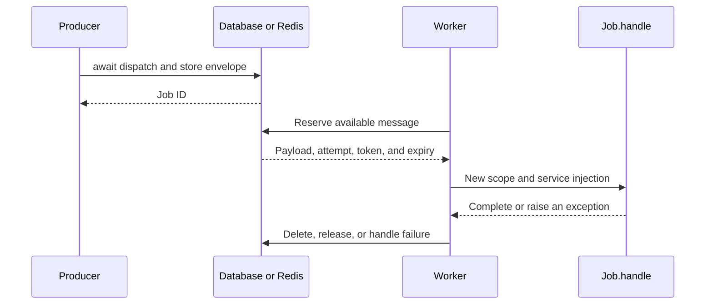

## Choose where work executes

The API is async for every driver. This does not mean every submission uses another process: the backend determines when `handle()` executes.

| Mode | What the producer awaits | What executes the job |
| --- | --- | --- |
| `sync` | The complete attempt execution. | The submitting process and event loop. |
| `database` | Persistent insertion of the message. | A worker consuming the same table and channel. |
| `redis` | Writing the message to Redis. | A worker consuming the same namespace and channel. |

Database durability depends on the configured database; an in-memory SQLite database does not survive its process. Redis depends on its persistence and recovery configuration. See [drivers and persistence](/en/asynchronous/queues/drivers-and-configuration).

## Execute immediately with sync

With `QUEUE_CONNECTION=sync`, or by selecting it explicitly:

```python
from app.jobs.process_record_job import ProcessRecordJob
from orionis.support.facades import Queue


async def process_now(record_id: int) -> str:
    return await (
        Queue.dispatch(ProcessRecordJob(record_id)).onConnection("sync")
    )
```

The driver serializes state, prepares a one-attempt reservation, and invokes `Worker.execute(raise_errors=True)`: the scope, `handle()` injection, and timeout apply. Successful completion returns the ID; an execution exception is recorded as a failure when possible and propagates to the producer. It does not use the normal automatic retry budget or keep a pending queue, and rejects nonzero `delay()` or `JobContext.release()`.

Use it when the operation must finish before continuing, while retaining a job's structure. It does not shorten a request that awaits that work or create a separate worker.

## Submit now and process later

With `database` or `redis`, producer and consumer must share configuration, channel, and importable job classes. For example:

```python
from app.jobs.process_record_job import ProcessRecordJob
from orionis.support.facades import Queue


async def process_later(record_id: int) -> str:
    return await (
        Queue.dispatch(ProcessRecordJob(record_id))
        .onConnection("database")
        .onQueue("records")
        .delay(10.0)
    )
```

Successful submission returns the ID before `handle()` executes. Delay only establishes when the message becomes reservable; it does not guarantee its exact execution time. Without a worker, the message remains pending.



## Continuous CLI worker

From the project root, in another process:

```shell
orionis queue:work database --queue records --concurrency 2
```

The local equivalent is:

```shell
python -B reactor queue:work database --queue records --concurrency 2
```

The command remains active waiting for messages. Concurrency is a number of async consumers within the process; it does not create that many processes or turn blocking Python operations into parallel CPU work. The [worker manual](/en/asynchronous/queues/workers-and-failures#command-work) explains all arguments, signals, and defaults.

## Bounded CLI processing

To process available messages and exit when none are ready:

```shell
python -B reactor queue:work database --queue records --stop-when-empty
```

To limit the number of processed reservations:

```shell
orionis queue:work database --queue records --max-jobs 100 --stop-when-empty
```

`--stop-when-empty` can exit while messages remain delayed or reserved by another consumer. `--max-jobs` counts reserved attempts, not unique jobs or successes. A successful command exit does not prove every business operation succeeded: inspect [terminal failures](/en/asynchronous/queues/failures-and-retries).

## Control a worker from an async component

`worker()` lets you integrate consumption into a custom command or a service with a managed lifecycle:

```python
from orionis.queues.contracts.manager import IQueueManager


async def drain_records(queue: IQueueManager) -> int:
    worker = await queue.worker(
        "database", queues=("urgent", "records"), concurrency=2,
    )
    return await worker.run(stop_when_empty=True, max_jobs=100)
```

For a continuous consumer whose shutdown is controlled by another component:

```python
import asyncio
from orionis.queues.contracts.manager import IQueueManager


async def consume_until_stop(
    queue: IQueueManager, shutdown: asyncio.Event,
) -> int:
    worker = await queue.worker("database", queues=("records",))
    task = asyncio.create_task(worker.run())
    try:
        await shutdown.wait()
    finally:
        worker.stop()
        processed = await task
    return processed
```

This example assumes the owning component sets `shutdown` when stopping and the worker does not fail beforehand. A complete integration must also supervise `task` and react to its exceptions; the [native CLI](/en/asynchronous/queues/workers-and-failures) already coordinates supported signals. `stop()` requests shutdown: it lets active attempts finish and does not drain every pending message.

`Worker.execute(reserved)` is a low-level operation for an already acquired reservation. It neither reserves messages nor starts a loop. Use `run()` or the CLI unless you are implementing and verifying a custom consumer; see [the worker API](/en/asynchronous/queues/workers-and-failures#worker-execute).

## Response tasks and scheduling

A [task after responding](/en/asynchronous/background-tasks/response-tasks) executes within the application process and does not by itself represent a persistent message. It can submit a job to Database or Redis, but submission must still complete and a worker must be active.

The [task scheduler](/en/console/task-scheduling) determines when to invoke a command or callback. If it submits jobs, their consumers remain independent: scheduling submission does not automatically start `queue:work`.

Calling `job.handle()` directly also bypasses queue serialization, reservations, policies, scopes, and failure handling. Use `await Queue.dispatch(job)` with the appropriate backend for those facilities.
