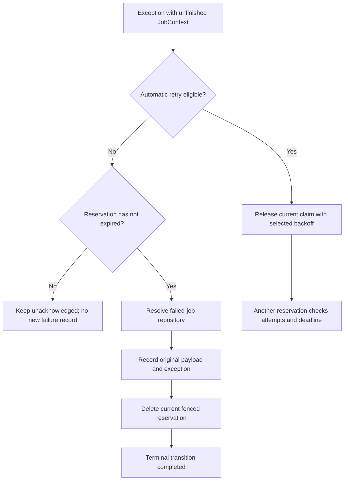

A failed attempt and a terminal failed job are different states. A retryable exception can release the same job for another reservation. A terminal failure is recorded before the worker attempts to delete its current reservation.

[Workers](/en/asynchronous/queues/workers-and-failures) explain consumption, leases, timeout, and graceful shutdown. This page covers the decisions made after execution and the APIs for inspecting their evidence.

## Attempts and retry policy

Dispatch stores these settings in the envelope:

| Setting | Meaning |
| --- | --- |
| `max_tries` | Total reservation budget, including the first attempt. Comes from the job's `tries` or worker defaults at dispatch. |
| `backoff` | Nonempty tuple of nonnegative seconds between retryable failed attempts. Comes from the job or dispatch-time defaults. |
| `timeout` | Cooperative execution limit. Must be positive, finite, and below the connection's `retry_after`. |
| `retry_until` | Optional absolute epoch deadline returned by `retryUntil()`. It is not a relative delay. |

`tries=3` permits an initial attempt and up to two automatic retries. `JobContext.attempts` counts reservations, including reservations recovered after a crash; it is not necessarily the number of completed calls to `handle`.

With `backoff=(1.0, 5.0)`, attempt 1's retry waits one second, attempt 2's retry waits five, and any later eligible retry reuses five. The index is `min(attempts - 1, len(backoff) - 1)`.

Backoff, initial dispatch `delay`, and lease `retry_after` serve different purposes. Backoff schedules a retry after an error; dispatch delay postpones initial availability; `retry_after` limits ownership of one reservation.

### What the worker retries automatically

After an ordinary exception and while the context is unfinished, the worker releases the reservation only if:

1. `raise_errors` is `False`.
2. The envelope was successfully decoded.
3. `attempts < max_tries`.
4. The exception is not `QueuePayloadError`, `QueueConfigurationError`, or `QueueRetryError`, including their subclasses.
5. If a deadline exists, `current_time + selected_backoff < retry_until`.

Otherwise it attempts terminal failure recording. `UnknownJobError` is a `QueuePayloadError`, so an unregistered job is not treated as a temporary business outage.

Before invoking `handle`, the worker also rejects a reservation whose attempts already exceed the budget or whose deadline is reached. A recovered/explicitly released claim can therefore be recorded with an attempt count above `max_tries` without running the handler again.

A timeout becomes `TimeoutError` and can be retried under those same rules. A failed acknowledgement can also lead to another attempt even if the handler already completed business work.

### Declare a bounded retry policy

Save a job such as this in `app/jobs/archive_report_job.py`. Its constructor contains persistent data, not live services:

```python
from typing import ClassVar

from orionis.queues import BaseJob, JobContext
from orionis.support.facades import Storage


class ArchiveReportJob(BaseJob):
    __slots__ = ("report_id", "deadline")

    report_id: str
    deadline: float

    tries: ClassVar[int | None] = 3
    timeout: ClassVar[float | None] = 10.0
    backoff: ClassVar[tuple[float, ...] | None] = (1.0, 5.0)

    def __init__(self, report_id: str, deadline: float) -> None:
        self.report_id = report_id
        self.deadline = deadline

    def retryUntil(self) -> float | None:
        return self.deadline

    async def handle(self, context: JobContext) -> None:
        storage = await Storage.resolve()
        disk = storage.disk("local")
        source = disk.file(f"reports/{self.report_id}.txt")
        if not await source.exists():
            raise FileNotFoundError(f"Report {self.report_id} is not ready.")
        await disk.file(f"archive/{self.report_id}.txt").write(
            await source.read(),
        )
```

The connection's configured `retry_after` must exceed ten seconds for this job. If the report is missing, the worker decides whether another attempt is eligible. When it exists, normal completion is acknowledged automatically.

Dispatch it from an initialized asynchronous service:

```python
from app.jobs.archive_report_job import ArchiveReportJob
from orionis.support.facades import DateTime, Queue


class ArchiveReportService:

    async def submit(self, report_id: str) -> str:
        manager = await Queue.resolve()
        deadline = DateTime.now().timestamp() + 600.0
        return await (
            manager.dispatch(ArchiveReportJob(report_id, deadline))
            .onConnection("database")
            .onQueue("reports")
        )
```

The deadline is calculated before dispatch and persisted in both job state and envelope policy. A later manual retry does not recalculate it. Reusing an already expired deadline does not grant a fresh ten-minute window.

<a id="job-context"></a>
<a id="job-context-construction"></a>

## JobContext: inspect and complete the current reservation

Orionis binds a new `JobContext` inside each job's isolated DI scope. Receive it as an annotated `handle` argument, as above. Do not serialize it in the job constructor or reuse it outside that execution.

Its advanced constructor is:

```text
JobContext(
    driver: IQueueDriver,
    reserved: ReservedJob,
    connection: str,
    fail: FailureCallback,
) -> None

FailureCallback = Callable[[ReservedJob, Exception], Awaitable[bool]]
```

All four arguments are required. The worker supplies the driver, real fenced claim, logical connection, and callback that records terminal failures. Construction sets `finished=False` and `failure=None`; it does not acquire a reservation.

### Read-only properties

<a id="job-context-id"></a>
<a id="job-context-attempts"></a>
<a id="job-context-queue"></a>
<a id="job-context-connection"></a>
<a id="job-context-finished"></a>
<a id="job-context-failure"></a>

| Property | Type | Meaning |
| --- | --- | --- |
| `id` | `str` | Original dispatch identifier. |
| `attempts` | `int` | One-based reservation count for this execution. |
| `queue` | `str` | Logical channel of the reservation. |
| `connection` | `str` | Logical queue connection selected by the worker. |
| `finished` | `bool` | Whether an explicit lifecycle operation completed. Initially `False`. |
| `failure` | `Exception \| None` | The exception passed to a completed explicit `fail`. Initially `None`. |

For example, metadata can be recorded through an injected logger without adding live dependencies to persistent state:

```python
from orionis.logging.contracts.logger import ILogger
from orionis.queues import BaseJob, JobContext


class ObserveAttemptJob(BaseJob):
    __slots__ = ("record_id",)

    record_id: str

    def __init__(self, record_id: str) -> None:
        self.record_id = record_id

    async def handle(self, context: JobContext, logger: ILogger) -> None:
        logger.info(
            f"Job {context.id}: record={self.record_id}, "
            f"attempt={context.attempts}, "
            f"connection={context.connection}, queue={context.queue}",
        )
```

<a id="job-context-release"></a>

### release: explicitly schedule another reservation

```text
async release(delay: float = 0.0) -> None
```

`delay` is optional nonnegative finite seconds; booleans, negative values, NaN, and infinity raise `QueueConfigurationError`. It calls the driver's release operation on the current claim. On success, `finished` becomes `True` and automatic acknowledgement is skipped.

A repeated transition or a driver returning `False` for lost/expired ownership raises `QueueLeaseError`. Backend exceptions can propagate; an unsuccessful operation does not mark the context finished.

This is an explicit release, not automatic exception backoff. It uses the delay you pass and does not check the retry budget/deadline itself. The next reservation performs those checks. Return from `handle` immediately after releasing:

```python
from orionis.queues import BaseJob, JobContext


class DeferFirstAttemptJob(BaseJob):
    __slots__ = ()

    async def handle(self, context: JobContext) -> None:
        if context.attempts == 1:
            await context.release(delay=5.0)
            return
```

This minimal job defers its first reservation and completes the next normally. Use a durable connection; `sync` does not support release for later execution.

<a id="job-context-delete"></a>

### delete: acknowledge an intentionally completed or skipped job

```text
async delete() -> None
```

Takes no arguments. Deletes the currently owned reservation and sets `finished=True`. A repeated transition or rejected ownership raises `QueueLeaseError`; storage exceptions propagate.

Normal `handle` completion already calls this automatically. Use it explicitly when you deliberately acknowledge a branch and return:

```python
from orionis.queues import BaseJob, JobContext
from orionis.support.facades import Storage


class EnsureReportMarkerJob(BaseJob):
    __slots__ = ("report_id",)

    report_id: str

    def __init__(self, report_id: str) -> None:
        self.report_id = report_id

    async def handle(self, context: JobContext) -> None:
        storage = await Storage.resolve()
        marker = storage.disk("local").file(f"markers/{self.report_id}.txt")
        if await marker.exists():
            await context.delete()
            return
        await marker.write("ready\n")
```

The existence check is an application branch, not an atomic distributed business lock. A successful marker write still precedes automatic acknowledgement.

<a id="job-context-fail"></a>

### fail: record a terminal application decision

```text
async fail(exception: Exception) -> None
```

`exception` is required. The worker callback records it before attempting to delete the reservation. On success, `failure` contains that same exception and `finished=True`. No automatic retry follows a completed explicit failure.

A repeated transition or a callback returning `False` raises `QueueLeaseError`. Missing failure storage, repository resolution, SQL errors, or deletion errors can propagate. If recording succeeds but deletion fails, a failure event can exist while the queue job remains.

```python
from orionis.queues import BaseJob, JobContext


class ValidateReportIdJob(BaseJob):
    __slots__ = ("report_id",)

    report_id: str

    def __init__(self, report_id: str) -> None:
        self.report_id = report_id

    async def handle(self, context: JobContext) -> None:
        if not self.report_id.isdecimal():
            await context.fail(ValueError("Report ID must contain decimal digits."))
            return
```

There is no `failed()` job hook in `IJob`, `BaseJob`, or the worker pipeline. Implement an explicit decision in `handle` with `context.fail` or inspect the failed-job repository; do not rely on a callback from another framework.

After a successful `release`, `delete`, or `fail`, stop executing that handler branch. The framework does not interrupt Python control flow for you. A later exception is logged, but a finished context keeps its completed transition; it does not get an additional automatic retry.

<a id="job-handle-exceptions"></a>

## Catch an exception inside handle

Catch an error when the job can make a deliberate lifecycle decision. This complete job marks an invalid number as a terminal failure and uses the injected Storage manager only for valid input:

```python
from orionis.queues import BaseJob, JobContext
from orionis.storage.contracts.manager import IStorageManager


class ParseReportNumberJob(BaseJob):
    __slots__ = ("raw",)

    raw: str

    def __init__(self, raw: str) -> None:
        self.raw = raw

    async def handle(
        self,
        context: JobContext,
        storage: IStorageManager,
    ) -> None:
        try:
            number = int(self.raw)
        except ValueError as exc:
            await context.fail(exc)
            return

        await storage.disk("local").put(f"parsed/{number}.txt", str(number))
```

The caught `ValueError` retains its original traceback when passed to `context.fail(exc)`. The following `return` ends that handler branch. Errors from `disk(...).put(...)` are outside the `try` block: they propagate to the worker, which applies its automatic retry policy.

Catching and suppressing an exception without `fail` or `release` makes the handler appear successful, unless another exception occurs. Normal completion then triggers automatic acknowledgement. To retain the worker's error handling from an `except` block, use a bare `raise` to propagate the original exception.

## Terminal failure sequence and storage problems



The worker checks reservation expiry before terminal recording; native deletion then checks ownership/fencing. Recording and queue deletion are separate operations, possibly in different stores. A competing reclaim or backend failure between them can leave the durable failure record and a queue job at the same time.

Failures to release, resolve failure storage, record, or delete are logged by the normal worker. When it cannot finish safely, it retains an unacknowledged claim where possible for lease recovery. That recovery can repeat a job whose business effect already happened. Use business idempotency or reconciliation; queue acknowledgement is not an exactly-once transaction with an external system.

The `sync` driver calls `execute(..., raise_errors=True)`: it attempts one immediate execution, bypasses automatic retries, and propagates its original error. It may still need SQL failure storage for terminal recording. See [execution modes](/en/asynchronous/queues/execution-modes).

<a id="command-failed"></a>

## queue:failed: list failure events

```bash
orionis queue:failed
python -B reactor queue:failed
```

There are no positional arguments or queue-specific options; `-h`/`--help` is available. It lists every stored event chronologically, printing:

```text
FAILURE_ID | job=JOB_ID | CONNECTION/QUEUE | attempts=N | EXCEPTION_TYPE: MESSAGE
```

The command does not print payload bytes or the stored traceback. An empty repository prints `No failed jobs.`. It returns `0` on success or `1` for a caught `QueueError`; unrelated SQL/infrastructure exceptions are not converted by that catch.

The first ID is a **failure event ID**, distinct from `job=...`. Use that failure ID with `queue:retry` or `queue:forget`.

<a id="command-retry"></a>

## queue:retry: requeue one recorded event

```bash
orionis queue:retry FAILURE_ID
python -B reactor queue:retry FAILURE_ID
```

`id` is a required positional `str`. Replace `FAILURE_ID` with one listed by `queue:failed`. There is no `all` special argument, `--all` flag, or connection override.

It calls `retryFailed(failed_id: str) -> str` on the manager:

1. Find the failure; a missing record raises `QueueRetryError`.
2. Decode the original envelope and reject an expired original deadline.
3. Push it onto its original connection and logical queue, with no added dispatch delay.
4. Forget that failure event **after** successful push.
5. Return the preserved job ID; backend attempt state starts over from its initial push state.

The envelope keeps its job data, ID, max tries, timeout, backoff, and deadline. Editing current defaults does not replace these values. A corrupt payload, unknown configured connection, expired deadline, or failed push leaves the failure record available.

The command prints `Job JOB_ID queued for retry.` and returns `0`; a caught `QueueError` returns `1`. It does not run a persistent job immediately: a worker must consume it. An original `sync` connection is the exception because its `push` executes immediately.

Push and forgetting are not one cross-store transaction. If push succeeds and forgetting raises, the job can already be queued while the command reports failure. Inspect the queue and record before retrying the administrative action blindly.

```python
from orionis.support.facades import Queue


class RetryFailureService:

    async def retry(self, failure_id: str) -> str:
        manager = await Queue.resolve()
        return await manager.retryFailed(failure_id)
```

<a id="command-forget"></a>

## queue:forget: remove one failure record

```bash
orionis queue:forget FAILURE_ID
python -B reactor queue:forget FAILURE_ID
```

`id` is a required positional `str`. This removes the failed-job evidence only; it does not run the job or clear a durable queue.

A deletion prints `Failed job deleted.` and returns `0`. A missing record prints `Failed job not found.` and returns `1`. Caught `QueueError` instances also return `1`. There is no confirmation prompt, batch deletion, or `--force` option.

For clearing ready, delayed, and reserved jobs instead, see [queue:clear](/en/asynchronous/queues/workers-and-failures#command-clear).

<a id="failed-repository"></a>

## Failed-job repository API

`await manager.failed()` returns the shared `IFailedJobRepository`, backed natively by `DatabaseFailedJobRepository`. Failure storage uses a framework database connection even for Redis or sync queue connections. Its configuration is separate from the durable jobs' storage.

### Construction

<a id="failed-repository-construction"></a>

```text
DatabaseFailedJobRepository(
    connection: IConnection,
    table: str = "failed_jobs",
) -> None
```

`connection` is required; `table` defaults to `"failed_jobs"`. It is a logical table name, with the database connection's prefix applied by the DB layer. Invalid SQL identifiers raise `QueueConfigurationError`.

Construction defines the schema without creating a table. The first `record`, `all`, `find`, or `forget` ensures the table exists. SQL permissions and connection failures can therefore surface when an inspection command first uses it. Schema creation is lazy and protected per repository; use shared framework connection lifecycle rather than opening one manually per call.

<a id="failed-repository-record"></a>

### record: persist one reservation's failure

```text
async record(
    reserved: ReservedJob,
    connection: str,
    exception: Exception,
) -> FailedJob
```

All arguments are required. Retains the original encoded envelope, queue routing, attempt count, qualified exception type, message, formatted traceback, and failure timestamp.

The failure ID is deterministic for the queue connection, job ID, and reservation token. Recording the same claim again returns its existing event instead of overwriting its original diagnostics. Another reservation token produces a different event, even for the same job.

This method alone **does not validate the lease, delete the job, or call a job hook**. The worker coordinates those steps. Use it directly only when implementing such an operational integration:

```python
from orionis.queues.entities.failed_job import FailedJob
from orionis.queues.entities.reserved_job import ReservedJob
from orionis.support.facades import Queue


class FailureRecordingService:

    async def record(
        self,
        reserved: ReservedJob,
        connection: str,
        error: Exception,
    ) -> FailedJob:
        manager = await Queue.resolve()
        repository = await manager.failed()
        return await repository.record(reserved, connection, error)
```

SQL errors propagate unless the existing deterministic failure event can be retrieved after an insertion conflict. A newly created exception that was never raised has formatted type/message information, not an execution stack it never acquired.

<a id="failed-repository-all"></a>

### all: read every event

```text
async all() -> tuple[FailedJob, ...]
```

No arguments. Returns an immutable tuple ordered by `failed_at` and then `id`. An empty repository returns `()`. There are no built-in pagination or filtering arguments on this method.

```python
from orionis.support.facades import Queue


class FailureSummaryService:

    async def list(self) -> list[dict]:
        manager = await Queue.resolve()
        repository = await manager.failed()
        return [
            {
                "failure_id": item.id,
                "job_id": item.job_id,
                "queue": item.queue,
                "attempts": item.attempts,
                "exception": item.exception_type,
            }
            for item in await repository.all()
        ]
```

<a id="failed-repository-find"></a>

### find: retrieve one event

```text
async find(failure_id: str) -> FailedJob | None
```

Returns the matching event or `None`. The identifier is the failure ID, not the job ID. It does not decode or execute the stored job.

```python
from orionis.queues.entities.failed_job import FailedJob
from orionis.support.facades import Queue


class FailureInspectionService:

    async def find(self, failure_id: str) -> FailedJob | None:
        manager = await Queue.resolve()
        repository = await manager.failed()
        return await repository.find(failure_id)
```

<a id="failed-repository-forget"></a>

### forget: delete one event

```text
async forget(failure_id: str) -> bool
```

Returns `True` only when one matching row was removed, otherwise `False`. It does not alter ready/reserved queue storage or perform a retry.

```python
from orionis.support.facades import Queue


class FailureRemovalService:

    async def forget(self, failure_id: str) -> bool:
        manager = await Queue.resolve()
        repository = await manager.failed()
        return await repository.forget(failure_id)
```

<a id="failed-repository-close"></a>

### close: reset repository readiness

```text
async close() -> None
```

No arguments. The native implementation resets its schema-readiness marker. It **does not disconnect the shared DB connection**, delete rows, or permanently disable the repository. A later operation ensures schema readiness again.

Application shutdown normally coordinates this through the manager. An explicit operational component can call the contract when it owns that lifecycle:

```python
from orionis.queues.contracts.failed_repository import IFailedJobRepository


class FailureRepositoryLifecycle:

    async def close(self, repository: IFailedJobRepository) -> None:
        await repository.close()
```

The interface annotates `record.exception` as `BaseException`, whereas the native implementation annotates `Exception`. Its `find`/`forget` parameter is named `failed_id` in the interface and `failure_id` in the implementation; the examples use positional identifiers to work with both. See the [API reference](/en/asynchronous/queues/api-reference) for contracts.

<a id="failed-job"></a>

## FailedJob fields and sensitive evidence

This frozen, keyword-only `msgspec.Struct` has ten required fields:

```text
FailedJob(
    *,
    id: str,
    job_id: str,
    connection: str,
    queue: str,
    payload: bytes,
    exception_type: str,
    exception_message: str,
    traceback: str,
    failed_at: float,
    attempts: int,
)
```

| Field | Meaning |
| --- | --- |
| `id` | Stable identifier for this failure event/claim token. |
| `job_id` | Original dispatch identifier, preserved by manual retry. |
| `connection` | Logical queue connection on which this failure occurred. |
| `queue` | Logical channel. |
| `payload` | Original envelope bytes, including serialized job state and retry policy. |
| `exception_type` | Module-qualified exception class name in the native repository. |
| `exception_message` | `str(exception)`, stored without automatic redaction. |
| `traceback` | Formatted exception and available traceback, stored without automatic redaction. |
| `failed_at` | Wall-clock epoch seconds. |
| `attempts` | Reservation count associated with the recorded event. |

Payloads, messages, and tracebacks can contain business data or secrets. The repository does not sanitize them automatically or provide a failure notification hook. Limit access to inspection endpoints and apply your application's retention policy; forgetting an event removes its recovery evidence.

There is no automatic pruning command in this API. Worker's ordinary exceptions are logged through the `orionis.queues.worker` logger; inspect those logs as well as durable records when failure storage itself is unavailable.
