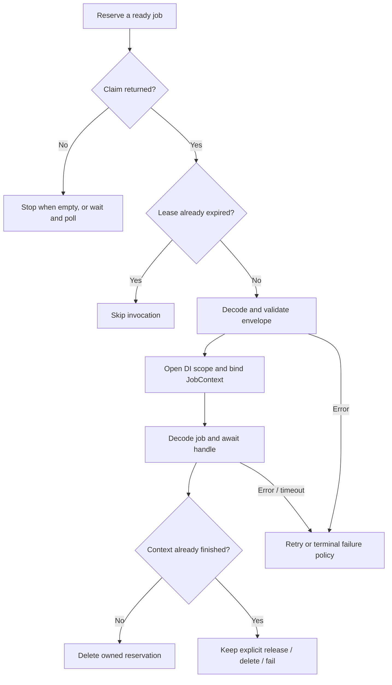

A worker consumes jobs already persisted on a durable queue connection. It reserves a job for a limited lease, restores its declaration, resolves the dependencies of `handle()` in an isolated scope, and acknowledges, releases, or records the attempt as failed.

Use the same job classes and compatible configuration in producers and workers. The `sync` connection executes during dispatch and cannot be selected by `Queue.worker()` or `queue:work`. See [execution modes](/en/asynchronous/queues/execution-modes) and [configuration](/en/asynchronous/queues/configuration) for connection selection.

For automatic retry rules, `JobContext`, and failure inspection, continue with [retries and failed jobs](/en/asynchronous/queues/failures-and-retries).

<a id="command-work"></a>

## Run queue:work

From the project root, choose either CLI form:

```bash
orionis queue:work database --queue high,default --concurrency 4
```

```bash
python -B reactor queue:work database --queue high,default --concurrency 4
```

For a bounded run:

```bash
orionis queue:work database --queue reports --stop-when-empty --max-jobs 100
python -B reactor queue:work database --queue reports --stop-when-empty --max-jobs 100
```

The complete command syntax is:

```text
queue:work [connection]
    [--queue QUEUE]
    [--concurrency CONCURRENCY]
    [--max-jobs MAX_JOBS]
    [--stop-when-empty]
```

| Argument or option | Type | CLI default | Actual selection |
| --- | --- | --- | --- |
| `connection` | Optional positional `str` | `None` | Uses `queue.default` when omitted. The shipped default is `sync`, so choose a durable connection explicitly or change configuration. |
| `--queue` | `str` | `None` | Uses the selected connection's configured queue when omitted. Otherwise, comma-separated names define priority order. |
| `--concurrency` | `int` | `None` | Uses `queue.worker.concurrency`; its shipped default is `1`. Must be a positive integer. |
| `--max-jobs` | `int` | `None` | Unlimited reservations until another stopping condition. A supplied value must be positive. |
| `--stop-when-empty` | Flag | `False` | Ends each consumer when its reservation call finds no ready job. |
| `-h` / `--help` | Flag | — | Shows command help. |

`--queue "high, default"` is split on commas and each part is trimmed. Empty parts are not silently discarded: `--queue high,,default` produces invalid queue settings. Names contain 1–128 letters, digits, `.`, `_`, or `-`, starting with a letter or digit.

Queues are checked in the declared order. A continuous flow in `high` can postpone `default`; priority does not imply fairness or completion order across concurrent consumers.

### Exit and stopping conditions

On a clean return, the command prints `Worker stopped after N attempt(s).` and returns exit code `0`. That count includes processed reservations that were released or failed; it is not the count of unique successful jobs. Handled business failures can therefore coexist with a successful command exit.

Caught `QueueError` instances are printed as errors and return `1`. Other infrastructure exceptions are not converted by this command's `QueueError` handler.

`--stop-when-empty` means “no work ready now.” Delayed jobs and jobs reserved by other workers may remain. It is useful for a drain or scheduled invocation, not a promise that the backend contains no jobs.

There are no `--tries`, `--timeout`, `--backoff`, `--sleep`, or `--retry-after` options on this command. Configure those values through [queue settings](/en/asynchronous/queues/configuration) or supported job declarations, as appropriate.

## Create a worker from application code

Asynchronous services can use the same runtime through the facade:

```python
from orionis.support.facades import Queue


class ReportsQueueService:

    async def drain(self) -> int:
        manager = await Queue.resolve()
        worker = await manager.worker(
            "database",
            queues=("reports",),
            concurrency=2,
        )
        return await worker.run(stop_when_empty=True, max_jobs=100)
```

The application must be initialized. `manager.worker` creates an independent `Worker`; it does not start consumption. Driver and serializer services remain managed by the existing application. See [manager and injection](/en/asynchronous/queues/manager-and-injection) for constructor or method injection.

<a id="worker-construction"></a>

## Worker construction

```text
Worker(
    app: IApplication,
    driver: IQueueDriver,
    serializer: IJobSerializer,
    options: WorkerOptions,
    failed: IFailedJobRepository | FailedResolver | None = None,
) -> None

FailedResolver = Callable[[], Awaitable[IFailedJobRepository]]
```

The first four arguments are required. `app` supplies dependency scopes and invokes the job; `driver` owns reservations and transitions; `serializer` restores envelopes and registered job classes; `options` carries polling and lease settings.

`failed` may be a repository, a zero-argument asynchronous resolver, or `None`. Resolution is deferred until terminal failure and the resolved repository is retained by that worker. With `None`, a terminal failure cannot be recorded: the worker logs the completion problem and leaves work unacknowledged when it cannot safely complete it.

Construction stores dependencies and initializes counters; it does not open backend connections. Normal application code obtains this configured object through `await manager.worker(...)` rather than assembling a second application.

<a id="worker-options"></a>

### WorkerOptions

This frozen, slotted dataclass is exported by `orionis.queues.worker`:

```text
WorkerOptions(
    connection: str,
    queues: tuple[str, ...] = ("default",),
    concurrency: int = 1,
    retry_after: float = 90.0,
    sleep: float = 1.0,
) -> None
```

| Field | Meaning and validation |
| --- | --- |
| `connection` | Required logical queue connection name. Follows the name rules above. |
| `queues` | Nonempty tuple of queue names, in priority order. A list or empty tuple is rejected. |
| `concurrency` | Positive `int`; booleans are rejected. Number of consumer tasks created by `run`. |
| `retry_after` | Positive finite seconds for a reservation lease. Distinct from retry backoff and execution timeout. |
| `sleep` | Nonnegative finite seconds between empty polls. A stop event can interrupt this wait. |

Invalid settings raise `QueueConfigurationError`. Numeric durations accept integers or floats, but not booleans, infinity, NaN, or negative values.

These constructor defaults are the low-level defaults. `QueueManager.worker` supplies the connection's configured `retry_after` and worker configuration values. Changing `WorkerOptions` does not rewrite the timeout, tries, backoff, or deadline already stored in an envelope.

<a id="worker-run"></a>

## run: consume reservations

```text
async run(
    *,
    stop_when_empty: bool = False,
    max_jobs: int | None = None,
) -> int
```

Both arguments are optional and keyword-only. `run` creates up to `concurrency` consumer tasks and shares a reservation budget across them. `max_jobs=None` has no job limit; a positive integer bounds started reservations, not successful handlers or unique dispatch identifiers.

A `None` reservation does not consume the budget. Each reservation whose `execute` returns increments the processed count, including handled failures, explicit releases, and expired claims skipped without invoking `handle`. Cancellation or an unhandled consumer error propagates instead of returning the count.

Starting `run` while that same worker is running, or passing a nonpositive/noninteger/boolean `max_jobs`, raises `QueueConfigurationError`. After a completed run, the worker may run again: counters are reset and its prior stop event is cleared.

An infrastructure error during reservation ends that consumer. `run` requests a stop and drains the other consumers before propagating the error; this differs from ordinary job exceptions handled by `execute`.

<a id="worker-stop"></a>

## stop: request graceful draining

```text
stop() -> None
```

This method is synchronous. It sets the worker's stop event and returns immediately; it does not wait for the current jobs. Await the task running `run` to know when draining has completed.

A stop prevents further polling iterations. A reservation request already in progress may still return and be executed; active work is allowed to finish. An idle consumer waiting between polls is awakened. Calling `stop` before a new `run` is not a permanent disable switch because `run` clears the event.

An application runtime can expose the stop request separately from its asynchronous consumption:

```python
from orionis.queues.contracts.worker import IWorker
from orionis.support.facades import Queue


class WorkerRuntime:

    def __init__(self) -> None:
        self.worker: IWorker | None = None

    async def run(self) -> int:
        manager = await Queue.resolve()
        self.worker = await manager.worker(
            "database",
            queues=("reports",),
            concurrency=2,
        )
        return await self.worker.run()

    def stop(self) -> None:
        if self.worker is not None:
            self.worker.stop()
```

Call `stop()` after `run()` has started, then await that run's task from your application lifecycle. Stopping does not undo business operations already completed.

### CLI signals

The command installs temporary SIGINT and SIGTERM handlers on the main thread, requests `worker.stop()`, and restores the previous handlers when it exits.

`WorkerSignals` uses the running loop's signal handlers when supported. When `add_signal_handler` raises `NotImplementedError`, as on the usual Windows loop, it falls back to `signal.signal`. Outside the main thread it installs no handlers. A signal handled this way requests draining; it does not forcibly cancel the current job.

The framework does not provide a process supervisor or lease heartbeat in this worker. Process restart policy belongs to your deployment.

<a id="worker-execute"></a>

## execute: process one existing reservation

```text
async execute(
    reserved: ReservedJob,
    *,
    raise_errors: bool = False,
) -> None
```

`reserved` must be an actual claim acquired from the matching driver, with its payload, attempt count, token, and expiry intact. This API does not enqueue a job or reserve it for you.

With `raise_errors=False`, ordinary execution failures are logged and processed through retry/failure policy. They do not normally stop consumption. A lost transition or unavailable failure repository is also logged, leaving the lease unacknowledged for recovery where possible.

With `raise_errors=True`, automatic retry is bypassed: the worker attempts terminal recording and propagates the original error. The `sync` driver uses this mode. Do not enable it merely to inspect a durable worker's logs.

```python
from orionis.queues.entities.reserved_job import ReservedJob
from orionis.support.facades import Queue


class ReservedReportsService:

    async def execute_claim(self, reserved: ReservedJob) -> None:
        manager = await Queue.resolve()
        worker = await manager.worker(
            "database",
            queues=(reserved.queue,),
        )
        await worker.execute(reserved, raise_errors=False)
```

The caller must supply a reservation belonging to the `database` queue connection selected in this example. There is no safe reason to invent a token or invoke `execute` twice concurrently for the same claim.

### Lease validation and scoped execution

Before invoking a job, the worker:

1. Skips an already expired reservation.
2. Decodes the envelope and checks job ID, queue, connection, and a positive one-based attempt count.
3. Requires a finite job timeout strictly below the worker's `retry_after`.
4. Rejects attempts above `max_tries` and an expired `retry_until`.
5. Creates an isolated DI scope, binds `JobContext`, restores the registered job, and invokes `handle` through the application container.

A new scope isolates scoped dependencies between jobs. Exiting it also occurs on exceptions and timeouts. Ordinary injected services are supplied to `handle` according to the framework's method-injection rules; operational state is supplied through `JobContext`.



See [JobContext and retry decisions](/en/asynchronous/queues/failures-and-retries#job-context) for the explicit transitions.

### Timeout is not the lease

The execution limit is:

```text
min(envelope.timeout, remaining_reservation_seconds * 0.95)
```

The remaining lease is recalculated after envelope validation. The timeout surrounds scope entry, job restoration, dependency resolution, `handle`, and scope exit. Envelope decoding/validation precedes that block; final acknowledgement or failure storage follows it.

`asyncio.timeout` is cooperative. It can interrupt awaited operations, but cannot forcibly terminate blocking Python/SDK code that does not yield. A timeout becomes `TimeoutError` and follows retry policy. It does not roll back a database write or external request already completed by the handler.

Leave margin between the job timeout and `retry_after` for cleanup and acknowledgement. No worker API renews the lease. Native driver transitions fence old tokens, but a lease does not guarantee that an external operation ran only once.

<a id="reserved-job"></a>

## ReservedJob: the acquired claim

`ReservedJob` is a frozen, keyword-only `msgspec.Struct`:

```text
ReservedJob(
    *,
    id: str,
    payload: bytes,
    queue: str,
    attempts: int,
    token: str,
    reserved_until: float,
)
```

All fields are required:

| Field | Meaning |
| --- | --- |
| `id` | Original dispatch/job identifier. |
| `payload` | Encoded envelope bytes, including the serialized job and stored retry policy. |
| `queue` | Logical channel from which the claim was acquired. |
| `attempts` | Reservations so far, including this one; starts at `1`. A recovered crash can consume an attempt without completing `handle`. |
| `token` | Opaque ownership/fencing token for this reservation. |
| `reserved_until` | Absolute epoch seconds at which the reservation expires. |

Treat it as driver-produced operational state. Holding its Python object does not extend ownership; backend deletion or release must still accept the current token and unexpired lease.

## Cancellation and resource ownership

Cancelling the outer `run` task requests a stop and drains its shielded consumers before propagating `CancelledError`. That does not cancel an active handler as an ordinary graceful stop mechanism.

Cancelling `execute` itself is different: when the context has not finished, the worker attempts an immediate `driver.release(reserved)` and propagates the original cancellation. If release raises, the error is logged and cancellation is preserved. An expired/lost claim may remain until backend recovery.

A killed process cannot finish these cleanup steps. Retrying a recovered reservation can repeat business effects; design the business operation to tolerate that.

`run` and `stop` do not close shared drivers, repositories, or database services. Stop and await active runtimes before application shutdown closes queue-owned resources through the [manager lifecycle](/en/asynchronous/queues/manager-and-injection).

<a id="command-clear"></a>

## queue:clear: remove one logical queue

```bash
orionis queue:clear database --queue reports
python -B reactor queue:clear database --queue reports
```

```text
queue:clear [connection] [--queue QUEUE]
```

| Argument or option | Default | Behavior |
| --- | --- | --- |
| `connection` | `None` | Uses `queue.default` when omitted. |
| `--queue` | `"default"` | Clears exactly this queue. This literal CLI default does **not** inherit the connection's configured queue name. |
| `-h` / `--help` | — | Shows help. |

The command clears ready, delayed, **and reserved** jobs in the selected logical queue. It does not remove failed-job records and does not stop handlers already executing. Those handlers can still perform business effects but lose the cleared reservation's ability to acknowledge.

There is no confirmation prompt or `--force` option. A successful operation prints `Cleared N job(s).` and returns `0`; a caught `QueueError` returns `1`. Use [queue:forget](/en/asynchronous/queues/failures-and-retries#command-forget) when the intention is to remove a failed-job record instead.
