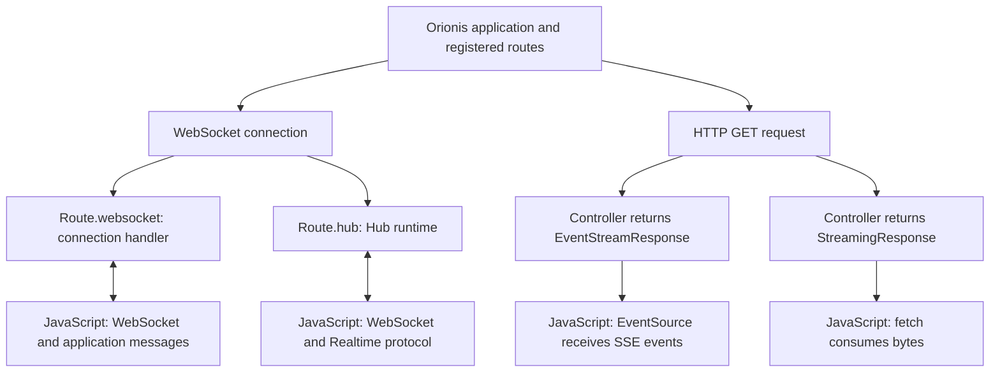

An application can keep a connection open to receive chat messages, update a dashboard, or display an operation's progress. Orionis provides three ways to build these flows. They share the server and routing system, but each defines a different exchange.

This section starts with a project created through the [installation guide](/en/getting-started/installation). The examples explain which files to create, how to register their routes, what to run in Python, and how to connect from a browser.

## Choosing the right flow

| Variant | What you exchange | When to use it |
| --- | --- | --- |
| **Realtime** | Typed method invocations, results, events, and sequences over WebSocket. | Room-based chats, group notifications, and operations that need a correlated response. |
| **WebSocket** | Text or binary messages whose meaning your application defines. | A custom protocol or a bidirectional connection without the hub contract. |
| **SSE** | Text events sent by the server within an open HTTP response. | Job progress, feeds, and dashboards where the browser mainly receives updates. |

**Realtime uses WebSocket as its transport.** A `Hub` adds method names, argument validation, invocation IDs, and recipient selection. A basic WebSocket does not automatically interpret those messages.

**SSE uses HTTP.** The browser opens a GET request through `EventSource` and receives events. You can send a command to the server through another HTTP request; that does not make the SSE channel bidirectional.

### HTTP streaming and Realtime streams

The word *stream* appears in several contexts:

- `StreamingResponse` delivers byte chunks in an HTTP response, such as a CSV.
- `EventStreamResponse` delivers events in SSE format, with fields such as `event`, `data`, and `id`.
- A Realtime method returning an asynchronous sequence produces `stream_item` and `stream_complete` messages within the Hub protocol.

The client must interpret its channel's format. `EventSource` does not consume a Realtime stream, and a `WebSocket` object does not interpret SSE.

## From route to browser

The diagram shows the available variants, not automatic negotiation between them. You select the flow when registering the route and constructing the client.

| Registration | Usual file | Example client |
| --- | --- | --- |
| `Route.websocket(...)` | `routes/websocket.py` | `new WebSocket(...)`. |
| `Route.hub(...)` | `routes/websocket.py` | [`RealtimeClient` from npm](/en/asynchronous/realtime/javascript-client). |
| `Route.get(...)` with an SSE response | `routes/api.py` or `routes/web.py` | `new EventSource(...)`. |

The files must be registered in `app.withRouting(...)`. Their names do not add a URL prefix or replace the registration's protocol. The [routing and lifecycle chapter](/en/asynchronous/realtime/routing-and-lifecycle) includes a complete example.

## What happens during a connection

For **WebSocket**, the kernel reserves capacity, creates a connection scope, and checks the handshake before running its socket middleware. The handler accepts the connection and stays active while exchanging messages. At the end, the connection, its resources, and the scope are closed.

For **Realtime**, the same transport enters `HubRuntime`. The runtime registers the connection, runs `onConnect()`, and, if it can continue, accepts and sends `ready`. Each remote invocation receives a new scope and Hub instance. On disconnection, pending operations are cancelled, the connection and its groups are removed, and `onDisconnect()` runs.

For **SSE**, an ordinary HTTP request runs through its middleware and WEB or API profile. The controller returns a response whose producer is consumed during delivery. The HTTP scope stays available until delivery and cleanup finish. A disconnection cancels SSE production and closes its resources.

The individual guides expand these lifecycles with diagrams, errors, and examples. The kernel does not apply the same pipeline to all three variants.

## Requests, permissions, and state

WebSocket connections and hubs **do not automatically restore an HTTP session or execute API token authentication**. They also do not receive middleware registered through `app.withMiddleware(...)`. They use the shared handshake guards and their route's `WebSocketMiddleware`.

A cookie in the handshake or an allowed origin does not establish an authenticated identity. Establish identity and authorize the operations that require it. The [WebSocket guide](/en/http/websockets) explains that boundary.

SSE preserves the HTTP flow associated with its WEB or API file. [HTTP middleware](/en/http/middleware-and-security) and authentication in that flow remain relevant even when the response body lasts longer than an ordinary request.

Realtime groups select connections; they do not store users, messages, or permissions. The default manager and its memberships belong to the current worker. The [chat example](/en/asynchronous/realtime/chat) uses one worker so its two tabs share the registry; the [deployment guide](/en/asynchronous/realtime/groups-and-deployment) explains the implications of multiple processes.

## Guide path

1. [Routes and lifecycle](/en/asynchronous/realtime/routing-and-lifecycle): prepare files, register endpoints, and distinguish path parameters, messages, and RPC arguments.
2. [Hubs and remote methods](/en/asynchronous/realtime/hubs-and-methods): declare operations, validation, dependencies, and hooks.
3. [JavaScript client](/en/asynchronous/realtime/javascript-client): install and integrate the npm package, then configure reconnection, deadlines, and limits.
4. [Chat with rooms](/en/asynchronous/realtime/chat): build the server and a JavaScript page, open two tabs, and verify broadcasts.
5. [Protocol and streams](/en/asynchronous/realtime/protocol-and-streaming): correlate invocations, process events, consume streams, and handle errors.
6. [Groups and deployment](/en/asynchronous/realtime/groups-and-deployment): select recipients, publish from other components, and configure limits.
7. [WebSocket](/en/http/websockets): implement a connection handler and a client without the Realtime contract.
8. [Streaming and SSE](/en/http/streaming-and-sse): deliver progress and other events, consume the flow, and handle disconnections.

Browser examples use native JavaScript APIs. Run them from an HTTP page of your application, using its server's origin and port. Secure connections use `wss:` for WebSocket and `https:` for SSE.
