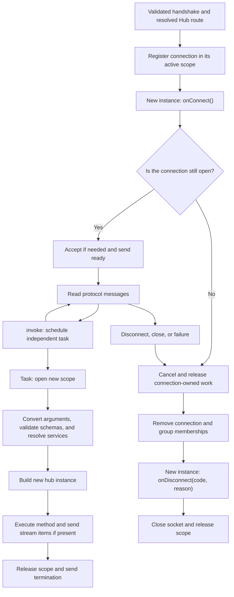

A **Hub** groups operations the browser can invoke and events the server can send to clients. Orionis Realtime uses WebSocket as its transport and adds its own protocol, result correlation, groups, and streams.

The class extends `Hub`. Only instance methods decorated with `@remote` are exposed to clients; public methods without the decorator stay internal.

## Generating a hub with the CLI

Run either alternative from the project root:

```bash
python -B reactor make:realtime-hub chat
```

```bash
orionis make:realtime-hub chat
```

The only argument is the required `name`. With `chat` and the default application paths, the command creates `app/realtime/hubs/chat_hub.py` with this exact content:

```python
from orionis.realtime import Hub, remote

class ChatHub(Hub):
    """Group explicitly exposed realtime operations."""

    @remote
    async def echo(self, message: str) -> str:
        """
        Return the message supplied by the client.

        Parameters
        ----------
        message : str
            Validated text supplied by the realtime client.

        Returns
        -------
        str
            Original client message.
        """
        return message
```

`ChatHub` extends `Hub`. Its only remote operation is `echo`: it receives a validated `str` and returns the same text in a `completion`. The Realtime runtime handles acceptance and the connection lifecycle.

The generator creates missing directories. If the file exists, it reports an error and preserves it; there is no `--force` or other command-specific flag. See `python -B reactor make:realtime-hub --help` or `orionis make:realtime-hub --help`. The [routes and lifecycle](/en/asynchronous/realtime/routing-and-lifecycle) chapter explains names, subdirectories and configurable output paths.

Naming the component `chat` does not generate a complete chat application: the stub adds no rooms, broadcasting or history. The [chat with rooms](/en/asynchronous/realtime/chat) extends this class to implement those operations.

### Register the generated class

Generating the file does not publish an endpoint or start connections. Add this registration to `routes/websocket.py`:

```python
from app.realtime.hubs.chat_hub import ChatHub
from orionis.support.facades import Route

Route.hub("/realtime/echo", ChatHub).name("realtime.echo")
```

Register the **class**, without constructing an instance. The `/realtime/echo` URL lets you test the stub without using the complete chat example's route.

Include the file in the existing `app.withRouting(websocket="routes/websocket.py", ...)` call in `bootstrap/app.py`, before `app.create()`. Keep its other arguments. [Routes and lifecycle](/en/asynchronous/realtime/routing-and-lifecycle) explains files, prefixes, parameters and connection middleware.

| `Route.hub` argument | Purpose |
|---|---|
| `path` | WebSocket URL, supporting the usual router converters. |
| `hub` | Class extending `Hub`. |
| `protocol` | Optional keyword-only argument: `"json"` by default, or `"msgpack"` for binary MessagePack. |

The protocol applies to the entire route; it is not negotiated per message and is separate from the browser WebSocket constructor's `protocols` argument. Orionis prepares hub methods while loading the kernel's handlers.

With the server running, connect a client to `/realtime/echo`. After receiving `ready`, send:

```json
{"type":"invoke","id":"echo-1","target":"echo","args":["Hola"]}
```

The result is:

```json
{"type":"completion","id":"echo-1","result":"Hola"}
```

The [JavaScript client](/en/asynchronous/realtime/protocol-and-streaming) shows how to wait for `ready` and correlate the response.

### Customize a hub: aliases and defaults

To reproduce the next example, generate another component:

```bash
python -B reactor make:realtime-hub math
```

Its equivalent is `orionis make:realtime-hub math`. Replace the generated content in `app/realtime/hubs/math_hub.py` with:

```python
from orionis.realtime import Hub, remote


class MathHub(Hub):

    __slots__ = ()

    @remote(name="sum")
    async def add(self, first: int, second: int = 2) -> int:
        return first + second
```

Add its route to `routes/websocket.py`:

```python
from app.realtime.hubs.math_hub import MathHub
from orionis.support.facades import Route

Route.hub("/realtime/math", MathHub).name("realtime.math")
```

Here the remote name is `sum` and the Python name is `add`. After receiving `ready`, the client sends:

```json
{"type":"invoke","id":"sum-1","target":"sum","args":[3]}
```

The response is `{"type":"completion","id":"sum-1","result":5}`: `second` keeps its default value. The following client examples use this `MathHub`.

## Arguments and accepted values

Annotate every remote parameter. Orionis separates client data from container services.

Data supports `msgspec`-compatible types: scalars such as `str`, `int`, `float`, and `bool`; typed collections; enums; schemas/structures; and other supported types such as dates, `UUID`, or `Decimal`. Conversion and validation happen before the method executes. An HTTP body is not read to resolve an invocation.

Default values make arguments optional. Parameters after `*` can only be supplied through `kwargs`:

```python
from orionis.realtime import Hub, remote


class SearchHub(Hub):

    __slots__ = ()

    @remote
    async def search(
        self,
        term: str,
        *,
        limit: int = 10,
    ) -> dict[str, object]:
        return {"term": term, "limit": limit}
```

With `Route.hub("/realtime/search", SearchHub)`, a valid call is:

```json
{"type":"invoke","id":"search-1","target":"search","args":["Orionis"],"kwargs":{"limit":5}}
```

Do not repeat an argument in `args` and `kwargs`, omit required arguments, or send unknown names. Binding failures produce `invalid_arguments`; invalid types or rules produce `validation_error`.

## Validation with schemas

Use schemas to validate complete objects, including asynchronous rules. For example, save `app/realtime/profile_hub.py`:

```python
from orionis.realtime import Hub, remote
from orionis.schemas import Schema
from orionis.schemas.constraints import MaxLength, MinLength
from orionis.schemas.fields import Field


class ProfileInput(Schema, forbid_unknown_fields=True):

    display_name: Field[str, MinLength(2), MaxLength(40)]


class ProfileHub(Hub):

    __slots__ = ()

    @remote
    async def preview(self, profile: ProfileInput) -> dict[str, str]:
        return {"display_name": profile.display_name}
```

After registering `Route.hub("/realtime/profile", ProfileHub)`, send the object inside `args`:

```json
{"type":"invoke","id":"profile-1","target":"preview","args":[{"display_name":"Ada"}]}
```

Orionis converts the data and runs nested schema rules too. A failure terminates the invocation with `validation_error`; it does not produce an HTTP 422 JSON response or the HTML exception page. The public message is sanitized and does not include individual field errors. See [Validation](/en/validation) to define custom rules.

## Dependency injection

Orionis supports injection into the **hub constructor** and **`@remote` methods**. Use the constructor for a dependency shared by several operations; a method parameter declares a dependency needed by that action.

First create a concrete service in `app/services/message_formatter.py`:

```python
class MessageFormatter:

    __slots__ = ()

    def format(self, text: str) -> str:
        return text.strip()
```

This service can be built without additional configuration: it has no required dependencies that you need to register. Abstract contracts require a container binding to an implementation.

### Constructor and remote methods

Save the following hub in `app/realtime/hubs/preview_hub.py`. The two actions demonstrate each injection form separately:

```python
from app.services.message_formatter import MessageFormatter
from orionis.realtime import Hub, remote


class PreviewHub(Hub):

    __slots__ = ("_formatter",)

    def __init__(self, formatter: MessageFormatter) -> None:
        self._formatter = formatter

    @remote
    async def preview(self, text: str) -> str:
        return self._formatter.format(text)

    @remote
    async def preview_once(
        self,
        text: str,
        formatter: MessageFormatter,
    ) -> str:
        return formatter.format(text)
```

In `__init__()`, Orionis resolves `MessageFormatter` and supplies it when constructing the hub. `preview()` uses that dependency stored in `self._formatter`; its slot allows this subclass to store the attribute.

In `preview_once()`, Orionis identifies `text: str` as client data and `formatter: MessageFormatter` as a service. It converts and validates the text, resolves the service from the container, and executes the method with both arguments. You do not need to instantiate or pass the service when registering the route.

Add this to `routes/websocket.py`:

```python
from app.realtime.hubs.preview_hub import PreviewHub
from orionis.support.facades import Route

Route.hub("/realtime/preview", PreviewHub)
```

With the [JavaScript client installed](/en/asynchronous/realtime/javascript-client), both calls send only the text:

```javascript
import { RealtimeClient } from "@orionis-framework/realtime-client";

const client = new RealtimeClient("/realtime/preview");

try {
    await client.connect();
    console.log(await client.invoke("preview", ["  Hola  "])); // Hola
    console.log(await client.invoke("preview_once", ["  Hola  "])); // Hola
} finally {
    await client.dispose();
}
```

The client **does not send `formatter`**, through either `args` or `kwargs`: it is excluded from remote parameters. Attempting to send it produces `invalid_arguments`.

### Instances, context, and hooks

The runtime constructs a new hub for each invocation. Service lifetime and reuse depend on their bindings: an unregistered concrete class is automatically built, but constructor and method injection are not guaranteed to receive the same object. A `scoped` binding shares one instance within that invocation's scope; another invocation has an independent scope.

`WebSocket` and `HubContext` can also be injected by type into constructors and remote methods. They are already registered in the active scope. However, `self.context`, `self.clients`, and `self.groups` are assigned **after** the constructor executes: use these attributes inside methods and hooks, rather than in `__init__()`.

The `onConnect(self)` and `onDisconnect(self, code, reason)` hooks are called directly with their lifecycle arguments; they do not receive additional dependencies through parameters. If they need a service, inject it through the constructor and use the corresponding attribute. Each hook receives a new hub instance; an attribute stored in `onConnect()` does not automatically survive into invocations or `onDisconnect()`.

Keep annotation classes imported and available when loading the module: Orionis resolves them during compilation. Importing them exclusively inside `TYPE_CHECKING` can prevent this.

Unannotated parameters, positional-only parameters, `*args`, `**kwargs`, and ambiguous unions mixing data and services are rejected. Remote methods must be ordinary instance methods, not `staticmethod`, `classmethod`, or properties. Names and aliases must be public Python identifiers of at most 128 characters, cannot start with `_`, and cannot be duplicated.

## Context and route parameters

| Attribute | Content |
|---|---|
| `self.context.connection_id` | Identifier generated for this connection. It changes after reconnecting. |
| `self.context.socket` | The connection's `WebSocket` object. |
| `self.context.user` | Authentication context identity when starting the hub, or `None`. |
| `self.clients` | Recipient selectors for events or invocations. |
| `self.groups` | `join` and `leave` operations for the current connection. |

A route such as `Route.hub("/realtime/projects/{project_id:int}", ProjectHub)` exposes its parameter as follows:

```python
from orionis.realtime import Hub, remote


class ProjectHub(Hub):

    __slots__ = ()

    @remote
    async def current(self) -> dict[str, int]:
        project_id = self.context.socket.routeParams()["project_id"]
        return {"project_id": project_id}
```

`project_id` is already an `int`. It is not automatically injected as a remote argument: declaring `current(self, project_id: int)` would make it part of the client's invocation data.

The WebSocket handshake does not automatically apply HTTP session, CSRF, or identity-resolution layers. For authenticated users, configure WebSocket middleware to resolve identity and authorize access. Shared cookies or `@remote` alone do not authenticate; groups do not replace permissions either.

## Lifecycle and instances

Orionis creates an instance for `onConnect()`, a new one for **every invocation**, and another for `onDisconnect()`. Do not store state shared across calls in hub attributes. Use `self.context.socket.state` for connection-local data and services/storage for persistent data.



`onConnect()` runs before `ready`. It can join groups or reject the handshake with `await self.context.socket.reject(403)`. It does not need to call `accept()`: the runtime does that afterward if acceptance is still pending. Event recipients only include ready connections; you cannot yet wait for a result with `self.clients.caller.invoke(...)` in this hook.

`onDisconnect(code, reason)` runs after removing the connection from the registry and its groups. It has a five-second limit; failures are logged without preventing the attempt to close the socket. Use it to release application resources idempotently, without sending a final event to the disconnected client.

Invocations can run concurrently, each with its own scope and a copy of the connection's authentication context. Do not assume they finish in arrival order.

## Responses and business errors

A method returns a protocol-serializable value, not an HTTP response such as `JSONResponse`. A compatible schema/structure, scalar, collection, or `None` travels in `completion`. An asynchronous iterable produces a stream.

For a business rejection:

```python
from orionis.realtime import Hub, remote
from orionis.realtime.errors import RPCError


class OrderHub(Hub):

    __slots__ = ()

    @remote
    async def cancel(self, order_id: int) -> dict[str, int]:
        if order_id == 42:
            raise RPCError("order_closed", "This order is already closed")
        return {"cancelled": order_id}
```

With `Route.hub("/realtime/orders", OrderHub)`, canceling `42` returns code `order_closed`. The runtime keeps the code and replaces its text with `"Invocation failed"`; it does not automatically transmit the `RPCError` message or traceback. Clients can translate codes into their own messages. Unexpected failures produce `internal_error`. See the [protocol reference](/en/asynchronous/realtime/protocol-and-streaming) for other codes.
