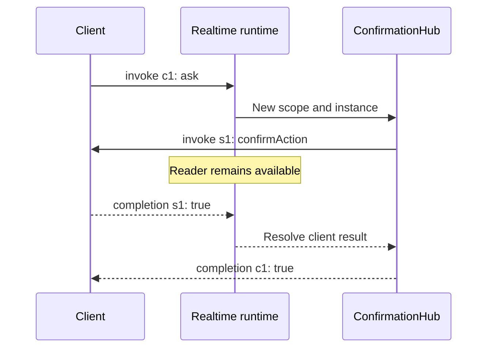

Realtime uses the **Orionis Realtime v1 protocol** over WebSocket. Opening the socket is not enough: clients must await `ready`, correlate operations with identifiers, and distinguish events, results, and streams.

The [JavaScript client](/en/asynchronous/realtime/javascript-client), published on npm as `@orionis-framework/realtime-client`, implements these messages and manages limits, deadlines, and reconnection. This page explains the protocol and provides complete stream and bidirectional-result examples.

## Protocol messages

With JSON, every envelope is an object sent as text. The `protocol="msgpack"` alternative uses the same fields encoded as binary MessagePack; the browser would need a compatible MessagePack codec. `JSON.parse` cannot decode that route.

| Message | Direction and purpose |
|---|---|
| `ready` | Server → client: `version: 1` and `connection_id`. Enables invocations. |
| `invoke` | Client → server: `id`, `target`, `args`, `kwargs`, and optional `timeout`. Server → one client: requests a result with `id`, `target`, and `args`. |
| `completion` | Scalar result or error with the same `id`. Also answers a server invocation. |
| `send` | Server → client: `target` event and `args` list, without an expected result. |
| `stream_item` | Server → client: `id` and `item` for an invocation producing a sequence. |
| `stream_complete` | Server → client: ends a stream with `id` and `error` on failure. |
| `cancel` | Client → server: requests cancellation of the active invocation identified by `id`. |
| `ping` / `pong` | Application messages without `id`; a client `ping` receives `pong`. |

A complete scalar call:

```json
{"type":"invoke","id":"call-1","target":"sum","args":[2,3],"kwargs":{},"timeout":10}
```

```json
{"type":"completion","id":"call-1","result":5}
```

An error instead of a result:

```json
{"type":"completion","id":"call-1","error":{"code":"validation_error","message":"Invocation failed"}}
```

`args` and `kwargs` are optional in an `invoke` and default to empty lists/dictionaries. An omitted or `null` timeout uses runtime policy. A client `completion` must include **exactly one** of `result` or `error`; `result: null` is valid.

Incoming envelopes reject unknown fields. IDs must contain 1–128 printable ASCII characters without spaces. At most 64 positional and 64 named arguments are allowed. An ID cannot be reused while its call remains active; use a new one for each operation.

## Invoke using the npm package

Install the package in your frontend:

```bash
npm install @orionis-framework/realtime-client
```

The JavaScript examples on this page are browser modules processed by a bundler that resolves the npm import. For HTML with `<script type="module">` without a bundler, follow [Serve the module from Orionis](/en/asynchronous/realtime/javascript-client#serve-the-module-from-orionis) and change only the import source to `"/assets/orionis-realtime.js"`.

Connect to `MathHub` from the [Hubs](/en/asynchronous/realtime/hubs-and-methods) chapter:

```javascript
import { RealtimeClient } from "@orionis-framework/realtime-client";

const url = new URL("/realtime/math", location.href);
url.protocol = location.protocol === "https:" ? "wss:" : "ws:";
const client = new RealtimeClient(url);

try {
    await client.connect();
    console.log(await client.invoke("sum", [2, 3])); // 5
} catch (error) {
    console.error(error.code, error.message);
} finally {
    await client.dispose();
}
```

`args` contains call data only, without injected services. Use `kwargs` for named arguments, for example `client.invoke("search", ["Orionis"], { kwargs: { limit: 5 } })` with `SearchHub` from the previous chapter. Register events with `client.on("message", ([message]) => { ... })`: the callback receives the argument array.

## Streams: operation progress

A method returning an asynchronous iterable produces `stream_item` and ends with `stream_complete` instead of returning a complete list in `completion`. Save `app/realtime/feed_hub.py`:

```python
import asyncio
from collections.abc import AsyncIterator
from orionis.realtime import Hub, remote
from orionis.realtime.errors import RPCError


class FeedHub(Hub):

    __slots__ = ()

    @remote
    async def updates(self, count: int) -> AsyncIterator[int]:
        if not 1 <= count <= 100:
            raise RPCError("invalid_count", "Count must be between 1 and 100")
        for value in range(count):
            await asyncio.sleep(0.5)
            yield value
```

Register the route in `routes/websocket.py`:

```python
from app.realtime.feed_hub import FeedHub
from orionis.support.facades import Route

Route.hub("/realtime/feed", FeedHub)
```

With the package installed in the frontend, this client receives three items:

```javascript
import { RealtimeClient } from "@orionis-framework/realtime-client";

const url = new URL("/realtime/feed", location.href);
url.protocol = location.protocol === "https:" ? "wss:" : "ws:";
const client = new RealtimeClient(url);

try {
    await client.connect();
    for await (const item of client.stream("updates", [3], { timeoutMs: 10000 })) {
        console.log("Progress:", item);
    }
    console.log("Stream finished");
} catch (error) {
    console.error(error.code, error.message);
} finally {
    await client.dispose();
}
```

The server sends `0`, `1`, and `2` with the call ID, then `stream_complete`. `timeoutMs` limits the iterator's total lifetime locally. The server has no default stream lifetime deadline; request one using `serverTimeout` in seconds within `REALTIME_INVOCATION_TIMEOUT`.

Production awaits delivery of each item before advancing. If the generator opens resources, close them in `finally`: Orionis requests `aclose()` when available and releases the scope before sending termination. Cancellation, validation, and business errors terminate declared streams with `stream_complete.error`.

### Cancel a sequence

With `FeedHub`, an `AbortSignal` cancels the operation after 1.2 seconds:

```javascript
import { RealtimeClient } from "@orionis-framework/realtime-client";

const url = new URL("/realtime/feed", location.href);
url.protocol = location.protocol === "https:" ? "wss:" : "ws:";
const client = new RealtimeClient(url);
const controller = new AbortController();
let cancellationTimer;

try {
    await client.connect();
    cancellationTimer = setTimeout(() => controller.abort(), 1200);
    const stream = client.stream("updates", [100], {
        signal: controller.signal,
        timeoutMs: 0,
    });
    for await (const item of stream) console.log(item);
} catch (error) {
    console.log(error.code); // aborted for a local AbortSignal cancellation
} finally {
    clearTimeout(cancellationTimer);
    await client.dispose();
}
```

The client rejects locally with `aborted` on cancellation. You can also call `stream.cancel()` or leave `for await` with `break`, which calls `return()`. If the server rejects stream admission before execution, it can return `completion.error`; the client recognizes this case too.

`cancel` affects only an operation still active on that connection. Unknown IDs are ignored; cancellation does not roll back completed effects. Cooperative cancellation attempts to send a termination with code `cancelled` if the connection remains open.

## Invoke a browser method

To request a client decision, save `app/realtime/confirmation_hub.py`:

```python
from orionis.realtime import Hub, remote


class ConfirmationHub(Hub):

    __slots__ = ()

    @remote
    async def ask(self) -> object:
        return await self.clients.caller.invoke(
            "confirmAction",
            {"question": "Do you want to continue?"},
            timeout=5.0,
        )
```

Register `Route.hub("/realtime/confirmation", ConfirmationHub)`. In the browser:

```javascript
import { RealtimeClient } from "@orionis-framework/realtime-client";

const url = new URL("/realtime/confirmation", location.href);
url.protocol = location.protocol === "https:" ? "wss:" : "ws:";
const client = new RealtimeClient(url);
client.handle("confirmAction", ([{ question }], { signal }) => {
    if (signal.aborted) return false;
    return window.confirm(question);
});

try {
    await client.connect();
    console.log("Confirmed:", await client.invoke("ask"));
} catch (error) {
    console.error(error.code, error.message);
} finally {
    await client.dispose();
}
```

The handler receives an argument array and a context containing `signal` and `connectionId`. The client bounds its concurrency and deadline. Cancellation is cooperative: a blocking synchronous dialog cannot be interrupted by the timer; use an asynchronous interface honoring `signal` for longer interactions.

`ask` waits while the server reader keeps receiving messages. The browser answers the server's `invoke` with a correlated `completion`; the result then reaches the original call.



Only `self.clients.caller` and `self.clients.client(id)` support `invoke`. Its timeout covers sending and awaiting the result; the default is `REALTIME_CLIENT_RESULT_TIMEOUT`. The pending-result limit applies per connection.

A browser error becomes `ClientInvocationError` with code `client_error` and a sanitized message, without propagating arbitrary client text into diagnostics. Because it extends `RPCError`, an unhandled instance in a hub method terminates the original call with `client_error` and the public message `"Invocation failed"`. Unknown, late, or duplicate completions are ignored.

## Errors and deadlines

| Code | Situation |
|---|---|
| `method_not_found` | `target` is not a `@remote` method. |
| `invalid_arguments` | Missing, duplicate, unknown arguments, or a deadline above the allowed value. |
| `validation_error` | Invalid types, constraints, or schema rules. |
| `busy` | Connection concurrent-invocation capacity was reached. |
| `unauthorized` | The method raised `AuthenticationException`. |
| `forbidden` | The method raised `AuthorizationException`. |
| `timeout` | Execution exceeded its deadline. |
| `cancelled` | The active invocation was canceled. |
| `client_error` | A browser method answered with an error that the hub did not handle. |
| `internal_error` | Unexpected exception or a result that could not be serialized. |
| `RPCError` code | Deliberate application-defined rejection. |

Codes other than `internal_error` receive `"Invocation failed"`; `internal_error` receives `"Internal server error"`. Even custom `RPCError` messages are replaced. Translate codes into your own interface explanations.

Ordinary calls use `REALTIME_INVOCATION_TIMEOUT` unless another deadline is requested. An explicit `timeout` must be finite, positive, and no greater than that value. The deadline governs the operation; terminal delivery happens after cleanup and is not an overall network-latency limit.

HTML pages and HTTP 422 responses are not generated inside the protocol. Invocation failures can end a call while keeping the connection open; malformed envelopes are connection failures.

## Closure, heartbeat, and codecs

| Condition | Closure requested by Realtime |
|---|---|
| Invalid envelope or duplicate active ID | `1002`: protocol error. |
| Text on a MessagePack route or bytes on a JSON route | `1003`: incompatible message kind. |
| Incoming size exceeds the limit | `1009`: message too large. |
| Unrecoverable connection failure | `1011` when the transport supports details. |

Close details depend on the adapter: RSGI does not expose all ASGI capabilities and may use `1000`. See [WebSocket](/en/http/websockets).

You can send `{"type":"ping"}` and process `{"type":"pong"}`. These are application messages; they do not create an automatic heartbeat task or guarantee persistence. The JavaScript client manages that timer and its response deadline; the runtime does not initiate periodic heartbeat itself. WebSocket transport pings are a separate mechanism.

Reconnecting requires another `ready`, reconstructing room selections, and reconciling business state. Read [Groups and deployment](/en/asynchronous/realtime/groups-and-deployment) for limits and per-worker scope.
