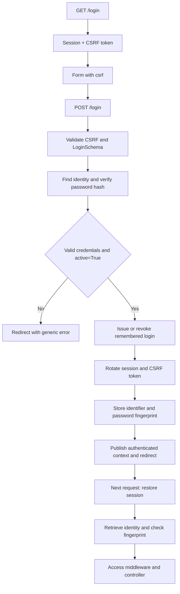

Session authentication is intended for web applications where the browser retains a session cookie. The `session` guard restores the identity from server-side storage and exposes it for the request; the session cookie does not contain the user model or its password.

This guide uses the defaults in `config/auth.py`. See [configuration and guards](/en/authentication/configuration-and-guards) when changing the model, login field or redirect destinations.

## Prepare the identity and password

The model configured in `auth.identity.model` must implement `IAuthenticatable`. For an ORM model, use the `Authenticatable` mixin: it reads the primary key from model metadata and the password hash from `AUTH_PASSWORD`, which defaults to `"password"`.

The reference application already defines its table in `database/schemas/users_v1.py` and its model in `app/models/user.py`:

```python
from typing import ClassVar

from database.schemas.users_v1 import USERS_V1
from orionis.auth import Authenticatable, Authorizable, MustVerifyEmail
from orionis.orm import Model
from orionis.orm.schema.table import TableDefinition


class User(Model, Authenticatable, Authorizable, MustVerifyEmail):
    table_definition: TableDefinition = USERS_V1

    casts: ClassVar[dict[str, str]] = {
        "active": "bool",
        "email_verified_at": "datetime",
    }
    hidden: ClassVar[list[str]] = ["password", "remember_token"]
    fillable: ClassVar[list[str]] = ["name", "email", "password", "active"]
```

Adapt the existing model; a second user model is unnecessary. Its table and migration must exist on the configured database connection. The relevant fields are:

| Field | Purpose |
| --- | --- |
| Primary key, usually `id` | Identifier persisted in the session. Integer, UUID and text keys are supported. |
| `email` | Default lookup field; change it through `auth.identity.username`. |
| `password` | Password hash. Change its attribute name through `User.AUTH_PASSWORD`. The credential key submitted to `attempt()` remains `"password"`. |
| `active` | `attempt()` and persistent-login restoration require the boolean `True`. The cast matters when a driver returns numeric values. |
| `remember_token` | Nullable column used for persistent login; the reference schema allocates 100 characters. |

`Authorizable` adds role, permission and token operations; `MustVerifyEmail` adds email verification behavior. Neither replaces `Authenticatable`. See [authorization](/en/authentication/authorization) and [registration and recovery](/en/authentication/account-recovery).

The identity provider looks up only the configured username field and verifies the password using the hashing service. Adding `{"active": True}` or other filters to the credentials does not add query conditions.

When creating an account, persist the result of `await Hash.make(...)`. For example, in `app/services/account_creator.py`:

```python
from app.models.user import User
from orionis.support.facades import Hash


class AccountCreator:
    async def create(self, name: str, email: str, password: str) -> User:
        return await User.create({
            "name": name,
            "email": email,
            "password": await Hash.make(password),
            "active": True,
        })
```

This service assumes already validated input and does not implement a complete registration or email verification workflow. Assigning a password does not hash it automatically. See [password storage](/en/cryptography/hashing/password-storage) for algorithm and cost settings.

## Build a login form and controller

The following example defines its own routes. If your `routes/web.py` already calls `Route.auth()`, use the [built-in alternative](#use-the-built-in-routes) or replace those definitions before copying this example, to avoid duplicate `/login` and `/logout` routes.

### Validate credentials

Create `app/http/schemas/auth/login.py`:

```python
from orionis.schemas import Schema
from orionis.schemas.constraints import Email, MinLength
from orionis.schemas.fields import Field, Nullable


class LoginSchema(Schema):
    email: Field[str, Email()]
    password: Field[str, MinLength(8)]
    remember: Nullable[str] = None
```

The kernel validates the payload and injects `LoginSchema` into the action. A checked HTML checkbox submits `"on"`; an unchecked checkbox omits the field. The example therefore compares that value explicitly instead of converting any string to `bool`. See [validation](/en/validation).

### Handle login, the private page and logout

Create `app/http/controllers/auth/session_controller.py`:

```python
from app.http.schemas.auth.login import LoginSchema
from orionis.http import HttpResponse, response
from orionis.http.base import BaseController
from orionis.support.facades import Auth, View


class SessionController(BaseController):
    async def loginForm(self) -> HttpResponse:
        return await View.make("auth.login")

    async def login(self, payload: LoginSchema) -> HttpResponse:
        authenticated = await Auth.attempt(
            {"email": payload.email, "password": payload.password},
            remember=payload.remember == "on",
        )
        if not authenticated:
            return (
                response.redirect("/login", 303)
                .withInput({"email": payload.email})
                .withErrors({"email": "These credentials do not match our records."})
            )
        return response.redirect("/home", 303)

    async def home(self) -> HttpResponse:
        return await View.make("auth.home", user=Auth.user())

    async def logout(self) -> HttpResponse:
        await Auth.logout()
        return response.redirect("/login", 303)
```

`Auth.attempt()` returns a `bool`, not the user. After it returns `True`, `Auth.user()` and `Auth.identifier()` already expose the identity in that same request. The example uses the same error for an unknown username, incorrect password or inactive account. Only the email is retained for filling the form again.

### Register web routes

In `routes/web.py`:

```python
from app.http.controllers.auth.session_controller import SessionController
from orionis.auth.middleware import AuthenticateSessionMiddleware, GuestMiddleware
from orionis.support.facades import Route


Route.group(middleware=GuestMiddleware, routes=[
    Route.get("/login", [SessionController, "loginForm"]).name("login"),
    Route.post("/login", [SessionController, "login"]),
])

Route.group(middleware=AuthenticateSessionMiddleware, routes=[
    Route.get("/home", [SessionController, "home"]).name("home"),
    Route.post("/logout", [SessionController, "logout"]).name("logout"),
])
```

The web pipeline already starts the session, validates CSRF and resolves the identity. `GuestMiddleware` restricts the form to guests. `AuthenticateSessionMiddleware` requires authentication before private actions run; identity resolution alone permits guests. Logout is a POST operation protected by CSRF.

### Create the views

Save the form as `resources/views/auth/login.html`:

```jinja
<!doctype html>
<html lang="en">
<head>
    <meta charset="utf-8">
    <title>Sign in</title>
</head>
<body>
    <h1>Sign in</h1>
    
        <p role="alert">{{ errors.first("email") }}</p>
    
    <form method="post" action="/login">
        
        <label>
            Email
            <input type="email" name="email" value="{{ old('email', '') }}"
                   autocomplete="username" required>
        </label>
        <label>
            Password
            <input type="password" name="password" minlength="8"
                   autocomplete="current-password" required>
        </label>
        <label>
            <input type="checkbox" name="remember">
            Remember me
        </label>
        <button type="submit">Sign in</button>
    </form>
</body>
</html>
```

And the private page as `resources/views/auth/home.html`:

```jinja
<!doctype html>
<html lang="en">
<head>
    <meta charset="utf-8">
    <title>Account</title>
</head>
<body>
    <h1>Hello, {{ user.name }}</h1>
    <p>Account identifier: {{ auth().identifier() }}</p>
    <form method="post" action="/logout">
        
        <button type="submit">Sign out</button>
    </form>
</body>
</html>
```

Open `/login`, enter an existing account with a hashed password and submit the form. After success, the GET redirect to `/home` uses the new session cookie and renders a new CSRF token. For JavaScript requests to these routes, retain cookies and send that token in `X-CSRF-Token` or an `_csrf` field; the token issued before login is no longer valid.

The `auth()`, `old()` and `errors` helpers and `` tag are included in the view engine. See [view globals](/en/views/globals) for their variants.

## What the session guard does

`SessionGuard` implements `ISessionGuard` and uses the session attached to `request.state.session`. It does not create a separate authentication store.



Login rotates the session identifier, stores the user's key and a fingerprint of the password hash, and generates a new CSRF token. On the next request, the guard queries the identity again and checks that fingerprint. If the user no longer exists or its hash changed, it removes the authentication data and attempts to restore a valid remembered login, if present.

`active` is checked when validating credentials and restoring a remembered login. Restoring an already authenticated session checks the identity and fingerprint without an additional `active` check. If your application must immediately block existing sessions based on business state, enforce that condition through an [access middleware](/en/authentication/middleware) as well.

## Persistent login: remember me

`remember=True` allows authentication to be restored when the session no longer contains an identifier. This credential is separate from the regular session cookie and is issued only after `attempt()` verifies the password.

Configure it through `auth.remember` in `config/auth.py`:

| Option | Default | Effect |
| --- | --- | --- |
| `cookie` | `"orionis_remember"` | Persistent cookie name; it must differ from the session cookie. |
| `lifetime` | `43200` minutes | Remembered login deadline, equivalent to 30 days. |
| `secure` | `True` | Requires HTTPS to issue and restore the credential. |

With the defaults, you can test a regular login over local HTTP **without checking** “Remember me”. Checking the option requires HTTPS. Exclusively for local HTTP testing, set `AUTH_REMEMBER_SECURE=bool:false` in that environment file; see [configuration](/en/authentication/configuration-and-guards). This is distinct from `SESSION_SECURE`, which configures the other cookie.

The actual behavior is:

1. After verifying credentials and `active`, the remember component generates a random secret and stores its digest in `remember_token`, bound to the user, expiration and password hash.
2. The browser receives a host-only, `HttpOnly`, `SameSite=Lax` cookie with path `/` and a `Max-Age` based on the configured lifetime.
3. Without a session identity, the guard validates the cookie and digest, rotates the secret and starts a new authenticated session. Rotation preserves the original deadline: browsing does not extend the 30-day period indefinitely.
4. A new login with `remember=True` replaces the user's previous remembered credential. There is one digest per identity, not a separate registry per device.
5. Successful login with `remember=False` revokes the stored remembered credential and expires its cookie. `logout()` also revokes it and removes the cookie.
6. Changing the password hash invalidates the old remembered credential because its digest is bound to that hash.

The provider must be able to update `remember_token`; a missing column or persistence failure prevents issuance and raises `AuthException`. Do not read or construct the cookie manually.

## Read the identity and use dependency injection

Always import the facade from `orionis.support.facades`. These reads are synchronous:

| Call | Result |
| --- | --- |
| `Auth.user()` | The request's `IAuthenticatable` or `None`. |
| `Auth.identifier()` | The identity's primary key or `None`. |
| `Auth.check()` | `True` when the request is authenticated. |
| `Auth.guest()` | `True` for a guest request. |
| `Auth.context()` | The current authentication context. |

The API is named `identifier()`; there is no `Auth.id()` alias. Any component executing within the request scope can read the identity. Do not retain a request's user in a global variable or shared service.

Injecting `IAuthManager` is an alternative to the facade. Inject `IAuthenticationContext` to inspect the identity resolved for that request. For example, create `app/http/controllers/session_status_controller.py`:

```python
from orionis.auth.contracts import IAuthenticationContext, IAuthManager
from orionis.http import JSONResponse, response
from orionis.http.base import BaseController


class SessionStatusController(BaseController):
    def __init__(self, auth: IAuthManager) -> None:
        self.auth = auth

    async def show(self, context: IAuthenticationContext) -> JSONResponse:
        return response.json({
            "authenticated": self.auth.check(),
            "identifier": self.auth.identifier(),
            "guard": context.guard,
        })
```

Register the action in `routes/web.py`:

```python
from app.http.controllers.session_status_controller import SessionStatusController
from orionis.auth.middleware import AuthenticateSessionMiddleware
from orionis.support.facades import Route


Route.get("/account/session", [SessionStatusController, "show"]).middleware(
    AuthenticateSessionMiddleware,
)
```

The constructor receives the manager and the action receives the context through their annotations. Both consult the same request; there is no need to construct them or pass `Request` manually. `await auth.attempt(...)`, `await auth.login(identity)` and `await auth.logout()` have the same contract as their `Auth` equivalents.

## Sign in an already verified identity and sign out

`await Auth.login(identity)` starts a session for a persisted identity your application has verified through another trusted workflow. **It does not verify a password or `active` and does not issue a remembered credential**; do not call it with an unverified client-supplied identifier.

Unlike the synchronous low-level `SessionGuard.login(request, identity)` method, the manager's public method is asynchronous: it coordinates the operation and immediately publishes the new context.

`await Auth.logout()` revokes the remembered credential, removes the identifier and fingerprint, invalidates the session and makes the current context a guest. Web middleware applies cookie deletion to the response. Deleting a variable, removing a cookie through JavaScript or redirecting to `/login` does not perform this lifecycle.

The manager's `attempt()`, `login()` and `logout()` always use the session guard, even if `auth.default` is `"token"`. They require an active HTTP request; login additionally requires the web pipeline's session. For API clients, use [access tokens](/en/authentication/personal-access-tokens).

## Use the built-in routes

If you prefer the included screens and controllers, register once in `routes/web.py`:

```python
from orionis.support.facades import Route


Route.auth()
```

This helper adds login/logout, registration, email verification and password recovery. It does not automatically protect your other pages: apply `AuthenticateSessionMiddleware` where appropriate.

Customize the login controller through `Route.auth(login_controller=LoginController)`; it must provide the `index`, `login` and `logout` actions used by the helper. This page's manual example uses `loginForm`, so it cannot be passed directly as that replacement.

See the [built-in routes and screens](/en/authentication/account-recovery) and [authentication middleware](/en/authentication/middleware).
