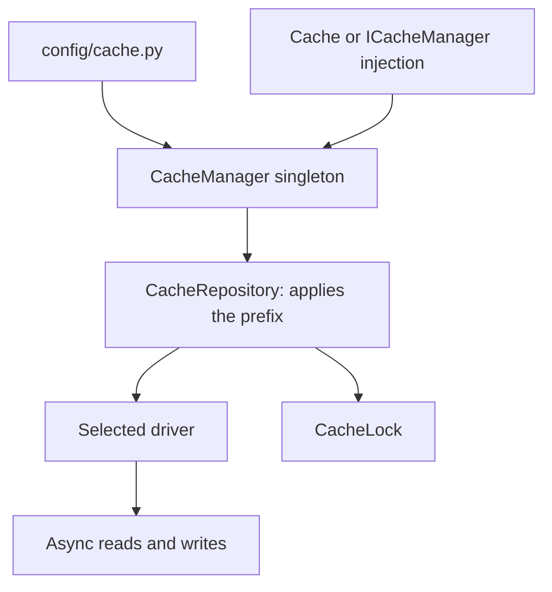

Cache results you can reconstruct: frequent queries, summaries or expensive calculations. Decide how long a value may become stale and when to invalidate it. The database keeps permanent information; caching avoids repeated work.

## First operation from a controller

The default file store works with the normal Orionis installation. Set these application environment values before startup:

```dotenv
CACHE_STORE=file
CACHE_PREFIX=my-app
```

Its default directory is `storage/framework/cache/data`; the application process needs write access there. No Redis server or additional Python cache package is needed. Import the facade from `orionis.support.facades`. Save this controller in `app/http/controllers/cache_example_controller.py`:

```python
from orionis.http import JSONResponse
from orionis.support.facades import Cache


class CacheExampleController:
    async def __call__(self) -> JSONResponse:
        key = "catalog:summary:v1"
        await Cache.set(key, {"products": 42}, ttl=300)
        return JSONResponse(await Cache.get(key))
```

Register its action in the configured route file:

```python
from app.http.controllers.cache_example_controller import CacheExampleController
from orionis.support.facades import Route

Route.get("/cache-example", CacheExampleController)
```

The dictionary is cached for five minutes. Once expired or deleted, `get()` returns `None`. To calculate only on a miss, use `remember()` in the [operations guide](/en/cache/caching-values#repository-remember).

## Service architecture



The manager selects one of five native stores and retains its repository. The facade delegates to the same service resolved by the container. Value operations are asynchronous; the `store()` and `lock()` factories are synchronous. If your first facade operation selects a store, resolve `cache = await Cache.resolve()` first, then call `cache.store("memory")`. Its provider is deferred: importing `Cache` or booting the application does not guarantee resolution. Asynchronous calls such as `await Cache.get(...)` resolve it when awaited.

`FileBasedCache` is a separate synchronous API for artifacts derived from source files. It is not the `file` driver and does not use its TTL or prefix.

## Continue with the guides

- [Drivers and dependencies](/en/cache/stores-and-drivers): advantages, limits and external services for all five options.
- [Configuration](/en/cache/configuration): every property, environment variable and default.
- [Storing and regenerating values](/en/cache/caching-values): complete repository API, TTL, batches and counters.
- [Locks and concurrency](/en/cache/locks): contexts, waiting and each backend's guarantees.
- [Source-derived artifacts](/en/cache/source-artifacts): source invalidation and enriched serialization.
- [Facade and injection](/en/cache/manager-and-injection): controllers, services and providers.
- [Technical reference](/en/cache/api-reference): contracts, backends, factories and errors.
