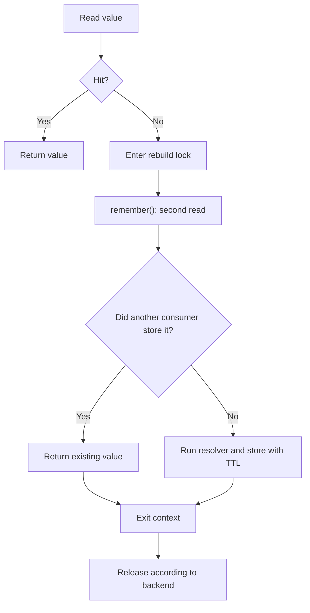

A cache lock coordinates consumers using the same key, store, and prefix. Its scope depends on the backend: `file` coordinates tasks within one event loop; others use leases or database rows with different guarantees. It does not turn a cache sequence into a business transaction.

See [stores](/en/cache/stores-and-drivers) and [configuration](/en/cache/configuration) to choose a backend. This page explains actual lock behavior and how to reduce duplicate rebuilding.

## Obtain a lock

<a id="lock-construction"></a>
Concrete implementations expose these signatures:

```text
CacheManager.lock(key: str, timeout: float | None = None) -> Any
CacheRepository.lock(key: str, timeout: float | None = None) -> CacheLock
CacheLock(backend: Any, key: str, timeout: float | None = None) -> None
```

`CacheManager.lock()` uses the default store. `CacheRepository.lock()` uses the selected store and prepends the repository key prefix. Both construct an object synchronously: **they do not acquire yet**. The `CacheLock` constructor takes an internal backend; normally you do not need to construct it directly.

Resolve the manager before obtaining a synchronous repository: `cache = await Cache.resolve()`, followed by `cache.store("file")`. This also works when the deferred provider has not resolved yet. Do not chain `Cache.store(...).lock(...)` on the assumption that the facade is already pinned. See [manager and injection](/en/cache/manager-and-injection).

`ICacheManager` and `ICacheRepository` do not declare `lock()`, although concrete classes implement it. `CacheLock` has no public `acquire()`, `release()`, `forceRelease()`, lease-renewal, or owner-query API. Acquisition and release use the asynchronous context protocol.

<a id="lock-context"></a>
### Enter and leave the context

```text
async __aenter__() -> Self
async __aexit__(
    exc_type: type[BaseException] | None,
    exc_val: BaseException | None,
    exc_tb: types.TracebackType | None,
) -> None
```

`async with repository.lock(key, timeout=...) as acquired` returns the same `CacheLock` instance, not a boolean confirming distributed ownership. The block begins when its backend acquisition strategy finishes. Exit releases according to that strategy, including after an exception, without suppressing it. An entry failure prevents the block from running and does not invoke its `__aexit__()`.

### Update a value under a file lock

This controller coordinates tasks within the same event loop and cache directory. Its read/write sequence shares an application lock; other writers must use the same key to participate:

```python
from orionis.http import JSONResponse
from orionis.support.facades import Cache


class RefreshCounterController:
    async def refresh(self) -> JSONResponse:
        cache = await Cache.resolve()
        repository = cache.store("file")
        try:
            async with repository.lock("reports:refresh-counter", timeout=2.0):
                current = await repository.get("reports:refresh-count")
                updated = int(current or 0) + 1
                await repository.set("reports:refresh-count", updated, ttl=60)
                return JSONResponse({"refreshes": updated})
        except TimeoutError:
            return JSONResponse(
                {"error": "Refresh is busy; retry later"},
                status_code=503,
                headers={"Retry-After": "2"},
            )
```

Save it in `app/http/controllers/refresh_counter_controller.py` and map a POST route to `refresh`. The `except` handles a `TimeoutError` from the entire context; if you introduce operations with their own timeouts inside the block, distinguish those failures when they require another response. A lock does not roll back `set()` if a later operation fails.

<a id="lock-timeouts"></a>
## What timeout means for each backend

A **waiting deadline** limits how long a consumer waits to enter. A **lease** limits an owner's reservation; after expiry, its code can continue while another consumer enters. This API uses one `timeout` argument and does not expose these controls separately.

| Store | Implementation and scope | `timeout=None` | Positive `timeout` |
| --- | --- | --- | --- |
| `file` | `asyncio.Lock` per event loop, canonical directory, and prefixed key. | Waits without a deadline; no automatic lease. | Limits `acquire()` waiting, not block duration. |
| `database` | Row with unique key, owner, and expiry in the configured table. | Waits without a deadline, with a 10-second lease. | Both waiting deadline and lease after acquisition. |
| `memory` | `aiocache.RedLock` over the process's cache instance. | 10-second lease. | Lease and local-event waiting; contention expiry does not raise an error. |
| `redis` | `aiocache.RedLock` over one Redis instance. | 10-second lease. | The same RedLock strategy; not strict resource exclusion. |
| `memcached` | `aiocache.RedLock` releasing without atomic owner comparison. | 10-second lease. | The same RedLock strategy; use whole seconds accepted by its client. |

Use a strictly positive value or `None`. No shared validation normalizes all values: `0` does not portably mean “attempt without waiting.” File can raise `TimeoutError` even when free; database makes one attempt with a 10-second lease before checking its deadline; RedLock substitutes 10 seconds for `0`. Negative values also lack uniform useful meaning.

The Memcached client can reject a `float` expiration; use `timeout=5` rather than `5.0`. Redis converts floating leases into milliseconds; avoid values so small that they become zero. These timings are independent of cached-data TTL and client network-operation timeouts.

<a id="lock-file"></a>
### File: application-lock scope

Objects addressing the same resolved directory, key, and event loop share an `asyncio.Lock`. Different directories or event loops do not share that lock. The registry uses weak references so unused locks do not accumulate.

The file backend also uses internal `FileLock` objects for certain atomic file mutations. Those can coordinate processes during one operation, but **do not extend** `repository.lock()` to protect an entire block across workers. Keep these two levels distinct.

<a id="lock-database"></a>
### Database: owner and expiry

```text
async acquireLock(key: str, owner: str, lease: float) -> bool
async releaseLock(key: str, owner: str) -> None
```

Acquisition generates a UUID token and calls `DatabaseCacheBackend.acquireLock(key, owner, lease)`. The backend tries inserting a row; an existing row may be updated only if self-owned or expired. It returns `True` when acquired and `False` when still occupied. `CacheLock` retries every 0.05 seconds until success or detection of deadline expiry; it guarantees neither FIFO order nor an exact waiting bound excluding I/O time.

The lease uses the acquiring process's `time.time()`. Sharing the connection, table, and key can coordinate consumers across processes while the lease is valid; account for their clocks and operation duration. The lease does not renew automatically. The backend requires enforced unique constraints and rejects connections without them, such as Redshift.

`releaseLock(key: str, owner: str) -> None` deletes a row only while it still belongs to that owner. If a lease expired and another consumer acquired it, the first consumer's exit cannot remove the second reservation. The public object does not expose its token; do not transfer ownership through private attributes.

Both backend primitives are asynchronous and sit behind the context; you do not need to call them when using `repository.lock()`. Update, release, or connection errors can propagate. During acquisition, an INSERT `QueryException` leads to an UPDATE attempt; when it changes no rows, acquisition can return `False` instead of exposing the original error. The implementation does not coordinate your business transaction with its lock row.

<a id="lock-redlock"></a>
### Memory, Redis, and Memcached: RedLock behavior

The installed `aiocache.RedLock` implementation tries adding a `-lock` suffixed key, random token, and lease. If occupied, it waits for a **process-local** event. It does not retry key acquisition after that wait.

Verified consequences:

- Lease/wait expiry can admit all waiting consumers simultaneously without reacquisition. This contention timeout is absorbed instead of becoming `TimeoutError` in your controller.
- If an occupied key has no local event—for example, another process created it—waiting can finish immediately. A remote backend does not make this strict distributed exclusion.
- Memory coordinates only that instance/process. Redis atomically checks the owner token before deleting a lock; this protects release, but does not change the entry behavior above.
- Memcached deletes without atomically comparing the token; an exiting consumer can remove another owner's reservation. Do not use it where correctness requires exclusive ownership.

The RedLock event registry is shared by final key within the process, without identifying the client/backend. Give independent clients/stores distinct lock names: reusing the same final key across instances can interfere with release and propagate `KeyError`.

This strategy reduces duplicate work when occasional recomputation is acceptable; it does not guarantee payments, record uniqueness, or other invariants. Enforce such invariants with appropriate database constraints and transactions.

## Avoid duplicate rebuilding with a double check

`remember()` alone reads, computes, and stores without calling `lock()`. Simultaneous misses can execute the resolver twice. Check first to avoid locking a cache hit; **inside** the context, call `remember()` to check again before rebuilding.

This controller summarizes local-disk files. It caches a dictionary, so the outer `None` is a valid miss indicator for this use case:

```python
from orionis.http import JSONResponse
from orionis.support.facades import Cache, Storage


class DocumentSummaryController:
    async def show(self) -> JSONResponse:
        cache = await Cache.resolve()
        repository = cache.store("file")
        key = "documents:summary"
        cached = await repository.get(key)
        if cached is not None:
            return JSONResponse(cached)

        try:
            async with repository.lock("documents:summary:build", timeout=3.0):
                value = await repository.remember(key, 60, self._build)
                return JSONResponse(value)
        except TimeoutError:
            return JSONResponse({"error": "Summary is being rebuilt"}, status_code=503)

    async def _build(self) -> dict[str, int]:
        storage = await Storage.resolve()
        files = await storage.disk("local").directory("documents").allFiles()
        return {"files": len(files), "bytes": sum([await file.size() for file in files])}
```

In this example's `file` store, `remember()` performs the second check with an internal sentinel, distinguishing stored `None` from an absent key. This behavior is not uniform: aiocache memory/Redis/Memcached backends replace a read `None` with the default and can run the resolver again. See [cached values](/en/cache/caching-values). The outer `get()` cannot make that distinction, although it does not affect this dictionary example. A synchronous resolver runs directly; use an asynchronous resolver for I/O or move blocking work to a worker thread.



This combination retains its backend's guarantees: file coordinates only the corresponding event loop, and lease expiry does not prevent concurrent resolvers with RedLock/database. It does not promise exactly-once execution in every scenario.

### Use dependency injection

A service can receive the real manager in its constructor and select a repository without the facade:

```python
from collections.abc import Awaitable, Callable
from orionis.cache.contracts.cache_manager import ICacheManager
from orionis.cache.repository import CacheRepository


class CachedSummary:
    def __init__(self, cache: ICacheManager) -> None:
        self.cache = cache

    async def get(self, resolver: Callable[[], Awaitable[dict]]) -> dict:
        repository: CacheRepository = self.cache.store("file")
        async with repository.lock("summary:build", timeout=3.0):
            return await repository.remember("summary:value", 60, resolver)
```

Inject the service into an action and supply your application resolver. `lock()` is invoked on the verified concrete `CacheRepository`; this does not add a nonexistent method to its contract.

## Exceptions, cancellation, and release

File uses `asyncio.wait_for()` when given a timeout: expiry before acquisition propagates `TimeoutError`. Database raises `TimeoutError` on detecting its deadline after a failed attempt. RedLock absorbs contention-wait expiry, but backend, validation, network, and client-operation timeout errors can still propagate.

Cancelling a task waiting for a file lock stops its wait without releasing the holder's lock. Cancellation inside the block invokes context exit: file releases its `asyncio.Lock` without I/O; database and RedLock must await release operations. These are not uniformly protected from repeated cancellation or backend failures. Remote acquisition completing concurrently with cancelled entry can depend on lease expiry to become available again.

Do not suppress `CancelledError` and continue as though acquisition succeeded. Use one context object per participant and avoid nested acquisition of the same key: these locks provide no task reentrancy. They do not depend on destructor-based release, and process exit does not necessarily execute `__aexit__()`.

Release errors propagate and can replace the block error. A lease does not undo work, a lock does not prevent external code writing without participation, and no context here commits or rolls back database transactions. See the [API reference](/en/cache/api-reference) for cache operations.

For cache-miss coordination in 1.1.0, [`rememberOnce(..., lease=...)`](/en/cache/caching-values#repository-rememberonce) adds separate bounded admission and Redis owner-checked cleanup. Its Redis polling behavior does not change the existing `repository.lock()`/RedLock contract described above.
