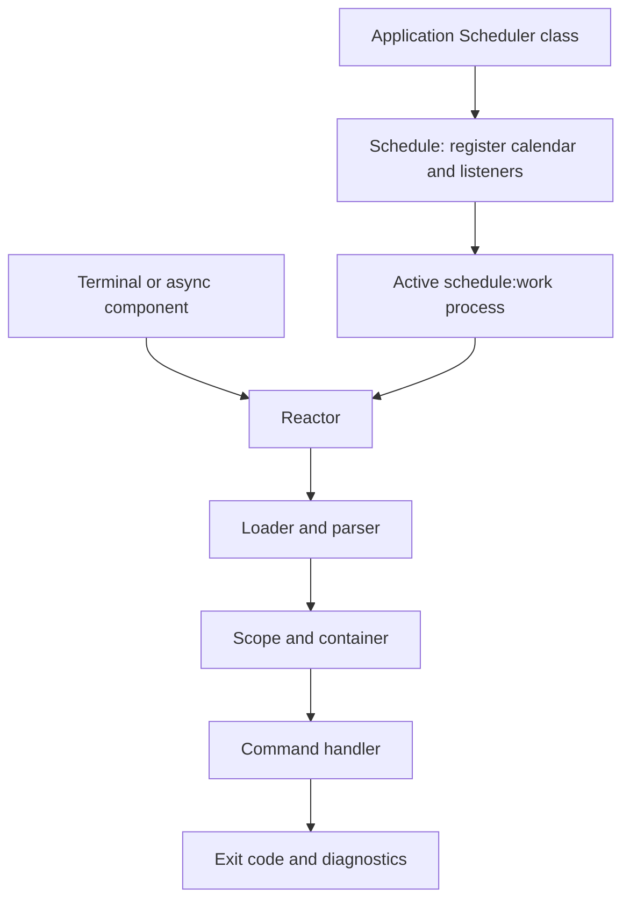

Orionis console exposes application operations as commands with typed arguments, help, interactive output and dependency injection. **Reactor** executes them. The **scheduler** decides when to execute scheduled commands through the public **`Schedule`** facade.

`Scheduler` is the conventional name of the application class extending `BaseScheduler`; it is not the exported facade name. Its configuration belongs in `config/scheduler.py`. `config/queue.py` configures [Queues](/en/queues), whose job storage and workers have a different lifecycle.

## Run the CLI

From the project root, use either alternative with the project's dependencies available:

```shell
orionis list
```

```shell
python -B reactor list
```

If you use uv to select the project environment:

```shell
uv run orionis list
uv run python -B reactor list
```

The `orionis` executable imports `bootstrap.app` from the current directory and calls the application without requiring a `reactor` file. The second alternative uses that local file. Both access the same registry and execution lifecycle; the direct command also disables bytecode writing in its process and sets this preference for child interpreters.

<a id="cli-syntax"></a>

## Syntax, help and exit codes

```text
orionis <signature> [arguments] [options]
python -B reactor <signature> [arguments] [options]
```

With no signature, or with `-h` / `--help` in its position, the command list is displayed. For an operation's help, append `--help` after its signature:

```shell
orionis make:console-command --help
python -B reactor make:console-command --help
```

Positional arguments follow declaration order; options use each command's flags. Long-option abbreviation is disabled. There is no universal set of flags such as `--quiet` or `--force`: inspect the specific command's help.

Status `0` normally means execution completed successfully; a command can return another integer for a business outcome. Parser errors normally produce `2`; an exception handled by Reactor produces `1`. Some built-in commands catch their errors without returning a nonzero code; these differences are documented in [the catalog](/en/console/built-in-commands).

## Create and run your first command

Generate the file and open `app/console/commands/greet_command.py`:

```shell
orionis make:console-command greet --signature app:greet
```

```shell
python -B reactor make:console-command greet --signature app:greet
```

Replace the unimplemented body with this complete module:

```python
from typing import ClassVar
from orionis.console import Argument
from orionis.console.base import BaseCommand


class GreetCommand(BaseCommand):
    signature = "app:greet"
    description = "Print a greeting."
    timestamps = False
    arguments: ClassVar[list[Argument]] = [
        Argument(name_or_flags="name", type_=str),
    ]

    async def handle(self) -> int:
        self.writeLine(f"Hello, {self.getArgument('name')}!")
        return 0
```

```shell
orionis app:greet Ada
python -B reactor app:greet Ada
```

The loader discovers the class through its configured path. The parser supplies `name`, Reactor constructs the command and `handle()` writes `Hello, Ada!`. See [creation and injection](/en/console/creating-commands) for constructors, services, conventions and error handling.

## From commands to scheduling



A command can run manually, through `await Reactor.call(...)` or from a scheduled task. Configuring a calendar does not start a consumer process. The native `schedule:work` command keeps the scheduler active; `schedule:list` inspects it. There is no native `schedule:run` command.

Task events belong to the scheduler: manual Reactor calls do not automatically trigger those listeners. Differences between nonzero returns, exceptions, missed execution and instance limits are explained under [events](/en/console/scheduler-listeners).

## Guide map

| Need | Documentation |
| --- | --- |
| Generate and organize commands | [Create commands and inject services](/en/console/creating-commands) |
| Declare and read CLI input | [Arguments and options](/en/console/commands-and-arguments) |
| Register a class/method through routes | [Console routes](/en/console/command-routing) |
| Write messages and tables | [Text, tables and output](/en/console/console-output) |
| Ask the operator for input | [Questions and interactive input](/en/console/interactive-input) |
| Show progress and manage delays | [Progress](/en/console/progress) |
| Run and inspect commands from code | [Reactor facade](/en/console/reactor-and-injection) |
| Configure discovery and invalidation | [Command caching](/en/console/command-cache) |
| Create the application scheduler | [Schedule tasks](/en/console/task-scheduling) |
| Schedule a command with arguments | [Schedule.command()](/en/console/scheduler-execution#schedule-command) |
| Persist schedules | [Scheduler configuration](/en/console/scheduler-configuration) |
| Choose any supported frequency | [Frequencies and calendars](/en/console/scheduler-frequencies) |
| React to outcomes and errors | [Listeners and events](/en/console/scheduler-listeners) |
| Control Schedule through its API | [Scheduler execution and API](/en/console/scheduler-execution) |
| Inspect all built-in operations | [Command catalog](/en/console/built-in-commands) |
| Review integration contracts and tools | [Technical reference](/en/console/api-reference) |
