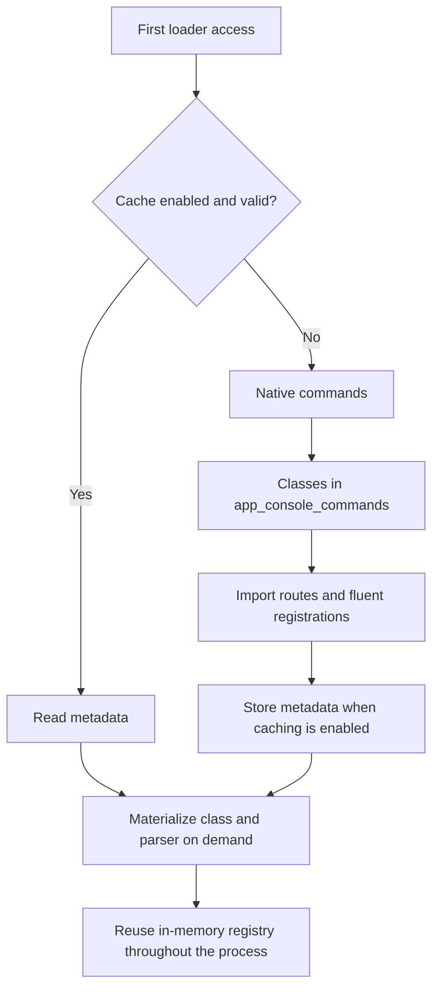

The CLI cache stores **command metadata**, not execution results, container instances or scheduled tasks. It uses a local `FileBasedCache` file; it does not select the Cache facade's driver or the drivers used by Queues or the scheduler.

<a id="compiled-configuration"></a>

## Enable and configure compilation

The distributed application calls `app.compile()` in `bootstrap/app.py`, before configuration and `app.create()`:

```python
app.compile(
    path="storage/framework/bootstrap",
    invalidation_paths=[
        "app", "bootstrap", "config", "database", "resources", "routes", ".env",
    ],
)
```

Its signature is `compile(path: str | None = None, invalidation_paths: list[str] | None = None) -> None`. Without a custom `path`, the application uses `storage/framework/cache`; the template above explicitly changes it to `storage/framework/bootstrap`. Paths resolve against the application root and are validated. Invalidation files/directories must exist so they can be classified and monitored.

The loader enables persistence only when `app.compiled` is active. Without `compile()`, it discovers commands in memory in every process. This implementation has no `COMMAND_CACHE_DRIVER` variable or Redis driver for CLI metadata.

<a id="command-persistence"></a>

## What is stored and where

The filename is **`commands`**, without an extension, inside `app.compiledPath`. With the template above, it is `storage/framework/bootstrap/commands`. It stores each command's module, class, method, signature, description, timestamps and `Argument` definitions.

The `FileBasedCache` wrapper adds a format version and source hash. Values are serialized as JSON through the cache serializer; the `argparse` parser is reconstructed when loading each command rather than persisted as an executable Python object. The serializer writes through a temporary file and replaces the destination.

For `type_` converters, the loader stores `__module__` and `__qualname__`, resolving them through imports. Define converters in importable modules with stable names; a lambda or local function is not a portable definition for this process. Metadata conversion also occurs when persistence is disabled.

Do not use the reserved text `"__MISSING__"` as a business default or constant: the loader uses it to reconstruct the `MISSING` sentinel. Defaults and choices must also be serializable by the cache mechanism when compilation is enabled.

## Discovery and invalidation



It monitors application invalidation paths and additionally `orionis/console/core/commands.py` to detect changes to the native catalog. `FileBasedCache` compares a hash; it reuses its calculated hash for half a second to avoid recomputing it on every query of that object.

A missing cache, invalid format or different hash causes reconstruction. This is not a TTL for results. Once a loader has loaded metadata, it retains its flags and objects in memory: disk changes do not automatically reload that running service.

`Reactor.info()` adds another in-memory cache of the sorted metadata list and returns that same list. Do not mutate it as a registration mechanism. Declare routes and builders before loading commands.

<a id="invalidate-command-cache"></a>

## Clear and regenerate

After changing signatures, options or routes, clear optimization artifacts from a fresh terminal:

```shell
orionis optimize:clear
```

```shell
python -B reactor optimize:clear
```

This clears application optimization rather than a single command entry. To validate application Python sources in memory:

```shell
orionis optimize
python -B reactor optimize
```

`optimize` validates sources without writing bytecode or preloading commands; metadata is reconstructed when needed. See [maintenance](/en/console/built-in-application) for exact operations and results. Run the next operation in a new process; deleting files does not clear dictionaries in an already running loader.

`bootstrap:*` commands activate a temporary recovery context that avoids reading and writing these caches while repairing the application. A repair context must not be persisted as ordinary configuration.

<a id="loader-api"></a>

## Public loader API

`orionis.console.core.loader.Loader` uses `IApplication`. Use [Reactor](/en/console/reactor-and-injection) for ordinary work; these operations support registry inspection and integration.

| Method | Result and behavior |
| --- | --- |
| `Loader(app: IApplication)` | Constructs the empty registry and configures the cache file when appropriate. May create its directory. |
| `async get(signature: str) -> Command \| None` | Loads metadata and materializes only the requested command; returns `None` when absent. |
| `async all() -> dict[str, Command]` | Materializes all commands and returns the internal dictionary without copying it. |
| `async load() -> None` | Materializes the complete registry without executing handlers. |
| `addFluentCommand(signature: str, handler: list[type[Any], str \| None]) -> ICommand` | Adds the class/method builder. Does not invalidate an already materialized registry. |

`ILoader` declares these four methods. The handler list must contain at least a callable reference with `__name__`; omitting the method selects `__call__`. Builder construction validates method existence. Import, definition and persistence errors can propagate from the loader; Reactor handles them within its normal error flow.

```python
from orionis.console.core.loader import Loader


class CommandInspector:
    async def inspect(self, loader: Loader) -> list[str]:
        await loader.load()
        commands = await loader.all()
        return sorted(commands)
```

The Reactor provider resolves the concrete `Loader` class; it does not itself register an `ILoader -> Loader` binding. To inject that contract into your component, declare the binding in a provider or receive `Loader` directly. The [reference](/en/console/api-reference) details native services and their contracts.
