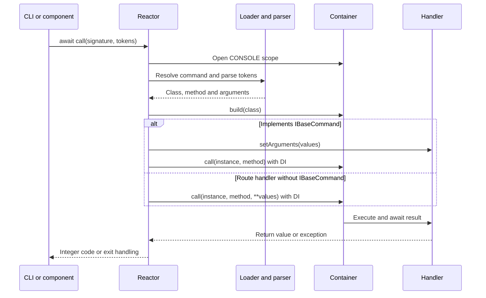

Reactor locates, parses and executes commands. The CLI, scheduled commands and calls from other components pass through this same service. Import the public facade as follows:

```python
from orionis.support.facades import Reactor
```

Writing, questions and progress bars belong to [Console and its helpers](/en/console/console-output). Reactor does not return captured stdout or a structured handler result: it returns an exit code.

<a id="reactor-construction"></a>

## Service, provider and dependencies

The implementation is `orionis.console.core.reactor.Reactor`, with this technical constructor:

```text
Reactor(
    app: IApplication,
    loader: Loader,
    executer: Executor,
    logger: ILogger,
    catch: ICatch,
    performance_counter: PerformanceCounter,
) -> None
```

The native provider registers `IReactor` as a singleton with alias `x-orionis-IReactor` and pins the facade during boot. The container constructs the loader, executor and other services. Ordinary usage needs neither an additional provider nor manual Reactor construction.

The facade and `IReactor` access the same manager; import the contract from `orionis.console.core.contracts.reactor`. All operations below assume a booted application.

<a id="reactor-call"></a>

## call: execute a command

```text
async call(signature: str, args: list[str] | None = None) -> int
```

`signature` is the registered name without the executable. `args` is the list of tokens after the signature; `None` means no arguments.

```python
from orionis.support.facades import Reactor


class GreetingRunner:
    async def run(self) -> int:
        return await Reactor.call("app:greet", ["Ada", "--times", "2"])
```

This uses the command from [creating commands](/en/console/creating-commands). Each value is a separate list element: do not pass a shell string such as `"Ada --times 2"` or include `python`, `reactor` or `orionis`. A value containing spaces is one element, such as `"Ada Lovelace"`; shell quotes are not part of it.

The call runs in the same process and awaits the handler. It creates no independent process, does not enqueue a job and has no general execution timeout. It follows this flow:



An integer returned by the handler is preserved, including nonzero values. Other successful return types normalize to `0`. The executor can print `DONE` and log successful execution even when the handler returns a nonzero code: that return is not itself an exception. Check the returned value.

<a id="reactor-hascommand"></a>

## hasCommand: check a signature

```text
async hasCommand(signature: str) -> bool
```

Returns whether the loader finds the signature. It can load metadata and construct its parser; it does not execute the handler or verify that its business operation will succeed.

```python
from orionis.support.facades import Reactor


class ConditionalRunner:
    async def run(self) -> int:
        if not await Reactor.hasCommand("app:greet"):
            return 1
        return await Reactor.call("app:greet", ["Ada"])
```

Import or configuration errors during this query can propagate. Unlike `call()`, `hasCommand()` does not wrap the operation in the same exception handler.

<a id="reactor-info"></a>

## info: inspect metadata

```text
async info() -> list[dict]
```

Materializes the complete registry, excludes signatures that both **start and end** with `__`, and sorts by signature. Each dictionary contains:

| Key | Contents |
| --- | --- |
| `timestamps` | Executor flag. |
| `signature` | CLI name. |
| `description` | Help description. |
| `arguments` | `argparse.ArgumentParser` built by the loader. |
| `object` | Handler class reference. |
| `method` | Method name to invoke. |

```python
from orionis.support.facades import Reactor


class CommandCatalog:
    async def signatures(self) -> list[str]:
        metadata = await Reactor.info()
        return [item["signature"] for item in metadata]
```

Do not serialize the entire list directly as JSON: it contains classes and parsers. The service caches and returns that same list without copying it; treat it as read-only. It is not a mechanism for adding or modifying commands. Loading errors can propagate.

<a id="reactor-command"></a>

## command: register a CLI route

```text
command(
    signature: str,
    handler: list[type[Any] | str | None] | str,
) -> ICommand
```

This **synchronous** method returns a builder. In actual usage, pass an importable class, `[Class, "method"]` or `[Class]` to use `__call__`. Broad contract annotations do not mean import strings or a `None` method are accepted: loader validation requires a callable reference and a valid method name.

```python
from orionis.support.facades import Reactor


class StatusHandler:
    async def __call__(self) -> int:
        return 0


Reactor.command("app:status", StatusHandler).description(
    "Check command wiring."
).timestamp(enabled=False)
```

Declare it in a configured console route file before loading the registry. The builder supports `.description()`, `.arguments()`, `.timestamp()` and `.get()`; see [its reference and DI examples](/en/console/command-routing).

<a id="reactor-injection"></a>

## Inject IReactor through constructors or methods

A component performing several CLI operations can retain the injected contract:

```python
from orionis.console.core.contracts.reactor import IReactor


class ReportWorkflow:
    def __init__(self, reactor: IReactor) -> None:
        self.reactor = reactor

    async def build(self, report_id: int) -> int:
        return await self.reactor.call("reports:build-one", [str(report_id)])
```

For a single action, receive it in a container-invoked method:

```python
from orionis.console.base import BaseCommand
from orionis.console.core.contracts.reactor import IReactor


class BuildDailyCommand(BaseCommand):
    signature = "reports:daily"
    description = "Run one report command."

    async def handle(self, reactor: IReactor) -> int:
        return await reactor.call("reports:build-one", ["42"])
```

The `reports:build-one` command is defined in [the Storage example](/en/console/creating-commands#dependency-injection). The nested call opens another scope and returns its code to the outer command. Avoid cycles of commands calling each other. Annotating services on a direct Python method call does not activate DI: the container or Reactor must invoke it.

<a id="reactor-exceptions"></a>

## Exceptions, help and cancellation

Within the normal `call()` flow, an `Exception` is logged through `ILogger`, its message receives `[Class.method]` context when known, and handling delegates to `ICatch.exception()`. When that handling completes successfully, Reactor returns `1`. Use the [global exception handler](/en/architecture/exception-handling) to customize presentation and reporting; you do not need to repeat the same diagnostics around every command.

A command can also catch an error and return its own code. Reactor cannot recognize a failure silently swallowed by a handler returning `None`; see the individual behavior of [built-in commands](/en/console/built-in-commands).

The parser uses `SystemExit`: help normally exits with `0`, and invalid usage with `2`. `SystemExit` is not an `Exception` and is not converted to return code `1`. Programmatic help calls must handle it explicitly:

```python
from orionis.support.facades import Reactor


class HelpRunner:
    async def show_greeting_help(self) -> int:
        try:
            return await Reactor.call("app:greet", ["--help"])
        except SystemExit as result:
            return result.code if isinstance(result.code, int) else 1
```

Async cancellation, `KeyboardInterrupt` and other exits outside `Exception` also bypass that handler. Errors while opening/closing the scope, starting measurements before the catch block, or inside the logger/catcher itself can propagate. The `int` return contract describes an execution that completes this flow; it does not guarantee converting every process error into a code.

<a id="command-events"></a>

## Manual commands and task events

A manual `Reactor.call()` does not itself emit scheduler events. `EXECUTED`, `ERROR`, `MISSED` and listener hooks belong to commands executed as scheduler tasks. If Reactor returns `1` without raising to the scheduler, it can emit `EXECUTED` with `retval=1`, rather than necessarily `ERROR`. See [listeners and events](/en/console/scheduler-listeners).
