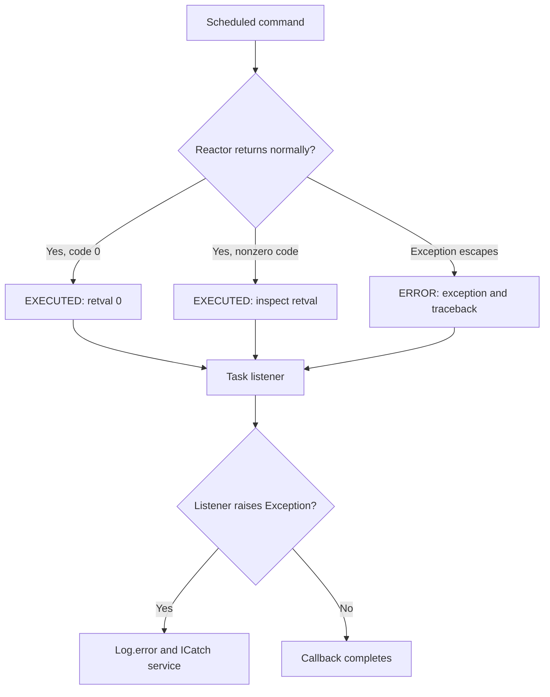

The scheduler emits events about its lifecycle and each task. Listeners can record results, report missed schedules, or react to errors without embedding that logic in a command. Events belong to two levels: the **scheduler** and a **scheduled command signature**.

## Create a task listener

<a id="listener-construction"></a>

```shell
orionis make:console-listener report
python -B reactor make:console-listener report
```

The only command-specific argument is required string `name`; `-h`/`--help` displays help. The generator uses `console_listener.stub`, adds the `Listener` suffix if necessary, and defaults to `app/console/listeners/report_listener.py`, containing `ReportListener(BaseTaskListener)`.

Relative subdirectories are supported: `reports/report` creates `app/console/listeners/reports/report_listener.py`. File components become lowercase; underscore-separated words form the class name. CamelCase is not automatically converted to snake_case: `ReportAudit` produces `reportaudit_listener.py`. Missing directories are created, absolute and parent-traversal paths are rejected, and existing files are not overwritten. There is no `--force` option.

The template generates the seven hooks referenced below. Initial bodies contain only their docstrings and perform no action. Keep only hooks you need to override: `BaseTaskListener` implements the others as async methods returning `None`. It also inherits [console output methods](/en/console/console-output).

Replace the generated listener with this example:

```python
from orionis.console.base import BaseTaskListener
from orionis.console.entities import TaskEvent


class ReportAudit:
    def record(self, signature: str, exit_code: object) -> None:
        print(f"Command {signature}: exit code {exit_code}")


class ReportListener(BaseTaskListener):
    def __init__(self, audit: ReportAudit) -> None:
        self.audit = audit

    async def onTaskExecuted(self, event: TaskEvent) -> None:
        self.audit.record(event.signature, event.retval)
        if event.retval != 0:
            self.warning(f"Scheduled command returned {event.retval}")

    async def onTaskError(self, event: TaskEvent) -> None:
        self.error(f"Escaped error in {event.signature}: {event.exception}")

    async def onTaskMissed(self, event: TaskEvent) -> None:
        self.warning(f"Missed schedule: {event.signature}")
```

## Register an injected instance

In `app/console/scheduler.py`, using the `reports:build` command from [the introductory guide](/en/console/task-scheduling):

```python
from app.console.listeners.report_listener import ReportListener
from orionis.console.base import BaseScheduler
from orionis.console.contracts import ISchedule


class Scheduler(BaseScheduler):
    def tasks(
        self,
        schedule: ISchedule,
        listener: ReportListener,
    ) -> None:
        (
            schedule.command("reports:build")
            .registerListener(listener)
            .maxInstances(1)
            .dailyAt(2, 30)
        )
```

The container builds `ReportListener`, injects its `ReportAudit` constructor dependency, and supplies the instance to `tasks()`. `registerListener()` requires an instance, not the class. Hooks instead receive `event` through direct calls: **there is no additional method injection**. Prepare collaborators in the constructor rather than adding service parameters to `onTaskExecuted()`.

Constructor injection into the scheduler is another option: receive `listener: ReportListener` there, retain it, and call `.registerListener(self.listener)` inside `tasks()`. The application builds that class through the container too.

## `BaseTaskListener` hook reference

Each hook receives `event: orionis.console.entities.TaskEvent` and returns `None`. Base implementations are asynchronous no-ops.

<a id="listener-ontaskadded"></a>

### `async onTaskAdded(self, event: TaskEvent) -> None`

Handles `ADDED`, when a job enters its store. This is distinct from submission for execution.

<a id="listener-ontaskremoved"></a>

### `async onTaskRemoved(self, event: TaskEvent) -> None`

Handles `REMOVED`, caused by explicit removal or a trigger having no future run time. A one-time task can leave its store before the submitted command finishes; removal does not confirm success.

<a id="listener-ontaskexecuted"></a>

### `async onTaskExecuted(self, event: TaskEvent) -> None`

Handles `EXECUTED`: the scheduled callable completed without propagating an exception. Inspect `retval`, which contains Reactor's exit code for Orionis's executor. A nonzero code still reaches this event when no exception escapes.

<a id="listener-ontaskerror"></a>

### `async onTaskError(self, event: TaskEvent) -> None`

Handles `ERROR`, when an exception escapes the scheduled callable. Provides `exception` and `traceback`; this is not equivalent to every command returning `1`.

<a id="listener-ontaskmissed"></a>

### `async onTaskMissed(self, event: TaskEvent) -> None`

Handles `MISSED`: an execution exceeded `misfire_grace_time`. This notification does not create an automatic retry.

<a id="listener-ontasksubmitted"></a>

### `async onTaskSubmitted(self, event: TaskEvent) -> None`

Handles `SUBMITTED`, when one or more run times are submitted to the executor. It does not confirm completion.

<a id="listener-ontaskmaxinstances"></a>

### `async onTaskMaxInstances(self, event: TaskEvent) -> None`

Handles `MAX_INSTANCES`, when an execution cannot be submitted because the signature's instance limit is already reached. It creates neither a waiting queue nor a business retry.

## Per-event callbacks

<a id="task-events"></a>

Attach a callback through `.on(TaskEvent.MEMBER, callback)` before selecting a trigger. Import the enum from `orionis.console.enums.events`; import the **event-data entity** from `orionis.console.entities`.

```python
from orionis.console.base import BaseScheduler
from orionis.console.contracts import ISchedule
from orionis.console.entities import TaskEvent as TaskEventData
from orionis.console.enums.events import TaskEvent
from orionis.support.facades import Log


async def record_modification(event: TaskEventData) -> None:
    Log.info(f"Schedule modified: {event.signature}")


class Scheduler(BaseScheduler):
    def tasks(self, schedule: ISchedule) -> None:
        (
            schedule.command("reports:build")
            .on(TaskEvent.MODIFIED, record_modification)
            .dailyAt(2, 30)
        )
```

| `TaskEvent` member | Value | Relevant information |
|---|---|---|
| `ADDED` | `512` | Added job identity and store. |
| `REMOVED` | `1024` | Removed job identity and store. |
| `MODIFIED` | `2048` | Configuration change; there is no base `onTaskModified` hook. |
| `EXECUTED` | `4096` | `scheduled_run_time`, `retval`. |
| `ERROR` | `8192` | `scheduled_run_time`, `exception`, `traceback`. |
| `MISSED` | `16384` | `scheduled_run_time` that exceeded its tolerance. |
| `SUBMITTED` | `32768` | `scheduled_run_times`, potentially multiple dates. |
| `MAX_INSTANCES` | `65536` | `scheduled_run_times` that could not be submitted. |

Each event/signature pair has **one effective callback**. Registering several replaces an earlier callback with the last at startup and logs a warning. `registerListener()` includes inherited no-op hooks: placing it after `.on()` can replace that callback with an empty hook. Compose multiple actions inside one callback when needed.

Use individual enum members: bitwise OR produces an `int`, which `on()` does not accept as a member. Synchronous callbacks run immediately; `async def` functions run as managed tasks. Their parameters are not resolved through Reactor, and callbacks do not await each other as a middleware chain. Avoid blocking operations in synchronous listeners.

## Global scheduler events

<a id="base-scheduler-events"></a>
<a id="scheduler-events"></a>

`BaseScheduler` provides these asynchronous no-op hooks:

| Hook | `SchedulerEvent` enum | Value |
|---|---|---|
| `onStarted(self, event: SchedulerEvent) -> None` | `STARTED` | `1` |
| `onShutdown(self, event: SchedulerEvent) -> None` | `SHUTDOWN` | `2` |
| `onPaused(self, event: SchedulerEvent) -> None` | `PAUSED` | `4` |
| `onResumed(self, event: SchedulerEvent) -> None` | `RESUMED` | `8` |

`schedule:work` automatically registers available hooks from the class passed to `app.withScheduler()`. Each receives an `orionis.console.entities.SchedulerEvent` entity; use enums only to select event types.

```python
from orionis.console.base import BaseScheduler
from orionis.console.contracts import ISchedule
from orionis.console.entities import SchedulerEvent
from orionis.support.facades import Log


class Scheduler(BaseScheduler):
    def tasks(self, schedule: ISchedule) -> None:
        schedule.command("reports:build").dailyAt(2, 30)

    async def onStarted(self, event: SchedulerEvent) -> None:
        Log.info(event.description)

    async def onShutdown(self, event: SchedulerEvent) -> None:
        Log.info(event.description)
```

When managing the service directly, register callbacks with `schedule.on(SchedulerEvent.STARTED, callback)` before `await schedule.boot()`. It replaces an earlier callback for the same event and returns the service. After startup, `on()` raises `RuntimeError`.

<a id="task-event-entity"></a>

## Task event data

The keyword-only `TaskEvent` dataclass contains these public fields:

| Field | Annotation and default |
|---|---|
| `code` | Required `int`, corresponding to the enum. |
| `signature` | Required `str`. |
| `description` | `str = ""`; `__post_init__()` replaces it with the description for the code. |
| `jobstore` | `str = "memory"`; dispatch uses the event's store or the selected store. |
| `scheduled_run_times` | `Any \| None = None`; run-date list in submission/limit events. |
| `scheduled_run_time` | `Any \| None = None`; individual date for execution/error/misfire. |
| `retval` | `Any \| None = None`; callable result, normally an integer exit code. |
| `exception` | `Any \| None = None`; escaped exception. |
| `traceback` | `Any \| None = None`; traceback of the escaped error. |

Fields not supplied by an event remain `None`. Description messages include `"Task Executed."`, `"Task Error."`, and `"Task Reached Max Instances."`; unknown codes produce `"Unknown Task Event."`.

<a id="scheduler-event-entity"></a>

## Scheduler event data

The `SchedulerEvent` entity contains required `code: int`, `description: str = ""`, and `jobstore: str = "memory"`. `__post_init__()` derives `"Scheduler started."`, `"Scheduler shutdown."`, `"Scheduler paused."`, or `"Scheduler resumed."`; unknown codes produce `"Unknown Task Event."`.

Dispatch takes `jobstore` from the underlying event's `alias` attribute. Lifecycle events normally identify no store and can supply `None` despite the public `str` annotation; do not treat it as a required connection name.

<a id="schedule-states"></a>

`ScheduleStates` defines `STOPPED = "STOPPED"`, `RUNNING = "RUNNING"`, and `PAUSED = "PAUSED"`. `state()` returns the string. The wrapper updates its state at startup, pause, and resume; shutdown currently does not reset it to `STOPPED`. Synchronize shutdown with `await wait()` rather than polling for that state.

## Exceptions and exit codes

These events belong to **scheduled** runs. Executing `orionis reports:build` directly or calling Reactor outside scheduling does not emit these task events; the command retains Reactor output, logging, and exception handling. This component provides no separate `CommandEvent` enum.



Reactor catches ordinary command exceptions, sends them to the [global handler](/en/exceptions), and normally returns `1`. The Orionis scheduler observes a **callable completing without an exception**, emitting `EXECUTED` with `retval=1`. Observe command failures by inspecting the code in `onTaskExecuted()` as well as implementing `onTaskError()`.

When a listener raises `Exception`, Orionis logs the error and invokes `ICatch.exception()` asynchronously. If that handler also fails, Orionis logs the secondary error. This neither reruns the command nor rolls back its effects. Async listeners are tracked in a task set; shutdown waits for already-pending listeners before requesting scheduler closure. Callbacks are not persisted or replayed after restart.

`MISSED`, `MAX_INSTANCES`, `ERROR`, and nonzero returns do not create business retries. Dispatch [Queue jobs](/en/queues/failures-and-retries) from the command for persistent retry policies, and observe both components separately.
