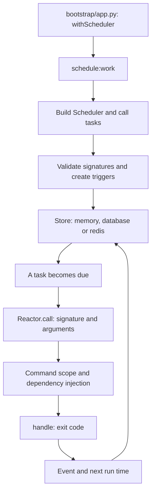

A scheduled task describes **when to execute a command registered in Reactor**: build a report at 02:30, clean records hourly, or synchronize a catalog on weekdays. The scheduler calculates upcoming run times and dispatches the command signature when it is due.

Define the agenda in `app/console/scheduler.py`. Timing and persistence settings belong to `config/scheduler.py`; `config/queue.py` configures the separate [queues and jobs](/en/asynchronous/queues) system. A scheduled command can dispatch queue jobs, but scheduling that command does not start a queue worker.



## 1. Create the command

Generate a command using either alternative:

```shell
orionis make:console-command scheduled_report --signature reports:build
python -B reactor make:console-command scheduled_report --signature reports:build
```

The default destination is `app/console/commands/scheduled_report_command.py`. Replace its contents with this minimal example; a real application can query its database and write the report through [Storage](/en/services/storage):

```python
from orionis.console.base import BaseCommand


class ReportService:
    async def build(self) -> int:
        # Replace this operation with actual report generation.
        return 1


class ScheduledReportCommand(BaseCommand):
    signature = "reports:build"
    description = "Build the daily report."

    async def handle(self, reports: ReportService) -> int:
        generated = await reports.build()
        self.success(f"Reports generated: {generated}")
        return 0
```

Check the command independently first:

```shell
orionis reports:build
python -B reactor reports:build
```

Reactor discovers the command class and resolves `ReportService` when executing `handle()`. See [creating commands](/en/console/creating-commands) for naming, arguments, and options.

<a id="2-define-the-agenda"></a>

## 2. Schedule commands with Schedule.command()

<a id="scheduler-registration"></a>

The application class extends `BaseScheduler`, which implements `IBaseScheduler`. Its `tasks(schedule: ISchedule)` method registers tasks. The base declares `async def tasks(self, schedule: ISchedule) -> None` and raises `NotImplementedError` if it is not implemented; your override can be synchronous or asynchronous because the application invokes it through the container.

Register tasks through the **`Schedule.command()`** facade or injected **`schedule.command()`** service. [See its signature, parameters, and complete CLI-argument example](/en/console/scheduler-execution#schedule-command).

In `app/console/scheduler.py`:

```python
from orionis.console.base import BaseScheduler
from orionis.console.contracts import ISchedule


class Scheduler(BaseScheduler):
    def tasks(self, schedule: ISchedule) -> None:
        (
            schedule.command("reports:build", purpose="Build the daily report")
            .coalesce()
            .misfireGraceTime(60)
            .maxInstances(1)
            .dailyAt(2, 30)
        )
```

This runs `reports:build` daily at 02:30 in the application timezone (`app.timezone`, normally `APP_TIMEZONE`, default `UTC`). Its signature must exist in Reactor: naming a class or file is insufficient.

Frequency methods such as `dailyAt()` are terminal and return `True`; preceding configuration methods return the same task. Set dates, listeners, and policies **before** selecting a frequency. The [frequency reference](/en/console/scheduler-frequencies) contains every method and examples.

Keep the skeleton registration in `bootstrap/app.py`, or import your class and register it before `app.create()`:

```python
from app.console.scheduler import Scheduler

# app is the Application instance configured by this bootstrap file.
app.withScheduler(Scheduler)
```

`Application.withScheduler(scheduler: type[IBaseScheduler]) -> Self` stores a class, not an instance. It requires an `IBaseScheduler` subclass and mutable application configuration; another declaration replaces the previous one. When the bootstrap is already compiled, its compiled configuration takes precedence. After application boot, `await app.getScheduler()` builds an instance through the container; before boot it raises `RuntimeError`. Registration **does not start the scheduler process**.

## 3. Inspect and run the agenda

```shell
orionis schedule:list
python -B reactor schedule:list
```

`schedule:list` builds the application scheduler, calls `tasks()`, and displays signatures, arguments, purposes, policies, dates, and schedule descriptions. It validates signatures and triggers without starting the clock or processing store entries.

Keep this process running to execute the agenda:

```shell
orionis schedule:work
python -B reactor schedule:work
```

`schedule:work` loads the agenda, attaches listeners, starts the service, and waits for shutdown. The process must remain alive for tasks to run. `Ctrl+C` requests shutdown. Both commands support `-h`/`--help` and declare no additional command-specific arguments or options. Orionis does not include `schedule:run`.

## Dependencies in the agenda and each execution

This module can replace `app/console/scheduler.py` while using the command above:

```python
from orionis.console.base import BaseScheduler
from orionis.console.contracts import ISchedule


class ReportSchedulePolicy:
    def hour(self) -> int:
        return 2


class ReportScheduleLabel:
    def purpose(self) -> str:
        return "Daily reports"


class Scheduler(BaseScheduler):
    def __init__(self, policy: ReportSchedulePolicy) -> None:
        self.policy = policy

    async def tasks(
        self,
        schedule: ISchedule,
        labels: ReportScheduleLabel,
    ) -> None:
        (
            schedule.command("reports:build", purpose=labels.purpose())
            .maxInstances(1)
            .dailyAt(self.policy.hour(), 30)
        )
```

The container builds `ReportSchedulePolicy` for the constructor and `ReportScheduleLabel` for `tasks()`. These concrete classes need no additional binding. `schedule:list` and `schedule:work` supply `schedule` explicitly; other dependencies are resolved from type annotations.

`tasks()` runs when the agenda loads. When a trigger fires, Reactor creates the scope for **each command execution**, builds its class, and invokes `handle()` with its own dependencies. Event listeners receive their event through a direct call; use dependencies prepared in the constructor as shown in [Listeners and events](/en/console/scheduler-listeners).

## Continue reading

- [Configuration and persistence](/en/console/scheduler-configuration): stores, environment variables, and restarts.
- [Task frequencies and calendars](/en/console/scheduler-frequencies): all intervals, calendars, dates, and task policies.
- [Listeners and events](/en/console/scheduler-listeners): callbacks, listener classes, and exit codes.
- [Execution and API](/en/console/scheduler-execution): the `Schedule` facade, `ISchedule` service, controls, and shutdown.

The scheduler does not itself add business retries or a failed-execution history. For those requirements, a command can dispatch a [persistent job](/en/asynchronous/queues/jobs-and-dispatch) to a queue backend and leave processing to its queue worker.
