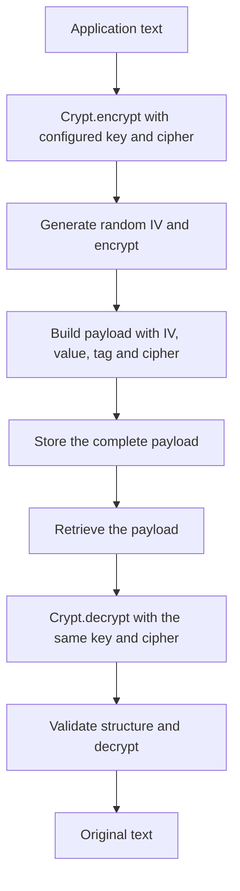

Encryption lets you keep text that the application needs to recover, such as an integration credential. Orionis exposes it through the `Crypt` facade and `IEncrypter` contract. `encrypt()` returns an encrypted payload and `decrypt()` recovers the original text using the configured key and cipher.

For login passwords, use [hashing](/en/cryptography/hashing): that use case checks a candidate. Encryption applies to values whose contents must be recoverable.

## Key, cipher and payload

These three elements participate in each operation:

| Element | Responsibility |
| --- | --- |
| `APP_KEY` | Key retained by the application and used for both encryption and decryption. |
| `APP_CIPHER` | Selects a supported AES variant and determines the key and IV length. |
| Payload returned by `encrypt()` | Represents the random IV, ciphertext, cipher and tag when applicable. Does not contain the key. |

`config/app.py` configures the key and cipher; `config/hashing.py` configures password hashes. Retain the key and cipher used to produce the values you want to recover.

The payload is Base64 text wrapping a JSON structure. This envelope makes it suitable for storage in a field or transmission as text; Base64 alone is not the protection mechanism. Store the complete `encrypt()` result.

## A value's lifecycle

A new IV means encrypting the same text several times can produce different payloads. Recover the value by calling `decrypt()` on the stored payload. A different key or incompatible cipher does not provide a way to recover previous data.

The API accepts and returns `str`. To store a structured object, explicitly serialize it before encryption and deserialize it after recovery; the [practical guide](/en/cryptography/encryption/encrypting-values) includes the complete flow.

## Access the service

Import the facade with `from orionis.support.facades import Crypt`. Its `Crypt.encrypt(text)` and `Crypt.decrypt(payload)` methods are **synchronous**, including inside an `async` controller.

To declare the dependency, import `IEncrypter` from `orionis.encrypter.contracts` and receive it in the constructor or action. The built-in provider registers a shared instance during application boot.

See [encrypting and decrypting values](/en/cryptography/encryption/encrypting-values) for complete controller, schema, route and dependency injection examples.

## Available variants

| Cipher | Key | Implemented integrity check |
| --- | --- | --- |
| `AES-128-CBC` | 16 bytes | The CBC variant does not add a MAC or authentication tag to the payload. |
| `AES-256-CBC` | 32 bytes | The CBC variant does not add a MAC or authentication tag to the payload. This is the configuration default. |
| `AES-128-GCM` | 16 bytes | Generates and verifies the GCM authentication tag. |
| `AES-256-GCM` | 32 bytes | Generates and verifies the GCM authentication tag. |

The service checks format and that the payload cipher matches configuration. Those checks do not make a CBC payload an authenticated message. GCM tag validation is part of decryption.

The [values and keys guide](/en/cryptography/encryption/encrypting-values) details `key:generate` commands, configuration, output format, errors you can handle and the implications of replacing a key. Recovering and replacing existing values requires an explicit application process.
