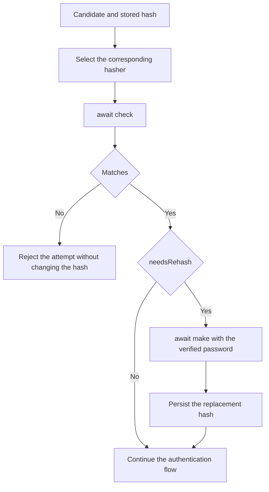

Password hashing transforms a password into an encoded value that you can store and check later. The application keeps that hash and verifies each candidate through `check()`. This process lets it check a password without providing an operation to recover it.

Orionis exposes this service through the `Hash` facade and `IHashManager` contract. The default driver is `argon2`, which generates **Argon2id** hashes; `bcrypt` is also included. Both run their calculations on a worker thread so `make()` and `check()` can be used from asynchronous actions.

## Choose hashing or encryption

| Need | Service | Result |
| --- | --- | --- |
| Store a password and check future attempts | `Hash` | Encoded hash containing the algorithm, parameters and salt. |
| Keep text that your application must recover | `Crypt` | Encrypted payload requiring the application key for decryption. |

The [encryption guide](/en/cryptography/encryption) explains the second case. Base64 encoding represents data but does not protect it on its own.

The `APP_KEY` key belongs to encryption. Hashing drivers use their own parameters and the salt generated by their backend; you do not supply a salt and they do not use that application key to check passwords.

## What each operation does

| Operation | Use |
| --- | --- |
| `await Hash.make(password)` | Generates the hash to store in the user's record. |
| `await Hash.check(candidate, stored_hash)` | Checks a candidate against the stored hash and returns `bool`. |
| `Hash.needsRehash(stored_hash)` | Checks whether the hash needs upgrading according to the current driver and parameters. |
| `Hash.driver("bcrypt")` | Explicitly selects a hasher when you know a record's algorithm. |

Import the facade with `from orionis.support.facades import Hash`. Calculation operations require `await`; `needsRehash()` and `driver()` are synchronous after application boot. You can also inject `IHashManager` from `orionis.hashing.contracts` into a constructor or action.

The built-in provider registers the service during Orionis boot. Examples in the [practical guide](/en/cryptography/hashing/password-storage) use a real application, HTTP schemas and controllers; you do not need to create a hash manager for every request.

## From registration to verification

1. Validate the received data and password policy.
2. Generate the hash with `await Hash.make(...)`.
3. Store the complete result in the password field.
4. On a subsequent attempt, retrieve the stored hash.
5. Check the candidate with `await Hash.check(candidate, stored_hash)`.
6. If verification succeeds and `needsRehash()` requests it, generate a replacement from the verified password and persist it.

Two `make()` calls for the same password can produce different hashes because they include a random salt. Use `check()` to verify it; directly comparing a newly generated hash with the stored one does not implement that process.

`needsRehash()` inspects format and costs; it neither verifies the user nor modifies the database. The hashing manager also does not register accounts, create sessions or limit attempts. To implement login through framework guards, continue with [authentication](/en/authentication).

## Drivers and configuration

| Driver | Generated algorithm | Main configuration |
| --- | --- | --- |
| `argon2` | `argon2id` | Memory in KiB, parallelism and iterations. |
| `bcrypt` | `bcrypt` | The `rounds` cost factor. |

`config/hashing.py` selects the driver and costs. Changing `HASH_DRIVER` affects operations using the default; it does not convert existing hashes or make `check()` automatically detect other algorithms.

The [generation and verification guide](/en/cryptography/hashing/password-storage) covers:

- Registration and verification from controllers.
- Facade access and constructor or method injection.
- Every `config/hashing.py` option and its environment variables.
- Per-call costs, algorithm inspection and available setters.
- Rehashing after successful verification and explicit migration from bcrypt.
- Dependencies, exceptions and driver limits.

For recoverable values and their keys, see [data encryption](/en/cryptography/encryption).
