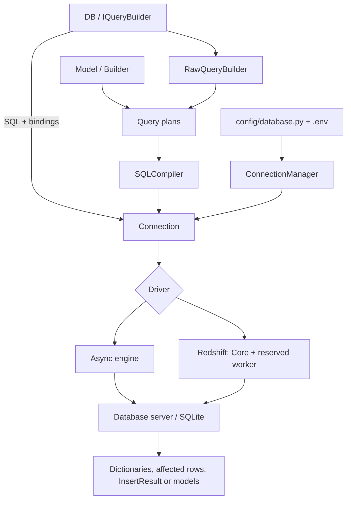

Database manages named SQL connections and provides query, transaction, schema, migration and seeder infrastructure. You can execute SQL, use the query builder or work with [ORM](/en/orm) models. All three alternatives share the manager and transactions.

Await I/O operations with `await`. Selecting a connection, building a query and defining a table are synchronous operations; terminal operations such as `get()` or `insert()` execute SQL.

## Architecture



| Component | Responsibility |
|---|---|
| `BootstrapDatabase` | Reads environment values and validates typed settings. |
| `ConnectionManager` / `IConnectionManager` | Resolves and reuses named connections. |
| `DB` / `IQueryBuilder` | Selects tables, executes SQL and controls transactions without models. |
| `RawQueryBuilder` | Builds query plans over tables. |
| `Model` / `Builder` | Add attributes, persistence and relationships. |
| `SQLCompiler` | Translates plans and definitions to the selected dialect. |
| `Connection` / `IConnection` | Acquires resources, executes statements, buffers results and manages transactions. |
| `Schema`, migrator and seeders | Define structures, apply changes and populate data. |

## First query from a controller

Configure a connection and create tables through [migrations](/en/database/migrations). This example assumes a `notes` table with `id` and `body` columns. Register the controller through [HTTP routes](/en/http/routing):

```python
from orionis.http import JSONResponse
from orionis.support.facades import DB


class NoteController:
    async def index(self) -> JSONResponse:
        notes = await (
            DB.table("notes")
            .select("id", "body")
            .orderBy("id")
            .limit(20)
            .get()
        )
        return JSONResponse({"notes": notes.all()})
```

Import the facade from `orionis.support.facades`. Application boot registers its services. Async services, commands, jobs and MCP components use the same API; `IQueryBuilder` or `IConnectionManager` can also be injected.

## Lifecycle

1. Configuration is loaded and validated without connecting to a server.
2. The manager creates and caches `Connection` when its name is first resolved.
3. The engine is created when I/O is needed; constructing the object does not check connectivity or credentials.
4. Without an explicit transaction, each operation acquires a physical connection, starts a temporary transaction, buffers its results and commits or rolls back before release.
5. Inside an explicit transaction, operations from its owning task reuse the same physical connection.
6. `disconnect()` disposes the engine and idle connections; later use can recreate it. Do not call it per request or while other tasks use the shared service.

## Guides and reference

[Database command reference](/en/database/commands): syntax, arguments and options for all 14 commands, including inspection and wiping.

- [Drivers and dependencies](/en/database/drivers): backends and `reactor packages`.
- [Configuration](/en/database/configuration): fields and environment variables.
- [Connection management](/en/database/connections): names, injection and registration.
- [DB facade](/en/database/db-facade): its eleven entry-point methods.
- [SQL and results](/en/database/raw-queries): bindings, return values and errors.
- [Query builder](/en/database/query-builder): model-less queries.
- [Transactions](/en/database/transactions): contexts, savepoints and concurrency.
- [Schemas](/en/database/schema), [migrations and seeders](/en/database/migrations).
- [Dialects and production](/en/database/dialects-and-production).
- [Connection and compilation API](/en/database/runtime-api).

Use `DB` without model instances; its builder returns collections of dictionaries and does not dispatch model events. Use the [ORM](/en/orm) for entity state, casts, scopes, events, relationships and factories.
