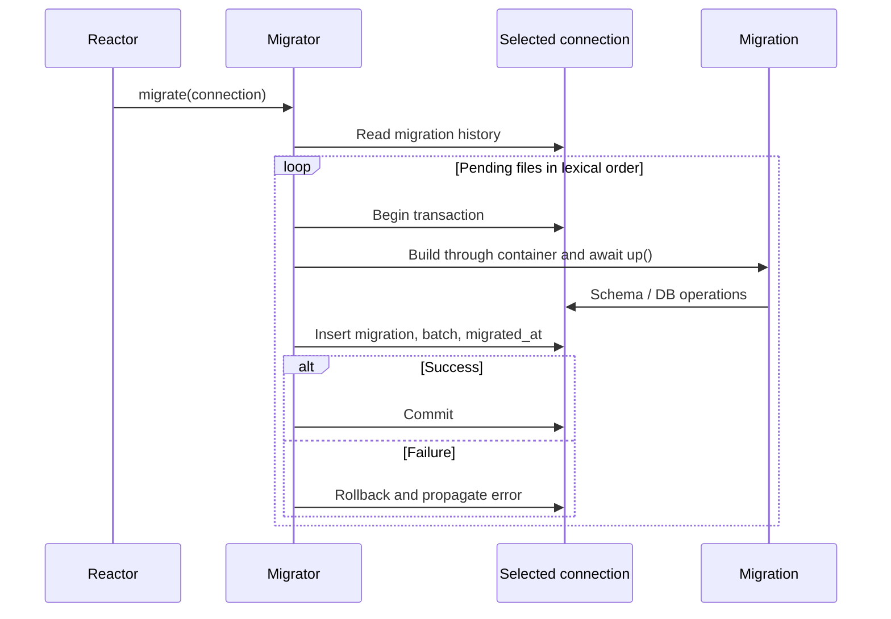

Migrations are asynchronous classes describing ordered physical changes. up applies a change and down describes its reversal. Every applied file is recorded in the migrations table on the same connection. [Seeders](/en/database/seeders) have separate history and run after the schema is ready.

## Generating a migration

[Database command reference](/en/database/commands): syntax, arguments and options for all 14 commands, including inspection and wiping.

```shell
orionis make:database-migration create_flags
python -B reactor make:database-migration create_flags
```

These commands are alternatives. The real command is make:database-migration with a required name: str and only -h/--help for help; there is no --create, --table, or --force. The generator uses database_migrations, normally database/migrations. It creates `m<YYYYmmddHHMMSS>_create_flags.py` using the application timezone and a CreateFlags class with empty async up/down methods. The m prefix makes the file importable as a Python module.

Choose snake_case for predictable names. Subdirectories using / or \ are accepted, such as catalog/create_flags. Components are normalized to lowercase and must form Python modules (letters, digits, and underscores, beginning with a letter). One filename extension is stripped; absolute paths, empty components, `.` and `..` are rejected. Required directories are created. Existing files produce an error and are never overwritten; identical names generated within the same second can collide.

Complete the generated contents:

```python
from orionis.database import Migration
from orionis.support.facades import Schema


class CreateFlags(Migration):
    async def up(self) -> None:
        async with Schema.create("flags") as table:
            table.id()
            table.string("name", 80)
            table.unique("name", name="uq_flags_name")

    async def down(self) -> None:
        await Schema.drop("flags")
```

<a id="migration-contract"></a>

## Discovery and ordering

The runner recursively discovers modules under the configured path and imports local `Migration` subclasses. Package initializers are not required. Reexports and initializer modules are ignored. Each file must define one unambiguous local subclass: multiple classes for the same identity raise `ValueError`. Identity is the filename stem rather than class name or directory: matching stems in different subdirectories also collide. Files run in lexical order; timestamp prefixes preserve creation order.

Discovery is cached on each `Migrator` instance. A new process sees new files. Do not rename, delete, or change an applied migration: history uses its identity and down might no longer resolve. Add another file for future changes and preserve versioned schemas.

<a id="commands"></a>

## Every command and option

Run from the project root using orionis <command> or python -B reactor <command>. Shared options are --database NAME or -d NAME (optional str, None selects the default connection) and -h/--help. The name must be declared in config/database.py.

| Command | Specific options | Result |
|---|---|---|
| migrate | --seed, bool False by default | Applies pending migrations; --seed runs pending seeders after success, including when no new migrations were pending. |
| migrate:status | None | Shows discovered migration state and batch; may create an empty tracking table. |
| migrate:rollback | --step N / -s N, optional int, effective default 1 | Reverts the last N batches. |
| migrate:reset | None | Calls down for every applied migration in reverse order. |
| migrate:refresh | --step N / -s N, optional int, None means all | Reverts selected batches and reapplies pending migrations. |
| migrate:fresh | None | Resets, removes migrations/seeders history, and applies again as batch 1. |
| seed / db:seed | None | Runs pending seeders; see the [guide](/en/database/seeders). |

```shell
orionis migrate:status
python -B reactor migrate:status

orionis migrate --seed
python -B reactor migrate --seed

orionis migrate --database reporting
python -B reactor migrate --database reporting

orionis migrate:rollback --step 1
python -B reactor migrate:rollback --step 1

orionis migrate:refresh --step 2
python -B reactor migrate:refresh --step 2
```

step counts **batches rather than files** and must be a positive integer. One migrate invocation assigns the same batch to its pending files, but every file has its own transaction. rollback reverts the most recently applied records within selected batches. refresh accepts no --seed; run seed afterward to populate again. fresh also accepts no --seed and **does not arbitrarily drop every table**: it relies on down to remove recorded structures and leaves unrelated tables intact.

## Transactions and history



The migrations table contains a generated id, unique migration identity, batch, and migrated_at as epoch seconds. Each operation sets a contextual connection: unqualified `DB`, `Schema`, and ORM resolution use it. Explicitly selecting another connection can escape that transaction; keep a migration file on its target connection. `Migration` instances are constructed through app.build, supporting constructor injection; up/down are called without arguments and receive no method injection.

```python
from orionis.database import Migration
from orionis.database.contracts.schema import ISchema


class CreateAuditEntries(Migration):
    def __init__(self, schema: ISchema) -> None:
        self._schema = schema

    async def up(self) -> None:
        async with self._schema.create("audit_entries") as table:
            table.id()
            table.string("message", 255)

    async def down(self) -> None:
        await self._schema.drop("audit_entries")
```

A failure aborts the current file, rolls back its transaction, and prevents recording success. Earlier files from that batch may already be committed; rerunning applies remaining files. **DDL reversibility depends on the backend**: engines with implicit commits cannot guarantee restoring a table merely through rollback. down is explicit code and must be tested. The runner provides no global deployment lock between migration processes; coordinate one executor per connection.

Partial reversal preserves seeders history. Reverting the last applied migration removes that history with the final step, allowing seed to run again after reconstruction. reset leaves empty migrations history; fresh removes and recreates history as the first batch.

<a id="migrator-init"></a>

## Programmatic `Migrator` API

`Migrator`(app: `IApplication`, conn_manager: `IConnectionManager`) can be injected into custom commands. Every operation is asynchronous; connection=None selects the default and events=None reports no progress. There is no individual file selection or force argument.

<a id="migrator-migrate"></a>

### migrate

```text
async migrate(*, connection: str | None=None, events: MigrationEvents | None=None) -> list[str]
```

Returns list[str] of applied identities in order, or [] when nothing is pending. This API does not run seeders: --seed belongs to the CLI command.

```python
from orionis.database import Migrator


async def migrate_example(migrator: Migrator) -> list[str]:
    return await migrator.migrate(connection=None, events=None)
```

<a id="migrator-rollback"></a>

### rollback

```text
async rollback(steps: int=1, *, connection: str | None=None, events: MigrationEvents | None=None) -> list[str]
```

Returns list[str] of reversed identities in reverse order. steps defaults to 1; nonintegers, bool, or values <1 raise `ValueError`. Applied identities with missing files raise `MigrationNotFoundException` before reversions begin.

```python
from orionis.database import Migrator


async def rollback_example(migrator: Migrator) -> list[str]:
    return await migrator.rollback(steps=1, connection=None, events=None)
```

<a id="migrator-reset"></a>

### reset

```text
async reset(*, connection: str | None=None, events: MigrationEvents | None=None) -> list[str]
```

Reverts all and returns identities in reverse order; [] if none were applied. Propagates down failures and missing files.

```python
from orionis.database import Migrator


async def reset_example(migrator: Migrator) -> list[str]:
    return await migrator.reset(connection=None, events=None)
```

<a id="migrator-refresh"></a>

### refresh

```text
async refresh(steps: int | None=None, *, connection: str | None=None, events: MigrationEvents | None=None) -> list[str]
```

steps=None means reset followed by migrate; steps=N means rollback(N) followed by migrate. Returns newly applied rather than reverted identities.

```python
from orionis.database import Migrator


async def refresh_example(migrator: Migrator) -> list[str]:
    return await migrator.refresh(steps=None, connection=None, events=None)
```

<a id="migrator-fresh"></a>

### fresh

```text
async fresh(*, connection: str | None=None, events: MigrationEvents | None=None) -> list[str]
```

Resets, removes migrations history and residual seeders history, then migrates. Returns reapplied identities. This neither repairs an incorrect down nor drops untracked tables.

```python
from orionis.database import Migrator


async def fresh_example(migrator: Migrator) -> list[str]:
    return await migrator.fresh(connection=None, events=None)
```

<a id="migrator-status"></a>

### status

```text
async status(*, connection: str | None=None) -> list[dict[str, Any]]
```

Returns list[dict] in discovery order with migration: str, ran: bool, batch: int | None. Enumerates discovered files rather than an independent list of every historical record.

```python
from orionis.database import Migrator


async def status_example(migrator: Migrator) -> list[dict[str, object]]:
    return await migrator.status(connection=None)
```

```python
from orionis.console.base.command import BaseCommand
from orionis.database import Migrator


class InspectMigrations(BaseCommand):
    signature = "database:inspect-migrations"
    description = "Show migration history for the default connection."

    async def handle(self, migrator: Migrator) -> None:
        rows = await migrator.status()
        self.table(
            ["Migration", "Ran", "Batch"],
            [[row["migration"], row["ran"], row["batch"]] for row in rows],
        )
```

```python
[
    {"migration": "m20261022090000_create_flags", "ran": True, "batch": 1},
    {"migration": "m20261022090100_create_audit_entries", "ran": False, "batch": None},
]
```

The second block illustrates returned data rather than a migration file. `IMigrator` exposes the same operation signatures.

<a id="migrationevents"></a>

## Progress and errors

```python
from orionis.console.base.command import BaseCommand
from orionis.database import Migrator
from orionis.database.migrations.events import MigrationEvents


class ApplyMigrations(BaseCommand):
    signature = "database:apply-migrations"
    description = "Apply pending migrations and show progress."

    async def handle(self, migrator: Migrator) -> None:
        events = MigrationEvents(
            on_start=lambda name: self.info(f"Starting {name}"),
            on_success=lambda name, elapsed: self.info(f"Done {name}: {elapsed:.2f}s"),
            on_error=lambda name, elapsed: self.error(f"Failed {name}: {elapsed:.2f}s"),
        )
        applied = await migrator.migrate(connection=None, events=events)
        self.info(f"Applied: {len(applied)}")
```

`MigrationEvents`(*, on_start: Callable[[str], None] | None = None, on_success: Callable[[str, float], None] | None = None, on_error: Callable[[str, float], None] | None = None) is frozen/slotted and accepts synchronous callbacks. started(name) calls on_start; succeeded(name, elapsed) calls on_success; failed(name, elapsed) calls on_error. All three methods return None; elapsed is measured in seconds. NO_EVENTS is the callback free instance.

Do not raise exceptions from callbacks: started runs before the transaction, succeeded after commit, and failed during failure propagation; callback exceptions propagate too. `SeederEvents` is an alias of the same type.

Unknown connection names raise `ConnectionNotFoundException`. A type lacking a builder or invalid DDL raises `QueryException`. Python errors fail during module import. Ambiguous migrations raise `ValueError`. There are no pretend, file skipping, production confirmation, or automatic cross-backend DDL compatibility options. See [verified alterations](/en/database/schema-alterations) to evolve existing tables.

<a id="migration-connection-context"></a>

### Connection context for integrations

```text
current_migration_connection() -> IConnection | None
migration_connection_scope(connection: IConnection) -> Generator[None]
```

These functions are in orionis.database.migrations.context. The first reads the contextual connection without creating it; the second is a synchronous contextmanager setting and restoring its ContextVar in finally. Migrations and seeders manage this automatically; the context alone opens no transaction and commits or rolls back nothing. A custom runner must retain the same async task and combine this context with a real connection transaction.

```text
MigrationEvents.started(name: str) -> None
MigrationEvents.succeeded(name: str, elapsed: float) -> None
MigrationEvents.failed(name: str, elapsed: float) -> None
```
