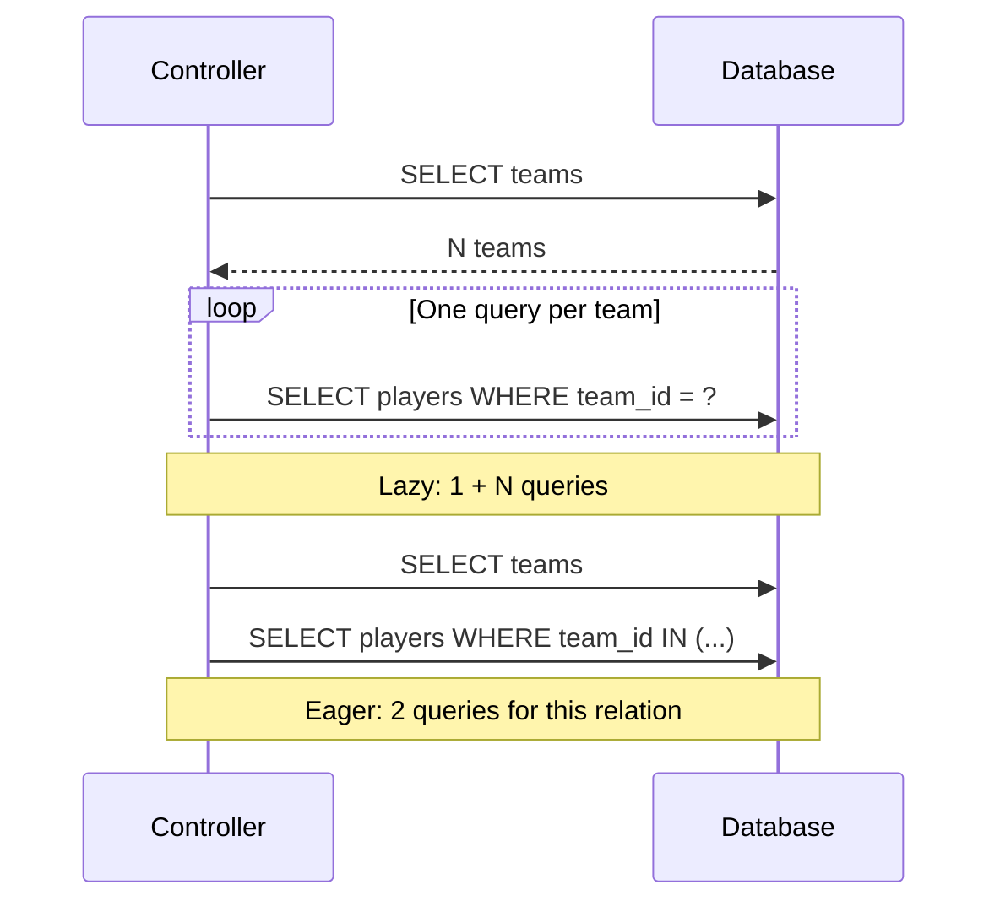

N+1 occurs when a list query is followed by one relationship query for every row. With N teams, this code runs 1 team SELECT and N player SELECTs. Latency grows even when each individual query looks inexpensive. Use the models from [relationships](/en/database/orm/relationships).

## Recognizing the pattern

```python
async def roster_with_extra_queries():
    teams = await Team.orderBy("id").get()
    result = []
    for team in teams:
        players = await team.players().get()
        result.append({"team": team.name, "players": players.serialize()})
    return result
```



## Batch loading and reuse

```python
async def roster_batched():
    teams = await Team.withRelations("players", "profile", "tags").orderBy("id").get()
    return [
        {
            "team": team.toDict(),
            "players": team.getRelation("players").serialize(),
            "profile": (
                team.getRelation("profile").toDict()
                if team.getRelation("profile") is not None else None
            ),
            "tags": team.getRelation("tags").serialize(),
        }
        for team in teams
    ]
```

For a nonempty batch with the required keys, this runs 1 team query + 1 player query + 1 profile query + 2 tag queries (pivot and related models): **5**, independent of team count. Without pivot ids it skips the tag query; keyless batches skip related queries. Relationships load in declaration order, not through `gather`.

`getRelation` reads the stored result; calling `team.players()` again creates another builder and may reintroduce N+1. `relationLoaded("profile")` distinguishes an unloaded relation from a loaded relation without a match (`None`). There is no automatic relationship property loading.

## API


<a id="modelquerybuilder-withrelations"></a>

### `withRelations`

```text
def withRelations(self, *names: str) -> Self
```

Registers unique relationship method names in order. Returns the same builder without SQL. After hydration, each name builds a relation without its individual constraint, gathers batch keys, queries and assigns through `setRelation`. Missing names or methods not returning `Relation` raise `RelationNotFoundException` when rows exist; empty results do not validate names.

```python
async def teams_with_players():
    return await Team.withRelations("players").get()
```

<a id="modelquerybuilder-load"></a>

### `load`

```text
def load(self, *names: str) -> Self
```

Synchronous fluent alias of `withRelations`. It belongs to the builder, not an already retrieved instance: `await team.load(...)` is not an available API. Accepts direct names as separate arguments.

```python
async def teams_with_profiles():
    return await Team.query().load("profile").get()
```

## Projections, filters and deeper levels

- Keep local/foreign keys needed for grouping in SELECT. `Team.select("name").withRelations("players")` omits `id` and cannot associate its players correctly.
- Dotted paths such as `"players.team"` and mapping/callback arguments to `withRelations` are not interpreted. Declare direct relationship methods for read variants or query further levels explicitly.
- Filters declared in a relationship method apply to the batch. A `limit` there limits the entire related batch query; it does not mean “N rows per parent”.
- Related-model scopes and soft deletion visibility still apply. The cache belongs to each instance and can become stale after writes; query again for updated data.
- Confirm the pattern by counting SELECT calls with a connection wrapper in tests or examining SQL observed by your infrastructure. Compare several parents, not just one. No automatic N+1 detector is exposed here.

See [collections and pagination](/en/database/orm/collections-and-pagination) to load only the needed page and [testing](/en/database/orm/factories-and-testing) to verify results and operation counts.
