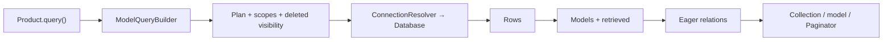

## From query to model

`Product.query()` creates a `ModelQueryBuilder[Product]`. Clauses are added without I/O; asynchronous terminals execute the plan, receive Database rows and construct `Product` instances. Hydration establishes original state and dispatches `retrieved`; eager loading runs afterwards.



This example uses the [complete Product model](/en/database/orm/factories-and-testing#complete-model-and-factory) and its existing table. In an initialized application, register the controller actions through the [router](/en/http/routing):

```python
from app.models.product import Product
from orionis.http import JSONResponse


class ProductController:
    async def index(self) -> JSONResponse:
        products = await (
            Product.query()
            .where("active", True)
            .where("stock", ">", 0)
            .orderBy("id")
            .get()
        )
        return JSONResponse([product.toDict() for product in products])

    async def show(self, product_id: int) -> JSONResponse:
        product = await Product.findOrFail(product_id)
        return JSONResponse(product.toDict())
```

The controller explicitly serializes every model. `get()` returns `Collection`, rather than a JSON list; `first()` and `find()` may return `None`. `firstOrFail()` and `findOrFail()` raise `ModelNotFoundException`; the [HTTP exception handler](/en/http/exceptions) determines the endpoint response.

## Class, builder and instance methods

| Form | Meaning |
| --- | --- |
| `Product.query()` | Class method creating a fresh builder. |
| `Product.where(...)`, `Product.orderBy(...)`, `Product.paginate(...)` | Metaclass shortcuts to supported methods of a new builder. They do not share a global builder. |
| `query.where(...)`, `query.select(...)` | Synchronous configuration of the same mutable builder. |
| `await query.get()` / `await query.update(...)` | Execution over rows matching that plan. |
| `await product.save()` / `await product.update(...)` | Instance persistence with attribute tracking and events. |

The [model API](/en/database/orm/model-api) documents signatures and distinctions between class and instance methods; `ModelQueryBuilder` extensions are covered under [retrieval and pagination](/en/database/orm/collections-and-pagination), [scopes](/en/database/orm/scopes), [relationships](/en/database/orm/relationship-operations) and [soft deletion](/en/database/orm/soft-deletes).

Not every builder name is a class shortcut. For instance, use `Product.query().adoptPlan(plan)` to adopt a plan. There is no `Product.factory()`.

## Shared query language

| Topic | Complete reference |
| --- | --- |
| `select`, `addSelect`, `selectRaw`, `selectSub`, `distinct` | [Selection and results](/en/database/query-builder). |
| `where` variants, NULL, ranges, LIKE, regex, columns, SQL and EXISTS | [Filters and conditions](/en/database/query-filters). |
| JOIN, subqueries and UNION | [Joins and subqueries](/en/database/joins-and-subqueries). |
| Ordering, grouping, HAVING, limits, aggregates and terminals | [Query Builder reference](/en/database/query-builder). |
| `insert`, `update`, `delete`, `lockForUpdate`, `sharedLock` | [Writes and locks](/en/database/query-writes). |
| `toPlan`, `clone`, `adoptPlan`, `adoptConnection` and structures | [Plans and expressions](/en/database/query-plans). |

The same clauses work with `DB.table()` and `Model.query()`, with different result representations. `DB.table()` returns dictionaries without applying model configuration. Qualify joined tables and columns; retain primary and relationship keys if the model will later save or load associations. Partial selection does not hydrate omitted columns automatically.

Values are bound as parameters. Identifiers, operators and SQL fragments remain the application's responsibility. Conditions combine left to right: explicitly group alternatives to control logical meaning.

## Reuse a query

```python
from app.models.product import Product


async def product_reports():
    base = Product.where("active", True)
    available = await base.clone().where("stock", ">", 0).orderBy("id").get()
    sold_out = await base.clone().where("stock", 0).orderBy("id").get()
    return available, sold_out
```

`clone()` copies plan lists; appending new clauses does not alter `base` lists. Existing clause objects and nested plans remain shared: do not change them expecting a deep copy. Do not share a mutable builder across requests or tasks.

Scopes and the soft-delete filter are incorporated before execution and marked as applied. Configure `withoutGlobalScope`, `withTrashed` and other options **before the first terminal**; use a fresh builder for a different policy.

## Results, scalars and pagination

`get()` returns models; `value(column)` returns the first instance's attribute or `None`; `pluck(column)` returns a `Collection` of attributes. The last two hydrate and read attributes, so casts/accessors may apply. Aggregates (`count`, `sum`, `avg`, `min`, `max`) are SQL calculations without hydrating every row.

```python
from app.models.product import Product
from orionis.http import JSONResponse


class ProductPageController:
    async def index(self) -> JSONResponse:
        page = await Product.where("active", True).orderBy("id").paginate(
            page=1,
            per_page=20,
        )
        return JSONResponse(page.toDict())
```

`paginate(page=1, per_page=15)` performs a count and a read. Model builders run them concurrently outside transactions and sequentially within an active transaction. This differs from raw builders, which run them sequentially. Without suitable isolation, the two reads may observe different changes. Order by a unique key for stable pages. [Paginator and Collection](/en/database/orm/collections-and-pagination) detail every method and field.

## Individual persistence versus bulk writing

```python
from app.models.product import Product
from orionis.support.facades import DB


async def change_price(product_id: int, price: int) -> bool:
    async with DB.transaction():
        product = await Product.findOrFail(product_id)
        return await product.update({"price": price})


async def archive_out_of_stock() -> int:
    return await Product.where("stock", 0).update({"active": False})
```

The first function uses instance `fillable`, mutators, state and events. A listener may veto the operation, producing `False`. The second updates a set in SQL and returns a count: dict/list/UUID storage serialization follows column types and the update timestamp applies where configured, but assignment casts from `Model.casts`, per-instance `fillable`, mutators and events do not.

`insert()` returns `InsertResult`, rather than models or a list of IDs; it does not automatically add creation timestamps. `update()` and `delete()` ignore read JOINs, ordering, limit and offset: restrict them through `where` and explicit keys. Individual operations use the normal execution lifecycle; use [transactions](/en/database/transactions) for an atomic unit.

## Loading, errors and next steps

Builder `withRelations()`/`load()` help [avoid N+1](/en/database/orm/eager-loading). Do not add relationship names as `select` columns: they are separate mechanisms. Models do not automatically include relationships in `toDict()`.

Composition errors raise `InvalidQueryException`; unknown relationships raise `RelationNotFoundException`; explicitly requested missing scopes raise `ScopeNotFoundException`; SQL failures propagate from Database. Types and rules for each operation are linked in the references above. The [testing module](/en/database/orm/testing) provides fixtures and checks for queries, persistence and relationships.
