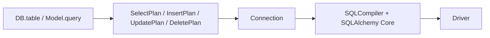

Builders produce engine-independent plans; `Connection` passes them to the compiler and executes the resulting SQL. Normally use the [Query Builder](/en/database/query-builder). This API serves integrations, inspection and tools that already have a structured query description.



## Execute a plan

This service receives the manager through its constructor. It requires an initialized application and an existing products table. `Connection.select(plan)` returns a list of dictionaries; it differs from `RawQueryBuilder.get()`, which returns `Collection`.

```python
from orionis.database.contracts.connection_manager import IConnectionManager
from orionis.orm.query.expressions import OrderClause, SelectPlan, WhereClause
from orionis.orm.schema.table import TableDefinition


class ProductReport:
    def __init__(self, manager: IConnectionManager) -> None:
        self._manager = manager

    async def run(self) -> list[dict[str, object]]:
        plan = SelectPlan(
            table=TableDefinition(name="products"),
            columns=("id", "name", "price"),
            wheres=[WhereClause("price", operator=">=", value=10)],
            orders=[OrderClause("id")],
            limit_value=10,
        )
        return await self._manager.connection().select(plan)
```

Plans are dataclasses, rather than complete SQL validators. Supply correct columns, aliases and types; dynamic tables can resolve without a complete column catalog. Annotations alone do not prevent invalid values. SQL or capability errors become [execution-layer exceptions](/en/database/runtime-api).

## Enumerations and constants

<a id="constant-supported_operators"></a>

### `SUPPORTED_OPERATORS`

```python
from orionis.orm.query.expressions import SUPPORTED_OPERATORS

SUPPORTED_OPERATORS: frozenset[str] = frozenset({'=', '==', '!=', '<>', '<', '<=', '>', '>=', 'like', 'not like', 'ilike', 'not ilike'})
```

<a id="enum-wheretype"></a>

### `WhereType`

```python
from orionis.orm.query.expressions import WhereType

assert WhereType.BASIC.value == 'basic'
assert WhereType.IN.value == 'in'
assert WhereType.NOT_IN.value == 'not_in'
assert WhereType.NULL.value == 'null'
assert WhereType.NOT_NULL.value == 'not_null'
assert WhereType.BETWEEN.value == 'between'
assert WhereType.NOT_BETWEEN.value == 'not_between'
assert WhereType.LIKE.value == 'like'
assert WhereType.NOT_LIKE.value == 'not_like'
assert WhereType.ILIKE.value == 'ilike'
assert WhereType.NOT_ILIKE.value == 'not_ilike'
assert WhereType.STARTS_WITH.value == 'starts_with'
assert WhereType.ENDS_WITH.value == 'ends_with'
assert WhereType.CONTAINS.value == 'contains'
assert WhereType.REGEXP.value == 'regexp'
assert WhereType.NESTED.value == 'nested'
assert WhereType.COLUMN.value == 'column'
assert WhereType.RAW.value == 'raw'
assert WhereType.EXISTS.value == 'exists'
assert WhereType.NOT_EXISTS.value == 'not_exists'
```

<a id="constant-columnless_where_types"></a>

### `COLUMNLESS_WHERE_TYPES`

```python
from orionis.orm.query.expressions import COLUMNLESS_WHERE_TYPES, WhereType

COLUMNLESS_WHERE_TYPES: frozenset[WhereType] = frozenset({WhereType.NESTED, WhereType.RAW, WhereType.EXISTS, WhereType.NOT_EXISTS})
```

<a id="enum-lockmode"></a>

### `LockMode`

```python
from orionis.orm.query.expressions import LockMode

assert LockMode.UPDATE.value == 'update'
assert LockMode.SHARE.value == 'share'
```

<a id="enum-sortdirection"></a>

### `SortDirection`

```python
from orionis.orm.query.expressions import SortDirection

assert SortDirection.ASC.value == 'asc'
assert SortDirection.DESC.value == 'desc'
```

<a id="enum-aggregatefunction"></a>

### `AggregateFunction`

```python
from orionis.orm.query.expressions import AggregateFunction

assert AggregateFunction.COUNT.value == 'count'
assert AggregateFunction.MAX.value == 'max'
assert AggregateFunction.MIN.value == 'min'
assert AggregateFunction.AVG.value == 'avg'
assert AggregateFunction.SUM.value == 'sum'
```

<a id="enum-jointype"></a>

### `JoinType`

```python
from orionis.orm.query.expressions import JoinType

assert JoinType.INNER.value == 'inner'
assert JoinType.LEFT.value == 'left'
assert JoinType.RIGHT.value == 'right'
assert JoinType.FULL.value == 'full'
assert JoinType.CROSS.value == 'cross'
```

WHERE, HAVING and ON conditions combine **left to right**: A OR B AND C is built as `(A OR B) AND C`. Use explicit groups to express different association. Enums do not guarantee support on every engine: RIGHT/FULL, regex and locks depend on the dialect.

## Public structures

<a id="plan-rawexpression"></a>

### `RawExpression`

Trusted SQL fragment with bound values. Its attributes are frozen, but its bindings dictionary remains mutable.

```python
from dataclasses import dataclass, field
from typing import Any
from orionis.orm.schema.table import TableDefinition
from orionis.orm.query.expressions import (
    AggregateClause, AggregateFunction, JoinCondition, JoinExpression,
    JoinType, LockMode, OrderClause, RawExpression, SelectPlan, SortDirection,
    SubQueryColumn, UnionClause, WhereClause, WhereType,
)

@dataclass(slots=True, frozen=True)
class RawExpression:
    sql: str
    bindings: dict[str, Any] = field(default_factory=dict)
    alias: str | None = None
```

| Field | Meaning |
| --- | --- |
| `sql` | SQL text with :name placeholders. |
| `bindings` | Names and values dictionary; a separate one is created for each instance. |
| `alias` | Source or projection alias; None retains its logical name where allowed. |

Each `field(default_factory=list/dict)` creates a separate container. Other defaults and types appear in the declaration above.

```python
from orionis.orm.query.expressions import (
    AggregateClause, AggregateFunction, DeletePlan, InsertPlan, JoinCondition,
    JoinExpression, JoinType, OrderClause, RawExpression, SelectPlan, SortDirection,
    SubQueryColumn, UnionClause, UpdatePlan, WhereClause,
)
from orionis.orm.schema.table import TableDefinition

table = TableDefinition(name="products")
expression = RawExpression("price * :factor", {"factor": 2}, alias="double_price")
```

<a id="plan-subquerycolumn"></a>

### `SubQueryColumn`

Scalar subquery projection: it must produce one column and at most one row per evaluation. The engine determines the error if it returns several.

```python
from dataclasses import dataclass, field
from typing import Any
from orionis.orm.schema.table import TableDefinition
from orionis.orm.query.expressions import (
    AggregateClause, AggregateFunction, JoinCondition, JoinExpression,
    JoinType, LockMode, OrderClause, RawExpression, SelectPlan, SortDirection,
    SubQueryColumn, UnionClause, WhereClause, WhereType,
)

@dataclass(slots=True, frozen=True)
class SubQueryColumn:
    plan: SelectPlan
    alias: str
```

| Field | Meaning |
| --- | --- |
| `plan` | SelectPlan incorporated into the outer query without executing another connection. |
| `alias` | Required scalar-column alias in the outer query. |

Each `field(default_factory=list/dict)` creates a separate container. Other defaults and types appear in the declaration above.

```python
from orionis.orm.query.expressions import (
    AggregateClause, AggregateFunction, DeletePlan, InsertPlan, JoinCondition,
    JoinExpression, JoinType, OrderClause, RawExpression, SelectPlan, SortDirection,
    SubQueryColumn, UnionClause, UpdatePlan, WhereClause,
)
from orionis.orm.schema.table import TableDefinition

table = TableDefinition(name="products")
column = SubQueryColumn(SelectPlan(table=table, aggregate=AggregateClause(AggregateFunction.MAX, "price")), "maximum_price")
```

<a id="plan-whereclause"></a>

### `WhereClause`

WHERE or HAVING condition. Its type determines how value is interpreted; boolean connects it to the preceding condition.

```python
from dataclasses import dataclass, field
from typing import Any
from orionis.orm.schema.table import TableDefinition
from orionis.orm.query.expressions import (
    AggregateClause, AggregateFunction, JoinCondition, JoinExpression,
    JoinType, LockMode, OrderClause, RawExpression, SelectPlan, SortDirection,
    SubQueryColumn, UnionClause, WhereClause, WhereType,
)

@dataclass(slots=True)
class WhereClause:
    column: str
    where_type: WhereType = WhereType.BASIC
    operator: str = '='
    value: Any = None
    boolean: str = 'and'
```

| Field | Meaning |
| --- | --- |
| `column` | Column name, optionally qualified; empty for columnless conditions. COUNT aggregates may use *. |
| `where_type` | WhereType condition kind; BASIC by default. |
| `operator` | Comparison operator; = by default. Use supported operators. |
| `value` | Scalar value; iterable for IN/BETWEEN; WhereClause list for NESTED; RawExpression for RAW; SelectPlan for EXISTS or subquery IN. |
| `boolean` | and or or, combined left to right with previous conditions. |

Each `field(default_factory=list/dict)` creates a separate container. Other defaults and types appear in the declaration above.

```python
from orionis.orm.query.expressions import (
    AggregateClause, AggregateFunction, DeletePlan, InsertPlan, JoinCondition,
    JoinExpression, JoinType, OrderClause, RawExpression, SelectPlan, SortDirection,
    SubQueryColumn, UnionClause, UpdatePlan, WhereClause,
)
from orionis.orm.schema.table import TableDefinition

table = TableDefinition(name="products")
condition = WhereClause("price", operator=">=", value=10)
```

<a id="plan-orderclause"></a>

### `OrderClause`

One ordering column and its direction.

```python
from dataclasses import dataclass, field
from typing import Any
from orionis.orm.schema.table import TableDefinition
from orionis.orm.query.expressions import (
    AggregateClause, AggregateFunction, JoinCondition, JoinExpression,
    JoinType, LockMode, OrderClause, RawExpression, SelectPlan, SortDirection,
    SubQueryColumn, UnionClause, WhereClause, WhereType,
)

@dataclass(slots=True)
class OrderClause:
    column: str
    direction: SortDirection = SortDirection.ASC
```

| Field | Meaning |
| --- | --- |
| `column` | Column name, optionally qualified; empty for columnless conditions. COUNT aggregates may use *. |
| `direction` | SortDirection.ASC or DESC. |

Each `field(default_factory=list/dict)` creates a separate container. Other defaults and types appear in the declaration above.

```python
from orionis.orm.query.expressions import (
    AggregateClause, AggregateFunction, DeletePlan, InsertPlan, JoinCondition,
    JoinExpression, JoinType, OrderClause, RawExpression, SelectPlan, SortDirection,
    SubQueryColumn, UnionClause, UpdatePlan, WhereClause,
)
from orionis.orm.schema.table import TableDefinition

table = TableDefinition(name="products")
order = OrderClause("id", SortDirection.DESC)
```

<a id="plan-aggregateclause"></a>

### `AggregateClause`

Aggregate replacing the SELECT projection. COUNT accepts *, while the others require a column.

```python
from dataclasses import dataclass, field
from typing import Any
from orionis.orm.schema.table import TableDefinition
from orionis.orm.query.expressions import (
    AggregateClause, AggregateFunction, JoinCondition, JoinExpression,
    JoinType, LockMode, OrderClause, RawExpression, SelectPlan, SortDirection,
    SubQueryColumn, UnionClause, WhereClause, WhereType,
)

@dataclass(slots=True)
class AggregateClause:
    function: AggregateFunction
    column: str = '*'
```

| Field | Meaning |
| --- | --- |
| `function` | AggregateFunction: COUNT, MAX, MIN, AVG or SUM. |
| `column` | Column name, optionally qualified; empty for columnless conditions. COUNT aggregates may use *. |

Each `field(default_factory=list/dict)` creates a separate container. Other defaults and types appear in the declaration above.

```python
from orionis.orm.query.expressions import (
    AggregateClause, AggregateFunction, DeletePlan, InsertPlan, JoinCondition,
    JoinExpression, JoinType, OrderClause, RawExpression, SelectPlan, SortDirection,
    SubQueryColumn, UnionClause, UpdatePlan, WhereClause,
)
from orionis.orm.schema.table import TableDefinition

table = TableDefinition(name="products")
aggregate = AggregateClause(AggregateFunction.SUM, "price")
```

<a id="plan-joincondition"></a>

### `JoinCondition`

Comparison between two column references in ON; second is not a bound value.

```python
from dataclasses import dataclass, field
from typing import Any
from orionis.orm.schema.table import TableDefinition
from orionis.orm.query.expressions import (
    AggregateClause, AggregateFunction, JoinCondition, JoinExpression,
    JoinType, LockMode, OrderClause, RawExpression, SelectPlan, SortDirection,
    SubQueryColumn, UnionClause, WhereClause, WhereType,
)

@dataclass(slots=True)
class JoinCondition:
    first: str
    operator: str = '='
    second: str = ''
    boolean: str = 'and'
```

| Field | Meaning |
| --- | --- |
| `first` | Left column reference; accepts table.column. |
| `operator` | Comparison operator; = by default. Use supported operators. |
| `second` | Right column reference, rather than a string literal value. |
| `boolean` | and or or, combined left to right with previous conditions. |

Each `field(default_factory=list/dict)` creates a separate container. Other defaults and types appear in the declaration above.

```python
from orionis.orm.query.expressions import (
    AggregateClause, AggregateFunction, DeletePlan, InsertPlan, JoinCondition,
    JoinExpression, JoinType, OrderClause, RawExpression, SelectPlan, SortDirection,
    SubQueryColumn, UnionClause, UpdatePlan, WhereClause,
)
from orionis.orm.schema.table import TableDefinition

table = TableDefinition(name="products")
condition = JoinCondition("p.category_id", "=", "c.id")
```

<a id="plan-joinexpression"></a>

### `JoinExpression`

JOIN source, alias and ON conditions. A subquery source needs an alias. CROSS JOIN does not require ON.

```python
from dataclasses import dataclass, field
from typing import Any
from orionis.orm.schema.table import TableDefinition
from orionis.orm.query.expressions import (
    AggregateClause, AggregateFunction, JoinCondition, JoinExpression,
    JoinType, LockMode, OrderClause, RawExpression, SelectPlan, SortDirection,
    SubQueryColumn, UnionClause, WhereClause, WhereType,
)

@dataclass(slots=True)
class JoinExpression:
    join_type: JoinType
    table: TableDefinition | SelectPlan
    alias: str | None = None
    conditions: list[JoinCondition] = field(default_factory=list)
```

| Field | Meaning |
| --- | --- |
| `join_type` | JoinType subject to actual engine support. |
| `table` | TableDefinition describing the table; JoinExpression also accepts SelectPlan for a derived table. |
| `alias` | Source or projection alias; None retains its logical name where allowed. |
| `conditions` | JoinCondition list for ON. |

Each `field(default_factory=list/dict)` creates a separate container. Other defaults and types appear in the declaration above.

```python
from orionis.orm.query.expressions import (
    AggregateClause, AggregateFunction, DeletePlan, InsertPlan, JoinCondition,
    JoinExpression, JoinType, OrderClause, RawExpression, SelectPlan, SortDirection,
    SubQueryColumn, UnionClause, UpdatePlan, WhereClause,
)
from orionis.orm.schema.table import TableDefinition

table = TableDefinition(name="products")
join = JoinExpression(JoinType.LEFT, TableDefinition(name="categories"), alias="c", conditions=[JoinCondition("p.category_id", "=", "c.id")])
```

<a id="plan-unionclause"></a>

### `UnionClause`

Additional SELECT, either removing duplicates or retaining them with UNION ALL.

```python
from dataclasses import dataclass, field
from typing import Any
from orionis.orm.schema.table import TableDefinition
from orionis.orm.query.expressions import (
    AggregateClause, AggregateFunction, JoinCondition, JoinExpression,
    JoinType, LockMode, OrderClause, RawExpression, SelectPlan, SortDirection,
    SubQueryColumn, UnionClause, WhereClause, WhereType,
)

@dataclass(slots=True)
class UnionClause:
    plan: SelectPlan
    all_rows: bool = False
```

| Field | Meaning |
| --- | --- |
| `plan` | SelectPlan incorporated into the outer query without executing another connection. |
| `all_rows` | False generates UNION; True generates UNION ALL. |

Each `field(default_factory=list/dict)` creates a separate container. Other defaults and types appear in the declaration above.

```python
from orionis.orm.query.expressions import (
    AggregateClause, AggregateFunction, DeletePlan, InsertPlan, JoinCondition,
    JoinExpression, JoinType, OrderClause, RawExpression, SelectPlan, SortDirection,
    SubQueryColumn, UnionClause, UpdatePlan, WhereClause,
)
from orionis.orm.schema.table import TableDefinition

table = TableDefinition(name="products")
union = UnionClause(SelectPlan(table=table, columns=("id",)), all_rows=True)
```

<a id="plan-selectplan"></a>

### `SelectPlan`

Complete representation of a read. Its attributes can be inspected and modified; constructing it neither opens a connection nor executes SQL.

```python
from dataclasses import dataclass, field
from typing import Any
from orionis.orm.schema.table import TableDefinition
from orionis.orm.query.expressions import (
    AggregateClause, AggregateFunction, JoinCondition, JoinExpression,
    JoinType, LockMode, OrderClause, RawExpression, SelectPlan, SortDirection,
    SubQueryColumn, UnionClause, WhereClause, WhereType,
)

@dataclass(slots=True)
class SelectPlan:
    table: TableDefinition
    alias: str | None = None
    joins: list[JoinExpression] = field(default_factory=list)
    columns: tuple[str | SubQueryColumn | RawExpression, ...] = ()
    wheres: list[WhereClause] = field(default_factory=list)
    orders: list[OrderClause] = field(default_factory=list)
    groups: list[str] = field(default_factory=list)
    havings: list[WhereClause] = field(default_factory=list)
    limit_value: int | None = None
    offset_value: int | None = None
    aggregate: AggregateClause | None = None
    distinct: bool = False
    lock: LockMode | None = None
    unions: list[UnionClause] = field(default_factory=list)
```

| Field | Meaning |
| --- | --- |
| `table` | TableDefinition describing the table; JoinExpression also accepts SelectPlan for a derived table. |
| `alias` | Source or projection alias; None retains its logical name where allowed. |
| `joins` | List of JoinExpression sources. |
| `columns` | Tuple of str, SubQueryColumn or RawExpression; empty selects all columns. |
| `wheres` | WhereClause list delimiting rows. An empty list adds no WHERE. |
| `orders` | OrderClause list applied to the read. |
| `groups` | List of GROUP BY column names. |
| `havings` | List of WhereClause conditions following grouping. |
| `limit_value` | Maximum rows; None adds no limit. |
| `offset_value` | Rows to skip; None adds no offset. |
| `aggregate` | AggregateClause, or None to retain the columns projection. |
| `distinct` | False by default; True requests SELECT DISTINCT. |
| `lock` | LockMode or None. SQLite omits row locking; Redshift rejects it. |
| `unions` | UnionClause list appended to the SELECT. |

Each `field(default_factory=list/dict)` creates a separate container. Other defaults and types appear in the declaration above.

```python
from orionis.orm.query.expressions import (
    AggregateClause, AggregateFunction, DeletePlan, InsertPlan, JoinCondition,
    JoinExpression, JoinType, OrderClause, RawExpression, SelectPlan, SortDirection,
    SubQueryColumn, UnionClause, UpdatePlan, WhereClause,
)
from orionis.orm.schema.table import TableDefinition

table = TableDefinition(name="products")
plan = SelectPlan(table=table, columns=("id", "name"), wheres=[WhereClause("price", operator=">=", value=10)], orders=[OrderClause("id")], limit_value=10)
```

<a id="plan-insertplan"></a>

### `InsertPlan`

Table and list of rows to insert. It does not apply model configuration or events.

```python
from dataclasses import dataclass, field
from typing import Any
from orionis.orm.schema.table import TableDefinition
from orionis.orm.query.expressions import (
    AggregateClause, AggregateFunction, JoinCondition, JoinExpression,
    JoinType, LockMode, OrderClause, RawExpression, SelectPlan, SortDirection,
    SubQueryColumn, UnionClause, WhereClause, WhereType,
)

@dataclass(slots=True)
class InsertPlan:
    table: TableDefinition
    values: list[dict[str, Any]] = field(default_factory=list)
```

| Field | Meaning |
| --- | --- |
| `table` | TableDefinition describing the table; JoinExpression also accepts SelectPlan for a derived table. |
| `values` | list[dict] in InsertPlan; column-to-value dict in UpdatePlan. |

Each `field(default_factory=list/dict)` creates a separate container. Other defaults and types appear in the declaration above.

```python
from orionis.orm.query.expressions import (
    AggregateClause, AggregateFunction, DeletePlan, InsertPlan, JoinCondition,
    JoinExpression, JoinType, OrderClause, RawExpression, SelectPlan, SortDirection,
    SubQueryColumn, UnionClause, UpdatePlan, WhereClause,
)
from orionis.orm.schema.table import TableDefinition

table = TableDefinition(name="products")
plan = InsertPlan(table=table, values=[{"name": "Book", "price": 10}])
```

<a id="plan-updateplan"></a>

### `UpdatePlan`

Table, new values and update filters. It has no JOIN, ordering, limit or offset fields.

```python
from dataclasses import dataclass, field
from typing import Any
from orionis.orm.schema.table import TableDefinition
from orionis.orm.query.expressions import (
    AggregateClause, AggregateFunction, JoinCondition, JoinExpression,
    JoinType, LockMode, OrderClause, RawExpression, SelectPlan, SortDirection,
    SubQueryColumn, UnionClause, WhereClause, WhereType,
)

@dataclass(slots=True)
class UpdatePlan:
    table: TableDefinition
    values: dict[str, Any] = field(default_factory=dict)
    wheres: list[WhereClause] = field(default_factory=list)
```

| Field | Meaning |
| --- | --- |
| `table` | TableDefinition describing the table; JoinExpression also accepts SelectPlan for a derived table. |
| `values` | list[dict] in InsertPlan; column-to-value dict in UpdatePlan. |
| `wheres` | WhereClause list delimiting rows. An empty list adds no WHERE. |

Each `field(default_factory=list/dict)` creates a separate container. Other defaults and types appear in the declaration above.

```python
from orionis.orm.query.expressions import (
    AggregateClause, AggregateFunction, DeletePlan, InsertPlan, JoinCondition,
    JoinExpression, JoinType, OrderClause, RawExpression, SelectPlan, SortDirection,
    SubQueryColumn, UnionClause, UpdatePlan, WhereClause,
)
from orionis.orm.schema.table import TableDefinition

table = TableDefinition(name="products")
plan = UpdatePlan(table=table, values={"price": 12}, wheres=[WhereClause("id", value=1)])
```

<a id="plan-deleteplan"></a>

### `DeletePlan`

Table and deletion filters. An empty condition list means all rows.

```python
from dataclasses import dataclass, field
from typing import Any
from orionis.orm.schema.table import TableDefinition
from orionis.orm.query.expressions import (
    AggregateClause, AggregateFunction, JoinCondition, JoinExpression,
    JoinType, LockMode, OrderClause, RawExpression, SelectPlan, SortDirection,
    SubQueryColumn, UnionClause, WhereClause, WhereType,
)

@dataclass(slots=True)
class DeletePlan:
    table: TableDefinition
    wheres: list[WhereClause] = field(default_factory=list)
```

| Field | Meaning |
| --- | --- |
| `table` | TableDefinition describing the table; JoinExpression also accepts SelectPlan for a derived table. |
| `wheres` | WhereClause list delimiting rows. An empty list adds no WHERE. |

Each `field(default_factory=list/dict)` creates a separate container. Other defaults and types appear in the declaration above.

```python
from orionis.orm.query.expressions import (
    AggregateClause, AggregateFunction, DeletePlan, InsertPlan, JoinCondition,
    JoinExpression, JoinType, OrderClause, RawExpression, SelectPlan, SortDirection,
    SubQueryColumn, UnionClause, UpdatePlan, WhereClause,
)
from orionis.orm.schema.table import TableDefinition

table = TableDefinition(name="products")
plan = DeletePlan(table=table, wheres=[WhereClause("id", value=1)])
```

<a id="plan-selectplan-clone"></a>

## `SelectPlan.clone() -> SelectPlan`

Copies joins, wheres, orders, groups, havings and unions lists; retains references to their elements and to table, columns and aggregate. Appending a clause to the clone does not change the original list, but changing a shared clause affects both. This is not a deep copy. `QueryBuilderBase.clone()` uses the same operation.

```python
from orionis.orm.query.expressions import SelectPlan, WhereClause
from orionis.orm.schema.table import TableDefinition

original = SelectPlan(
    table=TableDefinition(name="products"),
    wheres=[WhereClause("price", operator=">=", value=10)],
)
branch = original.clone()
branch.wheres.append(WhereClause("active", value=True))
assert len(original.wheres) == 1
assert len(branch.wheres) == 2
assert branch.wheres[0] is original.wheres[0]
assert branch.table is original.table
```

<a id="builder-constructors"></a>

## Builder constructors

```text
QueryBuilderBase(table: TableDefinition | None = None) -> None
JoinClause() -> None
```

`QueryBuilderBase` creates an empty SelectPlan when no table is supplied and stores None as its connection name. It is the shared base; it does not itself provide connection resolution or row representation. Use `DB.table()` or `Model.query()` for executable queries. `JoinClause()` creates an empty ON list; its [methods](/en/database/joins-and-subqueries#api-join-on) only accumulate conditions.

```python
from orionis.orm.query.base_builder import QueryBuilderBase
from orionis.orm.query.join_clause import JoinClause
from orionis.orm.schema.table import TableDefinition

builder = QueryBuilderBase(TableDefinition(name="products"))
assert builder.toPlan().table.name == "products"
join = JoinClause().on("products.category_id", "=", "categories.id")
assert len(join.conditions()) == 1
```
