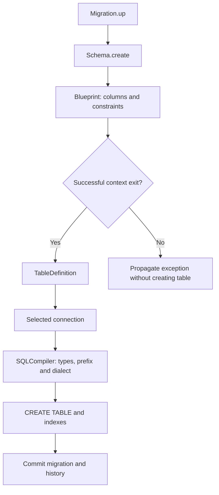

A physical schema describes tables, columns, keys, and indexes. **Defining a model does not create its table.** `Schema` turns a `Blueprint` or `TableDefinition` into connection operations; the ORM shares those metadata for query compilation. Organize persistent changes in [migrations](/en/database/migrations-and-seeders).

## Creating a table

```python
from orionis.database import Migration
from orionis.support.facades import Schema


class CreateProjects(Migration):
    async def up(self) -> None:
        async with Schema.create("projects") as table:
            table.id()
            table.string("name", 120)
            table.string("slug", 160)
            table.boolean("active").default(True)
            table.timestamps()
            table.unique("slug", name="uq_projects_slug")
            table.index("active", name="ix_projects_active")

    async def down(self) -> None:
        await Schema.drop("projects")
```

Save the class in a migration file and run migrate from the project. create() is synchronous and returns `TableCreation`: use async with, without await before `Schema.create`. Columns are collected in memory and SQL executes when the block exits without an exception. Exceptions are not suppressed. timestamps() adds nullable created_at and updated_at columns; it does not schedule their updates itself.



<a id="schema-init"></a>

## `Schema` API

Import the facade directly from orionis.support.facades. For injection, use `ISchema` from orionis.database.contracts.schema. Its provider registers a transient implementation because each instance retains its connection selection. The five public operations are:

<a id="schema-connection"></a>

### connection

```text
connection(name: str | None=None) -> Self
```

Select a connection and return the same instance. name=None explicitly selects the default connection. Only one selection per instance is permitted; calling again raises `ValueError` even with the same name. The facade resolves a new service per access.

```python
from orionis.support.facades import Schema


async def remove_reporting_table() -> bool:
    schema = await Schema.connection("reporting")
    return await schema.drop("old_reports")
```

<a id="schema-create"></a>

### create

```text
create(name: str) -> TableCreation
```

Return `TableCreation` to build a table named name or schema.table. Empty names, schema., or names containing more than one dot raise `ValueError` when the definition is processed. Unknown `Blueprint` factory names raise `AttributeError`.

```python
from orionis.database import Migration
from orionis.support.facades import Schema


class CreateProjects(Migration):
    async def up(self) -> None:
        async with Schema.create("projects") as table:
            table.id()
            table.string("name", 120)
            table.string("slug", 160)
            table.boolean("active").default(True)
            table.timestamps()
            table.unique("slug", name="uq_projects_slug")
            table.index("active", name="ix_projects_active")

    async def down(self) -> None:
        await Schema.drop("projects")
```

<a id="schema-createfromdefinition"></a>

### createFromDefinition

```text
async createFromDefinition(definition: TableDefinition) -> bool
```

Accept a reusable `TableDefinition` and return bool after awaiting. Uses the explicit connection, migration contextual connection, or default connection, in that order. Type/DDL failures propagate as `QueryException` or from the compiler.

```python
from database.schemas.projects_v1_schema import ProjectsV1Schema
from orionis.database import Migration
from orionis.support.facades import Schema


class CreateProjects(Migration):
    async def up(self) -> None:
        await Schema.createFromDefinition(ProjectsV1Schema.table_definition)

    async def down(self) -> None:
        await Schema.drop("projects")
```

<a id="schema-createfrommodel"></a>

### createFromModel

```text
async createFromModel(model: type[Model]) -> bool
```

Accept a concrete `Model` class, never an instance or the abstract base; otherwise `TypeError` is raised. Connection selection is explicit > model declared connection > migration contextual connection > default. Returns bool. Uses current metadata: appropriate for bootstrap and testing, not for freezing migration history.

```python
from app.models.project import Project
from orionis.support.facades import Schema


async def prepare_test_table() -> bool:
    return await Schema.createFromModel(Project)
```

<a id="schema-drop"></a>

### drop

```text
async drop(name: str) -> bool
```

Drop a table and return bool. Accepts schema.table and splits the schema from the name before passing it to the connection. The underlying operation uses if_exists=True; `Schema` exposes no argument for changing that flag. Table contents are removed.

```python
from orionis.support.facades import Schema


async def remove_projects() -> bool:
    return await Schema.drop("projects")
```

<a id="schema-generator"></a>

## Shared versioned definitions

Generate the holder with either command below. name is required; `Schema` is appended when absent. catalog/projects_v1 creates database/schemas/catalog/projects_v1_schema.py and ProjectsV1Schema. No table contents are generated automatically.

```shell
orionis make:database-schema projects_v1
python -B reactor make:database-schema projects_v1
```

```python
from orionis.database.schema.column import Column
from orionis.orm.schema import TableDefinition


class ProjectsV1Schema:
    table_definition = TableDefinition(
        name="projects",
        columns={
            "id": Column.id(),
            "name": Column.string("name", 120),
        },
        primary_key="id",
    )
```

Save the example in database/schemas/projects_v1_schema.py. `TableDefinition` contains the logical name, columns, and constraints. A model metaclass accepts table_definition = ProjectsV1Schema.table_definition. Freeze V1: introduce V2 and another migration to evolve the schema instead of changing an applied migration. Nested directories are created automatically; an existing file raises `FileExistsError` and there is no --force. Names, relative paths, suffixes, and rejections follow the [migration generator](/en/database/migrations-and-seeders#generating-a-migration).

<a id="blueprint-api"></a>

## `Blueprint` and direct access

`Blueprint`() starts an empty collector. All 40 `Column` factories become blueprint methods automatically and register their result; calling `Column.string` separately does not register it on a blueprint. columns() -> tuple[`ColumnDefinition`, ...] returns a column snapshot. definitions() -> tuple[`SchemaDefinition`, ...] returns columns followed by constraints, preserving order within each group. `SchemaDefinition` is the union of `ColumnDefinition`, `Comment`, `ForeignKey`, `Index`, `PrimaryKey`, and `Unique`.

```python
from orionis.database.schema.blueprint import Blueprint


table = Blueprint()
table.id()
table.string("name", 120)
table.unique("name")
columns = table.columns()
definitions = table.definitions()
```

Creation preserves an existing table using checkfirst=True and returns True; it neither compares columns nor updates the structure. `IConnection.createTable`(definition, if_not_exists=False) is the lower level exposing strict creation. The connection prefix applies to structured tables and references; do not duplicate it in name. Raw SQL receives no such transformation.

The code exposes no `Schema.table`, alter, rename, hasTable, or dropIfExists. [Alterations](/en/database/schema-alterations) require explicit backend SQL. See [all types](/en/database/column-types), [modifiers and keys](/en/database/schema-modifiers), and [`TableDefinition`](/en/database/orm/schema-and-type-reference) to complete a declaration.

Declaring the same column name more than once causes `Schema` to retain the last definition; it neither creates two columns nor reports a duplicate. Declare each name once to avoid accidentally replacing options.


<a id="tablecreation-init"></a>

### Direct service and context construction

```text
Schema(conn_manager: IConnectionManager)
TableCreation(schema: Schema, name: str)
```

The container constructs `Schema` with `IConnectionManager`. `TableCreation` is the context returned by create: __aenter__ yields `Blueprint` and __aexit__ creates only when no exception occurred, returns False, and propagates failures. To select a connection through the facade, await the service first: schema = await `Schema.connection`("reporting"); then use schema.create or await schema.drop. Selection is synchronous on an `ISchema` instance, but facade dispatch resolves through await.
