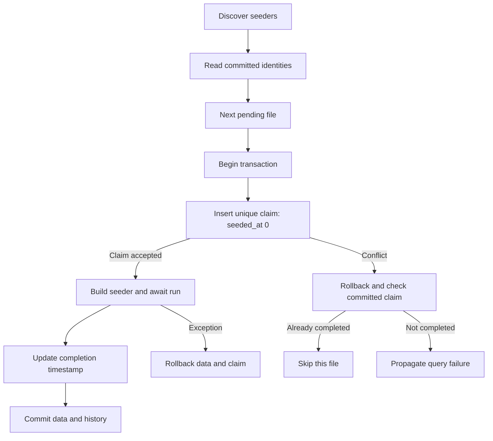

A seeder describes initial or development data in a class with an async run method. `SeederRunner` discovers pending files and records execution in the seeders table. A recorded seeder does not run again on that connection; a factory generates models each time it is called and does not replace that history. Migrate referenced tables first.

## Creating a seeder

```shell
orionis make:database-seeder default_flags
python -B reactor make:database-seeder default_flags
```

name: str is required. The command uses database_seeders, normally database/seeders. default_flags creates default_flags_seeder.py and DefaultFlagsSeeder, appending `Seeder` only when absent. The stub imports `Seeder` and creates an empty async def run(self) -> None. No overwrite or model selection flags exist. Subdirectories are accepted and created automatically; absolute paths, . and .., empty components, or invalid module names are rejected. Existing files are never overwritten.

Complete the generated file. The flags table belongs to the [example migration](/en/database/migrations).

```python
from orionis.database import Seeder
from orionis.support.facades import DB


class DefaultFlagsSeeder(Seeder):
    async def run(self) -> None:
        await DB.table("flags").insert({"name": "enabled"})
```

<a id="seeder-contract"></a>

## Running pending seeders

[Database command reference](/en/database/commands): syntax, arguments and options for all 14 commands, including inspection and wiping.

```shell
orionis seed
python -B reactor seed

orionis db:seed --database reporting
python -B reactor db:seed --database reporting

orionis migrate --seed
python -B reactor migrate --seed
```

Each pair is an alternative. seed and db:seed behave identically. They accept --database NAME / -d NAME (optional str, None selects the default) and -h/--help. Neither accepts a class argument, --class, --force, --count, or --seed. migrate --seed applies migrations and then runs pending seeders. A seeder failure does not undo previously committed migrations.

## Ordering and identity

Files are discovered recursively and sorted lexically by stem. Only locally defined `Seeder` subclasses count; reexports are not executed. Each identity must identify one unambiguous class. Multiple local classes in a file or matching stems in different subdirectories raise `ValueError`. Additional __init__.py files are not required.

For data dependencies use sortable names such as s010_roles_seeder.py and s020_users_seeder.py; the generator adds no timestamp and resolves no dependency graph. Using a model does not create its table. Add a new seeder to change previously seeded production data instead of renaming or editing a completed file. Discovery is cached on each runner instance.

## Transactions, exclusion, and failures



seeders contains id, unique seeder identity, batch, and seeded_at (epoch seconds). Each seeder claims its unique identity before run; data and history commit in the same transaction. If another execution has already committed that identity, the second skips it. A failed claim without a completed seeder propagates its `QueryException`; arbitrary database errors do not become silent skips.

A run failure rolls back its writes and claim, leaving it pending for retry. Earlier seeders may already be committed; there is no transaction around the whole set. Keep operations on the contextual connection and the same async task. Do not assume rollback can reverse email or external services. Claims require enforced UNIQUE constraints: **Redshift rejects seed before starting** because it cannot guarantee them.

## Dependency injection

`SeederRunner` constructs each class with app.build, so constructors can receive services. run is called without arguments and receives no additional injected method parameters. This example replaces the facade with the real Query Builder contract:

```python
from orionis.database import Seeder
from orionis.orm.contracts.query_builder import IQueryBuilder


class DefaultFlagsSeeder(Seeder):
    def __init__(self, db: IQueryBuilder) -> None:
        self._db = db

    async def run(self) -> None:
        await self._db.table("flags").insert({"name": "enabled"})
```

See also [`Faker`](/en/faker) for simulated data.

## Models and factories

The file below acts as a seeder after products has been created with id, name, and price. `Factory.definition` is synchronous; create is asynchronous and persists through the normal model flow. The runner already provides the transaction around all 20 inserts.

```python
from decimal import Decimal
from typing import Any
from orionis.database import Seeder
from orionis.orm import Integer, Model, Numeric, String
from orionis.orm.factories import Factory


class Product(Model):
    table = "products"
    timestamps = False
    fillable = ("name", "price")
    id = Integer().primary().autoIncrement()
    name = String(120)
    price = Numeric(12, 2)


class ProductFactory(Factory[Product]):
    model = Product

    def definition(self) -> dict[str, Any]:
        return {"name": "Demo product", "price": Decimal("9.50")}


class DemoProductsSeeder(Seeder):
    async def run(self) -> None:
        await ProductFactory().count(20).create()
```

These records deliberately repeat values and the table declares no UNIQUE(name). For variations, sequences, `Faker`, relations, and states, use the [factory guide](/en/orm/factories). Do not expect `Factory` to create tables or assign relations by itself.

<a id="seederrunner-seed"></a>

## `SeederRunner` API

<a id="seederrunner-init"></a>

```text
SeederRunner(app: IApplication, conn_manager: IConnectionManager)
async seed(*, connection: str | None=None, events: SeederEvents | None=None) -> list[str]
```

seed returns list[str] of identities completed by that call in order, or [] when none are pending or another execution claimed them. connection=None selects the default; events=None disables progress. `SeederEvents` aliases `MigrationEvents` and uses synchronous on_start(name), on_success(name, elapsed), and on_error(name, elapsed) callbacks. All defaults are None. See [migration events](/en/database/migrations#progress-and-errors) for signatures and started/succeeded/failed methods.

```python
from orionis.console.base.command import BaseCommand
from orionis.database import SeederRunner
from orionis.database.seeders.events import SeederEvents


class SeedReporting(BaseCommand):
    signature = "database:seed-reporting"
    description = "Run pending seeders on reporting."

    async def handle(self, runner: SeederRunner) -> None:
        events = SeederEvents(
            on_start=lambda name: self.info(f"Starting {name}"),
            on_success=lambda name, elapsed: self.info(f"Done {name}: {elapsed:.2f}s"),
            on_error=lambda name, elapsed: self.error(f"Failed {name}: {elapsed:.2f}s"),
        )
        names = await runner.seed(connection="reporting", events=events)
        self.info(f"Completed: {len(names)}")
```

## Explicitly executing one class

seed provides no individual class selection. An application needing a specific class can resolve it and invoke run from a custom command. This is explicit execution **without `SeederRunner` tracking or claims**; it repeats on every call and you must decide idempotency. The example requires either the dependency free DefaultFlagsSeeder variant or registered dependencies.

```python
from database.seeders.default_flags_seeder import DefaultFlagsSeeder
from orionis.console.base.command import BaseCommand
from orionis.support.facades import DB


class InsertDefaultFlags(BaseCommand):
    signature = "database:insert-default-flags"
    description = "Invoke one seeder explicitly without recorded history."

    async def handle(self, seeder: DefaultFlagsSeeder) -> None:
        async with DB.transaction():
            await seeder.run()
```

## Relationship with rollback and rebuilding

Seeders have no down method or separate rollback command. When migrate:rollback/reset reverts every applied migration on a connection, seeders history is removed too. A partial reversal preserves it. migrate:fresh rebuilds both histories and then needs seed or migrate --seed to repopulate. Preserve data through carefully designed migrations rather than manual tracking edits.
