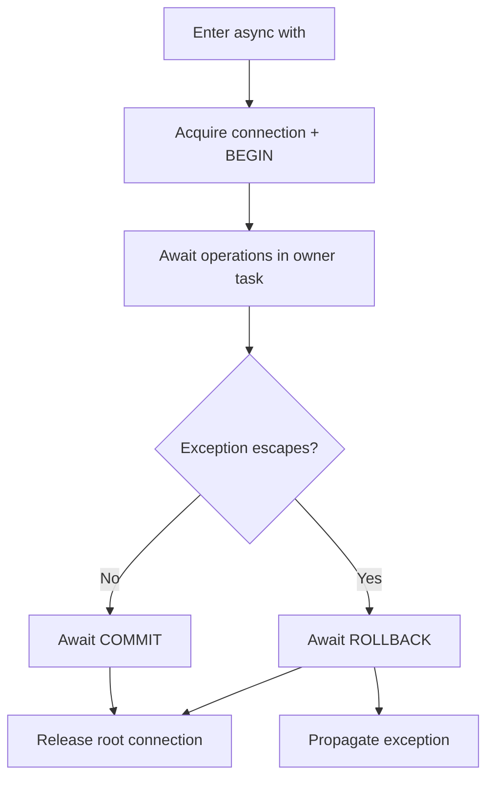

A transaction groups reads and writes into a unit that can be committed together. Use the same connection name and asyncio task. `DB`, raw SQL and models using that connection share transaction state. No distributed coordinator spans connections or servers.

## Async context manager

```python
from orionis.support.facades import DB


async def transfer(source_id: int, target_id: int, amount: int) -> None:
    if source_id == target_id or amount <= 0:
        raise ValueError("Invalid transfer")
    async with DB.transaction():
        debited = await DB.execute(
            "UPDATE accounts SET balance = balance - :amount "
            "WHERE id = :id AND balance >= :amount",
            {"amount": amount, "id": source_id},
        )
        if debited != 1:
            raise ValueError("Account missing or insufficient funds")
        credited = await DB.execute(
            "UPDATE accounts SET balance = balance + :amount WHERE id = :id",
            {"amount": amount, "id": target_id},
        )
        if credited != 1:
            raise ValueError("Target account missing")
```

Requires `accounts` with a unique `id` and integer `balance`. The debit condition is evaluated in the database, avoiding reliance on an earlier read that could become stale.

Entry opens a dedicated connection and transaction level. Normal exit awaits `commit()`. Any escaping `BaseException`, including cancellation, triggers `rollback()` and propagates. Hiding an exception **inside** the block makes exit appear successful and commits: re-raise or catch outside.

`async with DB.transaction() as transaction` yields the context, not a builder or SQL connection. Continue querying through `DB` or models; do not manually settle the same level managed by the context.



## Equivalent manual control

```python
from orionis.support.facades import DB


async def record_event(message: str) -> None:
    await DB.beginTransaction()
    try:
        await DB.execute(
            "INSERT INTO audit_log (message) VALUES (:message)", {"message": message}
        )
    except BaseException:
        await DB.rollback()
        raise
    else:
        await DB.commit()
```

`beginTransaction(name=None)`, `commit(name=None)` and `rollback(name=None)` are async and return `None`. Begin occurs before `try`: if it fails there is no owned level to roll back. Commit is in `else`: after a failure, do not assume an active level remains available to roll back.

Each settlement closes the innermost level; without an active transaction, `commit()`/`rollback()` raise `TransactionException`. Keep the same name for begin, queries and settlement. See [DB signatures](/en/database/db-facade#transaction-control).

Use `finally` to release resources you created. Do not dispose the singleton manager after business operations. For a test or preview that must always roll back, use `try/finally` and `rollback()` with no commit branch.

## Selecting the connection

```python
from orionis.support.facades import DB


async def report_event(message: str) -> None:
    reporting = DB.connection("reporting")
    async with reporting.transaction():
        await reporting.execute(
            "INSERT INTO audit_log (message) VALUES (:message)", {"message": message}
        )
```

A scoped gateway does not establish a block-wide implicit default. Unnamed `DB.table("...")` still resolves the manager default, except within the dedicated migration context. Use the scoped gateway or `connection="reporting"` on each builder to participate in its transaction.

## Savepoints and nesting

```python
from orionis.support.facades import DB


async def save_with_optional_event() -> None:
    async with DB.transaction():
        await DB.execute(
            "INSERT INTO notes (body) VALUES (:body)", {"body": "retained"}
        )
        try:
            async with DB.transaction():
                await DB.execute(
                    "INSERT INTO notes (body) VALUES (:body)", {"body": "discarded"}
                )
                raise ValueError("Discard only inner work")
        except ValueError:
            pass
```

The first level starts a root transaction; later levels create savepoints on the same connection. Catching outside the inner context rolls back its row while the outer row can commit. If the exception also escapes the outer block, everything rolls back.

Redshift rejects nesting with `TransactionException`. Other drivers request savepoints, subject to their DDL compatibility. These are not independent transactions, and `DB.transaction()` exposes no savepoint-name or isolation arguments.

## Concurrency and task ownership

A `ContextVar` retains the stack and owning task. A child inherits context but not ownership: attempting to use that active state raises `TransactionException`. Do not share a transaction through `asyncio.gather()` or `create_task()`; await operations sequentially in its task.

Outside transactions, independent tasks may acquire different physical connections. Create a builder per query: sharing mutable builders can mix conditions. In-memory SQLite uses one pooled connection with exclusive checkout, serializing acquisition.

`IConnection.inTransaction()` returns `True` only for the owning task with active levels. A child receives `False`, which does not authorize use of an inherited transaction. Inherited state that has already settled is cleared during resolution.

ORM pagination performs its count and rows sequentially inside transactions and may run them concurrently outside. Without a transaction there is no shared-snapshot guarantee between those results.

## Isolation and cancellation

Backend settings determine isolation. No universal policy or deadlock retries are added. Builder `lockForUpdate()`/`sharedLock()` apply on execution and depend on dialect support; Redshift rejects them and SQLite does not provide relational-server row locks.

`Connection.createTable()` requests `BEGIN IMMEDIATE` on SQLite when creating its own temporary transaction. It does not change an existing transaction's mode; normal operations use `BEGIN`.

Pool acquisition remains cancellable. Transaction control and cleanup drain driver work before propagating cancellation; Oracle also protects native execution and Redshift drains its worker. This protects resources but does not guarantee immediately stopping server-side SQL.

A submitted `COMMIT` may have persisted changes even when the caller receives `CancelledError`. Cancellation does not prove rollback. Verify outcomes through a stable identity or idempotency before retrying.

## External effects and DDL

Keep blocks short. Email, files and HTTP calls are not rolled back with SQL. A database queue can participate on its connection; Redis does not share the SQL transaction. This layer exposes no general `afterCommit` API.

DDL can implicitly commit depending on the backend. A transaction-wrapped migration does not guarantee complete structural rollback: test errors, locks and DDL against the chosen backend.

### Transaction

`Transaction(connection: IConnection)` implements `ITransaction`. `async __aenter__() -> ITransaction` opens a level and returns `self`. `async __aexit__(exc_type: type[BaseException] | None, exc: BaseException | None, traceback: TracebackType | None) -> bool` commits or rolls back according to `exc_type` and always returns `False`. Exceptions are not suppressed. Use `async with connection.transaction()` rather than calling these special methods manually.
