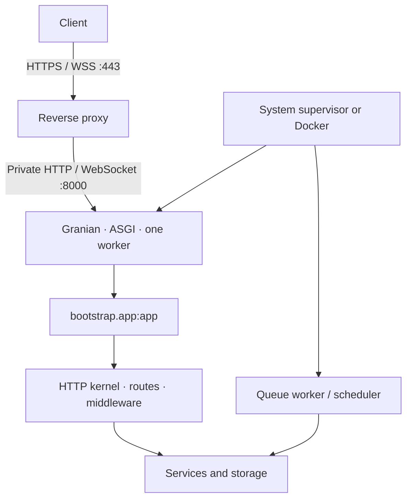

Publish your **complete application project**: code, `bootstrap/`, `config/`, `routes/`, `resources/`, `database/`, `reactor`, `pyproject.toml` and `uv.lock`, together with any frontend build artifacts it uses. Installing only the framework package does not publish your application.

The guides assume an installed, tested application. Replace the example domain `app.example.com`, paths and credentials with your own.

| Scenario | Application process | Proxy and HTTPS |
| --- | --- | --- |
| [Windows Server](/en/deployment/windows-server) | Windows service through WinSW | Caddy as a separate service |
| [Linux](/en/deployment/linux) | Unprivileged systemd service | Nginx with a TLS certificate |
| [Docker](/en/deployment/docker) | Unprivileged container | Caddy and a private Compose network |

## Publication architecture



Granian is already an Orionis dependency. The `app` object created in `bootstrap/app.py` implements **ASGI** and **RSGI**. These guides explicitly select ASGI, with its startup and shutdown lifecycle enabled, and one worker as a starting point. See [Application and Container](/en/application) to customize bootstrap.

## Prepare dependencies and configuration

Examples use Python **3.14**. Check your application's `requires-python`, `.python-version` and lockfile before choosing another version. Resolve and test required dependencies and extras in development; ship the resulting `uv.lock`. From the project root on the server:

```shell
uv sync --locked --no-default-groups --python 3.14
```

`--locked` requires the lockfile to match the project; correct it before publishing if validation fails. `--no-default-groups` excludes default groups, including `dev`; production dependencies must be declared outside those groups. Services subsequently run the Python in `.venv` directly, without resolving packages on every start. [uv reference](https://docs.astral.sh/uv/reference/cli/#uv-sync).

Provide the private production `.env` **before importing the application or running Reactor**. Set the service working directory to the project root: the environment component uses that location to read the file. Its values are consumed from `config/`. See [Environment](/en/environment).

```dotenv
APP_ENV=production
APP_DEBUG=bool:false
ALLOWED_HOSTS=list:["app.example.com"]
TRUSTED_PROXIES=list:["127.0.0.1"]
SESSION_DRIVER=file
SESSION_SECURE=bool:true
```

Keep the remaining variables, especially **the existing `APP_KEY`** and connections. This fragment assumes a proxy on the same server and file sessions on one instance; Docker uses a different proxy IP. Configuring sessions does not add them to API routes.

For a new installation without a key, `python -B reactor key:generate` creates one and saves it in `.env`; without `--force` it preserves an existing key. Provision it once and reuse it across all processes of the same application. Do not regenerate it on every deployment: previously encrypted data depends on it.

Use `.venv/bin/python` on Linux and `.venv\Scripts\python.exe` on Windows. Abbreviated `python` commands assume that environment is active:

```shell
python -B reactor about
python -B reactor route:list
python -B reactor serve --interface asgi --export
```

Run these checks with the service identity and working directory. `serve --export` prints the resolved command and exits without starting the server.

## Server and public files

```shell
python -B reactor serve --interface asgi --port 8000 --log
```

You can also use `orionis serve --interface asgi --port 8000 --log`. Reactor accepts `--interface` (`rsgi` by default or `asgi`), `--port` (8000), `--log` and `--export`; it **does not expose `--host`, `--workers` or `--reload`**.

| Decision | `serve` | Services in these guides |
| --- | --- | --- |
| Address | Loopback in development; `0.0.0.0` in production | Loopback on Windows/Linux; private network in Docker |
| Workers | One on Windows; CPU count on Unix | Explicitly one |
| Reload | Only outside production | Explicitly disabled |
| Public files | Reads the `public` disk | Equivalent mount configured in Granian |

The guides call `python -B -m granian` to pin those decisions. The target is `bootstrap.app:app`, without `--factory`. For RSGI, select `--interface rsgi` with the same object. Do not use `wsgi` or `asginl`: the first does not match Orionis's contract; the second omits ASGI lifespan. [Granian interfaces](https://github.com/emmett-framework/granian).

The default public disk is `storage/app/public`, published at `/static`. If you change `PUBLIC_PATH` or `PUBLIC_URL`, update the direct server's mount arguments as well. Granian serves that mount before the kernel: public files do not pass through Orionis middleware. Never publish the project root or `storage/app/private`.

## Permissions, caches and persistent data

The process needs to read code and write to directories it uses: bootstrap, logs, compiled views, sessions, temporary files and application files. These guides grant write access to `storage/`. SQLite also needs write access to the **directory** containing its file to create auxiliary files; configure that path and its permissions. See [database drivers](/en/database/drivers).

`app.compile(...)` enables persistence of configuration, commands and routes as startup prepares them, usually in `storage/framework/bootstrap`. This cache contains resolved configuration, absolute paths and possibly secrets. Protect it like `.env`; do not copy it from development or between releases with different code paths.

Invalidation checks paths declared in bootstrap. Changing only process variables does not guarantee invalidation of an existing cache. With the release stopped, remove its bootstrap cache or run `python -B reactor optimize:clear` knowing its scope: it also cleans bytecode and Python `build`/`dist` directories. Restart all persistent processes afterwards. See [application configuration](/en/application/configuration).

Keep uploads, SQLite databases, sessions and required persistent queues outside disposable releases. Docker uses volumes. A local directory is not automatically shared between servers.

## Data and auxiliary processes

Back up and review migrations before applying them. Run them once per deployment with the production configuration:

```shell
python -B reactor migrate:status
python -B reactor migrate
```

`migrate` accepts `--database` for another connection; it has no `--force` flag. Do not run `migrate:fresh`, `db:wipe` or demonstration seeders as a routine release step. See [database commands](/en/database/commands).

HTTP does not automatically start persistent queue workers or a CLI scheduler. If you use them, create separate services with the same code, configuration and key; follow [queues](/en/queues/workers) and [console and tasks](/en/console). Restart them when updating code too.

## Concurrency and verification

One worker does not make memory state durable. Before increasing workers or replicas, review [sessions](/en/sessions/stores-and-concurrency), [Realtime groups](/en/realtime/groups-and-deployment), [MCP events](/en/mcp/advanced-workflows), [cache](/en/cache) and [logs](/en/logging/rotation-and-lifecycle). A shared store does not by itself replace the Realtime connection registry.

Check the private backend, then the public domain. `/up`, if you retain the default route, returns 200 normally and 503 during maintenance; it does not automatically check databases. Test a real route, public files, secure sessions and WebSocket/SSE where present. [Health and default responses](/en/deployment/health-and-default-responses).

For a planned interruption, `python -B reactor down` writes the maintenance marker for processes sharing its storage; it does not interrupt operations already in progress. Stop processes, publish and verify; `python -B reactor up` restores availability. Investigate startup failures in the supervisor and [Logs](/en/logging).

Continue with [Windows Server](/en/deployment/windows-server), [Linux](/en/deployment/linux) or [Docker](/en/deployment/docker), and review [the proxy contract](/en/deployment/reverse-proxies).
