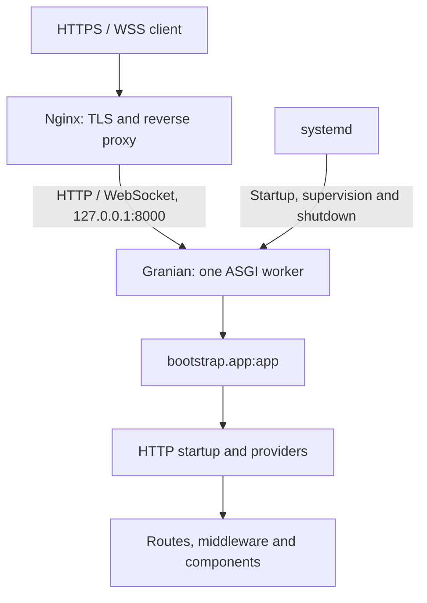

This guide uses a Debian/Ubuntu server with `systemd`, an application at `/srv/orionis-app`, an `orionis` service account and the example domain `app.example.com`. Replace the domain and provide a valid certificate for it. The application listens exclusively on `127.0.0.1:8000`; Nginx receives public connections.



## 1. Prepare the server and release

You need administrative access, DNS pointing to the server, public ports 80 and 443 enabled, and a release of your **application**, rather than only the `orionis` package. That release must contain `reactor`, `bootstrap/app.py`, the application directories, `pyproject.toml` and its reviewed `uv.lock`. Exclude `.venv`, credentials and caches generated on another machine.

The implementation requires Python 3.14 or later. This example selects Python 3.14; retain the Python version against which you have verified your application. Granian and its RSGI/ASGI integration are already Orionis dependencies.

On a new server, install the system tools and Nginx:

```bash
sudo apt update
sudo apt install --yes ca-certificates curl nginx
sudo useradd --system --user-group --create-home --home-dir /var/lib/orionis --shell /usr/sbin/nologin orionis
sudo install -d -o orionis -g orionis -m 0750 /srv/orionis-app
```

The distribution supplies the Nginx service and site layout used here; see its [Ubuntu installation guide](https://ubuntu.com/server/docs/how-to/web-services/install-nginx/) if the server already has another configuration.

Install `uv` for the service account. Its home directory will also retain the Python interpreter used by `.venv`:

```bash
sudo -u orionis -H sh -c 'curl -LsSf https://astral.sh/uv/install.sh | sh'
sudo -u orionis -H /var/lib/orionis/.local/bin/uv python install 3.14
```

These commands follow the [official uv installer](https://docs.astral.sh/uv/getting-started/installation/) and its [Python management guide](https://docs.astral.sh/uv/guides/install-python/). The account needs neither an interactive login nor administrator privileges to run the application.

## 2. Install application dependencies

Place the prepared release at `/tmp/orionis-release`. The following commands check its entry-point files before copying it:

```bash
set -eu
test -f /tmp/orionis-release/reactor
test -f /tmp/orionis-release/bootstrap/app.py
test -f /tmp/orionis-release/pyproject.toml
test -f /tmp/orionis-release/uv.lock
sudo cp -a /tmp/orionis-release/. /srv/orionis-app/
sudo chown -R orionis:orionis /srv/orionis-app
cd /srv/orionis-app
sudo -u orionis -H /var/lib/orionis/.local/bin/uv sync --locked --no-default-groups --python 3.14
```

`--locked` requires the delivered lockfile to match `pyproject.toml`; installation fails instead of changing it when an update is required. `--no-default-groups` excludes development and other default dependency groups. Your application’s production dependencies and required extras must be declared and selected in that release; if your own project defines required extras, add their corresponding `--extra` options. See [project synchronization](https://docs.astral.sh/uv/concepts/projects/sync/) and the [uv sync options](https://docs.astral.sh/uv/reference/cli/#uv-sync).

## 3. Provide configuration and permissions

Deliver the production `.env` through your secrets mechanism. For example, when temporarily mounted as `/run/secrets/orionis-app.env`:

```bash
sudo install -o root -g orionis -m 0640 /run/secrets/orionis-app.env /srv/orionis-app/.env
sudoedit /srv/orionis-app/.env
```

Check these entries in the file, preserving its private `APP_KEY` and the application’s other credentials:

```dotenv
APP_ENV=production
APP_DEBUG=bool:false
APP_URL=https://app.example.com
ALLOWED_HOSTS=list:['app.example.com']
TRUSTED_PROXIES=list:['127.0.0.1']
SESSION_DRIVER=file
SESSION_SECURE=bool:true
```

The example uses file sessions for this instance and secure cookies over HTTPS; preserve your driver if you already use another production store. This does not add sessions to API routes. `TRUSTED_PROXIES` matches the Nginx → application hop in this scenario. Nginx will replace the client’s forwarding headers; Orionis uses them only when the connection comes from a trusted proxy. Review [proxy configuration](/en/deployment/reverse-proxies) if another load balancer sits in front.

The framework reads `.env` from the working directory and converts typed prefixes while loading configuration files. This is why the service sets `WorkingDirectory=/srv/orionis-app`. This guide lets Orionis load it; neither systemd’s `EnvironmentFile=` nor Granian’s `--env-files` is used, avoiding a second reading of the same file. A present `.env` can also overwrite matching process variables while loading. See [Environment](/en/environment) to define one coherent configuration source.

Prepare the directories used by the public disk and components writing into `storage`. Then restrict code writes to the administrator:

```bash
sudo install -d -o orionis -g orionis -m 0750 /srv/orionis-app/storage/app/public /srv/orionis-app/storage/app/private /srv/orionis-app/storage/framework /srv/orionis-app/storage/logs
sudo chown -R root:orionis /srv/orionis-app
sudo chmod -R u=rwX,g=rX,o= /srv/orionis-app
sudo chown -R orionis:orionis /srv/orionis-app/storage
sudo chmod 0640 /srv/orionis-app/.env
```

If you use SQLite, its file **and the directory containing SQLite’s auxiliary files** must be writable by `orionis`. You can set `DB_DATABASE=storage/app/private/database.sqlite` in `.env`; for an existing application, move and preserve the database through a controlled operation with the service stopped. The default `database/database.sqlite` path is outside this service’s writable directory. For an external engine, configure its connection and the appropriate drivers; see [Database](/en/database).

Check startup and routes from the project root:

```bash
cd /srv/orionis-app
sudo -u orionis -H .venv/bin/python -B reactor about
sudo -u orionis -H .venv/bin/python -B reactor route:list
sudo -u orionis -H .venv/bin/python -B reactor serve --export
```

`serve --export` prints the generated command without starting the server. On Linux, `serve` selects as many workers as logical CPUs and listens on `0.0.0.0` in production. This guide’s service explicitly uses loopback and one worker; review the topology before copying those values from the exported command. Apply the [migrations](/en/database/migrations) required by your release as a controlled operation before accepting traffic.

## 4. Register the systemd service

Create `/etc/systemd/system/orionis-app.service`:

```ini
[Unit]
Description=Orionis HTTP application
Wants=network-online.target
After=network-online.target

[Service]
Type=simple
User=orionis
Group=orionis
WorkingDirectory=/srv/orionis-app
Environment=PYTHONUTF8=1
Environment=PYTHONDONTWRITEBYTECODE=1
ExecStart=/srv/orionis-app/.venv/bin/python -B -m granian --interface asgi --host 127.0.0.1 --port 8000 --workers 1 --loop uvloop --no-reload --log-level info --workers-kill-timeout 60 --static-path-mount /srv/orionis-app/storage/app/public --static-path-route /static --static-path-dir-to-file index.html bootstrap.app:app
Restart=on-failure
RestartSec=3
KillMode=mixed
TimeoutStopSec=75
UMask=0077
NoNewPrivileges=true
PrivateTmp=true
ProtectSystem=strict
ReadWritePaths=/srv/orionis-app/storage
StandardOutput=journal
StandardError=journal

[Install]
WantedBy=multi-user.target
```

`bootstrap.app:app` imports the instance created in `bootstrap/app.py`; it requires neither a wrapper nor `--factory`. The static mount reproduces the default public disk. If you change `config/filesystems.py`, adjust both the directory and mount URL; files in that mount are public and bypass your route middleware.

The RSGI alternative replaces only `--interface asgi` with `--interface rsgi`. RSGI executes Granian’s startup/shutdown hooks; ASGI uses the lifespan protocol. In both cases, HTTP startup prepares Orionis’s kernel and providers. See [entry points](/en/application/server-entrypoints).

systemd supervises the parent process and captures stdout/stderr. During shutdown, `KillMode=mixed` first sends the termination signal to the main process; the 75-second limit lets Granian exhaust its 60-second worker wait before a forced stop. This does not guarantee indefinite completion of a WebSocket/SSE connection. See [systemd.service](https://www.freedesktop.org/software/systemd/man/latest/systemd.service.html) and [systemd.kill](https://www.freedesktop.org/software/systemd/man/latest/systemd.kill.html) for supervision and termination details.

`ProtectSystem=strict` makes the service filesystem read-only apart from its private directories and the exception declared in `ReadWritePaths`. If your application writes to other configured paths, declare them explicitly; see [systemd.exec](https://www.freedesktop.org/software/systemd/man/latest/systemd.exec.html).

Enable the service and check the backend while preserving the public `Host`:

```bash
sudo systemd-analyze verify /etc/systemd/system/orionis-app.service
sudo systemctl daemon-reload
sudo systemctl enable --now orionis-app
sudo systemctl status orionis-app --no-pager
curl --fail --header 'Host: app.example.com' http://127.0.0.1:8000/up
```

`/up` is the default health route from `withRouting(health="/up")`. If your bootstrap changes it, use that configured route. A successful response checks the HTTP flow, rather than the availability of every external service.

## 5. Configure Nginx with HTTPS

Provide the complete chain of a certificate issued for `app.example.com` and its private key through your certificate process. This example receives them as temporary secret files and installs them at explicit paths:

```bash
sudo install -d -m 0755 /etc/nginx/tls
sudo install -m 0644 /run/secrets/fullchain.pem /etc/nginx/tls/orionis-fullchain.pem
sudo install -m 0600 /run/secrets/privkey.pem /etc/nginx/tls/orionis-privkey.pem
```

Nginx uses the certificate chain and key separately; see its [HTTPS configuration guide](https://nginx.org/en/docs/http/configuring_https_servers.html). Schedule renewal through your certificate issuer and reload Nginx after installing renewed files.

Create `/etc/nginx/sites-available/orionis-app`. Debian/Ubuntu includes this file inside `http { ... }`, so `map` and `upstream` belong outside the `server` blocks:

```nginx
map $http_upgrade $orionis_connection {
    default upgrade;
    ''      close;
}

upstream orionis_app {
    server 127.0.0.1:8000;
}

server {
    listen 80;
    server_name app.example.com;
    return 308 https://app.example.com$request_uri;
}

server {
    listen 443 ssl;
    server_name app.example.com;
    ssl_certificate /etc/nginx/tls/orionis-fullchain.pem;
    ssl_certificate_key /etc/nginx/tls/orionis-privkey.pem;
    ssl_protocols TLSv1.2 TLSv1.3;
    client_max_body_size 16m;

    location / {
        proxy_pass http://orionis_app;
        proxy_http_version 1.1;
        proxy_set_header Host $host;
        proxy_set_header X-Forwarded-For $remote_addr;
        proxy_set_header X-Forwarded-Proto $scheme;
        proxy_set_header Upgrade $http_upgrade;
        proxy_set_header Connection $orionis_connection;
        proxy_buffering off;
        proxy_read_timeout 3600s;
        proxy_send_timeout 3600s;
    }
}
```

The `Upgrade`/`Connection` headers enable WebSocket; see [Nginx’s official guide](https://nginx.org/en/docs/http/websocket.html). `proxy_pass` preserves the complete path, including API, Realtime, MCP and SSE endpoints. `proxy_buffering off` prevents the proxy from holding SSE responses. Timeouts measure inactivity between operations, rather than a guaranteed connection lifetime; adapt them to your application’s heartbeats. See [buffering and timeouts](https://nginx.org/en/docs/http/ngx_http_proxy_module.html).

The 16 MiB maximum matches Orionis’s default total HTTP limit. Adjust both if you need another size; the framework’s part/file limits still apply. The proxy does not replace WebSocket origin validation or the application’s CORS/CSRF policies.

Enable the site on this new server:

```bash
sudo ln -s /etc/nginx/sites-available/orionis-app /etc/nginx/sites-enabled/orionis-app
sudo nginx -t
sudo systemctl enable --now nginx
sudo systemctl reload nginx
curl --fail https://app.example.com/up
```

The firewall must publish 80/443 and allow your administrative access. Backend port 8000 remains bound to loopback and needs no public inbound rule. Also verify a real application route and, when used, a WebSocket connection and an SSE stream through HTTPS.

## 6. Operate, update and diagnose

Inspect the process and logs separately:

```bash
sudo journalctl -u orionis-app --since '10 minutes ago' --no-pager
sudo tail -n 100 /var/log/nginx/error.log
sudo systemctl restart orionis-app
sudo systemctl stop orionis-app
sudo systemctl start orionis-app
```

`journalctl` shows Granian and process output; the files written through the `Log` facade depend on your channels and normally reside in `storage/logs`. See [Logs](/en/logging) for rotation and retention.

To update this single server:

1. Prepare and verify another release and back up the required data.
2. Temporarily remove traffic or accept a controlled interruption, then stop `orionis-app`.
3. Install code and synchronize `.venv` as during preparation, restoring the documented permissions afterwards. Preserve `.env`, persistent files and databases.
4. Clear the previous release’s caches according to [bootstrap caching](/en/application/paths-and-caching), apply the planned migrations and start the service.
5. Check `/up`, real endpoints and logs before restoring traffic.

`restart` imports bootstrap again and executes the lifecycle; it is not an uninterrupted deployment. Editing `.env` or a code file does not update existing processes. This service does not use `--reload` in production.

The example starts with one worker because memory sessions, Realtime groups/connections, certain MCP events and other local state are not automatically shared between processes. Review [sessions](/en/sessions/stores-and-concurrency), [Realtime](/en/realtime/groups-and-deployment) and [MCP](/en/mcp/advanced-workflows) before increasing `--workers` or distributing instances. Queue workers and the scheduler require independently supervised processes; starting this HTTP service does not start them.

| Symptom | Specific check |
| --- | --- |
| Nginx returns `502` | Check `systemctl status`, the journal, port 8000 and that the instance imports `bootstrap.app:app` from the correct root. |
| Orionis returns `400` when checking by IP | Send `Host: app.example.com`; check `ALLOWED_HOSTS` and that Nginx preserves the expected host. |
| Logs, cache or SQLite cannot be written | Check ownership, permissions and whether the path is inside the writable directory declared in `ReadWritePaths`. |
| SSE disconnects or WebSocket fails to connect | Check buffering, upgrade headers, timeouts and allowed origins before changing the controller. |
| Configuration still shows previous values | Check the `.env` actually loaded, compiled caching and restart every process belonging to that release. |
