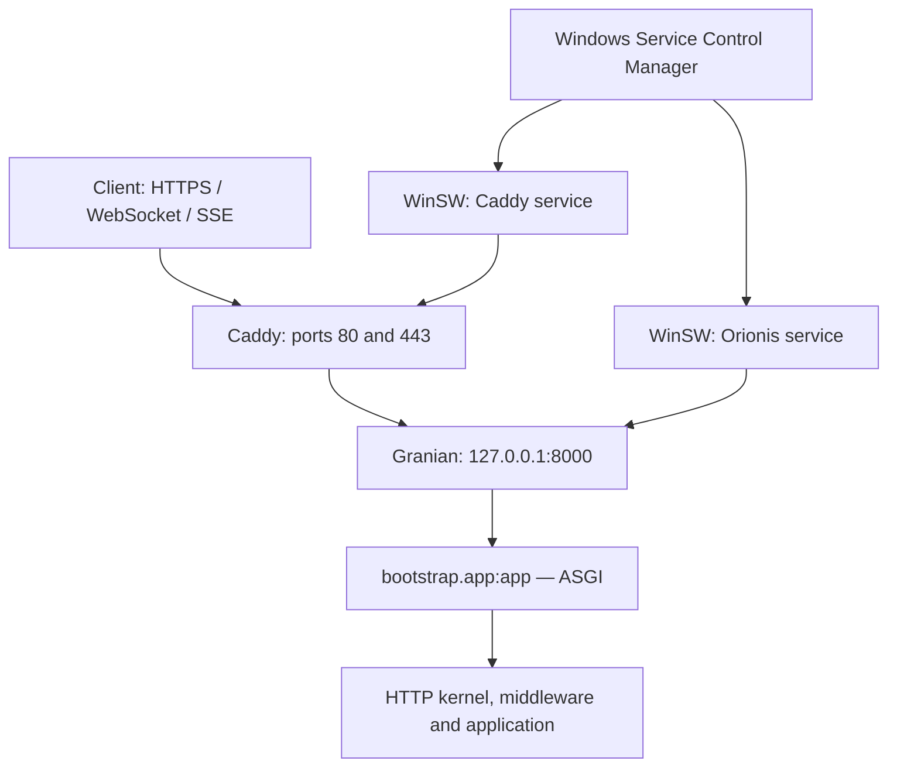

This guide uses 64-bit Windows Server, an application at `C:\Apps\Orionis\current`, Granian ASGI at `127.0.0.1:8000`, and Caddy as the public HTTPS entry point. Replace `app.example.com` with your domain. Complete the [production preparation](/en/deployment) first.



<a id="windows-requirements"></a>

## 1. Prepare the server and application artifact

Use a Windows Server edition supported by the selected tools; the reference scenario is Windows Server 2022 or later, x64. You need PowerShell, .NET Framework 4.8 or 4.8.1 enabled for the wrapper below, outbound HTTPS for dependency downloads and certificates, and administrator privileges to register services and firewall rules. Follow [.NET installation on Windows Server](https://learn.microsoft.com/en-us/dotnet/framework/install/on-server-2019) if the feature is disabled.

Your application artifact must include `pyproject.toml`, its up-to-date `uv.lock`, `reactor`, `bootstrap`, `config`, `app`, the routes, and the resources it uses. Deploy your application code; do not replace its bootstrap with another template or copy a `.venv` from another machine.

Create these locations in elevated PowerShell. Then copy your artifact to `C:\Apps\Orionis\current`:

```powershell
New-Item -ItemType Directory -Force -Path `
    C:\Apps\Orionis\current, `
    C:\Apps\Orionis\python, `
    C:\Services\Orionis\logs, `
    C:\Services\Caddy\logs, `
    C:\Services\Caddy\data, `
    C:\Services\Caddy\config, `
    C:\Tools\uv

Set-Location C:\Apps\Orionis\current
Get-Item pyproject.toml, uv.lock, reactor, bootstrap\app.py
```

The services use absolute paths and a fixed working directory. They do not depend on the deploying administrator's `PATH` or profile.

<a id="windows-python"></a>

## 2. Install Python and locked dependencies

Install uv at an explicit location and keep its managed Python outside a personal profile. The current component requires Python **3.14 or later**; this example selects 3.14. See [Astral's installer](https://docs.astral.sh/uv/reference/installer/) and [Python installation guide](https://docs.astral.sh/uv/guides/install-python/).

```powershell
$env:UV_INSTALL_DIR = 'C:\Tools\uv'
Invoke-RestMethod https://astral.sh/uv/install.ps1 | Invoke-Expression

$uvExe = 'C:\Tools\uv\uv.exe'
$env:UV_PYTHON_INSTALL_DIR = 'C:\Apps\Orionis\python'
& $uvExe python install 3.14

Set-Location C:\Apps\Orionis\current
& $uvExe sync --locked --no-default-groups --python 3.14
if ($LASTEXITCODE -ne 0) { throw 'Environment synchronization failed.' }

& .\.venv\Scripts\python.exe -B -c "import sys, granian, orionis; print(sys.version); print(sys.executable)"
```

`--locked` rejects a stale lockfile; `--no-default-groups` excludes default development groups. Application drivers must already belong to its locked dependencies. See [uv project synchronization](https://docs.astral.sh/uv/concepts/projects/sync/).

<a id="windows-environment"></a>

## 3. Configure the application and storage

Prepare the production `.env` in the project root. Preserve the installation's `APP_KEY`: changing it on every release can prevent previously encrypted data from being read. These entries are read by `config/app.py` and `config/http.py`:

```dotenv
APP_ENV=production
APP_DEBUG=bool:false
TRUSTED_PROXIES=list:["127.0.0.1"]
ALLOWED_HOSTS=list:["app.example.com"]
SESSION_DRIVER=file
SESSION_SECURE=bool:true
```

Add them to the existing file alongside `APP_KEY` and actual service credentials. Do not replace the entire file with this fragment. For a new application without a key, follow the [common preparation](/en/deployment). The [environment component](/en/environment) is used in configuration files.

`TRUSTED_PROXIES` contains the address of Caddy connecting to the backend, not the visitor's IP. Orionis accepts `X-Forwarded-For` and `X-Forwarded-Proto` from a trusted proxy. The host list validates the incoming domain. See the [proxy flow](/en/deployment/reverse-proxies).

For WEB routes, this example keeps [sessions](/en/sessions) in files under `storage/framework/sessions` and requires HTTPS to send their cookie. Preserve this storage when publishing another release. API routes do not activate the WEB session flow.

Prepare this deployment's storage:

```powershell
New-Item -ItemType Directory -Force -Path `
    C:\Apps\Orionis\current\storage\framework, `
    C:\Apps\Orionis\current\storage\logs, `
    C:\Apps\Orionis\current\storage\app\private, `
    C:\Apps\Orionis\current\storage\app\public
```

The default configuration publishes `storage/app/public` at `/static`. If you changed the `public` disk in `config/filesystems.py`, adjust both Granian's mount and the public route below. Private files, `.env`, source code, and the bootstrap cache must remain outside the public mount. Granian serves this mount before Orionis's kernel: published files do not pass through authentication middleware or the application's other HTTP policies.

<a id="windows-granian"></a>

## 4. Verify Granian before creating the services

From the root, temporarily start the same process the service will use:

```powershell
& .\.venv\Scripts\python.exe -B -m granian `
    --interface asgi `
    --host 127.0.0.1 `
    --port 8000 `
    --workers 1 `
    --loop auto `
    --no-reload `
    --log-level info `
    --static-path-mount C:\Apps\Orionis\current\storage\app\public `
    --static-path-route /static `
    --static-path-dir-to-file index.html `
    bootstrap.app:app
```

The target is the `app` instance exported by `bootstrap/app.py`. ASGI runs the startup and shutdown lifespan. You can select `--interface rsgi` with the same target; that uses RSGI hooks instead. Do not add `--factory`: the bootstrap exports an instance, not a factory. See [ASGI and RSGI](/en/application/server-entrypoints).

Granian is invoked directly to bind the backend to loopback: `reactor serve` does not expose `--host`, and its normal production launch uses `0.0.0.0`. On Windows that command selects one worker and loop `auto`; this guide preserves those choices. `--no-reload` prevents code reloading while the service runs.

In another console, check the health route configured by `app.withRouting(health="/up")`:

```powershell
curl.exe --fail --silent --show-error `
    --header "Host: app.example.com" `
    http://127.0.0.1:8000/up
```

If the application changed or disabled that route, use its actual check. Stop the test process with `Ctrl+C` before starting the service to release the port.

<a id="windows-services"></a>

## 5. Register Orionis as a WinSW service

Download the .NET wrapper from the [official WinSW 2.12.0 release](https://github.com/winsw/winsw/releases/tag/v2.12.0), matching these XML examples. Do not register `python.exe` directly with `sc.exe`: use the wrapper that integrates with the service manager.

```powershell
Invoke-WebRequest `
    -Uri https://github.com/winsw/winsw/releases/download/v2.12.0/WinSW.NET461.exe `
    -OutFile C:\Services\Orionis\orionis-service.exe

Copy-Item C:\Services\Orionis\orionis-service.exe `
    C:\Services\Caddy\caddy-service.exe
```

Create `C:\Services\Orionis\orionis-service.xml` next to the executable with the same basename. `LocalService`, the working directory, environment, and retries belong to the [wrapper configuration](https://github.com/winsw/winsw/blob/v2/doc/xmlConfigFile.md):

```xml
<service>
  <id>OrionisApp</id>
  <name>Orionis Application</name>
  <description>Orionis ASGI backend</description>
  <executable>C:\Apps\Orionis\current\.venv\Scripts\python.exe</executable>
  <arguments>-B -m granian --interface asgi --host 127.0.0.1 --port 8000 --workers 1 --loop auto --no-reload --log-level info --static-path-mount C:\Apps\Orionis\current\storage\app\public --static-path-route /static --static-path-dir-to-file index.html bootstrap.app:app</arguments>
  <workingdirectory>C:\Apps\Orionis\current</workingdirectory>
  <env name="PYTHONUTF8" value="1"/>
  <env name="PYTHONUNBUFFERED" value="1"/>
  <startmode>Automatic</startmode>
  <serviceaccount>
    <domain>NT AUTHORITY</domain>
    <user>LocalService</user>
  </serviceaccount>
  <onfailure action="restart" delay="10 sec"/>
  <stoptimeout>30 sec</stoptimeout>
  <logpath>C:\Services\Orionis\logs</logpath>
  <log mode="roll-by-size">
    <sizeThreshold>10240</sizeThreshold>
    <keepFiles>8</keepFiles>
  </log>
</service>
```

The wrapper captures stdout/stderr and rotates their files at 10 MiB, retaining eight rotated files per stream. These differ from `Log` facade channels. See [WinSW logging](https://github.com/winsw/winsw/blob/v2/doc/loggingAndErrorReporting.md) and [Orionis Logs](/en/logging).

When stopping the service, WinSW attempts to send `Ctrl+C` and waits up to the configured 30-second `stoptimeout`; it may then force termination. Forced termination does not guarantee completion of application hooks or `finally` blocks. Match the timeout to your application's shutdown operations.

Grant code and runtime read access, and write access only where the process needs it. This [`icacls` ACL example](https://learn.microsoft.com/en-us/windows-server/administration/windows-commands/icacls) targets the new, dedicated directories created above; administrators and SYSTEM retain full access. SIDs avoid relying on the Windows display language:

```powershell
icacls C:\Apps\Orionis /inheritance:r /grant:r `
    '*S-1-5-32-544:(OI)(CI)F' `
    '*S-1-5-18:(OI)(CI)F' `
    '*S-1-5-19:(OI)(CI)RX'

icacls C:\Apps\Orionis\current\storage /grant:r `
    '*S-1-5-19:(OI)(CI)M'

icacls C:\Services\Orionis /inheritance:r /grant:r `
    '*S-1-5-32-544:(OI)(CI)F' `
    '*S-1-5-18:(OI)(CI)F' `
    '*S-1-5-19:(OI)(CI)RX'

icacls C:\Services\Orionis\logs /grant:r `
    '*S-1-5-19:(OI)(CI)M'

& C:\Services\Orionis\orionis-service.exe install
& C:\Services\Orionis\orionis-service.exe start
Get-Service OrionisApp
```

`LocalService` is shared by services configured to use that account. If applications or service credentials require isolation, use dedicated identities and adjust each identity's ACL. Also grant access to custom paths or a SQLite database outside `storage` when required; do not grant general write access to the code directory.

<a id="windows-caddy"></a>

## 6. Configure Caddy and HTTPS

Download the standard **Windows amd64** binary from [Caddy](https://caddyserver.com/download) and save it as `C:\Services\Caddy\caddy.exe`. Create `C:\Services\Caddy\Caddyfile`:

```text
app.example.com {
    log

    reverse_proxy 127.0.0.1:8000
}
```

Caddy preserves the host, generates forwarding headers, and supports WebSocket upgrades. SSE responses with `Content-Type: text/event-stream` are sent without waiting for periodic buffering. See the [`reverse_proxy` reference](https://caddyserver.com/docs/caddyfile/directives/reverse_proxy) and [streaming settings](/en/deployment/reverse-proxies).

The domain must resolve to this server, TCP ports 80/443 must be reachable, and the data directory must be persistent and writable to obtain and renew certificates. See [automatic HTTPS requirements](https://caddyserver.com/docs/automatic-https). This example terminates TLS at Caddy; the local Granian connection uses HTTP.

Create `C:\Services\Caddy\caddy-service.xml`. The [official Windows service guide](https://caddyserver.com/docs/running#windows-service) uses WinSW; this example also fixes its directories:

```xml
<service>
  <id>OrionisProxy</id>
  <name>Orionis Caddy Proxy</name>
  <executable>C:\Services\Caddy\caddy.exe</executable>
  <arguments>run --config C:\Services\Caddy\Caddyfile --adapter caddyfile</arguments>
  <workingdirectory>C:\Services\Caddy</workingdirectory>
  <env name="XDG_DATA_HOME" value="C:\Services\Caddy\data"/>
  <env name="XDG_CONFIG_HOME" value="C:\Services\Caddy\config"/>
  <startmode>Automatic</startmode>
  <serviceaccount>
    <domain>NT AUTHORITY</domain>
    <user>LocalService</user>
  </serviceaccount>
  <onfailure action="restart" delay="10 sec"/>
  <stoptimeout>30 sec</stoptimeout>
  <logpath>C:\Services\Caddy\logs</logpath>
  <log mode="roll-by-size">
    <sizeThreshold>10240</sizeThreshold>
    <keepFiles>8</keepFiles>
  </log>
</service>
```

With these variables, Caddy stores certificates under `C:\Services\Caddy\data\caddy` and persisted configuration under `C:\Services\Caddy\config\caddy`. Preserve these directories between releases; certificates are not disposable cache. See [Caddy file locations](https://caddyserver.com/docs/conventions#file-locations).

```powershell
icacls C:\Services\Caddy /inheritance:r /grant:r `
    '*S-1-5-32-544:(OI)(CI)F' `
    '*S-1-5-18:(OI)(CI)F' `
    '*S-1-5-19:(OI)(CI)RX'

icacls C:\Services\Caddy\data /grant:r '*S-1-5-19:(OI)(CI)M'
icacls C:\Services\Caddy\config /grant:r '*S-1-5-19:(OI)(CI)M'
icacls C:\Services\Caddy\logs /grant:r '*S-1-5-19:(OI)(CI)M'

& C:\Services\Caddy\caddy.exe validate `
    --config C:\Services\Caddy\Caddyfile --adapter caddyfile
if ($LASTEXITCODE -ne 0) { throw 'Invalid Caddyfile.' }

New-NetFirewallRule -DisplayName 'Orionis HTTPS proxy' `
    -Direction Inbound -Action Allow -Protocol TCP -LocalPort 80,443

& C:\Services\Caddy\caddy-service.exe install
& C:\Services\Caddy\caddy-service.exe start
Get-Service OrionisApp, OrionisProxy
```

The rule opens the proxy's public ports using [`New-NetFirewallRule`](https://learn.microsoft.com/en-us/powershell/module/netsecurity/new-netfirewallrule). Configure external rules too when the server is hosted in a cloud or behind NAT. Granian continues listening exclusively on loopback; port 8000 needs no public rule.

<a id="windows-verification"></a>

## 7. Verify and update the deployment

Verify the backend first, then the proxy from an external machine:

```powershell
curl.exe --fail --silent --show-error `
    --header "Host: app.example.com" http://127.0.0.1:8000/up

curl.exe --fail --silent --show-error https://app.example.com/up
Get-NetTCPConnection -State Listen -LocalPort 8000
```

The backend must show `LocalAddress=127.0.0.1`. Also check a real application route and a public file; `/up` alone does not verify the database or external services. When used, test your `wss://` and SSE connections through the public domain, following [Realtime](/en/realtime).

To change Caddy alone, validate and reload its configuration:

```powershell
& C:\Services\Caddy\caddy.exe validate `
    --config C:\Services\Caddy\Caddyfile --adapter caddyfile
if ($LASTEXITCODE -ne 0) { throw 'Invalid Caddyfile.' }

& C:\Services\Caddy\caddy.exe reload `
    --config C:\Services\Caddy\Caddyfile --adapter caddyfile
```

For a simple release with controlled interruption, stop Orionis and wait for shutdown before replacing its code or environment:

```powershell
& C:\Services\Orionis\orionis-service.exe stopwait
Set-Location C:\Apps\Orionis\current
```

Publish the artifact while preserving `.env`, the key, and persistent data. Repeat the locked sync with `UV_PYTHON_INSTALL_DIR` pointing to the same runtime; then run:

```powershell
& .\.venv\Scripts\python.exe -B reactor optimize:clear
if ($LASTEXITCODE -ne 0) { throw 'Cache cleanup failed.' }

# Only when the release includes pending migrations.
& .\.venv\Scripts\python.exe -B reactor migrate
if ($LASTEXITCODE -ne 0) { throw 'Migrations did not complete.' }

& C:\Services\Orionis\orionis-service.exe start
```

Cleanup affects local caches and other artifacts described in [application caching](/en/application/paths-and-caching); it does not update other servers' processes. Updating this single backend interrupts requests and long-lived connections: it is not a zero-downtime strategy. Code rollback must also account for schema and data compatibility; see [migrations](/en/database/migrations).

If a service fails to start, inspect `C:\Services\Orionis\logs` or `C:\Services\Caddy\logs`, the working directory, Python runtime access, and storage ACLs. For a proxy `502`, first check that Granian is running and accepts the local request. Certificate errors require checking DNS, access to 80/443, and write access to Caddy's data.
