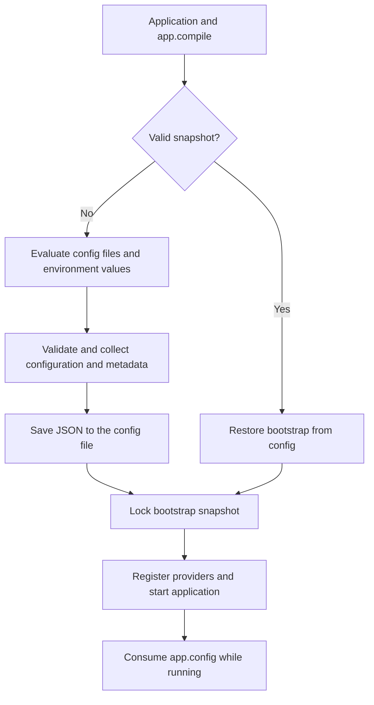

Use the environment component **only in configuration files**. During startup, Orionis evaluates those files and builds the configuration consumed by services. While the application runs, read that configuration through `IApplication.config()`; do not query `Env` or `env()` again from controllers, commands, jobs or services.

Compilation lets later application starts reuse the bootstrap result. It persists JSON under `storage/framework`, but **does not create a separate copy of every `.env` variable**.

## Enable persistence in the bootstrap

The distributed application configures the following in `bootstrap/app.py`, after constructing `app` and before registering its components and calling `app.create()`:

```python
app.compile(
    path="storage/framework/bootstrap",
    invalidation_paths=[
        "app",
        "bootstrap",
        "config",
        "database",
        "resources",
        "routes",
        ".env",
    ],
)
```

The actual signature is:

```text
compile(
    path: str | None = None,
    invalidation_paths: list[str] | None = None,
) -> None
```

| Parameter | Behavior |
| --- | --- |
| `path` | Persistence directory. Relative paths resolve against the application root. When omitted, it uses `storage/framework/cache`; the bootstrap above explicitly changes this to `storage/framework/bootstrap`. The directory is created when needed. |
| `invalidation_paths` | Files and directories whose changes invalidate the snapshot. No project paths are added by default. The framework's internal directory definitions are additionally monitored for configuration. |

There is no `env=True` argument or environment compilation method to call. Without `app.compile()`, startup builds configuration without this persistence.

Include `.env` **explicitly** and ensure it exists before `compile()`. Paths are classified when compilation is configured: a path that does not exist at that point is not registered for monitoring. Monitored directories contribute their `*.py` files, so monitoring the project root alone does not replace explicitly monitoring `.env`.

## What is stored

With the bootstrap above, the files are:

| File | Contents and consumer |
| --- | --- |
| `storage/framework/bootstrap/config` | Bootstrap snapshot: resolved configuration, directory paths, provider descriptors, route files, middleware, kernels, scheduler and exception handler. Read by `Application`. |
| `storage/framework/bootstrap/commands` | Command registry metadata and argument definitions. Consumed by the Reactor loader when discovering commands. |
| `storage/framework/bootstrap/routes` | Compiled HTTP route metadata. Consumed by the route loader when required. |

All three contain **JSON and have no extension**. Their names are not `config.json`, `env.json` or `commands.json`. Command and route files are produced when their components load and persist their registries; enabling compilation does not immediately create every file.

Each file is wrapped with:

- `__meta__.version`: cache format version.
- `__meta__.generatedAt`: generation time as a Unix timestamp in seconds.
- `__meta__.sourcesHash`: fingerprint of monitored sources.
- `__data__`: serialized component data.

The serializer represents types such as `Path`, bytes, tuples, sets and enumerations with JSON tags used to reconstruct them. Providers and other components are preserved as module and class references, not live instances. Writing stages a temporary file in the same directory before replacing the destination.

The `config` file stores **values that became part of configuration**, including values read from `.env`. It does not automatically export every entry from `Env.all()` or the whole of `os.environ`. A variable that never participates in configuration is not included merely because it exists in `.env`.

Sensitive configuration values may also be present in that snapshot, including credentials and the serialized application key. JSON and Base64 encoding do not encrypt them: protect this directory as you protect `.env` and keep it out of publicly served static content.

## Loading lifecycle



Without a valid snapshot, `app.create()` discovers frozen dataclasses under `config/`, instantiates them, merges their values with base configuration and registers provider metadata before persisting. This is where environment reads declared in configuration are resolved.

With a valid snapshot, `compile()` restores and locks the bootstrap. Subsequent loading reuses that configuration and skips rediscovering and instantiating its dataclasses; application providers are still registered for the current process. Bootstrap configuration methods that recognize this state reuse the restored data.

The `bootstrap:*` repair commands use a recovery context that skips reading and writing the configuration snapshot, preventing a transient repair state from becoming normal persisted configuration.

<a id="runtime-configuration"></a>

## Read configuration while the application runs

For example, `APP_NAME` is read in `config/app.py` and becomes available as `app.name`. A controller receives the application through dependency injection and reads the resolved value:

```python
from orionis.foundation.contracts.application import IApplication
from orionis.http import JSONResponse


class AppInfoController:
    async def __call__(self, app: IApplication) -> JSONResponse:
        return JSONResponse({
            "name": app.config("app.name"),
        })
```

This works with or without persistence. `app.config("section.key")` reads process configuration and returns `None` for an absent path. Its second argument is not a default value: passing it **changes** configuration in memory.

Restoring types from JSON is separate from preparing configuration for use. Orionis applies `FreezeThaw.freeze()` to the bootstrap and `FreezeThaw.thaw()` to create runtime configuration: mappings become dictionaries again and frozen sequences become lists. As a result, a tuple read through `Env` in `config/` is exposed as a `list` through `app.config()`, **even without compiled caching**. Sets (`set`) and bytes are not transformed at this step and retain their types; sets do not become `frozenset`.

Changing values through `app.config(...)` does not rewrite `.env` or the compiled snapshot. `app.resetRuntimeConfig()` restores a copy of the already loaded bootstrap configuration; it does not reevaluate `.env` either. Services that captured values earlier may require reconstruction or a new process.

<a id="refresh-compiled-configuration"></a>

## Environment changes and invalidation

Validation compares the format version and a fingerprint computed from monitored paths, file sizes and modification times in nanoseconds. It does not hash each file's contents or apply a configuration TTL. A cache object reuses its computed fingerprint for half a second to reduce repeated work.

When `.env` is monitored, a detected change invalidates the snapshot **for the next startup that checks it**. A process that already built its application retains its configuration; editing `.env` does not automatically refresh controllers, connections or existing services. Changing operating-system variables alone does not change the file fingerprint either.

To apply changes in a controlled way:

1. Update `.env` or configuration files.
2. Clear optimization artifacts if you need to force reconstruction.
3. Restart application processes and workers that should use the new values.

From the project root, clear artifacts using either alternative:

```shell
orionis optimize:clear
```

```shell
python -B reactor optimize:clear
```

`optimize:clear` removes `config`, `commands` and `routes` from the effective compiled directory. It also clears Python bytecode and build artifacts; see its [complete scope](/en/console/built-in-application). The next startup or loader access regenerates the relevant files. The `optimize` command validates Python sources; it is not a dedicated `.env` compilation command.

`Env.reload()` refreshes the file and environment component state, but **does not reconstruct resolved configuration or its services**. Do not use it to update application configuration during requests.

## Errors and operation

- The compiled directory needs creation and write permissions to generate its files; writing or serialization errors can interrupt startup.
- An absent file, a different version or a mismatched fingerprint allow reconstruction from sources. Malformed JSON can propagate a decoding error; silent repair is not guaranteed.
- Do not edit generated files to configure the application. Change `.env` or `config/`, invalidate and restart.
- Do not reuse a snapshot across installations as a substitute for their bootstrap: it contains resolved paths and references to the application components that produced it.

Continue with [environment reads and types](/en/environment/typed-configuration) or the [component reference](/en/environment/operations-and-reference).
