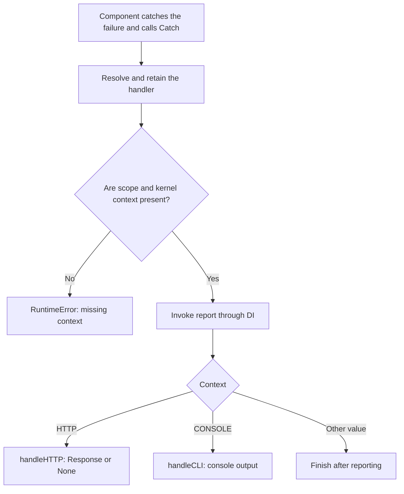

An exception is an object representing a condition that interrupts normal Python execution. When raised, control looks for a compatible `except` and unwinds pending calls if nobody handles it. An HTTP response, a console message, and a log entry are possible ways to handle that failure; they are separate responsibilities.

The `orionis.failure` module coordinates **reporting** and **presentation** for exceptions delegated to it by framework components. The application defines its policy through a handler class registered with:

```python
# Set the global exception handler for unhandled exceptions.
app.withExceptionHandler(ExceptionHandler)
```

This guide covers the general system. For the diagnostic page, statuses, and request behavior, see [HTTP exceptions](/en/http/exceptions). The HTTP chapter keeps that scope and links to this shared configuration.

## What the exception system handles

A component can handle an exception locally if it knows a valid recovery: reject data, choose an alternative, or return a domain result. If it cannot handle the failure, the error propagates to the component boundary.

In flows integrated with `failure`, the framework uses the `Catch` service to execute application policy. This coordination supports:

- Recording failure information through the logging service.
- Presenting a command exception in the console.
- Producing an appropriate HTTP response.
- Translating domain errors into a stable representation.
- Preserving common handling for other errors through the base class.

An `except Exception: pass` removes that propagation without providing recovery or a diagnostic. Catch errors where you can make a useful decision and preserve the information you need to report.

### Reporting and presenting are different operations

| Operation | Responsibility |
| --- | --- |
| Report | Record or communicate the failure to a diagnostic destination. |
| Present | Produce output appropriate to the context that was executing. |
| Recover | Decide how an operation continues when it can handle the problem. |

`report()` does not build an HTTP response. `handleHTTP()` does not replace recovery of a business transaction. The kernel also does not automatically retry an operation because the handler produced a message.

`Catch` reports first and then invokes the corresponding presentation method. The [customization guide](/en/exceptions/handling-exceptions) shows how to change one responsibility while preserving the other.

<a id="exception-registration"></a>

## Registering the application handler

### Where the class lives

The project structure includes `app/exceptions/handler.py` and its `ExceptionHandler` class. The file belongs to the application: define the decisions required by your domain there.

A minimal implementation that preserves all native behavior is:

```python
from orionis.failure.base import BaseExceptionHandler


class ExceptionHandler(BaseExceptionHandler):
    pass
```

`BaseExceptionHandler` implements the conversion, reporting, CLI presentation, and HTTP presentation contracts. Inheriting without overriding them uses those methods and its injectable constructor.

The project may also contain delegating overrides of `report()`, `handleCLI()`, and `handleHTTP()`. If they only call `super()`, they preserve the same behavior. See the [complete handler examples](/en/exceptions/handling-exceptions).

<a id="exception-bootstrap"></a>

### Registration from bootstrap/app.py

Register the class **after creating the Application instance and before `app.create()`**, which starts the application. In the existing bootstrap:

```python
from app.exceptions.handler import ExceptionHandler

# Set the global exception handler for unhandled exceptions.
app.withExceptionHandler(ExceptionHandler)
```

Keep the other bootstrap settings and its final call to `app.create()`. This snippet configures the existing `app` variable; it does not create another application.

| Aspect | Actual behavior |
| --- | --- |
| Method | `app.withExceptionHandler(handler: type[IBaseExceptionHandler]) -> Self`, synchronous. |
| Argument | A class, rather than an instance, function, or text name. |
| Contract | The class must inherit from `IBaseExceptionHandler`. Extending `BaseExceptionHandler` is the practical option for reusing its methods. |
| Return | The same application; configuration can be chained. |
| Registration | Stores the module and class name for later resolution. |
| Multiple calls | A new class replaces the previously registered one while configuration remains mutable. |
| Without application registration | Uses the Orionis base handler. |

The class must be importable from its module. Registration does not instantiate the handler or process an exception at that point. Abstract requirements must be implemented if you choose to inherit directly from the contract.

Import `IBaseExceptionHandler` from `orionis.failure.contracts.handler`. The method checks that contract; custom implementations do not necessarily need to inherit from the concrete base class.

<a id="exception-dependencies"></a>

### Why registration takes a class

The container constructs the handler and resolves annotated dependencies in its constructor and methods. For example, the base constructor receives `DefaultResponses` and `IApplication`; `report()` receives `ILogger`, and `handleCLI()` receives `Console`.

This lets you use configured application services without constructing them inside the handler. When customizing a method, preserve the signature and annotations its injection requires.

The `Catch` service reuses the resolved handler. Keep each failure's state in local variables: attributes such as `self.current_request` or `self.current_exception` would share mutable information between concurrent executions.

`await app.getExceptionHandler() -> IBaseExceptionHandler` requires a created application. It retains the imported class and constructs a new instance through `build()` on each call. `Catch`, however, keeps the first instance it retrieves and coordinates that resolution with an asynchronous lock. These are different lifetimes; do not use the shared handler to store a request.

<a id="exception-flow"></a>

## The complete failure flow

The service entry point is:

```text
await Catch.exception(exception, request=None)
```

`Catch` can refer to the concrete service or its facade, depending on the import. Applications usually use the facade or inject the `ICatch` contract; kernels already use them in their respective flows.

When an exception reaches the service:

1. It resolves the handler through `app.getExceptionHandler()` and keeps the instance for later calls.
2. It checks the active scope and retrieves its `kernel` context.
3. It invokes `report(exception, ...)` through the container.
4. For `KernelContext.CONSOLE`, it invokes `handleCLI()`.
5. For `KernelContext.HTTP`, it invokes `handleHTTP()`, passing the request or adapter.
6. For another context value, it finishes after reporting.



`report()` finishes before the error is presented. Its return value does not itself decide whether rendering should occur: returning `None` does not cancel the subsequent `handleHTTP()` or `handleCLI()` call. An exception during reporting, however, interrupts that flow.

There are no `shouldReport()`, `shouldRender()`, or generic `render()` methods in this contract. Extensions use the actual methods described below.

### Each component's role

| Component | Role in the flow |
| --- | --- |
| `Catch` | Coordinates resolution, context, reporting, and dispatch. |
| `BaseExceptionHandler` | Supplies reusable default handling. |
| `IBaseExceptionHandler` | Defines the five methods a handler implements. |
| `Throwable` | Preserves a structured representation of the failure for reporting. |
| `KernelContext` | Identifies the CONSOLE and HTTP contexts used for dispatch. |
| `CatchProvider` | Registers the shared service and prepares its facade. |
| `DefaultResponses` | Builds public responses and the diagnostic HTML when requested by HTTP policy. |

The [module reference](/en/exceptions/policies-and-reference) describes their signatures, imports, return values, and conditions of use.

<a id="exception-default-handler"></a>

## The handler's five methods

| Method | Type | Purpose |
| --- | --- | --- |
| `toThrowable(exception)` | Synchronous | Convert the failure into `Throwable`. |
| `isExceptionIgnored(exception)` | Synchronous | Check the policy for ignored classes. |
| `report(exception, log)` | Asynchronous | Report the failure; the base method uses the logger. |
| `handleCLI(exception, console)` | Asynchronous | Present it in the console. |
| `handleHTTP(exception, request)` | Asynchronous | Build an HTTP response or return `None` according to the contract. |

Base handling uses `log.getLogger().error(...)` with `exc_info=(type(exception), exception, throwable.traceback)`. It records `[ClassName] message` together with the traceback, including chained causes and Python notes, even when reporting outside the original `except` block.

Conversion to `Throwable` uses the first argument as the message and converts all arguments to strings; an exception without arguments uses `("",)`. It does not automatically collect every variable in an operation. Customize `report()` to change its format or select which errors to record, separately from the public response.

Without customization, `handleCLI()` presents the failure through `Console.exception()`. `handleHTTP()` preserves the statuses of known HTTP exceptions; other failures produce a generic `500` with debug disabled or detailed diagnostic HTML with debug enabled. JSON/HTML selection and cases handled directly by the kernel are explained in [HTTP exceptions](/en/http/exceptions). A handler does not itself determine Reactor's exit status or a protocol's error format.

### Throwable is not a response

`Throwable` is an immutable dataclass with `classtype`, `message`, `args`, and `traceback`. It separates failure information from its final representation.

It does not itself define an HTTP status, a retry policy, or a JSON format. The traceback is a native Python object; to serialize or send information to another system, convert only the data that destination needs.

### Inheriting and delegating

The usual approach is to extend `BaseExceptionHandler` and override the specific decision:

- `report()` if logging changes for a particular error.
- `handleCLI()` if you need particular command output.
- `handleHTTP()` if a domain failure has its own public status and body.
- `toThrowable()` if you need conversion compatible with the contract.
- `isExceptionIgnored()` if ignored-error selection requires a different explicit policy.

For cases you do not specialize, delegate through `super()`. The [reporting, domain, and presentation examples](/en/exceptions/handling-exceptions) show these alternatives without replacing the entire native policy.

<a id="exception-runtime-boundaries"></a>

## What a global handler means

Registration is shared by the application, but **does not install a universal Python exception catcher**. It does not replace `sys.excepthook` or convert every exception in a thread, independent task, or integration into an HTTP response.

Coordination depends on the component catching and handing over the failure:

| Context | Relevant integration |
| --- | --- |
| Ordinary HTTP | Layers and the kernel handle their specific cases and delegate the rest to HTTP handling. |
| Reactor commands | Use console reporting and presentation. |
| Scheduler | Can delegate callback failures to the Catch service. |
| MCP | Uses handler reporting at its integration points and preserves protocol responses. |
| Realtime and WebSocket | Have errors, closures, and handling specific to their protocols. |
| Queue workers | Manage logging, retries, and failed records through their worker flow. |
| Response background work | Runs after delivery; an error there cannot replace the HTTP status already sent. |

The [detailed context matrix](/en/exceptions/contexts-and-transports) distinguishes these cases. An HTTP status does not define how an MCP tool or queued operation fails.

Capture boundaries also matter: accepting `BaseException` in the contract does not mean kernels always catch `KeyboardInterrupt`, `SystemExit`, or cancellation. Preserve runtime termination signals rather than treating them indiscriminately as business errors.

## Ignoring, silencing logs, and recovering

`dont_catch` in the base handler is a collection of exact classes. A match skips both reporting and the base renderer. It is not solely a list of “errors I do not want to log.”

In HTTP, ignoring an error that has no other response can leave the flow without a valid Response. To preserve a public response while omitting only its log, specialize `report()`; to handle it, define `handleHTTP()` or local recovery. The [ignored-error policies](/en/exceptions/policies-and-reference) explain the differences.

The ignored check uses the exact type. HTTP status mapping, however, walks the class hierarchy and recognizes subclasses. They are separate decisions.

<a id="exception-bootstrap-cache"></a>

## Compiled configuration and running processes

`withExceptionHandler()` changes startup configuration. After startup, an ordinary modification is rejected with `RuntimeError`.

When the application loads compiled configuration, the method returns without registering the class again. The handler selection then comes from compiled metadata. Keep `app` and `bootstrap` files among the invalidation paths in the compilation schema you use.

The application also retains the resolved class, and Catch retains its instance. Changing a file does not replace the handler already held by a running process: restart the relevant processes and update or invalidate compilation when changing registration.

If you need to discard the project's optimization artifacts, the CLI offers these alternatives:

```bash
orionis optimize:clear
```

```bash
python -B reactor optimize:clear
```

This command removes compiled configuration, route, and command caches, along with bytecode and build artifacts. Apply it as part of updating those artifacts; it does not configure the handler itself.

<a id="exception-debug"></a>

## Debug and public messages

Base HTTP policy uses `app.debug` for errors it does not recognize. In production, configure `APP_DEBUG=bool:false` to receive the generic public message while preserving internal reporting.

The `APP_ENV` name does not disable debug. A custom handler also decides its own bodies and messages: delegating to base policy preserves its boundaries; building a detailed response yourself can change them.

The [HTTP exception page](/en/http/exceptions) explains the diagnostic contents, known statuses, and why an API request can receive debug HTML. The general chapters also distinguish reporting failures, cancellation, and other protocols' behavior.

## Continuing with implementation

The [verifiable Exceptions inventory](/downloads/exceptions-api-inventory.json) maps declarations in `failure`, the project's handler, and application registration to these guides. Each transport's integration is reviewed separately; these mechanisms are not presented as universal process interception.

1. [Reporting and handling exceptions](/en/exceptions/handling-exceptions): application class, domain errors, logging, CLI, and service injection.
2. [Contexts and transports](/en/exceptions/contexts-and-transports): actual capture and responses in HTTP, CLI, WebSocket, Realtime, MCP, queues, and tasks.
3. [Error policies and reference](/en/exceptions/policies-and-reference): complete contracts, Throwable, ignored errors, contexts, concurrency, and verification.
4. [HTTP exceptions](/en/http/exceptions): diagnostics, public responses, and request boundaries.
