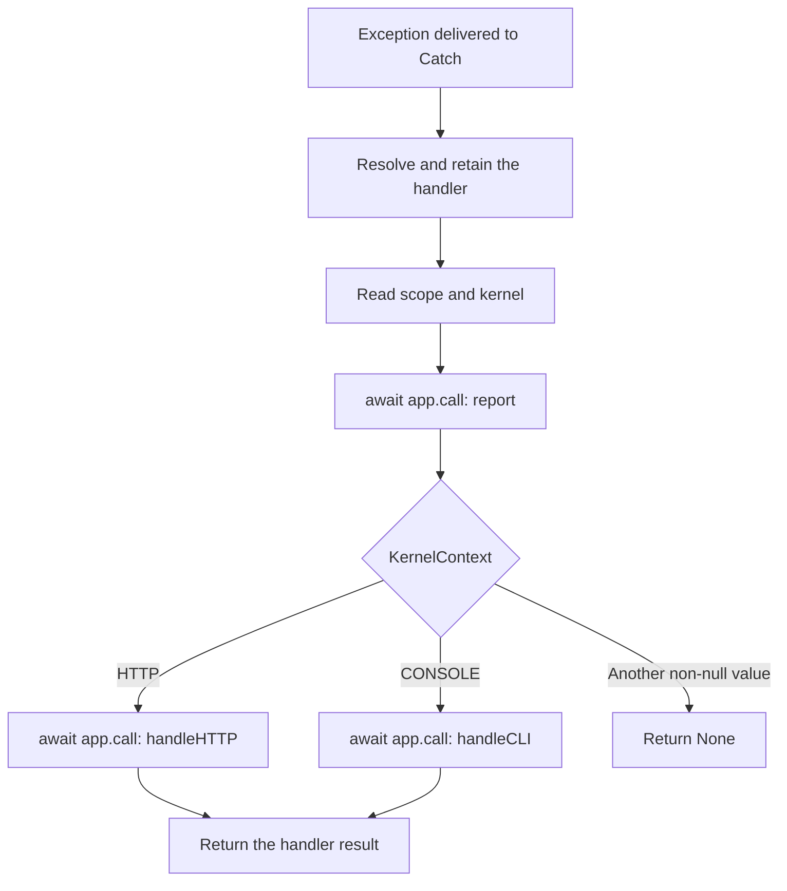

`Catch` coordinates reporting and presentation of an exception that another component has already caught. The handler decides what to record and return; the transport determines where it intercepts failures. Registering a handler does not install a process-wide exception catcher.

Start with [Registration and behavior](/en/exceptions), continue with [Customizing the handler](/en/exceptions/handling-exceptions), and see [Contexts and transports](/en/exceptions/contexts-and-transports) for differences between HTTP, CLI, MCP, connections, and background work.

<a id="failure-public-imports"></a>

## Public imports

```python
from orionis.support.facades import Catch
from orionis.failure.contracts import ICatch
from orionis.failure.entities import Throwable
from orionis.failure.enums import KernelContext
```

The first import is the facade. `from orionis.failure import Catch` gets the concrete service class, whose constructor requires an application. Extend policies using `BaseExceptionHandler` from `orionis.failure.base` or `IBaseExceptionHandler` from `orionis.failure.contracts.handler`; their methods are described in the [customization guide](/en/exceptions/handling-exceptions).

<a id="catch-service"></a>

## Catch and ICatch

The `orionis.failure.catch.Catch` class implements `ICatch` and exposes this API:

```python
def __init__(self, app: IApplication) -> None:
    ...

async def exception(
    self,
    exception: BaseException,
    request: Request | TransportAdapter | None = None,
) -> Response | None:
    ...
```

`ICatch.exception()` declares the same asynchronous signature. The constructor stores the application and prepares deferred handler resolution; it does not register another service or start the application.

| Parameter | Type and default | Usage |
|---|---|---|
| `app` | `IApplication`, required for direct construction. | Resolves the handler, scope, and method dependencies. |
| `exception` | `BaseException`, required. | Original exception delivered to `report()` and the presentation method. |
| `request` | `Request \| TransportAdapter \| None = None`. | Request delivered to `handleHTTP()`; the base handler requires a compatible request in HTTP. |
| Result | `Response \| None`. | Return value of `handleHTTP()` or `handleCLI()`; `None` in the base CLI flow or when no known context matches. |

Always use `await`, through either `ICatch` or the facade:

```python
from orionis.failure.contracts import ICatch
from orionis.http import Request, Response


class ImportBoundary:
    def __init__(self, catch: ICatch) -> None:
        self.catch = catch

    async def present(
        self,
        exception: Exception,
        request: Request,
    ) -> Response:
        response = await self.catch.exception(exception, request=request)
        if response is None:
            raise RuntimeError("The exception policy did not return a response")
        return response
```

This component can be resolved by the container from a controller or HTTP integration. It must run inside the existing HTTP scope. There is no need to wrap every controller action: the kernel already catches failures in its flow. A custom boundary is useful when you need to deliver an exception explicitly to the policy and use its response.

The equivalent operation through the facade is:

```python
from orionis.http import Request, Response
from orionis.support.facades import Catch


async def present_failure(
    exception: Exception,
    request: Request,
) -> Response | None:
    return await Catch.exception(exception, request=request)
```

<a id="catch-dispatch"></a>

## Reporting and presentation order



Reporting must finish before presentation begins. Each method receives the original exception as the named `exception` argument; `handleHTTP()` also receives `request`. `app.call()` resolves other annotated dependencies, such as `ILogger` or `Console`.

The `report()` result is discarded. Returning `None` from that method allows presentation to continue; raising an exception prevents it. `Catch` does not validate or convert handler return values: a `Response | None` annotation does not automatically generate a response.

<a id="catch-context"></a>

## Scope and KernelContext

`Catch.exception()` calls `app.getCurrentScope()` and then `await scope.get("kernel")`. Initial handler resolution happens before these checks.

| Context state | Behavior |
|---|---|
| No scope exists. | Raises `RuntimeError("No active scope found for context retrieval.")`; does not report. |
| `kernel` is `None`. | Raises `RuntimeError("No kernel found in the current scope for context retrieval.")`; does not report. |
| `kernel is KernelContext.HTTP`. | Reports and executes `handleHTTP()`. |
| `kernel is KernelContext.CONSOLE`. | Reports and executes `handleCLI()`. |
| Another value distinct from `None`. | Reports and returns `None`. |

`KernelContext` is an `Enum` with exactly two members:

```python
from orionis.failure.enums import KernelContext

http_context = KernelContext.HTTP
console_context = KernelContext.CONSOLE
assert KernelContext["HTTP"] is http_context
assert http_context is not console_context
```

Values are assigned with `auto()`. Integrations should use the members, rather than their numbers or the strings `"HTTP"` and `"CONSOLE"`: dispatch compares identity. There are no dedicated MCP, Realtime, WebSocket, or queue members. An HTTP marker does not require those protocols to call `handleHTTP()`.

Entry points create and close their scopes. Controllers do not need to manipulate them. See [Scopes and concurrency](/en/application/container/scopes-and-concurrency) to implement an integration that owns its own scope.

<a id="catch-provider"></a>

## Registration, caching, and injection

`CatchProvider` extends `ServiceProvider` and receives the application through its inherited constructor. It has two operations:

| Signature | Effect |
|---|---|
| `register(self) -> None` | Runs `self.app.singleton(ICatch, Catch, alias="x-orionis-ICatch")`. |
| `async boot(self) -> None` | Runs `await CatchFacade.pin()` to retain the resolved service on the facade. |

This is a native provider; you do not need to register it again to use `ICatch`. The singleton is shared within the application process. The facade exposes that registered service and preserves the asynchronous behavior of `exception()`.

There are two different caches:

1. `Application.getExceptionHandler()` retains the resolved **class** and calls `build()` for each direct handler request; it returns an instance constructed through the container.
2. `Catch` retains the **instance** obtained on first use. An `asyncio.Lock` prevents duplicate resolution when initial calls overlap. If resolution fails before assignment, a later call can try again.

The retained instance does not store the current request or exception. Keep those in local variables: the same policy can handle concurrent failures. Constructor dependencies stay with the retained handler; avoid holding request-specific services there. Per-invocation dependencies can be received in methods called through the container.

<a id="catch-facade"></a>

### Facade API

`Catch.getFacadeAccessor() -> str` returns `"x-orionis-ICatch"`. The facade also inherits `async resolve(*args, **kwargs) -> object`, `async pin() -> None`, and `unpin() -> None`; these are resolution mechanisms, rather than additional error treatments. The provider pins automatically. `unpin()` does not remove the singleton or the handler instance already retained by that service.

Normal usage is `await Catch.exception(...)` or `ICatch` injection. To create custom facades or understand synchronous and asynchronous invocation, see [Facades](/en/application/container/facades).

<a id="failure-throwable"></a>

## Throwable: structured representation

`Throwable` is a dataclass with `frozen=True`, `kw_only=True`, and `slots=True`:

```python
from orionis.failure.entities import Throwable


failure = Throwable(
    classtype=ValueError,
    message="Invalid quantity",
    args=("Invalid quantity",),
    traceback=None,
)
```

| Field | Declared type | Requirement and default |
|---|---|---|
| `classtype` | `type`. | Required; exception class. |
| `message` | `str`. | Required; failure message. |
| `args` | `tuple`. | Required; arguments represented by the entity. |
| `traceback` | `TracebackType \| None`. | Optional; `None`. |

Construction requires keyword arguments. The entity stores the supplied values without runtime validation or normalization. Fields cannot be reassigned and instances have no `__dict__`; that immutability does not turn referenced objects into immutable copies.

`BaseExceptionHandler.toThrowable()` performs the normalization used by the base policy: it converts `exception.args` to a tuple of strings, uses `("",)` when empty, takes the first item as `message`, and preserves the original class and traceback. The message may differ from `str(exception)` when the exception received multiple arguments.

```python
from orionis.foundation.contracts.application import IApplication
from orionis.failure.entities import Throwable


async def describe_failure(
    app: IApplication,
    exception: BaseException,
) -> Throwable:
    handler = await app.getExceptionHandler()
    return handler.toThrowable(exception)
```

This helper is valid in a created application and can be called with container dependencies. It does not catch or report the failure. The entity has no JSON serialization method; a class and a native traceback are not directly a JSON payload either.

<a id="failure-reporting-policy"></a>

## Reporting, ignoring, and presenting

Base reporting sends an `ERROR` record to the logger using the message `[%s] %s`, the class name, and the first argument converted to text. It calls `log.getLogger().error(..., exc_info=(type(exception), exception, throwable.traceback))`: the original exception preserves the traceback, chained exceptions, and notes, even when reported outside the `except` block. Effective emission depends on the level and channel configured in [Logs](/en/logging).

The `dont_catch` policy uses **exact class matching**. Base `report()`, `handleCLI()`, and `handleHTTP()` all consult it; an ignored class produces `None` in the base HTTP flow. `Catch` does not turn that value into a fallback response. Known HTTP error mapping, in contrast, walks the exception's ancestors. See [Customizing the handler](/en/exceptions/handling-exceptions) for both policies and complete examples.

To omit only a log record, override `report()` and retain presentation methods. Returning `None` from your `report()` does not automatically suppress the response. Avoid treating `dont_catch` as a logger-only filter.

<a id="failure-secondary-errors"></a>

## Policy failures and cancellations

`Catch` does not add a second fallback handler: failures in resolution, `report()`, `handleCLI()`, or `handleHTTP()` propagate. If logging fails during reporting, presentation does not execute. Do not call `Catch.exception()` from those methods to handle their own failure: that reenters the same policy.

An integration using only `app.call(handler, "report", ...)` can define its own protection against reporting failures. That belongs to the integration, as in MCP, and is not a `Catch` guarantee.

The signature accepts `BaseException`, but does not capture exceptions itself. HTTP and CLI kernels normally intercept `Exception`; `asyncio.CancelledError`, `KeyboardInterrupt`, and `SystemExit` have different boundaries. The default console validates an `Exception` instance; accepting `BaseException` in the contract does not guarantee that it can present every subclass.

Preserve cancellation propagation in custom treatments. An already transmitted response cannot be replaced retroactively by the handler's result either. Capture boundaries, protocol codes, and failures after response delivery are detailed in [Contexts and transports](/en/exceptions/contexts-and-transports).

<a id="failure-policy-checks"></a>

## Checking a policy

Check reporting and presentation separately: an exactly ignored type and an unlisted subclass, unknown errors with debug enabled and disabled, domain error responses, logger failures, and concurrent first use of the service. Verify transport behavior as well as the `handleHTTP()` return value.

A correct treatment must preserve a valid response wherever the caller requires one, avoid internal data in public responses, and respect work cancellation. The [HTTP guide](/en/http/exceptions) covers browser-visible diagnostics; the [customization guide](/en/exceptions/handling-exceptions) contains handler implementations.
