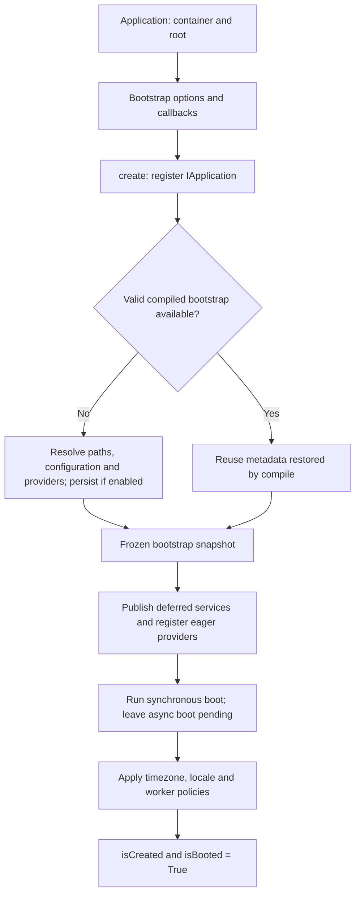
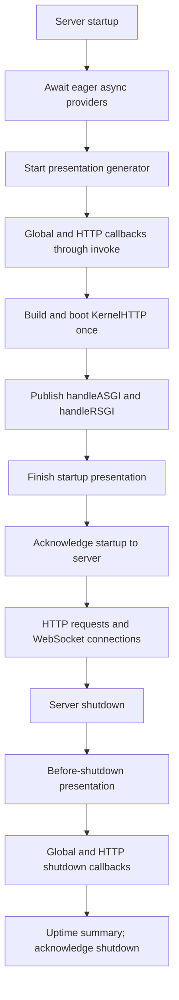
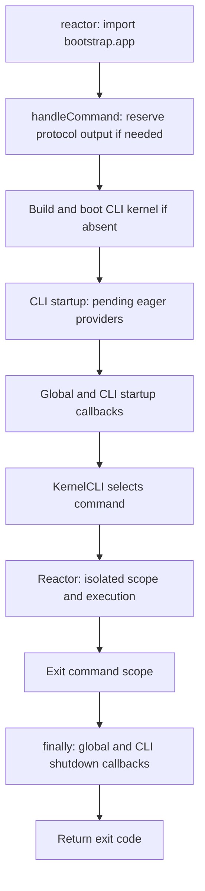

The project exports an application from `bootstrap/app.py`. That file prepares configuration and registers services; the HTTP server or Reactor completes the startup its runtime needs. Distinguishing these stages lets you initialize asynchronous resources before accepting requests and close them at the correct time.

Work with the existing instance. In controllers, commands and services, receive `IApplication` through dependency injection; do not construct another application to inspect its state.

<a id="creation"></a>

## 1. Construction and creation

Calling `Application(base_path=...)` initializes the container, validates the root and minimum Python version, records the initial timestamp and prepares internal state. It does not yet load application configuration.

`create() -> Self` performs synchronous creation once and returns the same instance:



`compile()` can restore a valid snapshot before `create()`; creation reuses that metadata. Compiled configuration stores metadata, not open instances, tasks or connections. Its files, invalidation and process or deployment scope are covered in [Directories and bootstrap cache](/en/getting-started/paths-and-caching).

Eager providers run `register()` during `create()`. A synchronous `boot()` also runs here; methods declared as `async def boot()` remain pending until `boot()` or runtime startup. Deferred providers are still resolved when one of their services is requested. See [Providers and facades](/en/architecture/service-container/providers-and-facades) to define them.

Later calls to `create()` return the instance without repeating completed creation. They do not turn modified configuration into a new initialization. `Application.current() -> Self | None` returns the existing instance without constructing or booting it; it can return an application not yet created, or `None` when none exists.

<a id="readiness"></a>

## 2. Creation, providers and HTTP readiness

These are read-only properties; do not call them with parentheses:

| Property | Type | When it is true |
|---|---|---|
| `isCreated` | `bool` | `create()` finished, including configuration and service registration. |
| `isBooted` | `bool` | Historical alias of the same creation state. It does not guarantee that async providers have finished. |
| `areProvidersBooted` | `bool` | The application was created and no eager async provider remains pending. It does not eagerly load deferred providers. |
| `isHttpReady` | `bool` | Eager providers finished and both HTTP kernel handlers, ASGI and RSGI, were published. |
| `startAt` | `int` | Construction timestamp in nanoseconds since Unix epoch; useful for calculating process duration. |

`isHttpReady` describes kernel preparation. It does not check sockets, database connectivity, load balancer state or external service health. It is not automatically reset to `False` when the server shuts down either; do not use it as a deployment-wide liveness signal.

For example, this controller inspects the application the framework already registered:

```python
from orionis.foundation.contracts.application import IApplication
from orionis.http import JSONResponse


class RuntimeStatusController:
    async def __call__(self, app: IApplication) -> JSONResponse:
        return JSONResponse({
            "created": app.isCreated,
            "providers_ready": app.areProvidersBooted,
            "http_ready": app.isHttpReady,
        })
```

Register it like any [HTTP controller](/en/http/request-lifecycle). This example exposes internal states; the health route configured through `withRouting(health=...)` has its own treatment in the kernel.

<a id="headless-boot"></a>

## 3. Boot services without an HTTP server

`async boot() -> Self` calls `create()` and awaits pending eager provider startup. It is useful in a component that needs application services without running a server or a complete command lifecycle.

```python
from orionis.foundation.contracts.application import IApplication


class ImportCoordinator:
    def __init__(self, app: IApplication) -> None:
        self.app = app

    async def prepare(self) -> bool:
        await self.app.boot()
        return self.app.areProvidersBooted
```

Code that calls `prepare()` should do so within its own asynchronous context. Inside a normal controller or command, eager providers have already passed through the corresponding startup, so calling `boot()` is usually unnecessary.

`boot()` does not fire `STARTUP`/`SHUTDOWN` callbacks, build kernels or start the scheduler. It does not provide automatic shutdown when the method returns. If your process opens additional resources, their owner must close them through their API or a `try/finally` block.

Concurrent calls to `boot()` within the same event loop share a startup lock. Each pending provider is awaited in registration order and removed from the queue only after successful completion. If it fails or is cancelled, it remains pending and a later call can retry its `boot()`: design that initialization to tolerate a previous partial attempt.

<a id="lifespan-events"></a>

## 4. Startup and shutdown callbacks

Callbacks add application behavior to lifecycle events. The project includes `bootstrap/lifespan.py` and calls `register_lifespan_callbacks(app)` from `bootstrap/app.py`.

The actual API is:

```python
def on(
    self,
    lifespan: Lifespan,
    *callbacks: Callable[..., Any] | Callable[..., Awaitable[Any]],
    runtime: Runtime | None = None,
) -> Self:
    ...
```

| Argument | Usage |
|---|---|
| `lifespan` | A `Lifespan` member: `STARTUP` or `SHUTDOWN`. A plain string does not replace the enum. |
| `*callbacks` | One or more callables. Sync and async functions are supported; they run through `await app.invoke(callback)`, with injection of annotated dependencies. |
| `runtime=None` | Global callback: participates in both HTTP and CLI events. |
| `runtime=Runtime.HTTP` | Participates only in the HTTP server lifecycle, including WebSocket. |
| `runtime=Runtime.CLI` | Participates only in calls to `handleCommand()`. |

`on()` returns the application, rejects an incorrectly typed event with `TypeError`, no callbacks with `ValueError`, and a non-callable item with `TypeError`. Callables must be storable in a set; an unhashable callable instance raises `TypeError`. Register functions or callable instances, not classes: although a class passes the initial callable check, `invoke()` rejects it when executing the event. Use the enums to avoid ambiguity: an unrecognized hashable runtime is registered in the global group.

<a id="lifespan-enums"></a>

### Available events and runtimes

```python
from orionis.foundation.enums import Lifespan, Runtime
```

| Enum | Members and values |
|---|---|
| `Lifespan` | `STARTUP = "lifespan.startup"`, `SHUTDOWN = "lifespan.shutdown"`. |
| `Runtime` | `HTTP = "http"`, `CLI = "cli"`. |

Both are `StrEnum`. There is no separate per-request event or `Runtime` variant for MCP or WebSocket: their transport determines the runtime handling them.

### Dependency injection in callbacks

In `bootstrap/lifespan.py`, keep your registration function and add the callbacks you need:

```python
import logging
from orionis.foundation.contracts.application import IApplication
from orionis.foundation.enums import Lifespan, Runtime


logger = logging.getLogger(__name__)


async def on_startup_http(app: IApplication) -> None:
    logger.info("Starting HTTP application %s", app.config("app.name"))


async def on_shutdown_http(app: IApplication) -> None:
    logger.info("Stopping HTTP application %s", app.config("app.name"))


def register_lifespan_callbacks(app: IApplication) -> None:
    app.on(Lifespan.STARTUP, on_startup_http, runtime=Runtime.HTTP)
    app.on(Lifespan.SHUTDOWN, on_shutdown_http, runtime=Runtime.HTTP)
```

Registration does not execute a function. The `app` dependency is resolved when the event occurs. Callbacks stay in memory and are not restored from compiled JSON: the bootstrap module must register them again in every process.

You can register callbacks after `create()`; that method does not lock `on()`. They must be registered before the event you want to observe. Adding one after startup does not replay the earlier event.

<a id="callback-order"></a>

### Ordering and deduplication

The framework unions the global set with the runtime set, then executes their members sequentially. **Registration order is not guaranteed**, either between global and specific callbacks or within a group. Registering the same function in both groups runs it once for that event.

When two operations depend on each other, write their sequence inside a single callback. Do not assume shutdown callbacks run in reverse startup order. Registration retains the original functions; `app.invoke()` does not provide an enter/exit mechanism for generator or async-generator callbacks: use `async def` for asynchronous work and an explicit `SHUTDOWN` callback for cleanup.

<a id="http-startup"></a>

## 5. HTTP server lifecycle

With ASGI, the server sends a startup event; with RSGI, it calls the initialization hook. Both reach the same process:



Startup callbacks run before the HTTP kernel is built. The kernel loads routes, prepares handlers and middleware, creates adapters and registers internal cleanup where applicable. Only then are both protocol handlers published. Callbacks can consume registered services, but must not assume the kernel is ready at that point.

If a request arrives before lifespan has run, dispatch can initialize the kernel on demand. This path does not replay HTTP startup callbacks; use a server that manages the lifecycle correctly. See [ASGI and RSGI entry points](/en/getting-started/server-entrypoints).

The kernel maintains one scope per HTTP request and per WebSocket connection. An HTTP request retains its scope during response generation and transmission; its `Request` is closed in `finally`. A WebSocket connection keeps its scope for the connection lifetime and closes the socket when it ends. Requests rejected early by policies or capacity may finish before opening a scope. Details are covered in [Scopes and concurrency](/en/architecture/service-container/scopes-and-concurrency).

When WebSocket routes exist, the kernel registers cancellation and cooperative cleanup of active WebSocket connections during HTTP shutdown. Cleanup waiting is limited to five seconds. Other framework resources can register their own callbacks; this does not automatically close every service in the container.

<a id="cli-lifecycle"></a>

## 6. Lifecycle of a CLI execution

The `reactor` file imports the same application from `bootstrap.app`, creates the framework-managed loop and calls `app.handleCommand(sys.argv)`. Its public signature is:

```python
async def handleCommand(self, args: list[str] | None = None) -> int:
    ...
```



CLI kernel boot happens before CLI startup. That kernel obtains Reactor; pending eager providers and startup callbacks are completed afterward. Reactor opens the command's isolated scope when executing it. Repeated `handleCommand()` calls reuse the kernel, while startup and shutdown events repeat.

The shutdown `finally` begins after CLI startup finishes successfully. If kernel construction or a startup callback fails, that `finally` is not entered. When a command fails after execution begins, shutdown is still attempted; if a shutdown callback raises another exception, it can replace the previous exception or prevent the exit code from being returned.

To invoke a command from another component, normally use [Reactor](/en/console/output-and-programmatic-execution). `Reactor.call()` executes the command within its scope; it does not replay the application callbacks of `handleCommand()`.

<a id="failures-and-ownership"></a>

## 7. Failures, concurrency and resource ownership

A failure while loading configuration, registering providers or running their boot propagates. A failed eager async provider remains pending; a failing callback stops the remaining callbacks for that event. Resources already opened by other callbacks are not automatically rolled back.

In ASGI, an ordinary startup/shutdown exception produces `lifespan.startup.failed` or `lifespan.shutdown.failed` and ends that lifespan loop. Cancellation is not converted into these ordinary-exception messages. In RSGI, hooks propagate the error to the server. Readiness states are published only when the relevant preparation finishes.

Each kernel's initialization and pending provider boot use asynchronous locks to coordinate concurrent tasks in a worker's event loop. These locks do not make the entire application thread-safe or synchronize separate processes. Callbacks have no general exactly-once guarantee across several concurrent lifecycle calls; do not use concurrent `handleCommand()` calls as a mutex for application resources.

For resources you own:

- Open and close the resource through callbacks or its owning component, using injected dependencies and a recovery strategy for incomplete startup.
- Use `try/finally` inside a task or handler when the resource lives only for that operation.
- Do not rely on shutdown to persist essential data after forced process termination.
- A container singleton does not imply automatic invocation of its `close()`/`aclose()` method. Scope exit removes that context's references; resource cleanup remains explicit.

Built-in startup/shutdown presentation is covered under [Entry points](/en/getting-started/server-entrypoints#lifespan-presentation). Initial configuration is detailed in [Bootstrap options](/en/getting-started/bootstrap-options), and inspection APIs in [Application reference](/en/getting-started/application-api).
