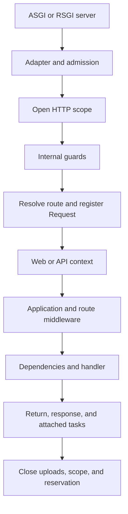
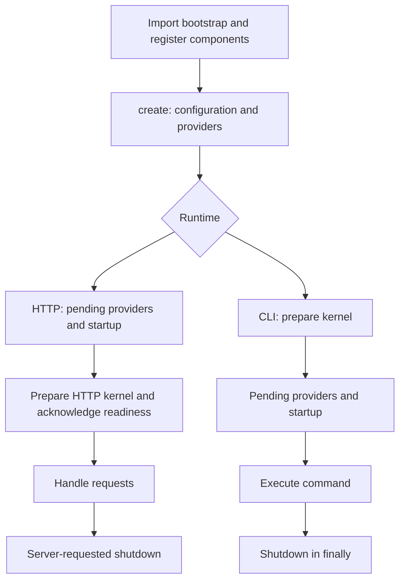

This guide connects HTTP processing, bootstrap, and project structure. Complete file examples use the SSR stack; each stack retains the components it needs.

## General architecture and ASGI/RSGI

`Application` brings together configuration, the service container, and the application's entry points. It exposes ASGI through `__call__(scope, receive, send)` and RSGI through `__rsgi__(scope, protocol)`. Its adapters normalize metadata and body access and delegate to the same HTTP kernel. Controllers use Orionis `Request`, dependencies, and responses without separate implementations for each server.

ASGI connects asynchronous Python applications to servers such as [Uvicorn](https://github.com/Kludex/uvicorn) and [Hypercorn](https://github.com/pgjones/hypercorn). RSGI is the interface used by [Granian](https://github.com/emmett-framework/granian), a server implemented in Rust. We recommend Granian: its design aims for a correct HTTP implementation and stable performance, and Orionis's `serve` command uses it with RSGI by default. It can also run the application through ASGI.

Startup and shutdown events prepare and close the application's execution context; they do not run for each request. During normal HTTP startup, the kernel initializes and prepares routes, invocation plans, and middleware before announcing application readiness.

## HTTP request lifecycle

An admitted request follows this order:

1. **Entry and adaptation.** The server calls the ASGI or RSGI entry point. Orionis selects the HTTP handler and builds the adapter exposing the method, path, headers, and connection data.
2. **Checks before admission.** A special endpoint policy, when present, can respond immediately. The kernel then attempts to reserve execution capacity; if exhausted, it returns `503` with `Retry-After: 1` without opening a request scope.
3. **Request context.** The kernel opens a container scope through `ContextVar` and identifies it as an HTTP context. Services resolved with a `scoped` lifetime during that work belong to this scope. The route's `Request` object does not exist yet.
4. **Internal guards.** Trusted proxies, maintenance, security, and CORS are processed first, followed by body-length header checks and rate limiting when enabled. These checks can produce early responses without executing controllers.
5. **Route resolution.** The resolver matches the method and compiled path and converts its parameters. `HEAD` uses the `GET` route; `OPTIONS` can respond with the allowed methods. After an HTTP match, `Request` is created with its parameters and limits and registered in the scope. Its body is read when requested.
6. **Web or API context.** An ordinary web route runs session, CSRF, and session identity middleware, in that order. An API route resolves token identity. Identity resolution allows guests; protection requires authentication or authorization middleware. `public()` skips these context layers.
7. **Application and route middleware.** Middleware registered with `withMiddleware()` runs next, followed by the route's own middleware, respecting configured exclusions. `public()` preserves this middleware. Each layer receives `Request` and a `call_next()` continuation that can be consumed only once; it can return a response without continuing.
8. **Invocation with dependencies.** The container invokes the function or builds the controller and invokes its action, resolving dependencies and parameters. The handler returns `Response`; a `dict` or `msgspec.Struct` becomes a JSON response. View routes render their template.
9. **Return and delivery.** The result returns through the middleware layers and the session is saved when applicable. The kernel applies final CORS processing and the adapter delivers the status, headers, and content through the selected protocol. Tasks attached to the response are awaited after successful delivery while the scope remains active.
10. **Finalization.** In `finally`, the kernel closes multipart files retained by `Request`, exits the scope, and releases the reserved capacity. The scope clears references and restores the previous context: it does not automatically call `close()` or `aclose()` on arbitrary services or await freely created tasks. Each owner must close its resources and await its work before leaving the scope.

Processing exceptions become responses through kernel rules, a fallback, or the handler configured with `withExceptionHandler()`. Ordinary web validation is converted inside the session to preserve errors; APIs receive structured errors. Delivery or subsequent task failures propagate outside that translation: a response that has already started cannot be replaced. Cancellation also triggers cleanup.

The diagram shows the normal admitted HTTP flow. Early responses and errors can skip later stages.



Explore these contracts in [HTTP controllers](/en/http/controllers), [Middleware and security](/en/http/middleware), and [Scopes and concurrency](/en/application/container/scopes-and-concurrency). Specialized flows are covered in [WebSockets](/en/realtime/websocket), [Streaming and SSE](/en/realtime/streaming-and-sse), and [MCP](/en/mcp).

## Project structure

This abbreviated tree describes the **SSR stack**, the variant containing the `bootstrap/app.py` explained in this section. Blank is the installer's default stack and provides a smaller foundation without these controllers, models, views, scheduler or initial migrations. See [Installation and stacks](/en/getting-started/installation) to choose your starting point.

```text
project/
├── app/
│   ├── console/
│   │   ├── commands/inspire_command.py
│   │   └── scheduler.py
│   ├── exceptions/handler.py
│   ├── http/
│   │   ├── controllers/
│   │   ├── middleware/global_middleware.py
│   │   └── schemas/
│   ├── models/user.py
│   └── providers/app_service_provider.py
├── bootstrap/
│   ├── app.py
│   └── lifespan.py
├── config/
├── database/
│   ├── factories/
│   ├── migrations/
│   ├── schemas/
│   └── seeders/
├── resources/
│   ├── lang/
│   └── views/
├── routes/
│   ├── ai.py
│   ├── api.py
│   ├── console.py
│   ├── web.py
│   └── websocket.py
├── storage/
│   └── app/public/
├── tests/test_example.py
├── .env.example
├── .env.reference
├── .python-version
├── pyproject.toml
└── reactor
```

The tree omits secondary files and other `resources/` folders, which are outside this explanation's scope. Installation prepares `.env`, `.venv` and `uv.lock`. Directories such as `storage/app/private`, `storage/framework` and `storage/logs` appear as their services are used; their contents are runtime data. Orionis' path registry defines additional possible locations, but each stack does not necessarily create all of them.

## The app directory

`app/` contains the application's own components. SSR organizes them as follows:

| Location | Responsibility |
| --- | --- |
| `app/http/controllers/` | HTTP handlers: API responses, authentication, dashboard, profile and example administration pages. |
| `app/http/middleware/` | Intercept requests and delegate to the next step. The included `GlobalMiddleware` provides an extension point. |
| `app/http/schemas/` | Declare input data and validation rules for authentication and profile forms. |
| `app/models/` | Represent persistent entities; SSR includes `User`. |
| `app/providers/` | Register services in the container and perform provider preparation. |
| `app/console/` | Application commands in `commands/` and task declarations in `scheduler.py`. |
| `app/exceptions/` | Customize exception handling through `handler.py`. |

The table describes locations, not automatic execution of every component. To implement them, continue with [Service container](/en/application/container), [Validation](/en/validation/declaring-schemas), [Commands](/en/console/commands-and-arguments), [Task scheduling](/en/console/task-scheduling) and [Exceptions](/en/exceptions).

## The bootstrap directory and application lifecycle

`bootstrap/` connects configuration and components to `Application`. `app.py` constructs and prepares the application; `lifespan.py` groups actions that run when an execution context starts or shuts down.

### The bootstrap/app.py file

This is the complete file from the SSR reference:

```python
from pathlib import Path
from orionis import Application
from app.console.scheduler import Scheduler
from app.exceptions.handler import ExceptionHandler
from app.http.middleware.global_middleware import GlobalMiddleware
from app.providers.app_service_provider import AppServiceProvider
from bootstrap.lifespan import register_lifespan_callbacks

# Create the application instance with caching enabled.
app = Application(
    base_path=Path(__file__).parent.parent,
)

# Compile the application with caching and invalidation paths.
app.compile(
    path="storage/framework/bootstrap",
    invalidation_paths=[
        "app",
        "bootstrap",
        "config",
        "database",
        "resources",
        "routes",
        ".env",
    ],
)

# Register callbacks for a specific application lifespan event.
register_lifespan_callbacks(app)

# Register route files for the different runtime contexts.
app.withRouting(
    ai="routes/ai.py",
    api="routes/api.py",
    console="routes/console.py",
    web="routes/web.py",
    websocket="routes/websocket.py",
    health="/up",
)

# Attach the scheduler for scheduled CLI jobs.
app.withScheduler(Scheduler)

# Set the global exception handler for unhandled exceptions.
app.withExceptionHandler(ExceptionHandler)

# Register service providers for dependency injection.
app.withProviders(
    AppServiceProvider,
    # ...
)

# Register global middleware for HTTP request processing.
app.withMiddleware(
    GlobalMiddleware,
    # ...
)

# Boot the application and prepare the runtime environment.
app.create()
```

**Application and base_path.** `Application` extends the dependency container and coordinates configuration, providers, routes, and HTTP/CLI entry points. `Path(__file__).parent.parent` sets the root from the location of `bootstrap/app.py`. Relative bootstrap configuration paths resolve against this base. Constructing the class does not enable caching by itself: the next call does that.

**compile().** Enables bootstrap metadata caching in `storage/framework/bootstrap`; it does not compile application Python code. It checks invalidation paths and restores a valid snapshot, or allows it to be rebuilt. Within directories, it recursively examines `*.py` files; explicitly listed files such as `.env` also participate. Including `resources` therefore does not watch every template or translation.

It runs before component registration because a valid snapshot restores compiled configuration and makes the `with…` methods reuse it. This is not live reload: after changing bootstrap configuration, invalidate the snapshot when necessary and restart the process. See [Directories and bootstrap caching](/en/application/paths-and-caching).

**register_lifespan_callbacks().** Registers functions for events; importing this file does not execute them.

**withRouting().** Declares and validates AI, API, console, web, and WebSocket route files. The relevant loaders process them later. `health="/up"` is the special health URL. The routes section explains accepted types and multiple files.

**withScheduler().** Registers the `Scheduler` class that declares scheduled console tasks. It does not start executing tasks during bootstrap.

**withExceptionHandler().** Selects the class that reports and transforms exceptions when the runtime needs it. Registration does not execute its exception-handling methods.

**withProviders().** Adds providers to the container registry. During `create()`, eager providers are instantiated and their `register()` methods run; synchronous `boot()` methods run then, while asynchronous ones wait for asynchronous startup. Deferred providers resolve when their service is requested. See [Providers](/en/application/container/providers).

**withMiddleware().** Registers global HTTP pipeline classes. The kernel prepares and executes them; they do not process a request during `create()`. In normal HTTP processing they run after route resolution and its context layers.

**create().** Registers the application as `IApplication`, loads and validates configuration, directory paths, and component metadata, prepares providers, sets timezone/locale, and retains worker policies. It saves the configuration cache when rebuilding is required. It is idempotent: an already created application does not repeat this preparation.

Make `with…` registrations before `create()`. A true `isCreated` does not mean the HTTP kernel is ready: `create()` does not open a port, run STARTUP/SHUTDOWN callbacks, or await asynchronous `boot()` methods. The server or Reactor owns those phases. Integrations without these runtimes can use `await app.boot()`: it creates the application and awaits providers without running HTTP/CLI events. See [Application lifecycle and resources](/en/application/lifecycle).

### The bootstrap/lifespan.py file

A lifespan event represents the start or shutdown of an application execution context. `Lifespan.STARTUP` and `Lifespan.SHUTDOWN` identify the event; `Runtime.CLI` and `Runtime.HTTP` restrict its context. Omitting `runtime` makes the callback general.

This is the SSR registration file, with shortened docstrings:

```python
from typing import TYPE_CHECKING
from orionis.foundation.enums.lifespan import Lifespan
from orionis.foundation.enums.runtimes import Runtime

if TYPE_CHECKING:
    from orionis.foundation.contracts.application import IApplication

async def on_startup() -> None:
    """Handle application startup."""
    # Add application startup behavior here.

async def on_shutdown() -> None:
    """Handle application shutdown."""
    # Add application shutdown behavior here.

async def on_startup_cli() -> None:
    """Handle CLI startup."""
    # Add CLI startup behavior here.

async def on_shutdown_cli() -> None:
    """Handle CLI shutdown."""
    # Add CLI shutdown behavior here.

async def on_startup_http() -> None:
    """Handle HTTP startup."""
    # Add HTTP startup behavior here.

async def on_shutdown_http() -> None:
    """Handle HTTP shutdown."""
    # Add HTTP shutdown behavior here.

def register_lifespan_callbacks(app: IApplication) -> None:
    """Register application callbacks through the native lifecycle API."""
    # Register generic callbacks before the runtime-specific callbacks.
    app.on(Lifespan.STARTUP, on_startup)
    app.on(Lifespan.SHUTDOWN, on_shutdown)
    app.on(Lifespan.STARTUP, on_startup_cli, runtime=Runtime.CLI)
    app.on(Lifespan.SHUTDOWN, on_shutdown_cli, runtime=Runtime.CLI)
    app.on(Lifespan.STARTUP, on_startup_http, runtime=Runtime.HTTP)
    app.on(Lifespan.SHUTDOWN, on_shutdown_http, runtime=Runtime.HTTP)
```

| Callback | Event | When it runs |
| --- | --- | --- |
| `on_startup` | General STARTUP | When an HTTP context or console invocation starts. |
| `on_shutdown` | General SHUTDOWN | During normal shutdown of that context. |
| `on_startup_cli` | CLI STARTUP | Before command execution, after its kernel is prepared. |
| `on_shutdown_cli` | CLI SHUTDOWN | When the command finishes following successful startup. |
| `on_startup_http` | HTTP STARTUP | During server-requested startup, before HTTP kernel preparation. |
| `on_shutdown_http` | HTTP SHUTDOWN | When the server requests application shutdown. |

HTTP combines general callbacks with HTTP callbacks; console execution combines general and CLI callbacks. These are sets: repeating the same callable deduplicates it, and callback order is not guaranteed, including reverse order during shutdown. Coordinate dependent actions inside one callback.

Normal HTTP startup awaits asynchronous eager providers, executes startup callbacks, and prepares both HTTP handlers before acknowledging readiness to the server. ASGI uses `lifespan` messages; Granian/RSGI invokes Orionis initialization and shutdown hooks. Enable lifespan support in your ASGI server to execute these events.



Use startup to prepare resources owned by a context, and shutdown to close them during normal termination. Callbacks may be synchronous or asynchronous and are invoked through the container with dependency resolution. To add one, define `async def warm_resources() -> None: ...` in the file and register it:

```python
app.on(Lifespan.STARTUP, warm_resources, runtime=Runtime.HTTP)
```

Register it before the event occurs. Callbacks do not run per request or when calling `create()`.

**Errors and shutdown.** A failing callback interrupts iteration: there is no rollback or guarantee that the remaining callbacks run. ASGI reports startup failure with `lifespan.startup.failed`; RSGI propagates the initialization error. A shutdown failure is reported as `lifespan.shutdown.failed` in ASGI and propagates from the RSGI hook. CLI startup occurs outside the command's `try/finally`: a startup failure does not automatically run shutdown. After successful startup, the command does have shutdown in `finally`, even when execution fails. Abrupt process termination cannot guarantee callbacks either; each resource must account for its own cleanup.

### Recovering bootstrap/lifespan.py

If the file is missing, run either alternative from the project root:

```bash
orionis bootstrap:lifespan
python -B reactor bootstrap:lifespan
```

The command creates the local stub and ensures the import and `register_lifespan_callbacks(app)` call in `bootstrap/app.py`. If `lifespan.py` exists, it preserves callbacks and checks the registration function; it may still update `app.py` to connect it. It accepts no command-specific arguments or `--force`.

The application must be able to import its bootstrap before running the command. If you deleted `lifespan.py` while `app.py` still imports it, temporarily remove that import and its call; the command can then generate the file and register both again.

## The `config/` directory

Files in `config/` customize application subsystems through frozen dataclasses that inherit core entities. During application creation, Orionis obtains core defaults, discovers local dataclasses and applies their configuration. The filename identifies the section: `config/cache.py` supplies `cache`.

A stack does not need to include all sixteen files. A section without a local file uses its core entities, which also read environment variables. The values below are the defaults in the examined local files when their variables are absent; a local override can differ from its inherited entity. See [Typed configuration](/en/application/configuration) to inspect effective values.

### `app.py`: identity and environment

Defines the application name, environment, debugging, localization and encryption. `APP_NAME` defaults to `Orionis Application`; `APP_ENV` to `development`; `APP_DEBUG` to `True`; `APP_TIMEZONE` to `UTC`; and `APP_LOCALE`/`APP_FALLBACK_LOCALE` to `en`. It also configures the translation directory and the `AES-256-CBC` cipher. A missing `APP_KEY`, or one parsed as `None`, causes a key to be generated and persisted; an existing key must be valid for the cipher.

### `auth.py`: identity and authentication

Selects `AUTH_GUARD=session`, with `token` as an alternative; `AUTH_MODEL=app.models.user.User` and `AUTH_USERNAME=email` identify the model and login field. It configures sessions, personal tokens, password recovery and persistent login. The local file defaults `AUTH_REDIRECT_TO` to `/login`, while the core entity uses `None`, retaining the standard 401 response. These settings do not create models, tables or routes. Continue with [Authentication](/en/authentication).

### `cache.py`: cache stores

`CACHE_STORE=file` selects file storage; `CACHE_FILE_PATH=storage/framework/cache/data` sets its location. The configuration also declares `memory`, `redis`, `memcached` and `database` stores. `CACHE_PREFIX` adds a prefix to cache keys: the local file defaults to an empty string, while the core defaults to `orionis`. External stores require an available service; declaring their settings does not install it. See [Cache](/en/cache).

### `database.py`: connections and engines

`DB_CONNECTION=sqlite` selects the active connection and `DB_DATABASE=database/database.sqlite` its local file. The configuration also declares MySQL, PostgreSQL, Oracle, SQL Server and Redshift, using parameters such as `DB_HOST`, `DB_PORT`, `DB_USERNAME` and `DB_PASSWORD`. Ports and options depend on the engine: Oracle supports service/SID/DSN/TNS; SQL Server declares its ODBC driver; Redshift includes SSL and IAM. Defining connections does not create external databases or run migrations. See [Connections](/en/database/connections).

### `filesystems.py`: storage disks

`FILESYSTEM_DISK=local` selects the default disk. `LOCAL_PATH=storage/app/private` and `PUBLIC_PATH=storage/app/public` separate private and public storage; `PUBLIC_URL=/static` sets the public URL prefix. The configuration also declares credentials, regions and destinations for S3, Azure and GCS. These settings do not provision cloud infrastructure or expose private files. See [Storage](/en/storage).

### `hashing.py`: passwords and costs

`HASH_DRIVER=argon2` selects Argon2id; `bcrypt` is the alternative. `ARGON_MEMORY=65536` specifies memory in KiB, `ARGON_THREADS=4` its parallelism and `ARGON_TIME=3` its iterations. `BCRYPT_ROUNDS=12` controls bcrypt's cost. These settings affect hash generation and verification, rather than the reversible encryption configured in `app.py`. See [Hashing](/en/cryptography/hashing).

### `http.py`: HTTP server policies

Groups body and multipart limits, WebSockets, proxies, hosts, CORS, CSRF and rate limiting. `HTTP_MAX_BODY_SIZE` allows 16 MiB and `HTTP_MAX_CONCURRENT_REQUESTS` allows 128. `TRUSTED_PROXIES` starts with `127.0.0.1`. Since 1.0.15, HTTP CORS defaults to `["*"]` for `CORS_ALLOW_ORIGINS`, `CORS_ALLOW_METHODS` and `CORS_ALLOW_HEADERS`, corresponding to `allow_origins`, `allow_methods` and `allow_headers`. This completes the origin change introduced in 1.0.13 to make debugging from browser clients easier. Exposed headers retain `[]` and `allow_credentials=False`. See [HTTP CORS](/en/http/middleware#http-cors) to adjust these options. Rate limiting is disabled and CSRF enabled by default. `HTTP_MONITOR_DISCONNECTS=False` controls additional monitoring during handler execution; the local file reads this variable, while the core retains a constant `False` default.

### `logging.py`: files and rotation

`LOG_CHANNEL=stack` and `LOG_LEVEL=info` select the channel and severity. Here, `stack` writes a single plain file, `storage/logs/stack.log`; it does not aggregate other channels. Alternatives include `hourly`, `daily`, `weekly`, `monthly` and `chunked`. `LOG_PATH` changes the active channel's path; `LOG_RETENTION` changes its time retention. For size rotation, `LOG_MB_SIZE=10` and `LOG_FILES=5` define size and count. Files are generated according to the channel used.

### `mail.py`: transport and sender

`MAIL_MAILER=smtp` selects SMTP; the `file` transport instead writes to `MAIL_FILE_PATH=storage/mail`. `MAIL_PORT=587` and `MAIL_ENCRYPTION=TLS` are the initial SMTP settings. Host, username, password and sender address start empty; `MAIL_FROM_NAME` uses `APP_NAME` when available. These defaults alone do not provide a usable SMTP connection. See [Mail](/en/mail).

### `mcp.py`: MCP protocol limits

`MCP_DEFAULT_PAGE_SIZE=50` and `MCP_MAX_PAGE_SIZE=100` control pagination. `MCP_MAX_REQUEST_SIZE` falls back to `HTTP_MAX_BODY_SIZE`, then to 1 MiB; concurrency falls back to `HTTP_MAX_CONCURRENT_REQUESTS`, then to 32. These are environment variables, rather than effective `http.py` values. The configuration also limits subscriptions, tool search and responses. Servers are registered through AI routes.

Since **1.0.16**, `allowed_origins` uses independent `list[str]` values. When `CORS_ALLOW_ORIGINS` is unset, editable `config/mcp.py` defaults to `["https://inspector.orionis-framework.com"]`; core `McpConfig` retains `[]`. A defined environment value replaces the editable default, including `[]`, which rejects every present `Origin`. Requests without that header pass the origin check. MCP requires exact HTTP(S) origins without wildcards, paths, or trailing slashes. See [MCP configuration](/en/mcp/stdio-and-configuration#allowed-http-origins) to update an existing application and distinguish this policy from HTTP CORS.

### `queue.py`: job execution

`QUEUE_CONNECTION=sync` executes jobs in the dispatching process; alternatives are `database` and `redis`. `QUEUE_TABLE=jobs` and `QUEUE_FAILED_TABLE=failed_jobs` name tables without creating them. Worker defaults include `QUEUE_WORKER_CONCURRENCY=1`, `QUEUE_WORKER_TIMEOUT=60.0` seconds and `QUEUE_WORKER_TRIES=3`. Configuring a backend does not start a worker. See [Queues](/en/queues).

### `realtime.py`: invocations and groups

Controls realtime hub limits: `REALTIME_MAX_MESSAGE_SIZE=1048576` bytes, `REALTIME_MAX_CONCURRENT_INVOCATIONS=16` and `REALTIME_MAX_PENDING_CLIENT_INVOCATIONS=32` per connection. `REALTIME_INVOCATION_TIMEOUT` and `REALTIME_CLIENT_RESULT_TIMEOUT` default to 30 seconds; `REALTIME_MAX_GROUPS_PER_CONNECTION=64` limits membership. These settings regulate resources and execution; they neither register hubs nor configure an external broker. See [Realtime](/en/realtime).

### `scheduler.py`: task storage and execution

`TASKS_STORE=memory` uses process storage; Redis and database stores are also available. `TASKS_MAX_INSTANCES=1` limits simultaneous instances per task, `TASKS_COALESCE=True` combines missed runs and `TASKS_MISFIRE_GRACE_TIME=30` permits thirty seconds of delay. `TASKS_REPLACE_EXISTING=True` retains replacement of existing identifiers; `TASKS_JITTER=0` adds no random delay. Task definitions and scheduler startup happen separately. See [Task scheduling](/en/console/task-scheduling).

### `session.py`: persistence and cookies

`SESSION_DRIVER=memory` keeps sessions in the process; `file`, `database` and `cache` are alternatives. `SESSION_LIFETIME=120` is measured in minutes. `SESSION_FILES=storage/framework/sessions` applies to the file driver. The default cookie is `sessionid`, with `SESSION_HTTP_ONLY=True`, `SESSION_SECURE=False` and SameSite `lax`. One worker's memory does not provide shared storage across processes. See [Sessions](/en/sessions).

### `testing.py`: discovery and results

Configures the test runner: `TESTING_START_DIR=tests`, `TESTING_FILE_PATTERN=test_*.py` and `TESTING_METHOD_PATTERN=test*` govern discovery. `TESTING_VERBOSITY=2` selects detailed output, `TESTING_FAIL_FAST=False` continues after failures and `TESTING_CACHE_RESULTS=False` disables result caching. These options do not execute tests during application startup. See [Testing](/en/testing).

### `view.py`: Jinja2 templates

`VIEW_PATHS=["resources/views"]` identifies template search directories. `VIEW_CACHE_SIZE=400` limits the in-memory LRU cache: `0` disables it and `-1` removes the limit. `VIEW_CACHE_PATH=storage/framework/views` enables disk bytecode caching; `None` disables it. `APP_DEBUG=True` controls automatic reload and `VIEW_AUTOESCAPE=True` enables HTML escaping. This does not mean every view is compiled at startup. See [Views](/en/views).

### Environment variables and defaults

`Env` loads `.env` from the current working directory, and its values take precedence over matching process variables (`override=True`). Run commands from the application root. `.env.reference` documents available options; it is not a second file loaded automatically.

These examples come from the examined configuration files:

```python
# config/app.py
default_factory=lambda: Env.get("APP_DEBUG", True)

# config/cache.py
default_factory=lambda: Env.get("CACHE_PREFIX", "")
```

If a variable is absent, the second argument is used. `APP_DEBUG=False` is parsed as a boolean, while `CACHE_PREFIX=shop` supplies the `shop` prefix. By contrast, `APP_DEBUG=` and `CACHE_PREFIX=` are present: the parser turns them into `None`, rather than their defaults. Their entities reject that value because its type is invalid. The literals `null`, `none`, `nil` and `nan` also represent `None`; typed prefixes can express other values. Check the expected type before editing `.env`.

### Recovering configuration files

From the application, use either form to recover all missing files:

```bash
orionis bootstrap:config
python -B reactor bootstrap:config
```

To recover only `database.py`:

```bash
orionis bootstrap:config database
python -B reactor bootstrap:config database
```

The optional argument is the module name without `.py`. The command retrieves the official skeleton repository's `master` configuration tree over the network and validates downloads before writing. Available names come from that catalog; an unknown name produces an error listing the alternatives.

Existing files are preserved and reported as `EXISTS`; new files appear as `CREATED`. There is no `--force` option to replace them. Recovery does not restore deleted customizations or necessarily copy the configuration from the stack's original branch. Creating files invalidates the relevant compiled caches. The application must be able to import its bootstrap and create its configuration to execute the command; it cannot repair syntax errors or invalid values that prevent startup.

## The database directory

Its four folders separate persistence responsibilities:

| Folder | Concept and SSR example |
| --- | --- |
| `factories/` | Generate model attributes for tests or example data. `UserFactory.definition()` prepares a name, email and active state; persistence requires another operation and mandatory fields such as an already hashed password. |
| `migrations/` | Express schema changes: `up()` applies them and `down()` defines their reversal. SSR includes migrations for users, authorization, sessions and other services. |
| `schemas/` | Table definitions containing columns, types and constraints. For example, `USERS_V1` is a `TableDefinition` used by a migration. |
| `seeders/` | Insert initial or example data. Request them explicitly with `migrate --seed`; review the administrator seeder and its credentials before running it. |

These schemas describe relational storage; those in `app/http/schemas/` validate input. Continue with [Factories and testing](/en/orm/factories), [Database schemas](/en/database/schema) and [Migrations and seeders](/en/database/migrations).

## The resources directory

`resources/lang/` includes `en.json` and `es.json`, translation dictionaries selected using the configured locale and fallback. The system also supports grouped files such as `es/messages.json`, although SSR does not create that structure. See [Localization](/en/localization).

`resources/views/` contains Jinja templates: pages, layouts, partials and emails. With the initial settings, `response.view("home.index")` looks for `resources/views/home/index.html`. The engine renders asynchronously and supports layout inheritance and partial includes. See [Views](/en/views).

## The routes directory

`withRouting()` registers files for five contexts:

| Context | SSR file | Responsibility |
| --- | --- | --- |
| `web` | `routes/web.py` | HTTP routes for the website and its forms. |
| `api` | `routes/api.py` | API HTTP routes. Declare the prefix in the routes; the filename does not add it. |
| `websocket` | `routes/websocket.py` | WebSockets and hubs, with their own connection middleware. |
| `console` | `routes/console.py` | Commands declared through the Reactor facade. |
| `ai` | `routes/ai.py` | MCP server registration through the Mcp facade. |

Each context accepts a string, a list of strings or `None`, but not tuples. Lists preserve order and let you split registrations by domain. This example distributes API routes across user, product, and order files:

```python
app.withRouting(
    ai="routes/ai.py",
    api=[
        "routes/v1/users.py",
        "routes/v1/products.py",
        "routes/v1/orders.py",
    ],
    console="routes/console.py",
    web="routes/web.py",
    websocket="routes/websocket.py",
    health="/up",
)
```

The three API files are a proposed organization: create them with their HTTP route declarations before using this fragment. The `v1` directory organizes files; URL prefixes are declared in routes. Configured files are validated; registering their locations does not immediately execute all their handlers.

`health` is different: it accepts a string or `None` and represents the health URL, not a file or a list. When omitted or set to `None`, the application uses `/up`. See [HTTP routing](/en/http/routing) and [MCP servers](/en/mcp).

## The storage directory

`storage/app/private/` is the initial root of the `local` disk, suitable for internal documents. That disk does not provide public URLs. `storage/app/public/` belongs to the `public` disk, whose initial URL is `/static`; `asset()` uses this disk by default.

When running `reactor serve`, Orionis configures the public directory mount in Granian. No symbolic link is required. Another ASGI server needs its own static-file configuration or a proxy. That mount does not publish the private location. See [Storage](/en/storage).

`storage/framework/` holds artifacts according to configuration and usage:

| Initial location | Contents and generation |
| --- | --- |
| `bootstrap/config` | Configuration and bootstrap/provider metadata saved by `create()` when compiled state needs rebuilding. |
| `bootstrap/routes` | Compiled routes produced when the HTTP kernel loads routes. |
| `bootstrap/commands` | Command metadata produced when the console loads it. |
| `views/` | Jinja bytecode produced when templates are compiled, if view caching is enabled. |
| `cache/data/` | Values stored when the file cache store is used. |
| `cache/testing/` | JSON results only when `testing.cache_results` is enabled. |

The first three entries are files without extensions inside the path selected by `compile()` in SSR. Provider metadata does not imply a separate `services/` directory. Bootstrap invalidation monitors Python files in registered directories and explicit files such as `.env`; including `resources` does not automatically monitor HTML/JSON changes. Views have their own cache. See [Directories and caching](/en/application/paths-and-caching).

`storage/logs/` receives logs according to the configured channels. For example, the initial `stack` channel uses `storage/logs/stack.log`; other channels can rotate files or use another path. See [Logging](/en/logging).

## The tests directory

Use Orionis' `TestCase` to integrate assertions, synchronous/asynchronous tests and container injection:

```python
from orionis.foundation.contracts.application import IApplication
from orionis.test import TestCase

class TestProject(TestCase):
    async def testApplication(self, app: IApplication) -> None:
        self.assertEqual(app.path("root"), app.basePath)
```

Save it, for example, as `tests/test_project.py` and run `uv run python -B reactor test`. The runner loads and tests the existing application. Its initial conventions are `test_*.py` files and `test*` methods; it also traverses subdirectories without `__init__.py`. Patterns can be adjusted in `config/testing.py`. See [Testing](/en/testing).

## Root files

`.env` contains concrete environment values. `.env.example` provides the minimal base copied during installation; `.env.reference` documents additional options and examples without being loaded automatically as configuration. Files in `config/` determine how these variables are consumed. See [Configuration](/en/application/configuration).

`pyproject.toml` declares metadata and dependencies; `uv.lock` records their resolution and `.python-version` guides interpreter selection. `uv sync` prepares the project's `.venv` from these files.

`reactor` belongs to the application: it loads `bootstrap.app`, prepares console/STDIO execution and passes arguments to `app.handleCommand()` through the Orionis loop. You can adapt this entry point when an integration requires it; changing it is not mandatory.

The core framework's `orionis` executable also loads the application from the current directory. It is distinct from the installer's executable with the same name. Inside the project, `uv run python -B reactor ...` explicitly identifies its local entry point. With the project environment active, these are two alternatives for running its tests:

```bash
orionis test
python -B reactor test
```

See [Console](/en/console).
