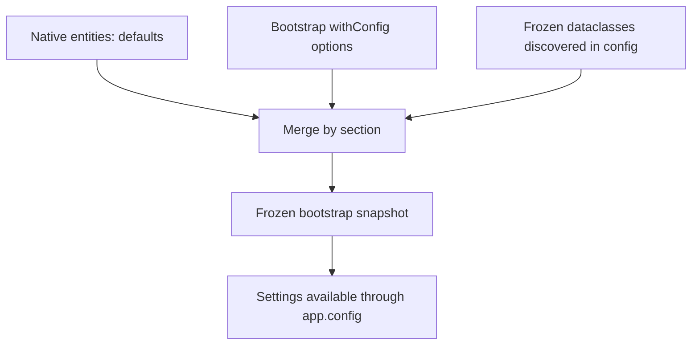

Files in `config/` describe how each installation works: connections, drivers, limits, cookies, mail and other services. They are the place to read variables using `Env` or `env()`; during execution, components consume resolved values through an injected `IApplication` and `app.config(...)`.

The [Environment](/en/architecture/environment) guide covers `.env`, typed values and bootstrap JSON persistence. This page documents configuration composition, native entities and validators you can reuse in your own configuration files.

<a id="configuration-merge"></a>

## How configuration is built



Without a valid compiled cache, the application:

1. Builds independent dictionaries containing defaults for all 16 native sections.
2. Incorporates dictionaries stored through `withConfig...()` in `bootstrap/app.py`.
3. Discovers and instantiates frozen dataclasses from `config/`; their values are applied last.
4. Freezes the bootstrap snapshot and prepares the configuration used by the application.

Merging uses `dict.update()` **per section**, rather than a universal recursive merge. Supply complete configuration when replacing a nested dictionary. A dataclass in `config/app.py` can also replace a value previously supplied through `withConfigApp(...)`.

Each call to the same `withConfig...()` replaces that section's dictionary stored by the preceding call. Group related options in a single call. When a compiled bootstrap is recovered, these setters do not rebuild it: see [Configuration cache](/en/architecture/environment/compiled-configuration) and [Bootstrap options](/en/getting-started/bootstrap-options).

<a id="configuration-validation"></a>

## What entities validate and what setters do

Constructing a native entity runs its validation and normalization. Depending on the field, this can check ranges, strict types, enums and nested option structures. For example:

```python
from orionis.foundation.config.hashing import Bcrypt


settings = Bcrypt(rounds=12)
assert settings.rounds == 12

try:
    Bcrypt(rounds=32)
except ValueError:
    print("The rounds setting is outside the supported range.")
```

The `withConfig...(**options)` setters store dictionaries for merging; **they do not automatically construct the equivalent entity or revalidate every option**. A constructor rejecting a value does not mean the corresponding setter rejects it at that point. Consumers may perform additional checks during initialization, but the entire merge is not universally revalidated through `Configuration`.

Discovered dataclasses are actually instantiated: when they inherit a native entity and preserve its `__post_init__()`, its checks run. An exception during that construction propagates from configuration loading as `RuntimeError`, retaining its cause. A custom dataclass's type annotations alone do not convert or validate every field.

`frozen=True` prevents attribute reassignment, but does not automatically make every internal dictionary or list immutable. Bootstrap freezing belongs to the application process and transforms supported containers such as dictionaries, lists, and tuples; it does not freeze every arbitrary object.

<a id="configuration-sections"></a>

## All 16 native sections

Every section is optional when constructing `Configuration`: each has a default entity factory. Component-specific options, variables, drivers and restrictions are documented in their respective guides.

| Section | Main entity | Option reference |
| --- | --- | --- |
| `app` | `App` | [Identity, environment and key](#configuration-app). |
| `auth` | `Auth` | [Authentication and guards](/en/security/authentication/configuration-and-guards). |
| `cache` | `Cache` | [Cache stores and configuration](/en/services/cache/configuration). |
| `database` | `Database` | [Database connections](/en/database/configuration). |
| `filesystems` | `Filesystems` | [Storage disks and configuration](/en/services/storage/configuration). |
| `hashing` | `Hashing` | [Hashing and drivers](/en/security/hashing/password-storage). |
| `http` | `HTTP` | [Middleware and HTTP policies](/en/http/middleware-and-security), [payloads](/en/http/forms-and-uploads) and [WebSocket](/en/http/websockets). |
| `logging` | `Logging` | [Logging channels](/en/services/logging/writing-logs) and [rotation](/en/services/logging/rotation-and-lifecycle). |
| `mail` | `Mail` | [Mailers and email content](/en/services/mail/configuration). |
| `mcp` | `McpConfig` | [MCP transport and configuration](/en/protocols/mcp/transports-and-configuration). |
| `queue` | `Queue` | [Queue connections, workers and persistence](/en/asynchronous/queues/configuration). |
| `realtime` | `RealtimeConfig` | [Message and invocation limits](/en/asynchronous/realtime/protocol-and-streaming). |
| `scheduler` | `Scheduler` | [Scheduling and persistence](/en/console/scheduler-configuration). |
| `session` | `Session` | [Lifetime, storage and cookies](/en/http/sessions/configuration-and-security). |
| `testing` | `Testing` | [Test execution and configuration](/en/testing/writing-and-running-tests). |
| `view` | `View` | [View engine and extensions](/en/services/views/configuration-and-extensions). |

<a id="configuration-container"></a>

## `Configuration`: collect entities or dictionaries

`orionis.foundation.config.startup.Configuration` is a frozen dataclass with keyword-only arguments. For each section in the table, it accepts **the corresponding entity or a `dict`**. It does not accept `None` as a replacement section; omitting the argument constructs its default.

Given a dictionary, it constructs `Entity(**options)` and runs that entity's validation. Given an instance of the expected type, it retains it; a different type produces `TypeError`. Unknown dictionary fields fail during entity construction. Some entities normalize their substructures into entities while others retain validated dictionaries: do not assume every component has the same internal representation.

```python
from orionis.foundation.config.app import App, Environments
from orionis.foundation.config.startup import Configuration


# Fixed key exclusively for this isolated validation example.
settings = Configuration(
    app=App(name="Reports", env=Environments.TESTING, key=b"k" * 32),
    hashing={"bcrypt": {"rounds": 12}},
    view={"cache_size": 0, "autoescape": False},
)

assert settings.app.name == "Reports"
assert settings.hashing.bcrypt.rounds == 12
assert settings.view.autoescape is False
assert settings.toDict()["app"]["env"] == "testing"
```

`toDict()` is inherited from `BaseEntity` and provides the data representation. Constructing `Configuration` **does not automatically configure or start `Application`**: there is no implicit step binding it to `bootstrap/app.py`. The application uses its own defaults, setters and dataclass-loading flow described above.

Do not replace an existing project's key with this example's fixed test key. Entity defaults may read the environment and `App` may generate and persist a missing key; configuration construction should not be assumed to have no side effects under all conditions.

<a id="configuration-app"></a>

## Application options: `App`

Import `App`, `Cipher` and `Environments` from `orionis.foundation.config.app`. The following are fallback defaults; environment values read by the entity may override them.

| Field | Type and default | Purpose and validation |
| --- | --- | --- |
| `name` | `str`, `"Orionis Application"` | Non-empty application name. |
| `env` | `str \| Environments`, `"development"` | `development`, `testing` or `production`; normalized to the enum value. |
| `debug` | `bool`, `True` | Enables debugging detail; a string cannot substitute for a boolean. |
| `timezone` | `str`, `"UTC"` | Timezone recognized by `ZoneInfo`. |
| `locale` | `str`, `"en"` | Non-empty primary locale. |
| `fallback_locale` | `str`, `"en"` | Non-empty fallback locale. |
| `language_path` | `str`, `"resources/lang/"` | Non-empty translation path; see [Localization](/en/services/localization). |
| `cipher` | `str \| Cipher`, `"AES-256-CBC"` | Normalized algorithm used to validate key length; see [Encryption](/en/security/encryption). |
| `key` | `str \| bytes \| None`, `None` | Normalized to bytes. Accepts `base64:` representation; requires the cipher's exact key length. Generates and persists a key when missing. |
| `maintenance` | `bool`, `False` | Maintenance setting; effective state also considers the application's maintenance marker. |

`Environments` contains `DEVELOPMENT`, `TESTING` and `PRODUCTION`. `Cipher` contains the available algorithms; the linked encryption guide explains their keys and uses. Normalization accepts a member, its name or its textual value according to `normalize_enum()`.

<a id="configuration-own"></a>

## Create a custom section

For example, create `config/payments.py`:

```python
from dataclasses import dataclass
from orionis.foundation.config.validation import validate_integer, validate_string


@dataclass(frozen=True, kw_only=True)
class Payments:
    currency: str = "USD"
    receipt_limit: int = 100

    def __post_init__(self) -> None:
        validate_string(self.currency, "currency")
        validate_integer(self.receipt_limit, "receipt_limit", minimum=1)
```

The section comes from the module: after application creation, read it with `app.config("payments.currency")`. Keep one concrete configuration dataclass per section to avoid depending on merge ordering between classes writing the same keys. Avoid network I/O in construction: it is imported and instantiated during startup.

For `.env` values, use the reading and `default_factory` pattern in [Environment](/en/architecture/environment). For reading or changing runtime values, see the [Application API](/en/getting-started/application-api); process-local changes do not rewrite configuration files or guarantee reconfiguration of existing managers.

<a id="configuration-validation-helpers"></a>

## Reusable configuration validators

These ten functions are in `orionis.foundation.config.validation`. They validate configuration options and do not replace [payload schemas](/en/validation). The `validate_*` functions return `None` for accepted values without converting them; `normalize_enum()` and `copy_string_list()` return a result.

<a id="configuration-validate-integer"></a>

### Integers, strings and booleans

```text
validate_integer(value: object, name: str, *, minimum: int = 0, maximum: int | None = None) -> None
validate_string(value: object, name: str, *, allow_empty: bool = False) -> None
validate_boolean(value: object, name: str) -> None
```

`validate_integer()` requires `int` and rejects `bool`; bounds are inclusive. `validate_string()` requires `str` and rejects empty or whitespace-only text unless `allow_empty=True`. `validate_boolean()` requires a real boolean without converting `1` or `"true"`. Wrong types produce `TypeError`; an out-of-range value or disallowed empty string produces `ValueError`.

```python
from orionis.foundation.config.validation import (
    validate_boolean,
    validate_integer,
    validate_string,
)


validate_integer(25, "page_size", minimum=1, maximum=100)
validate_string("reports", "name")
validate_string("", "optional_label", allow_empty=True)
validate_boolean(False, "enabled")
```

<a id="configuration-normalize-enum"></a>
<a id="configuration-copy-string-list"></a>

### Enums and string lists

```text
normalize_enum(value: object, enum_type: type[Enum], name: str) -> object
copy_string_list(value: object, name: str) -> list[str]
```

`normalize_enum()` accepts an enum member or a string containing a member's name or value, ignoring case and surrounding whitespace. It returns `.value`. An unsuitable type produces `TypeError` and an unknown string produces `ValueError`.

`copy_string_list()` requires a list rather than a tuple, validates that all items are non-empty strings and returns an independent copy. It preserves content and order without trimming or transforming strings.

```python
from orionis.foundation.config.app import Environments
from orionis.foundation.config.validation import copy_string_list, normalize_enum


assert normalize_enum(" PRODUCTION ", Environments, "env") == "production"
original = ["api", "reports"]
copied = copy_string_list(original, "channels")
assert copied == original and copied is not original
```

<a id="configuration-validate-cookie-name"></a>
<a id="configuration-validate-name"></a>

### Cookie names and identifiers

```text
validate_cookie_name(value: object, name: str) -> None
validate_name(value: object, name: str, *, table: bool = False) -> None
```

The first checks the name using the HTTP cookie serializer. The second accepts identifiers of 1 to 128 characters starting with an alphanumeric character and continuing with ASCII letters, digits, `_`, `.` or `-`. With `table=True`, it applies ASCII `[A-Za-z_]\w*` for an unqualified table name. It neither quotes SQL nor validates query data.

```python
from orionis.foundation.config.validation import validate_cookie_name, validate_name


validate_cookie_name("orionis_session", "cookie")
validate_name("reports-primary", "connection")
validate_name("job_results", "table", table=True)
```

Both reject non-string types with `TypeError` and invalid names with `ValueError`.

<a id="configuration-validate-seconds"></a>
<a id="configuration-validate-driver"></a>
<a id="configuration-validate-http-origin"></a>

### Durations, queue drivers and HTTP origins

```text
validate_seconds(value: object, name: str, *, positive: bool = False) -> None
validate_driver(value: object, expected: Drivers) -> None
validate_http_origin(origin: str) -> None
```

`validate_seconds()` accepts finite `int` and `float` values, rejects `bool` and negative numbers, and rejects zero with `positive=True`. `validate_driver()` checks a string driver against the exact expected **queue** `Drivers` member; it is not a universal validator for every enum named `Drivers`.

`validate_http_origin()` accepts an explicit HTTP or HTTPS origin with a host and a valid port when supplied. It rejects wildcards, whitespace, non-ASCII characters, credentials, paths, queries and fragments. It does not change the representation; `https://app.example.test/` has a path and is not equivalent to the origin without `/` for this validator.

```python
from orionis.foundation.config.queue.enums import Drivers
from orionis.foundation.config.validation import (
    validate_driver,
    validate_http_origin,
    validate_seconds,
)


validate_seconds(0.5, "timeout", positive=True)
validate_driver("redis", Drivers.REDIS)
validate_http_origin("https://app.example.test:8443")
```

Invalid types produce `TypeError`; durations, drivers or origins outside the accepted rules produce `ValueError`.

<a id="configuration-logging-validators"></a>

## Logging-specific validators

`orionis.foundation.config.logging.validators` exports two callable objects:

```text
IsValidPath(value: str, *, suffix: bool = False) -> None
IsValidLevel(value: Level | int | str) -> None
IsValidLevel.normalize(value: Level | int | str) -> int
```

`IsValidPath` requires a non-empty string ending in `.log`; `suffix=True` also requires the literal `{suffix}` placeholder. It checks format, not file existence or permissions. `IsValidLevel` accepts `Level`, an allowed integer or a textual level name; `normalize()` returns the canonical integer and `IsValidLevel(...)` only validates. Levels are `DEBUG=10`, `INFO=20`, `WARNING=30`, `ERROR=40` and `CRITICAL=50`.

```python
from orionis.foundation.config.logging.validators import IsValidLevel, IsValidPath


IsValidPath("storage/logs/application.log")
IsValidPath("storage/logs/application-{suffix}.log", suffix=True)
IsValidLevel("warning")
assert IsValidLevel.normalize(" INFO ") == 20
```

Wrong types produce `TypeError` and unsupported formats or levels produce `ValueError`. See [Logging](/en/services/logging) to choose channels, paths and rotation.

<a id="configuration-secret-key"></a>

## Secret-generation helper

```text
SecretKey.random(length: int = 32) -> str
```

`orionis.foundation.config.session.helpers.secret_key.SecretKey.random()` delegates to secure random-byte generation and returns hexadecimal text: the default produces 32 bytes and a 64-character string. `length` counts bytes, not output characters. The helper does not store the key or change configuration.

```python
from orionis.foundation.config.session.helpers.secret_key import SecretKey


generated_key = SecretKey.random()
assert len(generated_key) == 64
```

Use it when preparing a secret your component will retain in secure deployment configuration. Do not use it as a factory that changes a persistent secret on every startup or worker. Although located in `config/session/helpers`, the current session service does not use it automatically or expose a `secret_key` field connecting it: you do not need to add that setting to `config/session.py`. The helper adds no validation of `length`; invalid arguments propagate the underlying generator's errors.

<a id="configuration-type-index"></a>

## Configuration-family reference

The section table links to each component's operational configuration. Auxiliary types in those families are listed below to locate their reference; Database, mail, storage and authentication options remain in their respective guides without duplication here.

| Family and reference | Defined classes and enums |
| --- | --- |
| [app](/en/getting-started/configuration#configuration-app) | `App`, `Cipher`, `Environments` |
| [auth](/en/security/authentication/configuration-and-guards) | `Auth`, `Identity`, `PasswordReset`, `RememberAuth`, `SessionAuth`, `Tokens`, `Guards` |
| [cache](/en/services/cache/configuration) | `Cache`, `Database`, `File`, `Memcached`, `Memory`, `Redis`, `Stores`, `Drivers` |
| [database](/en/database/configuration) | `Connections`, `Database`, `MySQL`, `Oracle`, `PGSQL`, `Redshift`, `SQLite`, `SQLServer`, `ConnectionName`, `MySQLCharset`, `MySQLCollation`, `MySQLEngine`, `OracleEncoding`, `OracleNencoding`, `PGSQLCharset`, `PGSQLCollation`, `PGSQLSSLMode`, `RedshiftSSLMode`, `SQLiteForeignKey`, `SQLiteJournalMode`, `SQLiteSynchronous`, `SQLServerCharset` |
| [filesystems](/en/services/storage/configuration) | `S3`, `Azure`, `Disks`, `Filesystems`, `GCS`, `Local`, `Public`, `DiskName` |
| [hashing](/en/security/hashing/password-storage) | `Argon2`, `Bcrypt`, `Hashing`, `Drivers` |
| [http](/en/http/middleware-and-security) | `HTTPBodyLimits`, `Cors`, `HTTPCsrf`, `HTTP`, `HTTPProxies`, `HTTPRateLimit`, `Redis`, `HTTPSecurity`, `HTTPWebSocket` |
| [logging](/en/services/logging/writing-logs) | `Channels`, `Chunked`, `Daily`, `Hourly`, `Logging`, `Monthly`, `Stack`, `Weekly`, `Level` |
| [mail](/en/services/mail/configuration) | `File`, `FromAddress`, `Mail`, `Mailers`, `Smtp`, `MailDriver` |
| [mcp](/en/protocols/mcp/transports-and-configuration) | `McpConfig` |
| [queue](/en/asynchronous/queues/configuration) | `Connections`, `Database`, `Failed`, `Queue`, `Redis`, `Sync`, `Worker`, `Drivers` |
| [realtime](/en/asynchronous/realtime/protocol-and-streaming) | `RealtimeConfig` |
| [scheduler](/en/console/scheduler-configuration) | `Database`, `Memory`, `Redis`, `Scheduler`, `Stores`, `Drivers` |
| [session](/en/http/sessions/configuration-and-security) | `Session`, `SessionDriver`, `SameSitePolicy`, `SecretKey` |
| [testing](/en/testing/writing-and-running-tests) | `Testing`, `VerbosityMode` |
| [view](/en/services/views/configuration-and-extensions) | `View` |

Continue with the [Application API](/en/getting-started/application-api), [Bootstrap options](/en/getting-started/bootstrap-options) and [Service providers](/en/architecture/service-container/providers-and-facades).
