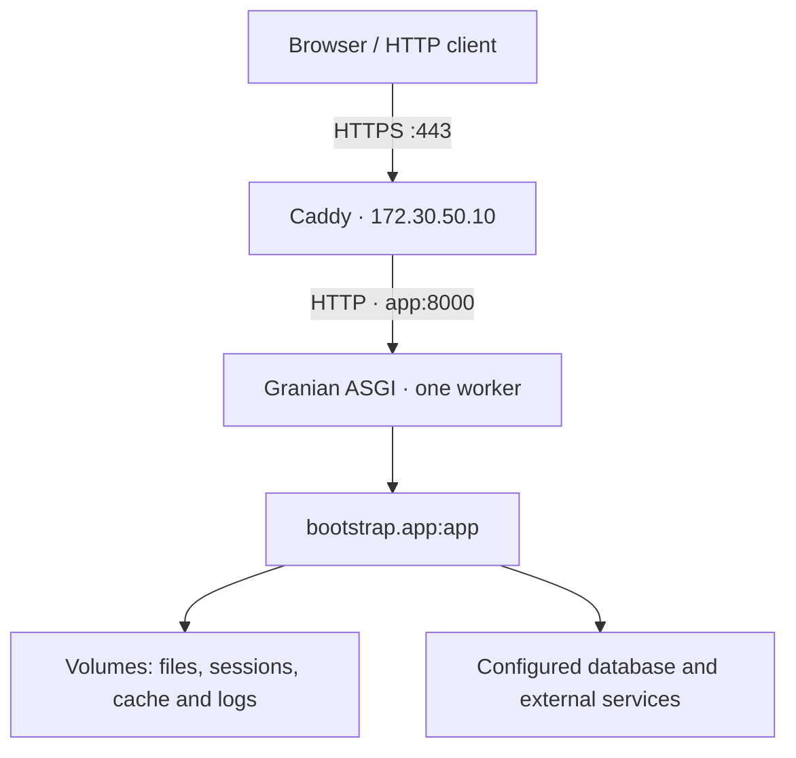

This guide runs an Orionis application in Linux containers: Caddy receives HTTPS and Granian listens exclusively within the Compose network. Use the application created by the [installer](/en/getting-started/installation), including its `pyproject.toml`, `uv.lock`, `bootstrap/app.py` and `reactor` file. Do not copy the framework repository into your application.



<a id="docker-requirements"></a>

## 1. Prepare the project and server

You need Docker Engine with Linux containers, Docker Compose supporting `env_file.format: raw`, and access to image registries and the dependency index during the build. The example uses this option, available since Compose 2.30. [The `env_file` reference](https://docs.docker.com/reference/compose-file/services/#env_file).

```shell
docker version
docker compose version
```

The host must accept inbound TCP connections on ports 80 and 443. Replace `app.example.com` in the following files with a real domain whose DNS points to the server. Port 8000 and private service ports are not published.

Keep the approved lockfile for your application release. Add any database or storage extras to `pyproject.toml` and `uv.lock` beforehand. SQLite and local storage require no extras. Drivers requiring system libraries—for example, an ODBC driver—need those libraries in the image as well as the Python extra; see [Database drivers](/en/database/drivers).

<a id="docker-image"></a>

## 2. Build the image

Create `Dockerfile` in the project root:

```dockerfile
ARG PYTHON_IMAGE=python:3.14-slim-bookworm
ARG UV_IMAGE=ghcr.io/astral-sh/uv:0.11.30

FROM ${UV_IMAGE} AS uv_binary

FROM ${PYTHON_IMAGE} AS build
COPY --from=uv_binary /uv /usr/local/bin/uv
ENV UV_PYTHON_DOWNLOADS=0 UV_LINK_MODE=copy
WORKDIR /app
COPY . .
RUN uv sync --locked --no-default-groups --no-editable

FROM ${PYTHON_IMAGE} AS runtime
ENV PATH="/app/.venv/bin:${PATH}" \
    PYTHONDONTWRITEBYTECODE=1 \
    PYTHONUNBUFFERED=1 \
    PYTHONUTF8=1
WORKDIR /app
RUN groupadd --gid 10001 orionis \
    && useradd --uid 10001 --gid 10001 --no-create-home orionis
COPY --from=build /app /app
RUN mkdir -p storage/app/private storage/app/public \
        storage/framework/sessions storage/framework/cache/data storage/logs \
    && touch .env \
    && chown -R 10001:10001 storage \
    && chown 10001:10001 .env
USER 10001:10001
EXPOSE 8000
STOPSIGNAL SIGTERM
CMD ["python", "-B", "-m", "granian", "--interface", "asgi", "--host", "0.0.0.0", "--port", "8000", "--workers", "1", "--loop", "uvloop", "--no-reload", "--workers-kill-timeout", "30", "--log-level", "info", "--static-path-mount", "/app/storage/app/public", "--static-path-route", "/static", "--static-path-dir-to-file", "index.html", "bootstrap.app:app"]
```

The interpreter and environment libraries are built on the same base image that will run them. `uv sync --locked` rejects an outdated lockfile; `--no-default-groups` excludes default development groups. The final stage does not need uv. The build pattern follows [the official uv Docker integration](https://docs.astral.sh/uv/guides/integration/docker/).

Image arguments let you replace the tools without changing your application. In your pipeline, pin approved base images by digest and retain the resulting release image tag or digest; a mutable tag alone does not identify an immutable artifact.

The `CMD` runs Granian directly against the real `bootstrap.app:app` entry point. Its process receives container signals and executes Orionis ASGI startup and shutdown. The single worker is deliberate: `reactor serve` selects the CPU count on Linux and exposes no `--workers` option. The RSGI alternative uses the same application object and is covered in [common preparation](/en/getting-started/deployment-and-reference). See [server entry points](/en/getting-started/server-entrypoints).

The static mount reproduces the public disk defaults. If you change its path or URL in `config/filesystems.py`, change these arguments too. This does not expose the private disk.

Create `.dockerignore`:

```text
.git
.venv
.env
.env.*
*.env
__pycache__
**/__pycache__
*.pyc
.pytest_cache
.ruff_cache
node_modules
storage
database/*.sqlite
database/*.sqlite-*
```

Secrets, local environments, user files and runtime caches stay outside the image. It creates an **empty** `.env` because the environment component prepares that file during initialization even when all values come from process variables. User 10001 can access it and write to `storage`; code and `.venv` remain owned by root.

If your frontend generates assets, compile them before publishing and explicitly add them to the appropriate image stage or asset publication mechanism. This `.dockerignore` excludes all of `storage`, including its public contents; it does not depend on local files on the build machine.

<a id="docker-environment"></a>

## 3. Provide production configuration

Create `.runtime.env` beside `compose.yaml`, outside version control, with restricted permissions. It is not included in the image:

```dotenv
APP_NAME=Orionis Application
APP_ENV=production
APP_DEBUG=bool:false
APP_KEY=REPLACE_WITH_YOUR_EXISTING_APPLICATION_KEY
TRUSTED_PROXIES=list:["172.30.50.10"]
ALLOWED_HOSTS=list:["app.example.com", "localhost"]
SESSION_DRIVER=file
SESSION_SECURE=bool:true
CACHE_STORE=file
FILESYSTEM_DISK=local
DB_CONNECTION=sqlite
DB_DATABASE=/app/storage/app/private/database.sqlite
QUEUE_CONNECTION=sync
LOG_CHANNEL=daily
LOG_LEVEL=info
LOG_RETENTION=int:14
```

Replace `APP_KEY` with the application's real private key and preserve it across recreations. The installer already generates it; for a project without a key, run `python -B reactor key:generate` once from its prepared environment and store the generated value in your secret manager. Do not generate a new key at every container startup.

`format: raw` passes values literally: do not surround each value with outer quotes. Preserve the internal list quotes and the key's `base64:` prefix, if present. Orionis interprets the `bool:`, `int:` and `list:` prefixes when reading configuration. Do not simultaneously mount another `.env` with different values: the framework loader prioritizes that file over process variables. See [Environment](/en/architecture/environment).

This example places SQLite in the private volume so its file survives container recreation. For an external database, replace those two variables with the actual engine and service configuration. Inside `app`, `localhost` identifies the application container itself; an external server or Compose service needs its address or service name.

<a id="docker-compose"></a>

## 4. Configure Compose and the reverse proxy

Create `compose.yaml`:

```yaml
name: orionis-production

services:
  app:
    image: orionis-app:production
    build:
      context: .
    init: true
    restart: unless-stopped
    env_file:
      - path: ./.runtime.env
        format: raw
    expose:
      - "8000"
    volumes:
      - app_files:/app/storage/app
      - sessions:/app/storage/framework/sessions
      - cache_data:/app/storage/framework/cache/data
      - app_logs:/app/storage/logs
    networks:
      backend: {}
    healthcheck:
      test: ["CMD", "python", "-B", "-c", "from urllib.request import Request, urlopen; r = urlopen(Request('http://127.0.0.1:8000/up', headers={'Host': 'localhost', 'Accept': 'application/json'}), timeout=3); assert r.status == 200"]
      interval: 30s
      timeout: 5s
      start_period: 30s
      retries: 3
    stop_grace_period: 40s

  proxy:
    image: caddy:2
    restart: unless-stopped
    depends_on:
      app:
        condition: service_healthy
    ports:
      - "80:80"
      - "443:443"
    volumes:
      - ./Caddyfile:/etc/caddy/Caddyfile:ro
      - caddy_data:/data
      - caddy_config:/config
    networks:
      backend:
        ipv4_address: 172.30.50.10

networks:
  backend:
    ipam:
      config:
        - subnet: 172.30.50.0/24

volumes:
  app_files:
  sessions:
  cache_data:
  app_logs:
  caddy_data:
  caddy_config:
```

Choose a subnet unused by your infrastructure. If you change Caddy's fixed IP, update `TRUSTED_PROXIES` too. Orionis accepts `X-Forwarded-For` and `X-Forwarded-Proto` only when the immediate peer belongs to its trusted list; this example authorizes only `172.30.50.10`. `ALLOWED_HOSTS` contains host names without a scheme or port. `localhost` permits the internal health check.

Create `Caddyfile`:

```text
app.example.com {
    reverse_proxy app:8000
    log
}
```

Caddy preserves `Host`, sets forwarding headers and supports WebSocket upgrades. Responses with `text/event-stream` flush immediately; do not configure buffers to accumulate SSE. [The `reverse_proxy` behavior](https://caddyserver.com/docs/caddyfile/directives/reverse_proxy).

With a public domain and accessible ports, Caddy manages HTTPS certificates. The `/data` and `/config` volumes preserve its state across recreation. [Automatic HTTPS requirements](https://caddyserver.com/docs/automatic-https). If your infrastructure terminates TLS before Caddy, adapt both hops and their trust lists using [reverse proxies](/en/getting-started/deployment/reverse-proxies); this topology does not include an additional CDN or load balancer.

<a id="docker-start"></a>

## 5. Build, check and start

Run these commands from the directory containing all four files. Silent validation avoids printing resolved configuration containing secrets:

```shell
docker compose config --quiet
docker compose build app
docker compose run --rm --no-deps app python -B reactor about
docker compose run --rm --no-deps app python -B reactor route:list
docker compose run --rm --no-deps proxy caddy validate --config /etc/caddy/Caddyfile --adapter caddyfile
```

Validate Caddy before its first startup. If the proxy is already running, use `docker compose exec proxy caddy validate --config /etc/caddy/Caddyfile --adapter caddyfile`: a second container for that service cannot simultaneously occupy its fixed IP.

If your project uses migrations, take a backup and run them **once per deployment** before admitting traffic. This command neither generates nor runs seeders unless you request those separately:

```shell
docker compose run --rm --no-deps app python -B reactor migrate
docker compose up -d --wait
docker compose ps
docker compose logs --tail 100 app proxy
```

Open `https://app.example.com/up`, then an actual application route. `/up` checks Orionis HTTP state and returns 503 during maintenance; it does not automatically test database, Redis or queue connectivity. If you changed `withRouting(health=...)`, update the Compose check too.

The check marks the container `healthy` or `unhealthy`; `restart: unless-stopped` restarts an exited process, not a living process that merely becomes `unhealthy`. Investigate the logs or integrate your recovery orchestrator. [Docker restart policies](https://docs.docker.com/engine/containers/start-containers-automatically/). Granian's shutdown timeout is 30 seconds in this example and Compose allows 40; a long connection that has not finished may close when that budget expires.

<a id="docker-state"></a>

## 6. Preserve data and publish new releases

| Directory | Persistence in this example | Contents and scope |
| --- | --- | --- |
| `storage/app` | `app_files` volume | Application files and the example SQLite database. An existing volume is not replaced with assets from a new image. |
| `storage/framework/sessions` | `sessions` volume | Sessions using the `file` driver; `memory` sessions would disappear when the process ends. |
| `storage/framework/cache/data` | `cache_data` volume | `file` cache data. Invalidate keys incompatible with a new release. |
| `storage/logs` | `app_logs` volume | Application logs, separate from the process logs displayed by Compose. |
| `storage/framework/bootstrap` | Container writable layer | Configuration, route and command caches; rebuilt on every recreation. |
| Other `storage/framework` subdirectories | Container writable layer | Temporary files and regenerable caches used by configured components. |

Named volumes survive their container and belong to the Docker host. Initial mounts receive image directories owned by user 10001; if you import volumes or change this UID, fix permissions before starting. A local volume does not replicate across servers. [Volume lifecycle](https://docs.docker.com/engine/storage/volumes/).

Do not bake bootstrap caches containing secrets or paths from another environment into the image. They are generated after receiving `.runtime.env` and are not shared as a volume between releases. Changing variables and only running `restart` preserves the existing container's files and environment: recreate `app` to apply configuration and remove its previous local cache.

With the approved source, lockfile and image for the next release:

```shell
docker compose build app
docker compose run --rm --no-deps app python -B reactor migrate
docker compose up -d --force-recreate --wait app
docker compose exec proxy caddy reload --config /etc/caddy/Caddyfile --adapter caddyfile
docker compose ps
```

Reloading the proxy resolves the recreated backend again. This recipe has a single application instance and may interrupt connections during replacement; progressive deployment requires a load balancer and an additional strategy. Retain the previous image and check migration compatibility before planning a rollback.

`docker compose down` stops services while preserving named volumes. Do not add `--volumes` if you need their data. Schedule backups of files, SQLite or the external database, and certificates as appropriate; [log retention](/en/services/logging/rotation-and-lifecycle) is configured independently.

<a id="docker-background"></a>

## 7. Separate processes and check persistent traffic

The `app` service runs HTTP; registering a scheduler in bootstrap does not start its loop, and `QUEUE_CONNECTION=sync` does not create a worker. For durable queues and scheduled tasks, use independent services from the same image, with their actual commands, compatible configuration, required persistence and their own health checks. See [workers](/en/asynchronous/queues/workers-and-failures) and [the scheduler](/en/console/scheduler-execution).

Test your WebSocket, Realtime, SSE and MCP endpoints through the public HTTPS URL. A successful `/up` response alone is insufficient. This example preserves the full request path and does not mount the application below an extra prefix.

A worker does not automatically distribute its state between containers. Before increasing replicas, review [Realtime groups](/en/asynchronous/realtime/groups-and-deployment), [sessions and concurrency](/en/http/sessions/stores-and-concurrency) and [MCP events](/en/protocols/mcp/advanced-workflows): their storage, affinity or local-state policies require explicit deployment decisions.
