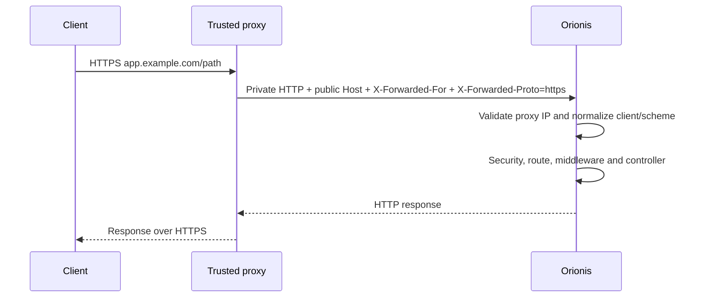

The proxy receives HTTPS and forwards HTTP to Granian over a private connection. Only the proxy should reach the backend port. The [Windows](/en/getting-started/deployment/windows-server), [Linux](/en/getting-started/deployment/linux) and [Docker](/en/getting-started/deployment/docker) guides include complete configurations; this page explains the contract they must follow.

## Client identity and scheme

Orionis runs `ProxiesMiddleware` before resolving routes. It only accepts forwarding headers when the **IP of the peer connecting to the backend** belongs to `http.proxies.trusted_proxies`, configured in `config/http.py`. The default contains `127.0.0.1`.

```dotenv
# Proxy on the same server, connecting over IPv4 loopback.
TRUSTED_PROXIES=list:["127.0.0.1"]
ALLOWED_HOSTS=list:["app.example.com"]
```

| Data | Actual behavior |
| --- | --- |
| `X-Forwarded-For` | Collects headers and walks the chain right to left to the first untrusted hop. Skips values that are not valid IP addresses. |
| `X-Forwarded-Proto` | Accepts the first header if its entire value is `http` or `https`. Does not accept a list such as `https,http`. |
| `Host` | Must preserve the public domain; HTTP security and URL construction use it. |
| `Forwarded`, `X-Forwarded-Host`, `X-Forwarded-Prefix` | Do not replace the preceding data in this middleware. Do not automatically enable deployment under a subdirectory. |

Trust accepts IP addresses and CIDRs. Use your proxy's precise addresses, including `::1` only if it actually connects over IPv6. Do not copy broad ranges for convenience. In Docker, `127.0.0.1` identifies the container itself: that guide assigns Caddy a stable private IP and trusts only that address.

With multiple proxies, also protect the public edge and configure which headers it can accept from its own upstream. These guides assume **one public proxy**, without an additional CDN. The edge replaces client-supplied values; the backend must not be reachable through another route allowing callers to impersonate that proxy.



## WebSocket, SSE and MCP

Preserve the complete path, query string, method and `Origin`. WebSocket origins must match the `http.websocket.allow_origins` policy; the default allows the same origin. Do not add `*` to compensate for an incorrect `Host` or scheme. See [WebSocket](/en/http/websockets).

Nginx needs to forward `Upgrade` and `Connection` explicitly for WebSocket; the guide uses a `map`, HTTP/1.1 towards Granian and extended idle timeouts. For SSE use `proxy_buffering off`; `proxy_request_buffering off` forwards request bodies progressively. Also adjust the proxy's upload limit and Orionis's limit to your actual payloads. [Nginx WebSocket](https://nginx.org/en/docs/http/websocket.html) and [proxy directives](https://nginx.org/en/docs/http/ngx_http_proxy_module.html).

Caddy handles WebSocket upgrades and immediately flushes `text/event-stream` responses. Examples retain this behavior; they do not force `flush_interval -1` globally, because it also changes backend cancellation on client disconnect. [Caddy proxy](https://caddyserver.com/docs/caddyfile/directives/reverse_proxy).

Do not cache or transform SSE, token or session responses in the proxy. For [SSE](/en/http/streaming-and-sse) and [MCP over HTTP](/en/protocols/mcp/http-and-clients), check incremental delivery and disconnects. Timeouts between reads do not make connections infinite or replace application heartbeats. Restarting a process closes its connections; clients must support reconnection.

## Check the proxy with a temporary route

In `routes/api.py`, register this route without custom authentication middleware, only during a controlled check. The API context does not automatically add an `/api` prefix:

```python
from orionis.http import JSONResponse, Request
from orionis.support.facades import Route


async def deployment_check(request: Request) -> JSONResponse:
    return JSONResponse({
        "client": request.ip,
        "scheme": request.scheme,
        "url": request.url,
    })


Route.get("/_deployment/check", deployment_check)
```

Restart the application after adding it. From another machine:

```shell
curl -fsS https://app.example.com/_deployment/check
curl -fsS -H "X-Forwarded-For: 192.0.2.123" https://app.example.com/_deployment/check
```

Both responses should show the IP observed by the proxy —possibly your NAT address—, `scheme: "https"` and the public domain in `url`. The second command must not impose the fictitious IP. An HTTP 400 may indicate incorrect `ALLOWED_HOSTS`; an `http` scheme often indicates a mismatched trusted IP or header.

Then check `/up` over HTTPS. To test the local backend with a restricted host list, provide the same `Host`:

```shell
curl -fsS -H "Host: app.example.com" -H "Accept: application/json" http://127.0.0.1:8000/up
```

On Windows use `curl.exe`; in Docker run the check inside the private network as its guide shows. A backend 200 does not verify certificates, DNS or the proxy: perform both checks. Remove the temporary route and restart when done.

## Diagnose a release

| Symptom | Concrete check |
| --- | --- |
| 502 or connection refused | Service running, matching port and upstream, correct working directory and Granian process errors. |
| Domain rejected with 400 | Received `Host` and `ALLOWED_HOSTS`; do not replace the public host with `127.0.0.1`. |
| Proxy IP or incorrect scheme | Actual backend peer IP, `TRUSTED_PROXIES`, effective configuration and stale bootstrap cache. |
| Cookies or WebSocket fail over HTTPS | Public scheme and domain, `SESSION_SECURE`, origin policy and upgrade headers. |
| Events arrive together or disconnect | Buffering, timeouts/heartbeats and proxy or application restarts. |
| `/static` returns 404 | File in the public disk and mount arguments; direct Granian execution does not read `config/filesystems.py`. |

Failures before startup completes belong in supervisor logs. Investigate application errors with [Logs](/en/services/logging) and [Exceptions](/en/architecture/exception-handling), with `APP_DEBUG=bool:false` in production.
