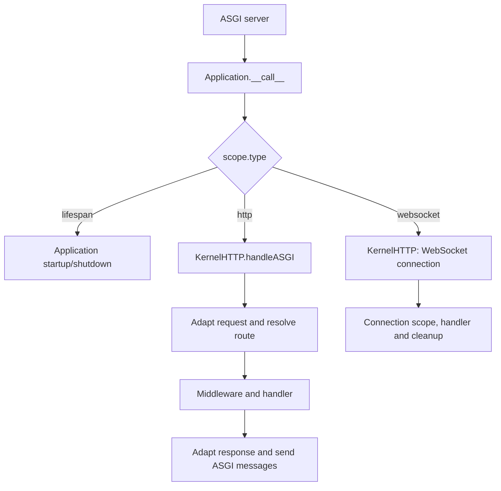

Orionis exposes the same application instance through ASGI and RSGI. The server receives connections and lifecycle events; `Application` directs them to the HTTP kernel. Your routes and controllers use Orionis APIs without implementing the server protocol.

<a id="application-target"></a>

## The exported application

The project entry point is **`bootstrap.app:app`**:

- `bootstrap.app` is the `bootstrap/app.py` module.
- `app` is the instance created and exported by that module.
- The final `app.create()` call prepares configuration and provider registration. The server completes HTTP startup.

The following minimal bootstrap is an alternative to project configuration, showing the relationship between module and object. Keep the other options from the generated `bootstrap/app.py` when working on your actual application:

```python
from pathlib import Path
from orionis import Application


app = Application(base_path=Path(__file__).parent.parent)
app.withRouting(
    api="routes/api.py",
    web="routes/web.py",
    health="/up",
)
app.create()
```

The indicated route files must exist. Do not add another `Application` object in controllers or replace the instance with a factory function when using the generated entry point.

<a id="entry-point-property"></a>

### Inspect `entryPoint`

`app.entryPoint -> str | None` derives the module from the file that called `create()` and appends `:app`. It returns `None` before application creation. With the default bootstrap, it returns `"bootstrap.app:app"`.

The method does not discover arbitrary variable names: its suffix is always `:app`. Moving the `create()` call also changes the calculated module. Keep that call in the file exporting `app`, especially when using `serve`, which uses this property as its target.

<a id="serve"></a>

## Select an interface when starting the server

Run one of these alternatives from the project root:

```shell
orionis serve
python -B reactor serve
```

The effective default interface is `rsgi`. To select ASGI explicitly:

```shell
orionis serve --interface asgi --port 8001
python -B reactor serve --interface asgi --port 8001
```

To select RSGI explicitly:

```shell
orionis serve --interface rsgi
python -B reactor serve --interface rsgi
```

`--interface` has the `-i` alias and only accepts `asgi` or `rsgi`. `--port` has the `-p` alias. The other command-specific options are `--log` and `--export`. See their effects and platform differences in the [complete `serve` reference](/en/console/built-in-application#command-serve).

`serve` prepares the Granian server and passes `app.entryPoint` as its target. Normal launching uses a default port of `8000`, binds `127.0.0.1` in development and `0.0.0.0` in production. Windows embedded debugger mode reads `app.host` and `app.port` in addition to the port argument. Always open the address shown in the console.

Normal execution uses a managed subprocess on Windows and replaces the process on Unix systems. Under a debugger on Windows, it uses the embedded server. In that case, RSGI launching explicitly awaits startup and shutdown from the active loop without invoking the synchronous hooks that call `run_until_complete()` within it.

<a id="asgi"></a>

## ASGI: scopes and messages

The application implements this signature:

```python
async def __call__(
    self,
    scope: dict,
    receive: Callable[[], Awaitable[dict[str, Any]]],
    send: Callable[[dict[str, Any]], Awaitable[None]],
) -> Any | None:
    ...
```

The server supplies `scope`, `receive` and `send`; do not construct them in a route.

| `scope["type"]` | Destination |
|---|---|
| `"lifespan"` | Application startup and shutdown events. |
| `"http"` | HTTP kernel, request adaptation, middleware and handler. |
| `"websocket"` | HTTP kernel and WebSocket connection lifecycle. |
| Another value | The application returns `None` without dispatching a handler. |



### Lifespan messages

On `lifespan.startup`, Orionis awaits eager providers, runs callbacks and prepares the kernel. Successful completion sends `lifespan.startup.complete`. An ordinary exception sends `lifespan.startup.failed` with `message=str(error)` and ends the loop.

`lifespan.shutdown` runs shutdown callbacks, sends `lifespan.shutdown.complete` and returns. An ordinary error produces `lifespan.shutdown.failed`. Repeated startup within the same lifespan conversation is acknowledged without repeating callbacks. `lifespan.disconnect` ends that conversation, while unrecognized types are ignored.

This duplicate-startup protection belongs to the lifespan conversation; it is not a global lock around every possible startup. If your server or tests omit lifespan, first dispatch can prepare the kernel, but does not replace HTTP startup callbacks.

<a id="rsgi"></a>

## RSGI: protocol and server hooks

RSGI uses the same instance's special methods:

```python
async def __rsgi__(
    self,
    scope: Scope,
    protocol: HTTPProtocol | WebsocketProtocol | ProtocolError | ProtocolClosed,
) -> object:
    ...


def __rsgi_init__(self, loop: asyncio.AbstractEventLoop) -> None:
    ...


def __rsgi_del__(self, loop: asyncio.AbstractEventLoop) -> None:
    ...
```

These names and objects belong to the server contract. They are not methods to call from a controller:

| Entry | Behavior |
|---|---|
| `__rsgi_init__(loop)` | The server supplies its loop; Orionis runs HTTP startup with interface `"rsgi"` through `run_until_complete()`. |
| `__rsgi__(scope, protocol)` | Dispatches `scope.proto == "http"` or `"ws"` to the kernel. Other protocols return `None`. |
| `__rsgi_del__(loop)` | Runs HTTP shutdown through the supplied loop. |

The kernel creates the RSGI transport adapter and uses `handleRSGI()` for HTTP or its WebSocket flow for `"ws"`. Route definitions, injected services and controller actions remain the same.

Synchronous hooks require the server to control the loop at that moment. Do not call them inside an async method to start or stop the application. In particular, `await app.boot()` is the public API for completing providers in headless usage; it does not equal RSGI startup.

<a id="kernels"></a>

## The boundary between application and kernels

Core configuration defines two kernels. `get_core_kernels_mapping() -> MappingProxyType` returns the immutable metadata map; `CORE_KERNELS` exposes that map:

| Key | Registered class |
|---|---|
| `KernelHTTP` | `orionis.http.kernel.KernelHTTP`. |
| `KernelCLI` | `orionis.console.kernel.KernelCLI`. |

The application imports classes from that metadata, constructs them through the container and checks their `IKernelHTTP` or `IKernelCLI` contracts. A type not implementing the contract raises `TypeError`. A missing CLI kernel raises `RuntimeError`; a missing HTTP entry has no such specific conversion and accessing its metadata can raise `KeyError`.

HTTP startup calls `await kernel.boot()` and publishes both handlers only when it finishes. CLI startup accepts `boot(application)` and awaits its result if awaitable. Each initialization shares its own lock so concurrent first dispatches cannot publish incomplete kernels.

These entries belong to core integration; `bootstrap/app.py` does not offer a `withKernel()` method or a public selector to replace them. Customize application behavior through providers, middleware, routes, callbacks and the exception handler.

<a id="disconnects"></a>

## Disconnects, cancellation and long responses

Without extra monitoring, Application delegates HTTP handling directly within the server task. Cancelling that task propagates cancellation through the handler and its `finally` blocks.

`http.monitor_disconnects=True` enables HTTP monitoring. Compiled endpoint policies can also enable monitoring for specific paths. The setting must be a `bool` when configured; a non-`None`, non-boolean value makes `create()` raise `TypeError`.

- In ASGI, an additional consumer dispatches incoming messages to the handler through a bounded queue. It can keep eight queued messages and one waiting to enter; disconnect detection pauses while that queue is full.
- In RSGI, a task awaits `protocol.client_disconnect()` and requests handler cancellation when the client disconnects.
- The monitoring task is awaited and cleaned up when processing ends. Cancellation attributed to that disconnect returns `None`; server cancellation and transport errors propagate.
- WebSocket uses its own connection lifecycle and does not pass through this additional HTTP monitor.

Configure this policy through [bootstrap](/en/getting-started/bootstrap-options) or HTTP configuration. For streaming and SSE, retain `try/finally` in your application's generators and see [HTTP responses](/en/http/responses) and [Realtime, WebSocket and SSE](/en/asynchronous/realtime).

<a id="lifespan-presentation"></a>

## Startup and shutdown presentation

Foundation wraps HTTP callbacks with two internal presentation generators. They are not a resource-registration mechanism and do not replace `app.on(...)`:

| Function | Signature and effect |
|---|---|
| `before_startup_orionis_generator()` | `-> None`: displays the initial startup panel. |
| `after_startup_orionis_generator(host: str, port: int)` | `-> None`: displays address, date, timezone, PID, loop and interface. Server launch metadata adjusts the presented address and interface. |
| `startup_orionis_generator(app: IApplication)` | `-> Generator[None]`: displays the before panel, yields, then displays the result after kernel preparation finishes. |
| `before_shutdown_orionis_generator()` | `-> None`: displays the before-shutdown panel. |
| `after_shutdown_orionis_generator(start_at: int)` | `-> None`: calculates elapsed time from the nanosecond timestamp and displays days, hours, minutes, seconds and milliseconds. |
| `shutdown_orionis_generator(app: IApplication)` | `-> Generator[None]`: yields between the before panel and the summary after shutdown. |

The application uses these wrappers only in the HTTP lifecycle. Wrappers display their content when `app.isDebug()` is true and `app.isProduction()` is false. If callbacks or kernel preparation fail, the generator's later step is not reached. Duration is calculated from `app.startAt`, set when constructing the application.

Complete the walkthrough with [Application lifecycle and resource ownership](/en/getting-started/application-lifecycle), [Bootstrap options](/en/getting-started/bootstrap-options) and [Scopes and concurrency](/en/architecture/service-container/scopes-and-concurrency).
