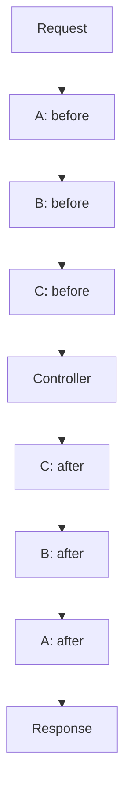

Middleware intercepts an HTTP request and can run logic before and after the next component in the chain: another middleware or the controller. It shares behavior across actions without repeating their logic.

Typical uses include authentication and authorization, access conditions, request logging, header manipulation and processing-time measurement. Each middleware decides whether to continue the chain or return a response immediately.

## Creating middleware with the CLI

Run either alternative from the project root, with its Python environment active:

```bash
orionis make:http-middleware global
```

Or use the local `reactor` file:

```bash
python -B reactor make:http-middleware global
```

Both generate `app/http/middleware/global_middleware.py` with the `GlobalMiddleware` class. They are alternatives for creating the same file.

The command's only argument is `name`: a required positional string with no default value. The generator defines no options of its own; `-h` or `--help` display help.

Use `snake_case` names. The generator appends `_middleware` to the filename and `Middleware` to the class when missing, and supports subdirectories:

| Input name | Class | Generated file |
| --- | --- | --- |
| `global` | `GlobalMiddleware` | `app/http/middleware/global_middleware.py` |
| `timing` | `TimingMiddleware` | `app/http/middleware/timing_middleware.py` |
| `access/check_access` | `CheckAccessMiddleware` | `app/http/middleware/access/check_access_middleware.py` |

The destination uses the `app_http_middleware` application path; customizing that path changes the generator's destination. It creates intermediate directories but does not overwrite existing files. Use valid relative names: absolute paths and `..` segments are rejected.

:::note
Passing `GlobalMiddleware` produces `globalmiddleware.py`: the generator does not split PascalCase words. Use `global` or `global_middleware` to obtain `global_middleware.py`.
:::

## Middleware structure

The template generates public imports, a `BaseMiddleware` subclass and a `handle()` method that delegates the request. This skeleton preserves that behavior and manually adds `__slots__ = ()`:

```python
from orionis.http import BaseMiddleware, NextCallable, Request, Response


class GlobalMiddleware(BaseMiddleware):

    __slots__ = ()

    async def handle(
        self,
        request: Request,
        call_next: NextCallable,
    ) -> Response:
        """
        Delegate the request without modifying it.

        Parameters
        ----------
        request : Request
            Incoming HTTP request.
        call_next : NextCallable
            No-argument callable for continuing the middleware chain.

        Returns
        -------
        Response
            Response returned by the next middleware or route handler.
        """
        # Forward the request through the middleware chain.
        return await call_next()
```

- **`BaseMiddleware`** defines the HTTP base class. Implement `handle()`; its base implementation raises `NotImplementedError`.
- **`__slots__ = ()`** declares that the class adds no instance attributes. In this hierarchy it avoids a dynamic attribute dictionary on that subclass. It is optional and absent from the generated template; it does not isolate requests.
- **`async def handle()`** receives the request and its continuation, processes the layer and returns a `Response`.
- **`request`** is the same `Request` instance received by subsequent layers. Share data for that request through `request.state`.
- **`NextCallable`** represents `Callable[[], Awaitable[Response]]`: call it without arguments and await its result.
- **`await call_next()`** executes the next layer or final handler. When it completes, its response returns to this middleware.
- **`Response`** is the HTTP response you must return, whether continuing or responding early.

This middleware delegates without modifying the request or response. It does not itself transmit the response to the client.

## Before logic and early responses

Generate the files for the following examples:

```bash
orionis make:http-middleware client_context
orionis make:http-middleware response_header
orionis make:http-middleware timing
```

In `app/http/middleware/client_context_middleware.py`, require a header before continuing:

```python
from orionis.http import BaseMiddleware, NextCallable, Request, Response, response


class ClientContextMiddleware(BaseMiddleware):
    __slots__ = ()

    async def handle(
        self,
        request: Request,
        call_next: NextCallable,
    ) -> Response:
        client_id = request.headers.get("X-Client-Id")
        if not client_id:
            return response.json(
                {"message": "X-Client-Id is required."},
                status_code=400,
            )

        request.state.client_id = client_id
        return await call_next()
```

The middleware receives the request, checks the header and stores the identifier in `request.state` for subsequent components. This example validates an input requirement; use the [authentication](/en/authentication) mechanisms to authenticate an identity.

When the header is missing, it returns a JSON `400` response without calling `call_next()`. Subsequent layers and the controller do not execute. Earlier middleware already awaiting their continuation receive that response and may execute their after logic.

## After logic

In `app/http/middleware/response_header_middleware.py`, capture the response and modify its headers:

```python
from orionis.http import BaseMiddleware, NextCallable, Request, Response


class ResponseHeaderMiddleware(BaseMiddleware):
    __slots__ = ()

    async def handle(
        self,
        request: Request,
        call_next: NextCallable,
    ) -> Response:
        response = await call_next()
        response.setHeader("X-Application", "Orionis")
        return response
```

`setHeader()` replaces the header value and returns `None`; return the `response` object after modifying it. The response may come from the controller or another middleware that stopped the chain.

After logic executes when control returns from `await call_next()`, before transmission to the client. It does not measure complete delivery of a streaming response or act as a task after sending. See [Responses](/en/http/responses) for other supported operations.

## Before and after logic in one middleware

In `app/http/middleware/timing_middleware.py`, measure the execution of subsequent layers:

```python
from time import perf_counter
from orionis.http import BaseMiddleware, NextCallable, Request, Response


class TimingMiddleware(BaseMiddleware):
    __slots__ = ()

    async def handle(
        self,
        request: Request,
        call_next: NextCallable,
    ) -> Response:
        started_at = perf_counter()
        response = await call_next()
        elapsed_ms = (perf_counter() - started_at) * 1000
        response.setHeader("X-Process-Time-Ms", f"{elapsed_ms:.3f}")
        return response
```

The clock starts before continuing; the calculation and header are added when control returns. This wraps the next component's execution. The value includes subsequent layers and the handler, until they return their response.

`started_at` is a local variable. The kernel may reuse a middleware instance across requests: keep request-specific data in local variables or `request.state`, even when using `__slots__`.

## Dependency injection in middleware

Orionis constructs middleware through the container, so you can receive annotated services in `__init__`. In `app/services/duration_formatter.py`, define a service without request state:

```python
class DurationFormatter:
    def milliseconds(self, seconds: float) -> str:
        return f"{seconds * 1000:.3f}"
```

In `app/http/middleware/timed_response_middleware.py`, request that service in the constructor:

```python
from time import perf_counter

from app.services.duration_formatter import DurationFormatter
from orionis.http import BaseMiddleware, NextCallable, Request, Response


class TimedResponseMiddleware(BaseMiddleware):
    __slots__ = ("_formatter",)

    def __init__(self, formatter: DurationFormatter) -> None:
        self._formatter = formatter

    async def handle(
        self,
        request: Request,
        call_next: NextCallable,
    ) -> Response:
        started_at = perf_counter()
        response = await call_next()
        response.setHeader(
            "X-Process-Time-Ms",
            self._formatter.milliseconds(perf_counter() - started_at),
        )
        return response
```

For example, in `routes/api.py`:

```python
from app.http.middleware.timed_response_middleware import TimedResponseMiddleware
from orionis.http import JSONResponse, response
from orionis.support.facades import Route


async def timed_status() -> JSONResponse:
    return response.json({"status": "ok"})


Route.get("/timed-status", timed_status).middleware(TimedResponseMiddleware)
```

`GET /timed-status` returns the status and the header calculated with the injected service. `DurationFormatter` is concrete and auto-constructible; abstract contracts need a [container binding](/en/application/container/bindings-and-invocation).

**`handle()` keeps the `handle(request, call_next)` signature**. The kernel calls it directly; adding a third service parameter does not enable injection. Use the constructor for those services and the `request` parameter for current request data.

Instances are prepared during startup and reused. Their dependencies must be resolvable at that point and safe to share across requests. Do not request `Request` or services requiring an active HTTP scope in this constructor. Keep timers, users, and other request data in local variables or `request.state`.

## Registering global middleware

In `bootstrap/app.py`, use the bootstrap's `app` instance and add the registration before `app.create()`:

```python
from app.http.middleware.global_middleware import GlobalMiddleware
from app.http.middleware.timing_middleware import TimingMiddleware

app.withMiddleware(
    GlobalMiddleware,
    TimingMiddleware,
)
```

For a single class, use `app.withMiddleware(GlobalMiddleware)`. The method accepts classes as individual arguments, preserves their order and avoids duplicate registrations. Pass classes without instantiating them.

Registration stores configuration; it does not execute `handle()` at that point. Middleware are incorporated into HTTP routes during compilation, and the kernel prepares their instances through the container during startup.

:::note[Global middleware scope]
Application-global middleware execute on the HTTP routes that include them, after resolving the route and establishing its API or WEB context. Internal proxies, maintenance, security, CORS and rate limiting checks are earlier kernel layers.

Early kernel responses, automatic `OPTIONS` and unresolved routes with their possible fallback do not pass through application-global middleware. They are not added to WebSocket routes either. See the [API and WEB flows](/en/http/routing#automatic-api-layers) for the distinction.
:::

When changing registrations in an application with compiled configuration, review [cache invalidation and process restart](/en/application/paths-and-caching).

## HTTP CORS

Since Orionis **1.0.15**, HTTP CORS uses these defaults:

```dotenv
CORS_ALLOW_ORIGINS=["*"]
CORS_ALLOW_METHODS=["*"]
CORS_ALLOW_HEADERS=["*"]
```

These correspond to `allow_origins`, `allow_methods` and `allow_headers` in `Cors`. This completes the change started in **1.0.13**, which enabled wildcard origins, by extending it to methods and headers to handle `OPTIONS` preflight requests as well. It makes API testing easier with browser debugging tools such as Postman, EchoAPI or Hoppscotch without installing a desktop client. The endpoint must be reachable from the browser.

Empty lists for these three options are also normalized to `["*"]`. `expose_headers` retains `[]` and `allow_credentials` retains `False`. To restrict methods or headers, declare explicit values. For example, to permit `GET` and JSON `POST` requests with an `Authorization` header, add or adjust the `cors` field in your existing `BootstrapHTTP` class in `config/http.py`:

```python
from dataclasses import dataclass, field
from orionis.foundation.config.http import HTTP, Cors


@dataclass(frozen=True, kw_only=True)
class BootstrapHTTP(HTTP):
    cors: Cors | dict = field(
        default_factory=lambda: Cors(
            allow_origins=["*"],
            allow_methods=["GET", "POST", "OPTIONS"],
            allow_headers=["Content-Type", "Authorization"],
            allow_credentials=False,
        ),
    )
```

Keep the other fields in your existing configuration. CORS is an internal kernel layer; it does not require registration through `app.withMiddleware()`. For cross-origin cookies with credentials, configure explicit origins and `allow_credentials=True`: the framework rejects credentials combined with `allow_origins=["*"]`.

These defaults belong to HTTP. [WebSocket](/en/realtime/websocket) and [MCP](/en/mcp/stdio-and-configuration#allowed-http-origins) keep their own origin policies. In 1.0.16, editable MCP configuration defaults to the inspector's origin when `CORS_ALLOW_ORIGINS` is unset, while core `McpConfig` defaults to `[]`. Setting the shared variable to `["*"]` replaces that MCP default and fails MCP configuration validation. For applications using MCP, provide explicit origins in the shared variable or configure each protocol separately in its editable configuration. Use [`serve --host`](/en/console/built-in-application#command-serve) to change the server's bind address.

## Assigning middleware to a route

In the file registered as API, usually `routes/api.py`, import the classes and use `.middleware(...)`:

```python
from app.http.middleware.client_context_middleware import ClientContextMiddleware
from app.http.middleware.response_header_middleware import ResponseHeaderMiddleware
from orionis.http import Request, response
from orionis.support.facades import Route


async def client_profile(request: Request):
    return response.json({"client_id": request.state.client_id})


Route.get("/client", client_profile).middleware(
    ClientContextMiddleware,
    ResponseHeaderMiddleware,
)
```

`GET /client` without `X-Client-Id` receives the first middleware's JSON `400`. With `X-Client-Id: demo`, the handler returns `{"client_id": "demo"}` and the second middleware adds `X-Application: Orionis`.

A class registered only on this route is not added to other routes. `.middleware()` accepts one or several classes; a list or tuple of classes is also supported.

### Route group middleware

This alternative `routes/api.py` example has two routes sharing the same condition:

```python
from app.http.middleware.client_context_middleware import ClientContextMiddleware
from app.http.middleware.response_header_middleware import ResponseHeaderMiddleware
from orionis.http import Request, response
from orionis.support.facades import Route


async def profile(request: Request):
    return response.json({"client_id": request.state.client_id})


async def orders(request: Request):
    return response.json({"client_id": request.state.client_id, "orders": []})


Route.group(
    prefix="/client",
    middleware=[ClientContextMiddleware, ResponseHeaderMiddleware],
    routes=[
        Route.get("/profile", profile),
        Route.get("/orders", orders),
    ],
)
```

Both routes, `/client/profile` and `/client/orders`, inherit the group's middleware in declaration order. This avoids repeating their configuration. Inner groups inherit their parents' layers first; see [Groups and nested groups](/en/http/routing#groups-and-nested-groups).

### Choosing a scope

| Scope | When to use it | Registration |
| --- | --- | --- |
| Application | Behavior shared across HTTP routes, such as timing. | `app.withMiddleware(...)` |
| Group | Several routes share a condition or policy. | `Route.group(middleware=..., routes=[...])` |
| Route | The condition belongs to one endpoint. | `Route.get(...).middleware(...)` |

Matching scopes are combined. To exclude an explicit class, use `.withOutMiddleware(Class)` on a route or `without_middleware=[Class]` on a group. Exclusions match exact classes and can also remove application-global middleware; they do not remove internal session, CSRF or identity layers, or shared kernel checks.

## Execution order and chaining

Orionis builds the chain in this incoming order:

**Application globals → outer group → inner group → route → handler.**

The compiler keeps each class's first occurrence and removes duplicates, after applying exclusions. Use ordered arguments, lists or tuples when order matters.

Imagine three middleware with before and after logic: A is global, B belongs to the group and C to the route. When all continue without exceptions, the flow is:



Each `await call_next()` suspends the current layer while executing subsequent layers. Once the controller finishes, the nearest layer resumes first; returning therefore reverses the incoming order.

If B responds without continuing, C and the controller are skipped, but A receives B's response and can execute its after logic.

## Implementation considerations

- Implement `handle()` with `async def` and return a valid `Response`. For an early JSON response, use `response.json(...)` as in the example.
- Call `call_next()` without arguments and await it. Each continuation can only be consumed once; repeating it raises `RuntimeError`, even if the first attempt raised an exception.
- Share custom data through `request.state`. The rest of the chain receives that same `Request` object; response methods such as `setHeader()` modify the response you will return.
- Instances may serve several requests. Do not store the request, user, response or timing start in `self`.
- If a subsequent layer raises an exception, ordinary statements after `await call_next()` do not run. Use `try/finally` to release resources owned by the middleware; HTTP layers and the kernel delegate failure handling to the [exception system](/en/http/exceptions).
