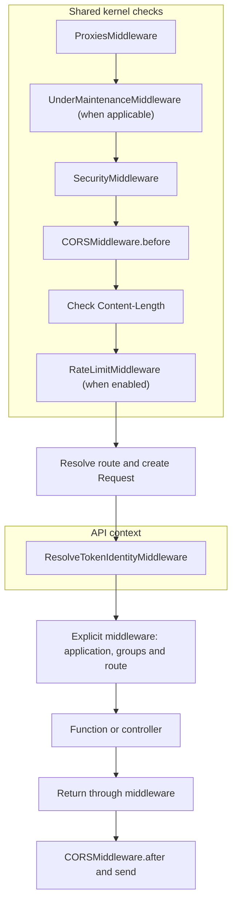
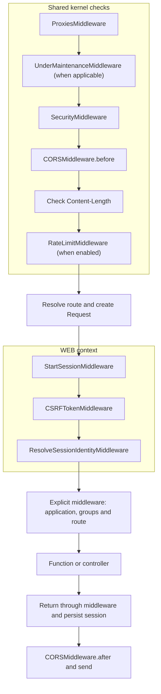

Routes associate an HTTP method and path with the function or controller action that handles the request. Orionis registers them during startup and prepares their resolution before executing their handlers.

## Separating API and WEB routes

In `bootstrap/app.py`, the `api` and `web` arguments of `app.withRouting(...)` identify the files for each context; these are usually `routes/api.py` and `routes/web.py`. The loader tags declarations from each file with that context, and the kernel selects their processing:

| Context | Automatic behavior | Typical use |
| --- | --- | --- |
| WEB, stateful | Starts the session, applies CSRF and resolves the session identity, in that order. | Navigation and forms that need continuity between requests through a session cookie. |
| API, without automatic session state | Resolves identity through a Bearer token; does not include automatic session or CSRF layers. | Clients that send the required credentials with each request. |

Separating them avoids loading browser session processing for endpoints that do not need it, while retaining it for forms and pages that do. Stateless does not mean an API cannot store data in a database: it describes its HTTP session processing.

The context depends on the `withRouting()` argument, rather than the physical filename or URL prefix. A `/api/products` path declared as WEB remains WEB. Registering API routes does not add `/api` to their URLs either: write it in the route or a group.

Both identity resolvers allow guests. To require an identity, use the corresponding authentication middleware; returning JSON from a WEB route neither makes it an API route nor makes it public. See [Middleware](/en/http/middleware-and-security) and [Authentication](/en/security/authentication).

The diagrams show the usual flow of an admitted HTTP request that continues to a route. Shared kernel checks run **before route resolution**, for both API and WEB. Context layers then run, followed by explicit middleware in this order: **application → groups → route**.

### Automatic API layers



API resolves identity through a Bearer token and allows guests; it does not start a session or add the WEB CSRF check. Shared security, CORS and rate limiting checks also apply to API according to their configuration.

### Automatic WEB layers



WEB restores or starts the session, applies the CSRF policy and resolves the session identity before application code. The response passes through middleware in reverse order, and the session layer persists its changes before final CORS processing.

:::note[Flow conditions]
- `ProxiesMiddleware` only normalizes the IP and scheme when the request comes from a configured trusted proxy. `SecurityMiddleware` checks header format and `Host`; the host allowlist applies when configured.
- `UnderMaintenanceMiddleware` responds with `503` during maintenance. The kernel exempts the health check and its default-page internal assets from this check.
- `RateLimitMiddleware` only runs when `http.rate_limit.rate_limit_enabled` is enabled; it is disabled by default. The `Content-Length` check is a kernel guard, rather than another middleware.
- An early response or an error can stop the flow. Allowed CORS preflight, internal assets served by the kernel and automatic `OPTIONS` can respond before the API/WEB context. `CORSMiddleware.after` also processes early responses sent by the kernel.
:::

## Importing Route and declaring a route

Always import the facade from the public package:

```python
from orionis.support.facades import Route
```

`Route` is already exposed by `orionis.support.facades.__init__`; you do not need to import it from the internal `router.py` file.

This complete example can go in the file registered as API:

```python
from orionis.http import response
from orionis.support.facades import Route

async def list_products():
    return response.json({"products": []})

Route.get("/products", list_products).name("products.index")
```

`GET /products` returns `{"products": []}`. The declaration registers the handler; the function executes when a matching request arrives.

HTTP registration methods accept `path` and `action`. An action can be a synchronous or asynchronous Python function, a class with `__call__`, or a `[ProductController, "show"]` pair referencing an imported controller. Keep functions and classes in importable modules. If you omit `action`, complete the route with `.action(ProductController, "show")` before exporting or compiling routes. Controller implementation is covered in [Controllers](/en/http/request-lifecycle).

### Routes to controller methods

The function and controller examples are alternatives: register only one action for each HTTP method and path combination. When trying this variant, replace any equivalent declarations you already have.

Save this controller in `app/http/controllers/product_controller.py`:

```python
from orionis.http import JSONResponse, response
from orionis.http.base import BaseController

class ProductController(BaseController):
    async def index(self) -> JSONResponse:
        return response.json({"products": []})

    async def show(self, product_id: int) -> JSONResponse:
        return response.json({"id": product_id})
```

In `routes/api.py`, import the class and register each action using `[Class, "method"]`:

```python
from app.http.controllers.product_controller import ProductController
from orionis.support.facades import Route

Route.get("/products", [ProductController, "index"]).name("products.index")
Route.get("/products/{product_id:int}", [ProductController, "show"]).name("products.show")
```

`GET /products` invokes `index()` and returns `{"products": []}`. `GET /products/42` invokes `show(product_id=42)` and returns `{"id": 42}`. The signature's `product_id` name matches the path parameter.

Pass the class and method name without instantiating the controller or executing the action in the routes file. Orionis prepares invocation during startup and constructs the controller through the container when handling the request; it also resolves its dependencies.

### Controller with `__call__`

For a controller dedicated to one action, implement `__call__`. Save this example in `app/http/controllers/show_product_controller.py`:

```python
from orionis.http import JSONResponse, response
from orionis.http.base import BaseController

class ShowProductController(BaseController):
    async def __call__(self, product_id: int) -> JSONResponse:
        return response.json({"id": product_id})
```

Register the class directly in `routes/api.py`:

```python
from app.http.controllers.show_product_controller import ShowProductController
from orionis.support.facades import Route

Route.get("/products/{product_id:int}", ShowProductController).name("products.show")
```

No method name is needed here: Orionis recognizes the invokable class and uses `__call__`. `GET /products/42` returns `{"id": 42}`, with the same parameter conversion and dependency injection as a named action. Pass `ShowProductController` without `()`; this registration replaces the previous example for that endpoint.

## Supported HTTP methods

These HTTP registration methods are available. Your handler defines the actual operation and its effects:

| Route method | HTTP verb | Typical use |
| --- | --- | --- |
| `Route.post(path, action)` | `POST` | Submit data to create a resource or perform an operation. |
| `Route.get(path, action)` | `GET` | Retrieve a resource representation. |
| `Route.query(path, action)` | `QUERY` | Query resources using the request body. |
| `Route.put(path, action)` | `PUT` | Replace a resource representation. |
| `Route.delete(path, action)` | `DELETE` | Delete a resource. |
| `Route.patch(path, action)` | `PATCH` | Apply a partial modification. |

`Route.query()` registers the HTTP **QUERY** method, defined by the IETF in [RFC 10008: The HTTP QUERY Method](https://www.rfc-editor.org/rfc/rfc10008.html). The RFC specifies safe (without requesting changes to the resource), idempotent processing of a query supplied in the request body. The handler must respect those semantics.

It does not add URL parameters. A `GET /products?category=books` request still matches `Route.get("/products", ...)`. Declarations do not include the query string.

### Automatic HEAD

A separate HEAD route is not registered. When a GET route exists, a HEAD request uses its resolution and executes its handler and middleware. The adapter omits the body when sending the response, retaining the applicable headers.

For example, `HEAD /products` uses the GET route above. HEAD does not skip the handler's work; it skips sending its content to the client.

### Automatic OPTIONS

The kernel handles OPTIONS before constructing a route's `Request` or executing its middleware. It returns `200` with `Allow`, calculated from the methods registered for the path:

- A GET route also contributes HEAD.
- If methods are available, OPTIONS is included.
- A QUERY route adds `Accept-Query: application/json, application/x-www-form-urlencoded`.

For a path registered with GET and POST, `Allow` is `GET, HEAD, OPTIONS, POST`. For an unknown path, OPTIONS returns `200` with an empty `Allow`; if a fallback exists, it advertises `GET, HEAD, OPTIONS`. Earlier kernel policies can still respond first.

A **CORS preflight** is a separate case: an OPTIONS request with `Origin` and `Access-Control-Request-Method` can be answered earlier with `204` if the origin is allowed. Its `Access-Control-Allow-*` headers come from CORS configuration, rather than the router's method list. If your client uses QUERY across origins, explicitly include it in the allowed CORS methods; the current expansion of `*` does not include it. See [Middleware and HTTP policies](/en/http/middleware-and-security).

## Route parameters

Write parameters as `{name:type}`. Only these four types are registered natively:

| Type | Example syntax | Match and delivered value |
| --- | --- | --- |
| `str` | `/users/{username}` or `/users/{username:str}` | A nonempty segment without `/`; delivers `str`. This is the implicit type. |
| `slug` | `/articles/{slug:slug}` | Lowercase ASCII letters, digits and hyphens; delivers `str`. Does not allow spaces or `_`. |
| `int` | `/products/{product_id:int}` | Unsigned digits; delivers `int`. Allows zero; does not allow negative or decimal values. |
| `uuid` | `/orders/{order_id:uuid}` | A hexadecimal UUID in `8-4-4-4-12` format; delivers `uuid.UUID`. Allows uppercase or lowercase hexadecimal. |

The placeholder determines conversion. A handler annotation does not, by itself, change a route's pattern.

```python
from orionis.http import response
from orionis.support.facades import Route

async def show_product(product_id: int):
    return response.json({"id": product_id})

Route.get("/products/{product_id:int}", show_product)
```

`GET /products/42` delivers the integer `42`. The kernel passes route parameters to the handler by name: accept them in its signature, even when injecting `Request`, or receive them through `**kwargs`. As an additional access method, `request.routeParam("product_id")` returns one parameter and `request.routeParams()` returns all converted values.

An input such as `/products/abc` does not match that route; it does not cause a payload validation error. If no other match exists, it is treated as a missing route.

There are no native `float` or `path` converters or optional segments. An unknown type, or an invalid or repeated parameter name, causes a route compilation error.

## Groups and nested groups

`Route.group()` shares a prefix and middleware across several routes. A group inside another adds its prefix to its parent's and inherits its middleware.

This `routes/api.py` example reuses the `ProductController` defined earlier and uses only two levels. The outer group requires token authentication for both routes in the inner group:

```python
from app.http.controllers.product_controller import ProductController
from orionis.auth.middleware import AuthenticateTokenMiddleware
from orionis.support.facades import Route

Route.group(
    prefix="/api",
    middleware=AuthenticateTokenMiddleware,
    routes=[
        Route.group(
            prefix="/products",
            routes=[
                Route.get("/", [ProductController, "index"]).name("api.products.index"),
                Route.get("/{product_id:int}", [ProductController, "show"]).name("api.products.show"),
            ],
        ),
    ],
)
```

| Request | Action | Name |
| --- | --- | --- |
| `GET /api/products` | `ProductController.index` | `api.products.index` |
| `GET /api/products/42` | `ProductController.show(product_id=42)` | `api.products.show` |

Pass `AuthenticateTokenMiddleware` as a class, without `()`. Both routes inherit it. This protection is explicitly added in the example; API's automatic identity resolution allows guests.

The outer `/api` prefix joins the inner `/products` prefix. The `"/"` route represents the group's root, while `"/{product_id:int}"` adds the parameter. Names are declared explicitly with `.name()`; groups do not prefix them.

`routes` receives the routes and groups created in the list. `group()` returns a `RouteGroup` that supports nesting; it is neither a decorator nor a `with` context for subsequent declarations.

### group() options

These `group()` options are passed by name:

| Option | Accepted type | Default | Effect |
| --- | --- | --- | --- |
| `prefix` | `str \| None` | `None` | Prepend a path to every descendant. Surrounding whitespace and slashes are normalized; `None`, `""` or `"/"` add no segments. |
| `middleware` | `MiddlewareInput \| None` | `None` | Add middleware classes before those of inner groups and routes. |
| `without_middleware` | `MiddlewareInput \| None` | `None` | Exclude classes from the final set of explicit middleware. Exclusions accumulate. |
| `routes` | `Sequence[FluentRoute \| RouteGroup] \| None` | `None` in the signature | Group members. You must supply a nonempty sequence of routes or groups; omitting it or passing `[]` causes an error. |

For `routes`, use a list or tuple of results from `Route.get(...)`, other HTTP methods or `Route.group(...)`. It does not accept generators, sets, strings or functions that declare routes. Do not reuse the same route instance in different branches expecting copies: groups modify that route, and repeating a member within a group is rejected.

`MiddlewareInput` accepts a class or a collection of classes, such as a list or tuple; it does not accept instances or text names. Sets are also supported and are sorted by import name. Use lists or tuples when order is part of your intent.

### Middleware inheritance

The explicit middleware order is: **application → outer group → inner group → route**. The compiler removes duplicates and applies exclusions by exact class; a parent's exclusion also affects its descendants. These exclusions do not remove the internal session, CSRF or identity layers.

## Fallback for missing routes

The method is named `Route.fallback()`. It registers an alternative response for a path that does not match a route:

```python
from orionis.http import Response, response
from orionis.support.facades import Route

async def not_found() -> Response:
    return response.json({"message": "Endpoint not found"}, status_code=404)

Route.fallback(not_found)
```

Use it to customize the response for a nonexistent endpoint, such as an API's JSON 404. Without a fallback, the framework's missing-route handling remains in effect.

There is **one fallback for the entire router**, shared by API and WEB files. It is not restricted by the file where you declare it or by a prefix. A second declaration raises `FallbackRouteAlreadyRegisteredException`.

Registration returns `None`, so it does not support chaining `.name()`, `.middleware()` or group options. Its handler must return a `Response` and explicitly set the desired status: Orionis does not force `404` or convert a dictionary to JSON here.

The fallback is not a general exception handler and does not handle an incorrect method: an existing path with a different verb produces `405`. Without a matching route, that route's `Request` is not constructed and its context layers and middleware do not run; this is why the example does not request `Request` as a dependency. See [Exceptions](/en/architecture/exception-handling) for other errors.

## Listing registered routes

From the project root, with its Python environment active, use either of these alternatives:

```bash
python -B reactor route:list
```

Or the framework's direct command installed in that environment:

```bash
orionis route:list
```

Both show the registered HTTP routes sorted by URI, along with their total. The table includes `Method` (HTTP method), `URI` (path), `Name` (route name), `Action` (handler) and `Middleware`. Use it to check prefixes, parameters, actions and middleware inherited from groups.

:::note
The `Middleware` column shows explicit application, group and route middleware. The automatic API and WEB layers shown in the diagrams do not appear in this column.
:::

## Resolution and conflicts

Static routes are checked before dynamic routes. Dynamic routes are sorted by segment specificity; ties retain registration order. Do not assume `{id:int}` automatically takes precedence over `{name:str}` when both can match: avoid overlaps or declare the more specific route first.

Duplicate method/path declarations, structurally equivalent dynamic patterns and incompatible route names cause compilation errors. A group does not provide numeric priority or change its members' API/WEB context.

After adding or changing declarations, restart the process and check cache invalidation if the application uses compiled routes. See [Directories and bootstrap caching](/en/getting-started/paths-and-caching).
