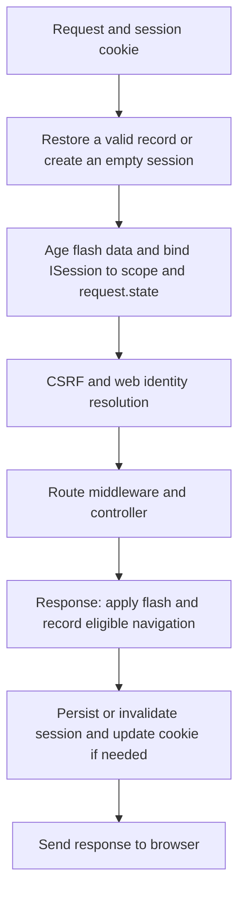

A session preserves data across requests from the same browser. Orionis stores its contents on the server and sends the client a cookie containing a random identifier: session values are not included in that cookie. Use it for preferences, form steps and notices after redirects.

Sessions also support web authentication and CSRF protection, but storing data does not authenticate a user. For login, logout and identities, use [session authentication](/en/security/authentication/identity-and-session).

## How sessions integrate with HTTP

Define stateful endpoints in the web file configured by `app.withRouting(web=...)`, normally `routes/web.py`. The web pipeline starts the session before running route middleware and the controller, and saves it when they return their response.



`StartSessionMiddleware` coordinates storage and cookies through `SessionManager`. Your controller does not need to call `start()` or `save()`, create another session instance, or manually register this middleware for a normal web route.

API routes use their own pipeline and do not automatically restore or save a session. Receiving a cookie on an API route does not activate this lifecycle. See [web and API routes](/en/http/routing) to choose the appropriate context.

An empty session is lazy: an isolated read does not generate an identifier. However, web middleware can write the CSRF token and previous URL even when your controller only reads data. A web visit can therefore create a session and send a cookie.

## First example: remember a preference

This example lets visitors select a theme and retain it when reloading the page. Use the same browser cookie throughout the flow.

Create `app/http/controllers/theme_controller.py`:

```python
from orionis.http import HttpResponse, Request, response
from orionis.http.base import BaseController
from orionis.session.contracts.session import ISession
from orionis.support.facades import View


class ThemeController(BaseController):
    async def show(self, session: ISession) -> HttpResponse:
        return await View.make(
            "preferences.theme",
            theme=session.get("theme", "system"),
            notice=session.getFlash("notice"),
        )

    async def store(self, request: Request, session: ISession) -> HttpResponse:
        values = await request.formUrlEncoded()
        theme = values.get("theme")
        if theme not in ("system", "light", "dark"):
            return response.redirect("/preferences/theme", 303).withFlash(
                "notice", "Choose a supported theme."
            )

        session.put("theme", theme)
        return response.redirect("/preferences/theme", 303).withFlash(
            "notice", "Theme saved."
        )
```

Register both actions in `routes/web.py`:

```python
from app.http.controllers.theme_controller import ThemeController
from orionis.support.facades import Route


Route.get("/preferences/theme", [ThemeController, "show"])
Route.post("/preferences/theme", [ThemeController, "store"])
```

Create `resources/views/preferences/theme.html`:

```jinja
<!doctype html>
<html lang="en">
<head>
    <meta charset="utf-8">
    <title>Theme preference</title>
</head>
<body>
    <h1>Theme preference</h1>
    
        <p role="status">{{ notice }}</p>
    
    <form method="post" action="/preferences/theme">
        
        <label for="theme">Theme</label>
        <select id="theme" name="theme">
            
                <option value="{{ value }}"
                        selected>{{ value }}</option>
            
        </select>
        <button type="submit">Save</button>
    </form>
</body>
</html>
```

With the server running, open `/preferences/theme` and submit the form. The POST stores `theme`, returns an HTTP 303 redirect and adds a flash notice. The next GET shows the selection and notice; reloading again retains the selection and removes the notice.

`` generates the field required by default web protection. `formUrlEncoded()` reads the HTML form; see [Request and payloads](/en/http/forms-and-uploads) for other bodies. The view renders through `await View.make(...)`, as explained in [views](/en/services/views).

## Access the current session

The `ISession` annotation lets you receive the active session through dependency injection. You can also use `from orionis.support.facades import Session` or `request.state.session`: they access the same session for that request.

Data methods such as `get()`, `put()` and `flash()` are synchronous, including calls through the facade: do not `await` them. Storage access is asynchronous and handled by middleware. See [data and form flash](/en/http/sessions/state-and-flash) for constructor, method, facade and view examples.

The session is bound to the request scope when the web pipeline starts. Do not resolve it while a provider boots or retain it in a singleton or tasks that outlive the request. A console command, MCP server or WebSocket connection does not automatically receive an HTTP session through this mechanism.

## Choose where each value belongs

| Need | Mechanism |
| --- | --- |
| Share information during a single request | `request.state`. |
| Remember a preference across browser requests | `ISession.put()` and `ISession.get()`. |
| Show a notice or repopulate a form after a redirect | Flash data and form helpers. |
| Keep business information permanently | Your database or domain service. |
| Identify the authenticated user | Authentication guards and services. |

The default configuration uses `memory`: records belong to the process handling the request and are lost when it restarts. Review storage before running multiple workers or instances.

Continue with these guides:

- [Data and form flash](/en/http/sessions/state-and-flash): reading, writing, removing data, notices, errors and views.
- [Storage](/en/http/sessions/stores-and-concurrency): the `memory`, `file`, `database` and `cache` drivers, and concurrent requests.
- [Configuration and lifecycle](/en/http/sessions/configuration-and-security): `config/session.py`, cookies, expiration, renewal, rotation and invalidation.
