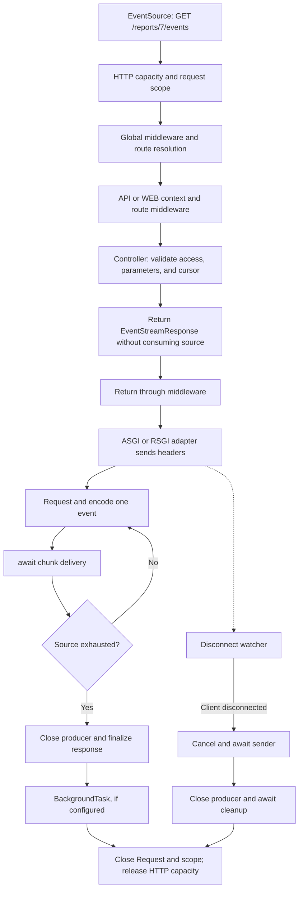

**Server-Sent Events (SSE)** keeps an HTTP response open to send text events from Orionis to the browser. Use it for job progress, notifications, and dashboards. The client opens the connection with `EventSource`; sending data to the server uses another HTTP request.

`StreamingResponse` delivers bytes progressively, such as a CSV. `EventStreamResponse` adds SSE formatting and connection management. For bidirectional communication over one connection, see [WebSocket](/en/http/websockets) or [Realtime Hubs](/en/asynchronous/realtime). [Realtime streaming](/en/asynchronous/realtime/protocol-and-streaming) uses the Hub protocol rather than SSE.

## Routes and preparation

SSE uses an ordinary HTTP `GET` route. It does not require `Route.websocket()` or `Route.hub()`. Import `Route` from `orionis.support.facades`.

These examples use `routes/api.py`. Confirm that file appears in the existing `bootstrap/app.py` call, before `app.create()`:

```python
app.withRouting(
    ai="routes/ai.py",
    api="routes/api.py",
    console="routes/console.py",
    web="routes/web.py",
    websocket="routes/websocket.py",
    health="/up",
)
```

Keep the other arguments your application uses. The API context selects the HTTP flow without WEB sessions; it does not add an `/api` prefix. Global, context, and route [HTTP middleware](/en/http/middleware-and-security) apply as with other HTTP routes. A WEB route can also return SSE if you need its session context.

`{report_id:int}` converts the segment to `int` and passes it to the controller by name. You can also use `str`, `slug`, and `uuid`; see [HTTP routes](/en/http/routing). The [routes and lifecycles](/en/asynchronous/realtime/routing-and-lifecycle) guide compares this registration with WebSocket and Realtime.

## Constructor and action injection

An SSE endpoint uses the same injection as any [HTTP controller](/en/http/request-lifecycle). The constructor can receive services shared by its actions, while the method can request services needed by that endpoint.

Save these concrete services in `app/services/report_events.py`. The source simulates progress; in a real application, replace its implementation with a query for an existing job's state:

```python
import asyncio
import json
from collections.abc import AsyncIterator


class ReportEventFormatter:
    def format(self, report_id: int, percent: int) -> str:
        return json.dumps({"report_id": report_id, "percent": percent})


class ReportProgressSource:
    async def percentages(self) -> AsyncIterator[int]:
        for percent in (25, 50, 75, 100):
            await asyncio.sleep(0.5)
            yield percent
```

In `app/http/controllers/injected_report_controller.py`:

```python
from collections.abc import AsyncIterator

from app.services.report_events import ReportEventFormatter, ReportProgressSource
from orionis.http import EventStreamResponse, ServerSentEvent, response
from orionis.http.base import BaseController


class InjectedReportController(BaseController):
    def __init__(self, formatter: ReportEventFormatter) -> None:
        self._formatter = formatter

    async def events(
        self,
        report_id: int,
        source: ReportProgressSource,
    ) -> EventStreamResponse:
        async def progress() -> AsyncIterator[ServerSentEvent]:
            async for percent in source.percentages():
                yield ServerSentEvent(
                    event="progress",
                    data=self._formatter.format(report_id, percent),
                )
            yield ServerSentEvent(event="done", data="complete")

        return response.eventStream(progress())
```

Register this action in `routes/api.py`:

```python
from app.http.controllers.injected_report_controller import InjectedReportController
from orionis.support.facades import Route


Route.get(
    "/reports/{report_id:int}/dependency-events",
    [InjectedReportController, "events"],
)
```

Orionis constructs `ReportEventFormatter` for the constructor and resolves `ReportProgressSource` when invoking `events()`. The client only supplies `report_id` in the route; services resolve on the server. These concrete classes without dependencies need no binding. Configure abstract contracts and instance reuse in the [container](/en/architecture/service-container/bindings-and-invocation).

You can open this route with the `EventSource` client shown below: it receives four `progress` events and one `done` event; close the connection on `done`. This standalone example does not resume from `Last-Event-ID`; the next example demonstrates that validation.

The inner `progress()` function captures services already resolved. Adding annotated parameters to it does not enable injection: the producer runs as a Python generator after the response has been returned. The HTTP scope stays open during stream delivery and closes when processing ends; do not retain its services for use after that closure.

## Complete example: report progress

This demonstration generates four states separated by an asynchronous wait. It lets you check events and reconnection without adding queues. In a real application, the producer should read the existing job's state; opening or reconnecting the stream must not start that job again.

### Controller and producer

Create `app/http/controllers/report_progress_controller.py`:

```python
import asyncio
import json
from collections.abc import AsyncIterator

from orionis.http import EventStreamResponse, JSONResponse, Request, ServerSentEvent, response
from orionis.http.base import BaseController


class ReportProgressController(BaseController):

    async def events(
        self,
        request: Request,
        report_id: int,
    ) -> EventStreamResponse | JSONResponse:
        cursor = request.headers.get("last-event-id", "0")

        # Validate before returning the response, while its status can change.
        if (
            not cursor.isascii()
            or not cursor.isdecimal()
            or len(cursor) > 1
            or int(cursor) > 4
        ):
            return response.json(
                {"message": "Last-Event-ID must be an integer from 0 to 4."},
                status_code=400,
            )

        last_step = int(cursor)

        async def progress() -> AsyncIterator[ServerSentEvent]:
            # This controls browser reconnection, not server-side retries.
            yield ServerSentEvent(retry=1500)

            for step in range(last_step + 1, 5):
                await asyncio.sleep(0.5)
                yield ServerSentEvent(
                    event="progress",
                    id=str(step),
                    data=json.dumps({
                        "report_id": report_id,
                        "percent": step * 25,
                    }),
                )

            yield ServerSentEvent(
                event="done",
                data=json.dumps({"report_id": report_id, "percent": 100}),
            )

        return response.eventStream(progress())
```

`Request` is injected from the HTTP scope, while `report_id` comes from the route. `progress()` returns an asynchronous generator: calling it does not consume events. The adapter requests them during delivery. Do not use `asyncio.run()` inside the controller.

Validate before returning the response: checks inside the generator can fail after headers have been sent. Identifiers `1…4` belong to this example; they are not an Orionis restriction.

### Registering the endpoints

Add to `routes/api.py`:

```python
from app.http.controllers.report_progress_controller import ReportProgressController
from orionis.support.facades import Route

Route.group(
    prefix="/reports",
    routes=[
        Route.view("/{report_id:int}", "reports.progress"),
        Route.get(
            "/{report_id:int}/events",
            [ReportProgressController, "events"],
        ).name("reports.events"),
    ],
)
```

`GET /reports/7` displays the client, and `GET /reports/7/events` opens the stream. The optional `reports.events` name does not change the URL.

### HTML and JavaScript client

Create `resources/views/reports/progress.html`:

```html
<!doctype html>
<html lang="en">
<head>
    <meta charset="utf-8">
    <title>Report progress</title>
</head>
<body>
    <h1>Report progress</h1>
    <progress id="progress" max="100" value="0"></progress>
    <p id="status" role="status">Connecting…</p>
    <button id="stop" type="button">Stop tracking</button>

    <script type="module">
        const bar = document.querySelector("#progress");
        const status = document.querySelector("#status");
        const stop = document.querySelector("#stop");
        const url = new URL(location.href);
        url.pathname = url.pathname.replace(/\/$/, "") + "/events";
        url.search = "";

        const events = new EventSource(url);

        events.onopen = () => {
            status.textContent = "Connected";
        };

        events.addEventListener("progress", (event) => {
            const payload = JSON.parse(event.data);
            bar.value = payload.percent;
            status.textContent = "Report " + payload.report_id + ": " + payload.percent + "%";
        });

        events.addEventListener("done", (event) => {
            const payload = JSON.parse(event.data);
            bar.value = payload.percent;
            status.textContent = "Report " + payload.report_id + " complete";
            events.close();
            stop.disabled = true;
        });

        events.onerror = () => {
            status.textContent = events.readyState === EventSource.CLOSED
                ? "Connection closed"
                : "Connection interrupted; waiting to reconnect…";
        };

        stop.addEventListener("click", () => {
            events.close();
            stop.disabled = true;
            status.textContent = "Tracking stopped";
        });

        window.addEventListener("pagehide", () => events.close(), { once: true });
    </script>
</body>
</html>
```

With the development server running, open `http://localhost:8000/reports/7` —or the address printed in your console—. You will see `25%`, `50%`, `75%`, and `100%`. `done` closes the client to prevent another connection.

To inspect the format from a terminal, `-N` disables curl's output buffering:

```bash
curl -N http://localhost:8000/reports/7/events
curl -N -H "Last-Event-ID: 2" http://localhost:8000/reports/7/events
```

The second request emits only steps `3` and `4`, followed by `done`. An invalid cursor receives JSON `400` before opening the stream.

## Events, data, and headers

Both public SSE response construction forms are equivalent:

```python
from orionis.http import EventStreamResponse, ServerSentEvent, response

events = [
    ServerSentEvent(event="notice", data="Report ready"),
    "A plain text message",
]

result = response.eventStream(events)
direct = EventStreamResponse(events)
```

A generator is single-use: create a new one per request. A string yielded by the source becomes a `data:` event; it is not interpreted as handwritten SSE framing. Explicitly serialize structured data with `json.dumps()` and use `JSON.parse(event.data)` in the client.

| Field | Type and default | Purpose |
| --- | --- | --- |
| `data` | `str \| None = None` | Text content; each line is encoded as `data:`. |
| `event` | `str \| None = None` | Event name; no newlines. |
| `id` | `str \| None = None` | Cursor; no newlines or NUL. |
| `retry` | `int \| None = None` | Reconnection wait in milliseconds; nonnegative integer, not `bool`. |
| `comment` | `str \| None = None` | Comment or heartbeat; may contain several lines. |

`ServerSentEvent` arguments are keyword-only, and instances are immutable:

```python
import json

from orionis.http import ServerSentEvent

event = ServerSentEvent(
    event="notice",
    id="42",
    retry=3000,
    comment="connection active",
    data=json.dumps({"message": "Report ready"}),
)

encoded = event.encode()
assert b"event: notice\n" in encoded
assert b"id: 42\n" in encoded
assert encoded.endswith(b"\n\n")

multiline = ServerSentEvent(data="First line\nSecond line")
assert multiline.encode() == b"data: First line\ndata: Second line\n\n"

heartbeat = ServerSentEvent(comment="ping")
assert heartbeat.encode() == b": ping\n\n"
```

The browser delivers unnamed events to `onmessage` and named events to `addEventListener("name", ...)`. Comments do not produce JavaScript messages. Orionis does not create periodic heartbeats automatically. [HTML SSE format and processing](https://html.spec.whatwg.org/multipage/server-sent-events.html#interpreting-an-event-stream).

`response.eventStream(content, status_code=200, headers=None, background=None)` configures:

| Header | Behavior |
| --- | --- |
| `Content-Type` | `text/event-stream; charset=utf-8` unless you supply your own. Keep the SSE type for `EventSource`. |
| `Cache-Control` | `no-cache` unless supplied. |
| `X-Accel-Buffering` | `no` unless supplied; proxy configuration is still necessary. |
| `Content-Length` | Removed when headers are created and serialized. |

`content` accepts synchronous or asynchronous iterables of `str` or `ServerSentEvent`. `status_code` accepts an integer or `HTTPStatus`; use `200` for `EventSource`. `headers` accepts other headers. `background` receives `BackgroundTask` and runs after complete delivery and successful cleanup; it does not run on client disconnection.

## Reconnection and authentication

`EventSource` reconnects when an SSE response ends or the connection breaks. `events.close()` stops it. After receiving an `id`, the browser sends it as `Last-Event-ID` when reconnecting; read it with `request.headers.get("last-event-id")`. `retry` adjusts the client's wait. [HTML reconnection model](https://html.spec.whatwg.org/multipage/server-sent-events.html#processing-model).

**Orionis does not store or replay events automatically.** The example reconstructs a deterministic sequence. For a real history, decide how to retain events or states, validate cursors, authorize the resource, and handle expired cursors. The client can receive duplicate data; avoid irreversible consumer effects.

Native `EventSource` accepts a URL and `withCredentials`; it does not offer a body, another method, or custom `Authorization` headers. Cross-origin cookies use `new EventSource(url, { withCredentials: true })` with matching CORS and credential settings. Validate access before returning `EventStreamResponse`. [EventSource interface](https://html.spec.whatwg.org/multipage/server-sent-events.html#the-eventsource-interface).

## SSE lifecycle

`EventStreamResponse` traverses its route's HTTP kernel and middleware. Logic after `await call_next()` receives the response object before producer consumption; it does not run per event.



The diagram represents a route returning SSE; a middleware can respond earlier. The sender and watcher coordinate: when one finishes, they cancel and join the remaining task. Delivery, watcher, and cleanup failures propagate. A disconnect is not successful completion.

The adapter awaits each send before requesting another event, without prefetching or its own queue. This follows transport pace (*backpressure*); it does not limit queues or buffers maintained by your application.

### Resources, heartbeats, and cancellation

ASGI and RSGI observe disconnects during SSE delivery. On completion, failure, or cancellation, they close the owned iterator through `aclose()` or `close()` as applicable and await asynchronous cleanup. The scope and HTTP slot remain active until it finishes.

Release resources opened by a producer with `try/finally` or an asynchronous context manager. This pattern consumes a queue supplied by your application and sends a comment after 15 seconds without messages:

```python
import asyncio
from collections.abc import AsyncIterator

from orionis.http import ServerSentEvent


async def queue_events(queue: asyncio.Queue[str]) -> AsyncIterator[ServerSentEvent]:
    while True:
        try:
            async with asyncio.timeout(15):
                message = await queue.get()
        except TimeoutError:
            yield ServerSentEvent(comment="ping")
        else:
            yield ServerSentEvent(event="notice", data=message)
```

The queue should belong to an individual subscription: sharing one queue distributes items among consumers rather than broadcasting to everyone. If the subscription comes from a broker, create and release it inside the generator with `try/finally` and bound its capacity. Do not catch `CancelledError` to keep producing.

- Consume required request body data **before returning SSE**. On ASGI, delivery uses `receive` to observe disconnects and drains pending request body messages.
- `HEAD` sends metadata only and closes the SSE source without starting iteration.
- `HTTP_MONITOR_DISCONNECTS` adds monitoring during HTTP execution. SSE already observes disconnects during delivery; enabling this setting is not required to close an idle producer.
- Synchronous iterables run directly on the event loop. Avoid blocking reads or `time.sleep()`; use asynchronous I/O or explicitly delegate the work.
- Every SSE occupies a `http.body_limits.max_concurrent_requests` slot until completion. The default is `128` per kernel. Excess requests receive `503` and `Retry-After: 1`; size that limit alongside other requests.

## Byte streaming: exporting CSV

For a progressive download without events, create `app/http/controllers/report_export_controller.py`:

```python
import asyncio
from collections.abc import AsyncIterator

from orionis.http import StreamingResponse, response
from orionis.http.base import BaseController


class ReportExportController(BaseController):

    async def __call__(self, report_id: int) -> StreamingResponse:
        async def rows() -> AsyncIterator[bytes]:
            yield b"id,name\n"
            for number in range(1, 4):
                await asyncio.sleep(0.1)
                yield f"{number},Report {report_id} row {number}\n".encode("utf-8")

        return response.stream(
            rows(),
            media_type="text/csv",
            headers={
                "Content-Disposition": f'attachment; filename="report-{report_id}.csv"',
            },
        )
```

Add this route to `routes/api.py`:

```python
from app.http.controllers.report_export_controller import ReportExportController
from orionis.support.facades import Route

Route.get("/reports/{report_id:int}/export", ReportExportController)
```

`response.stream(content, status_code=200, headers=None, media_type=None, background=None)` constructs a `StreamingResponse`. Yield `bytes` chunks. The synchronous iterable adapter also converts `bytearray` and `memoryview`; an asynchronous producer must yield bytes. It does not convert strings or add delimiters. The network may split or combine your chunks.

Run this JavaScript from a browser console on a page served by the same Orionis origin. It consumes the body progressively and retains UTF-8 characters split across chunks:

```javascript
const download = await fetch("/reports/7/export");
if (!download.ok || !download.body) {
    throw new Error("Export failed: HTTP " + download.status);
}

const reader = download.body.getReader();
const decoder = new TextDecoder();
try {
    while (true) {
        const { value, done } = await reader.read();
        if (done) break;
        console.log(decoder.decode(value, { stream: true }));
    }
    const tail = decoder.decode();
    if (tail) console.log(tail);
} finally {
    reader.releaseLock();
}
```

Generic streaming does not install SSE's own disconnect watcher: it depends on transport failures, server cancellation, or configured HTTP monitoring. Adapters close the asynchronous sending iterator. Do not assume `EventStreamResponse` ownership and cleanup guarantees for an arbitrary synchronous iterable wrapped in `StreamingResponse`. For existing files, see [file and download responses](/en/http/responses).

## Errors and verification

After headers are sent, a producer or transport error cannot replace the response with an HTML page or JSON `500`. If you need error events, define them in the producer without hiding cancellation; they do not change HTTP status. See [HTTP exceptions](/en/http/exceptions).

Verify the integration:

1. Open `/reports/7` and check four percentages and closure on `done`.
2. Inspect `/reports/7/events` with `curl -N`.
3. Test `Last-Event-ID: 2` and an invalid cursor.
4. Close the client during a wait and check resources opened by your producer.
5. Test through the actual proxy: headers alone do not disable every external buffer, timeout, and limit.
