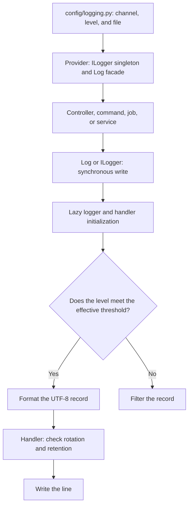

Logs let you follow the behavior of a request, command, or job through events with different severity levels. Orionis includes the `Logger` service, the `ILogger` contract, and the `Log` facade: all three access paths belong to the same component.

The service writes UTF-8 text files and uses one active channel per process. Configuration provides six channels: `stack`, `hourly`, `daily`, `weekly`, `monthly`, and `chunked`. **`stack` is a single file**, rather than a channel aggregation. The component requires no additional driver installation.

## Start recording

Select the channel and severity threshold in your project's `.env`:

```dotenv
LOG_CHANNEL=daily
LOG_LEVEL=INFO
LOG_RETENTION=int:7
```

The `config/logging.py` file reads these variables during configuration. Do not use `Env` from controllers to configure the logger: consume the service that the application has already prepared. [Channels and configuration](/en/logging/configuration) explains every variable, its defaults, and file locations.

After application startup, use the facade from a controller:

```python
from orionis.http import JSONResponse
from orionis.support.facades import Log


class ReportStatusController:
    async def index(self) -> JSONResponse:
        Log.info("event=report-status-read")
        return JSONResponse({"status": "ready"})
```

In your API route file:

```python
from app.http.controllers.report_status_controller import ReportStatusController
from orionis.support.facades import Route


Route.get("/reports/status", [ReportStatusController, "index"])
```

Save the controller as `app/http/controllers/report_status_controller.py`. With the daily channel, an example record looks like:

```text
2026-10-23 10:30:00 [INFO]: event=report-status-read
```

The file follows `storage/logs/daily_YYYY-MM-DD.log`, relative to the project root. The provider pins the facade during its asynchronous boot; after that startup completes, `Log.info()` is a **synchronous** call, including inside an `async` method. Do not add `await`. For integrations accessing it before that boot, see [facade dispatch](/en/logging/writing-logs#logger-facade).

## From the component to the file



Rotating handlers check rotation before writing the line; there is no independent process rotating files at a fixed time. The process's standard logger is named `__orionis__` and does not propagate records to Python's root logger.

## Choose a guide

| Need | Guide |
| --- | --- |
| Select a channel, level, and directory | [Channels and configuration](/en/logging/configuration). |
| Use every method, inject ILogger, or record an exception | [Writing logs](/en/logging/writing-logs). |
| Understand suffixes, retention, compression, shutdown, and multiple workers | [Rotation and lifecycle](/en/logging/rotation-and-lifecycle). |

Retention limits **file counts**, including settings named `retention_days` or `retention_hours`; it does not delete a file when it reaches an exact age. The `chunked` implementation generates a new suffix for every record and can rotate before reaching `mb_size`. Review [policy behavior](/en/logging/rotation-and-lifecycle) before choosing one.

Exception handling and presentation are documented in [Exceptions](/en/exceptions). That section explains when the handler reports an error; these guides explain how that record is written and retained.
